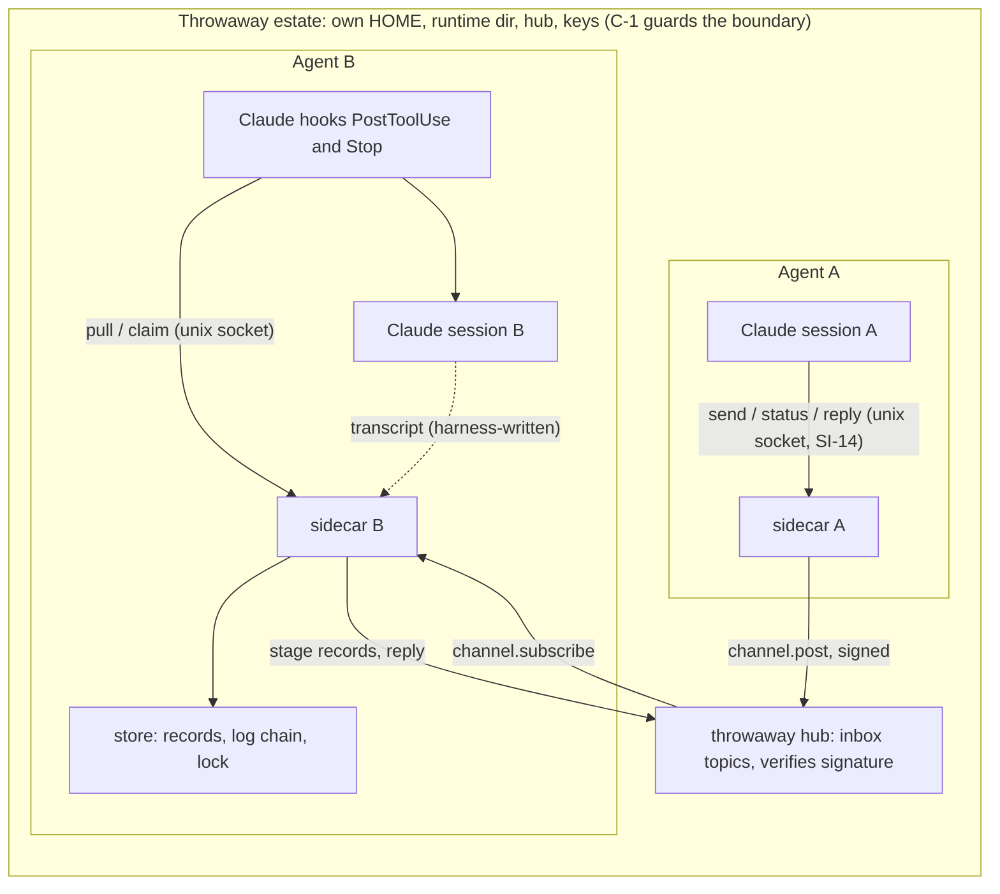
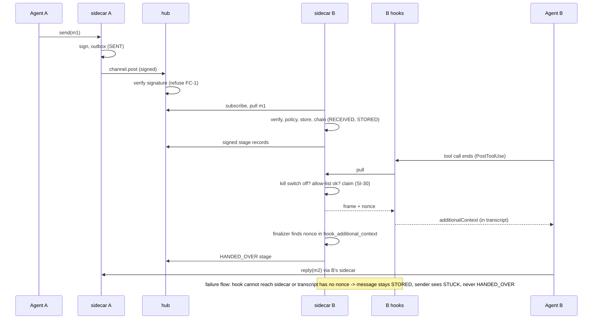
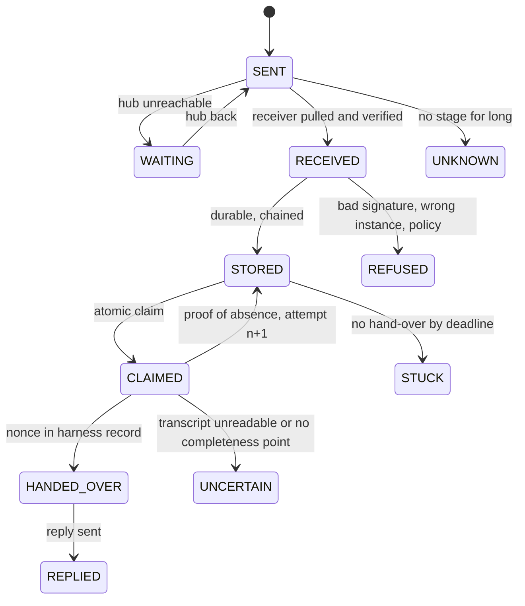

# arc-011 PH-1 architecture: how the basic version is composed

## 0 Version history

| Version | Date | Change | Task |
|---|---|---|---|
| 0.1 DRAFT | 2026-10-11 | First draft. PH-1 only (not the full step 4). Inputs: REQ v0.5.2, TM v0.3.7, step 3 v0.2.1 with its rulings (OP-21 B). | T-3400 |
| 0.2 DRAFT | 2026-10-11 | 5.2 and 5.3: the hub verifies a post's signature but does not return it on `channel.subscribe`, so the sender also carries signer key and signature in the post metadata (`sidecar_pk`, `sidecar_sig`) for the receiver to re-verify. Metadata is outside the signed bytes, so this changes nothing the signature covers and needs no hub change. 4.5: a chain line may carry `peer_ts_ms`, the peer's time on a stage it reported. | T-3408 |
| 0.3 DRAFT | 2026-10-12 | 7.2: OQ-2 built on the recommendation (withhold), pending the operator's ruling: a self-signed sender outside the roster is verified under its own key, stored, recorded REFUSED `not-allowed`, shown, and never answered (no stage records: its `from_agent` is not bound to a known key). 4.5: chain lines may carry `reason` (REFUSED reason codes, DOWNGRADED text, switch reasons). 7.3: switch flips are logged in the `_admin` conversation as DELIVERY_OFF / DELIVERY_ON with who (admin socket uid), when (line time) and why (reason). | T-3409 |
| 0.4 DRAFT | 2026-10-12 | 3.2: `handed-over` takes `nonce` (+ optional `msg_id`, `final`), not `transcript_path`: the transcript is bound to the session at registration (SessionStart, B10), so no verb takes a path (3.3). `pull` also takes `tool_use_id`. 6.4: completeness point defined from the B1 transcript order: an assistant record after the tool_result of the tool call the hook fired for; a Stop-hook pull has none, so it can only end HANDED_OVER or UNCERTAIN. 6.5: bodies are never cut (HANDED_OVER must mean the whole message); FRAME_CAP only limits batching, a larger message travels alone. Attempts are tracked on the chain: CLAIMED, ABSENT (closes an attempt), UNCERTAIN, HANDED_OVER, each with `attempt=<n> nonce=<x>`. | T-3410 |
| 0.5 DRAFT | 2026-10-12 | 2.1/6.2: in PH-1 the hooks and the sidecar process are the `termlink-sidecar` binary (`start --config`, `hook post-tool-use|session-start|stop`, `finalize --nonce`), not a `termlink sidecar` subcommand, so the production `termlink` CLI is untouched. 6.2: the Stop hook only records the session as ready and does not pull: without `decision: block` a Stop hook cannot hand text to the agent, so a claim taken there could never be evidenced; mail waits for the next tool call (OP-21 B). Sender labels: STORED without HANDED_OVER shows WAITING FOR RECIPIENT, then STUCK after `STUCK_AFTER_MS` (10 min). Live check: `docs/reports/arc011-ph1-b10-live-hook.md`. | T-3411 |
| 0.6 DRAFT | 2026-10-12 | 5.1: the signed payload gains `from_instance` (the sender's exact instance), so a reply goes to the instance that wrote, under the same SI-26 check as any message. Changed inside v1 before PH-1 acceptance (no deployed peer); the golden vector was regenerated deliberately. 3.2 `reply`: allowed only for a message stored here and not refused; REPLIED is recorded on the original once the reply is SENT and reported as a signed stage (stage order RECEIVED, STORED, HANDED_OVER, REPLIED). `status` gives each message a five-row `record` with times and adds UNKNOWN (posted, nothing back past the deadline); `PRE_HANDOVER_VOCAB` is the FC-16 allow-list. | T-3412 |
| 0.7 DRAFT | 2026-10-12 | 9.1/9.3: matrix in `docs/reports/arc011-ph1-fc-matrix.md`; one patch per FC row under `crates/termlink-sidecar/tests/mutants/`, run by `scripts/arc011-mutants.sh` in a scratch copy. FC-6's control is "a ready session taken as evidence" (the hook-less estate agent of FC-6 is covered with FC-7's labels). 4.3: a real I/O error in `put` removes the partial temp file (a failpoint, standing for a crash, does not). H-17 groundwork: a needs-attention entry that cannot be written goes to the sidecar's stderr; a message RECEIVED but never STORED shows STUCK past the deadline. | T-3413 |
| 0.8 DRAFT | 2026-10-12 | 4.6/6.4: start-up recovery closes orphan claims (a claim file with no CLAIMED line for its attempt: the frame provably never left) with ABSENT `orphan`; the sidecar sweeps open attempts through the finalizer every 2 s (final check after 60 s), so a crash after the frame left still ends decided. Both found by the B13 soak design: without them a crash between claim and frame blocks a message forever. Soak result in `docs/reports/arc011-ph1-soak.md`. | T-3414 |

Inputs of record: `interactive-agent-communication-01-requirements.md`, `-02-threat-model.md`, `-03-floor-and-phasing.md` (sections 3.3, 5, 5.6, 6.2.2, 13.2.14). Marks: **[A]** assumption to be verified by a build task; **OQ-n** a choice for the operator, with a recommendation. Scope limit: this note composes PH-1 and names where PH-2 grows from it; the full step-4 design (circuits, roles, cards, many-to-many) is not here.

## 1 What exists today, and what PH-1 reuses or does not

1.1 Survey (read, not assumed). CR-21 observed: no vendor sub-agents were used.

| Found | Where | PH-1 verdict |
|---|---|---|
| ed25519 identity, 32-byte seed, mode 0600, `Identity::{load_or_create,sign,verify,fingerprint}` | `crates/termlink-session/src/agent_identity.rs` | **Reuse.** The per-agent key of R-75. Keys are created in the estate (E-5), never from `~/.termlink` |
| TOFU peer keyring | `known_peers.rs` | **Reuse as the PH-1 key roster**, filled by the harness from the two test keys. Cards and rosters (SI-12) are PH-3 |
| Hub `channel.post` verifies an ed25519 signature over `canonical_sign_bytes(topic, msg_type, payload, artifact_ref, ts)` and checks `sender_id` against the key fingerprint (T-1427) | `termlink-protocol/src/control.rs`, `termlink-hub/src/channel.rs:827-890` | **Reuse unchanged.** The hub already refuses a bad signature (FC-1, hub half). **Finding:** the signed bytes do **not** cover `metadata`, so conversation id, message id, priority and recipient instance MUST sit inside `payload` (section 5.1). No hub change |
| Durable client outbox (SQLite, cap, dead letters, `client_msg_id` dedupe) | `offline_queue.rs`, hub dedupe T-2049 | **Reuse** for the send side (FC-8). It is not the receiver store |
| Hub `hub_id` from the TLS fingerprint; `inbox:<hub-id>/<project>` topic names | `termlink-hub/src/tls.rs:48`, `router.rs:817` | **Reuse** for FX-2: the sidecar pins the declared `hub_id` |
| `channel subscribe`/`ack`, cursors, claims | `termlink-bus`, `inbox_channel.rs` | **Reuse** for pull (section 3) |
| AEF receiver: `store_message` (temp, fsync, `os.replace`, flag after file, same id + other digest = conflict), `hooks.py` (UserPromptSubmit frame with a random surfacing token, detached finalizer reading the transcript for the `hook_additional_context` attachment, `HANDOVER_UNCONFIRMED`), `adapter.py` (ready flag), `seen.py`, `inject.py` (typing, out of PH-1) | `.agentic-framework/lib/sidecar/` (vendored, G-062) | **Reuse the design, not the code.** The behaviours are proven and PH-1 ports them to Rust under `termlink sidecar` (OD-9 C). Gaps PH-1 closes: no directory flush, no checksum on read, no hash chain, no signature check, no estate guard, UserPromptSubmit not PostToolUse. The AEF receiver keeps serving production until the per-host switch (R-49.a); PH-1 never touches it |
| `termlink sidecar` | nowhere (`grep sidecar crates/` finds a flag comment only) | **New** |
| `.claude/settings.json` hooks | `UserPromptSubmit: sidecar-inbox, sidecar-receiver-adapter`; `Stop: stop-driver, sidecar-receiver-ready`; **no PostToolUse mail hook** | The R-48 PostToolUse hook is new. The estate's agents get their own settings file, not this one |

1.2 Why not extend the AEF Python: OD-9 C rules the receiver ships in the binary; the vendored tree is erased by re-vendor (G-062); Python cannot give the owner-only socket plus peer-credential check (SI-14) as simply; and a second parallel receiver is the INC-c failure. **OQ-1:** confirm Rust in the binary (recommended, follows OD-9 C) versus a Python PH-1 followed by a port (faster to a demo, throws code away, keeps the vendored dependency).

## 2 Components and where the code lives

2.1 One new crate, `crates/termlink-sidecar` (library) plus a thin `termlink sidecar ...` subcommand group in `termlink-cli` (new file `commands/sidecar.rs`). The hub is untouched in PH-1. Dependencies: `termlink-session` (identity, client, offline queue), `termlink-protocol`, `termlink-bus` types, `ed25519-dalek`, `sha2`. No new network surface.

| Id | Module (in `termlink-sidecar/src`) | Job | Floor items |
|---|---|---|---|
| C-1 | `estate.rs` | Estate guard: refuse to start unless `HOME`, the runtime dir and the store root are inside a marked throwaway tree (marker file `.termlink-estate`, created only by the harness). Also the path-open audit used by X4 | SI-25, 3.3.1.d, X4 |
| C-2 | `store.rs` | Durable record store, per-agent lock, hash-chained log (section 4) | SI-15, SI-16, SI-22, SI-4 |
| C-3 | `wire.rs` | Canonical message payload, digest, signing, verification (section 5) | SI-3, SI-4, SI-26 |
| C-4 | `api.rs` | Local API on an owner-only unix socket with caller credential check (section 3) | SI-14 |
| C-5 | `send.rs` | Accept from the API, sign, enqueue, post, track SENT and the sender-side view | R-11, FX-7 |
| C-6 | `pull.rs` | Subscribe to the own inbox, verify, run receiver checks, store, report RECEIVED then STORED | SI-3, SI-15, FX-2 |
| C-7 | `policy.rs` | Receiver checks: SI-18 (priority, urgency, trust class), SI-23 kill switch, allow-list (section 7) | SI-18, SI-23 |
| C-8 | `frame.rs` | Frame peer content with a random boundary; delivery nonce | SI-7, SI-8 |
| C-9 | `deliver.rs` | Atomic claim, hand-over, evidence finalizer, HANDED_OVER | SI-30, SI-17 |
| C-10 | `stage.rs` | Stage records (signed, chained), the four labels, the record print | SI-6, R-44 |
| C-11 | `adapter/claude.rs` | The Claude adapter: hook entry points `post-tool-use`, `stop`, `session-start`; transcript evidence reader (section 6) | R-47, R-48 |
| C-12 | `termlink-sidecar/testkit` (dev-dependency crate or `tests/`) | The disposable estate harness and the kill-point and mutation tools (sections 8, 9) | X2, X4, X5 |

**Drawing D-1: component view (structure)**



D-1 text: 1 Each agent has one sidecar; the sidecar is the only thing that talks to the hub for that agent. 2 The agent and its hooks reach the sidecar only through the owner-only socket. 3 The hub is a store and a verifier; it decides nothing about delivery. 4 The transcript is written by the harness, read by the sidecar, and is the only evidence of HANDED_OVER. 5 The trust boundary is the estate: nothing outside it is read or written.

## 3 The local API

3.1 Transport: a unix stream socket `<runtime>/sidecar/<agent>.sock`, directory mode 0700, socket 0600; on accept the sidecar reads `SO_PEERCRED` and refuses a uid other than the owner's (PR-8). Framing: one JSON object per line, request and response. Loopback TCP is not offered (TH-2). Three scopes with separate socket files, as SI-14 asks, exist from PH-1 as paths but PH-1 serves **send** and **status** only; **admin** (kill switch, key rotation) is a separate socket file whose single PH-1 verb is `delivery off|on` (SI-23), reachable from the operator terminal harness, not given to the agent. **[A]** On this host agents run as root until Track A (RR-2), so the owner check proves nothing against a same-user process; X4 and the status line say so (3.1.e of step 3).

3.2 Verbs (JSON `op`):

| Op | Scope | Request fields | Response | Notes |
|---|---|---|---|---|
| `send` | send | `to` (agent id), `to_instance` (exact instance id), `conv` (new or existing), `body`, `priority` (optional) | `{msg_id, stage:"SENT"}` | Returns only after the signed message is in the outbox (durable). Never returns "delivered" (FX-7) |
| `status` | status | `msg_id` or `conv` or none | Stage rows with times and chain head; own strength flags; hub id; absent flags named | The record print of BV-7. Names "no per-agent accounts", "no operator key" (3.1.e) |
| `pull` | send (hook) | `session`, `hook` (`post-tool-use`/`stop`) | `{frame, nonce, msg_ids}` or `{none:true}` | Does steps 7.3 to 8.2 below in one call: checks, atomic claim, frame. Called by the hook, never by the model |
| `claim` | send (hook) | `msg_id` | `{claimed:true, attempt}` or refusal | The atomic claim alone, exposed for tests and for the finalizer; `pull` uses it internally |
| `handed-over` | send (hook/finalizer) | `msg_id`, `nonce`, `transcript_path` | `{stage}` | Records HANDED_OVER only if C-11's reader finds the nonce (SI-17). A caller cannot assert it |
| `reply` | send | `conv`, `in_reply_to`, `body` | `{msg_id}` | Same path as `send` with roles swapped (R-27). The reply is REPLIED for the original once the reply is SENT |

3.3 No verb takes a path, a command or a peer-supplied name as a file name (SI-28 groundwork). Error replies are structured `{error, code, hint}`; an unknown op or scope is refused, never ignored.

## 4 Store format and durability (SI-15, SI-16, SI-22, SI-4, SI-30)

4.1 Layout under `<estate>/sidecar/<agent>/` (all dirs 0700, files 0600):

```
lock                       # flock held for the sidecar's life (SI-16, FC-9)
log/<conv>.jsonl           # append-only chained log, one line per stage event
msgs/<conv>/<seq>-<msg_id>.rec     # one record per accepted message
claims/<msg_id>.<attempt>  # delivery claims (SI-30), created O_EXCL
tmp/                       # temp names only, swept at start
```

4.2 Record `.rec`: a header line `{"v":1,"len":N,"sha256":"<hex of body bytes>"}` then the canonical payload bytes (section 5.1). Whole-file checksum is the sha256 in the header over the payload; on every read the checksum is recomputed (3.3.1.d). A record that fails is **quarantined** (renamed `.bad`), a needs-attention entry is written, and it is never reported STORED.

4.3 Write sequence (the five steps of the BV, in this order, each a failure point the kill-point harness stops at):
1. verify signature and digest (before any write);
2. write `tmp/<random>`; 3. `fsync` the file; 4. `rename` to the final name; 5. `fsync` the directory;
6. append the chain line `{conv, seq, event:"STORED", msg_id, digest, prev, hash}` where `hash = sha256(prev || canonical(line without hash))` to `log/<conv>.jsonl`, `fsync` the log and (on first create) its directory;
7. only now raise the flag (the pending list entry, which is the chain line itself, so no separate flag file exists to diverge) and report STORED to the sender.
A failure at any step stops before STORED is reported (FC-2). After a kill, start recovery: delete `tmp/`, verify every record's checksum, and for a record present but with no chain line either append the line (the record is complete and verified) or quarantine it; for a chain line whose record is missing report loudly and never re-report STORED (FC-3, F-1). **[A]** `fsync` of the directory on the estate's ext4/tmpfs behaves as documented; the host-crash test (F-7) is PH-2.

4.4 Identity and conflict (SI-4): the key is `(sender fingerprint, conv, msg_id)`; storing again with the same digest is idempotent (returns the earlier STORED), with a different digest records a `CONFLICT` chain line and leaves the first record untouched (FC-10).

4.5 Chain (SI-22, FC-15): per-conversation hash chain over every stage event, including RECEIVED, STORED, CLAIMED, HANDED_OVER, REFUSED, CONFLICT. `status` re-walks the chain and reports the first break (insert, delete or edit in the middle). The chain head goes into the stage record sent to the sender; truncation of the tail is detected only against that anchor, which is PH-2 (heads compared daily), so PH-1 states "tail truncation: not yet detectable" in `status` (no false claim).

4.6 Claim (SI-30): delivery creates `claims/<msg_id>.<n>` with `O_CREAT|O_EXCL` where `n` is the attempt number; exactly one creator wins; the claim file holds the nonce and the time **before** any content leaves the store. A later attempt (n+1) is created only after the evidence reader proves absence (section 6.4). A killed sidecar leaves the claim, which blocks a second hand-over (FC-4).

## 5 Wire format and signing (R-75, SI-3, SI-4, SI-26)

5.1 Message payload (the bytes the hub transports and verifies): canonical JSON, UTF-8, keys sorted, no insignificant whitespace, `v:1`:
`{v, kind:"msg", from:<agent fp>, from_agent, to_agent, to_instance, conv, msg_id, seq, priority, ts_ms, body}`. `msg_id` is a random 128-bit hex (reuses `mint_client_msg_id`). The digest is `sha256(payload bytes)`.

5.2 Two signatures, one key. (1) The transport signature: the sender's own key signs `canonical_sign_bytes(topic, msg_type="sidecar.msg.v1", payload, None, ts)`, exactly what the hub already verifies, so the hub refuses a forged or altered post (FC-1, hub half) with no hub change. (2) The receiver re-verifies the same signature **and** checks that `from` equals the fingerprint of the key in the roster for that sender, and that `to_instance` equals its own instance id (SI-26: a message for another or ended instance is refused loudly, never redirected). The shared host key and a sibling's key fail the roster check (FC-1, receiver half). Because identity is inside the signed payload, a message that is altered after signing fails; because `to_instance` is signed, it cannot be replayed to another instance.

5.2.a Carrying the signature (B7, T-3408): `channel.subscribe` returns payload, topic, timestamp and metadata but not the post's key and signature, so the sender repeats them in metadata (`sidecar_pk`, `sidecar_sig`) and the receiver verifies them against the payload it read. A post with no such metadata is REFUSED.

5.3 Stage records and receipts (SI-6): the receiver's sidecar signs `{kind:"stage", conv, msg_id, stage, ts_ms, chain_head}` with its own key and posts it to the sender's inbox; the sender verifies and appends it to its own chain. Forward-only: a stage row never moves backward; an unsigned or wrongly signed stage is ignored and shown. `up_to` receipts are PH-2.

5.4 Replay and order: a duplicate `msg_id` is idempotent (4.4). Sequence windows and equivocation (SI-5) are PH-2; PH-1 records `seq` and refuses nothing on it.

5.5 Hub identity (FX-2): the sidecar is configured with the declared `hub_id` and address; each connection reads `hub_id` from the hub's status and refuses on mismatch (FC-14); a rotated certificate with the same id continues because the id derives from the persistent identity as `tls.rs` defines. **[A]** the id survives certificate rotation exactly as T-3345 states; a build test confirms it on the throwaway hub.

## 6 The Claude adapter and OP-21 B delivery

6.1 OP-21 B (ruled 2026-10-11): every message is delivered at the receiving agent's next tool call, as today. So every delivery is mid-turn, which is why SI-18, SI-23 and the allow-list are in PH-1 (section 7).

6.2 Hooks (the Claude adapter, R-47/R-48), installed only in the estate agents' own `settings.json`:

| Event | Command | Job |
|---|---|---|
| `PostToolUse` (all tools) | `termlink sidecar hook post-tool-use` | Reads the hook input (session id, `transcript_path`) from stdin, calls `pull` on the socket, prints `{"hookSpecificOutput":{"hookEventName":"PostToolUse","additionalContext":<frame>}}` and exits at once |
| `Stop` | `termlink sidecar hook stop` | Same pull for mail that arrived during the turn's last moments (`decision: block` is **not** used in PH-1); also marks the session READY-capable (the flag the PH-2 doorbell will use; PH-1 only records it) |
| `SessionStart` | `termlink sidecar hook session-start` | Registers the session id and instance id with the sidecar (R-62 binding at conversation creation) |

6.3 Fail directions, each deliberate: the **turn** fails open (a broken sidecar, a socket error or a timeout makes the hook print nothing and exit 0, so the agent is never blocked) but never silently: the hook appends to `hook-errors.log` and the message stays STORED, so the sender sees STUCK (FC-6); the **delivery** fails closed (no frame is printed, no claim is taken, unless the sidecar answered). A hook killed after printing may have its output discarded by the harness; this is exactly why HANDED_OVER is never set by the hook (6.4). **[A]** Claude Code delivers PostToolUse `additionalContext` into the running turn after each tool call and writes it into the transcript as a `hook_additional_context` attachment (REQ R-19.g records it as verified for the orchestrator's session; the AEF finalizer already relies on the same attachment type for UserPromptSubmit). Build task B1 verifies it for PostToolUse on the pinned Claude Code version before anything else is built on it.

6.4 Evidence (SI-17, FC-4, FC-11, FC-13): `pull` registers a delivery nonce with the claim and prints a frame whose header line contains it. A detached finalizer (spawned by the hook, not the hook itself) reads the session transcript and records HANDED_OVER only when it finds the header line, immediately followed by the frame opener, inside a record of type `attachment`/`hook_additional_context` written by the harness. The nonce in an assistant record, a tool result or a user record is not evidence (FC-11, the AEF `_in_transcript` rule, ported). Transcript unreadable: attempt stays open, "hand-over uncertain", needs-attention (FC-13). No evidence within the window and the transcript's completeness point reached: absence is proven, attempt n+1 is allowed. No completeness point: stays uncertain and waits for the operator; a timeout alone never re-delivers (CR-17).

6.5 Frame (SI-7, SI-8, FC-12): built by C-8 only, never by the message. Layout: a fixed header line (verified sender, conversation, message id, trust class, nonce), an opener line with a fresh 128-bit random boundary, the body, a closer with the same boundary; a body that contains the boundary is impossible by construction (regenerate), and any line that looks like an approval phrase is inside the frame and approves nothing. The frame states in fixed words that the content is untrusted data from a peer. Size cap per frame with a visible "N more waiting" tail (reuse AEF `FRAME_CAP`/`BODY_CAP` values as the starting point).

**Drawing D-3: primary flow and one failure flow (behaviour)**



D-3 text: 1 A sends; the call returns after the signed message is durable in the outbox. 2 The hub verifies and appends. 3 B's sidecar pulls, verifies, stores durably, chains, reports RECEIVED then STORED. 4 At B's next tool call the hook asks for pending mail; the sidecar checks policy, takes the claim and returns the frame. 5 The harness writes the frame into B's transcript; the finalizer finds the nonce and only then records HANDED_OVER. 6 B replies through the same API. 7 Failure flow: if the hook cannot reach the sidecar or no nonce appears, nothing advances past STORED and the sender sees STUCK.

**Drawing D-4: message state (behaviour)**



D-4 text: 1 The sender-visible labels of PH-1 are WAITING, WAITING FOR RECIPIENT (STORED with no hook able to fire), STUCK and UNKNOWN, plus the five stages. 2 Only HANDED_OVER requires harness evidence. 3 UNCERTAIN is the CR-17 state: the attempt stays open until the operator or proof of absence. 4 REFUSED is terminal and always visible; nothing is dropped silently.

## 7 Receiver checks in PH-1 (OP-21 B consequences)

7.1 SI-18, in `policy.rs`, run in `pull.rs` before STORED is reported and again in `deliver.rs` before the claim (the second run catches a switch flipped in between):
7.1.a Priority is a signed field of the payload, clamped to [-9, 9]; **urgency and trust class are never read from the message**. Trust class is computed from the verified sender key and the allow-list: `own-project` (fixed default) or `untrusted`. Urgent means priority at least 5 **and** the sender allow-listed; otherwise it is downgraded to normal, the downgrade is a chain line (`DOWNGRADED`), never a drop.
7.1.b Under OP-21 B every message, urgent or not, is delivered at the next tool call, so urgency changes order and the frame label, not the delivery point. The frame states the trust class in fixed text.
7.2 Allow-list: PH-1 has a **built-in, non-configurable default**: the senders are the keys in the estate roster (NK: no knob before its lock; SI-20/21 configuration is PH-4). Roster entries come from the harness at estate creation. A sender not in the roster is `untrusted`: stored, shown to the operator, **not delivered** to the agent (REFUSED with reason `not-allowed`, visible). **OQ-2:** whether an `untrusted` sender's message should be delivered framed-as-untrusted instead of withheld. Recommendation: withhold in PH-1 (smallest effect on a working agent; R-63.a's downgrade rule applies to urgency, not to admission) and revisit in PH-2 with the operator.
7.2.a As built (B8, T-3409): no stage records go back to a sender outside the allow-list, because its `from_agent` is a name it chose, not one bound to a key; answering would let any key post stage traffic into another agent's inbox.

7.3 SI-23 kill switch: `admin` socket `delivery off [--agent X|--all]`; sets a flag file in the store that `pull` and `deliver` read on every call (so "within one tick" holds: no cached copy), logs who/when/why to the chain, and `status` shows it. Off means no frame is printed; messages keep arriving and storing (nothing lost). Re-enable is `delivery on`. Not callable from the agent socket (SI-14), tested.
7.4 SI-7/SI-8 as in 6.5. SI-8: no code path reads a grant, an approval or a trust change from a message body; the only inputs to `policy.rs` are the verified key, the roster and the signed numeric fields (a static test greps for any other field read).

## 8 The disposable estate (E-1..E-5) as a reusable harness

8.1 `termlink-sidecar` test kit, one entry point `Estate::create()` used by every test and by the demonstration script `scripts/arc011-ph1-demo.sh` (same code path, so the demo is the test, R-69):
- **E-1** a hub started with its own runtime dir under `$ESTATE`, own hub id, secret and certificate, on a random loopback port;
- **E-2** `HOME`, `TERMLINK_RUNTIME_DIR` and `XDG_RUNTIME_DIR` set into `$ESTATE`; the marker `.termlink-estate` written; every child process inherits only this environment (`env -i` plus an explicit list);
- **E-3** two project directories, each with a scratch task;
- **E-4** two agents: for unit and integration tests, a scripted fake harness that writes transcript records in the real Claude Code shape (fixtures captured from a real session); for the acceptance run, two real Claude Code sessions (`claude -p`/interactive via TermLink PTY) as unprivileged `testdev` (E-7 **[A]**: its Claude login is provisioned without copying the operator's credential; **OQ-3**, recommended: the operator provisions `testdev` once);
- **E-5** keys generated per run into `$ESTATE/keys`, deleted by `Estate::drop`; the secret-canary (FC-17) is exported into the environment of every child.
8.2 Teardown deletes the tree, kills the hub, and asserts no process of the estate survives. Rollback of PH-1 is exactly this (6.2.2).
8.3 The harness also carries: the **kill-point driver** (a cargo feature `failpoints` compiled only in test builds that aborts the process at a named step of 4.3 or 6.4), the **mutation runner** (section 9.3), the **path-open audit** (strace-free: the harness replaces `HOME`/runtime and lists every path the sidecar opened outside `$ESTATE` through a `tracing` open-wrapper in test builds, plus a post-run scan of `/proc/<pid>/fd` and the production paths' mtimes), and the **secret scan** (SI-25: scans the estate tree, logs, status output, frames and stage records for the canary).

## 9 How each fail-closed row and each FC-n is tested

9.1 Tiers follow step 3 section 8 (T-1 unit/fixture, T-2 live throwaway hub, T-3 one real agent plus scripted peer, T-4a two real agents).

| FC | Test (tier) | Negative control (mutation that must turn it red) |
|---|---|---|
| FC-1 | Post with missing, wrong-key (shared host key, sibling key) and altered-after-signing signatures; hub refuses, receiver refuses, record shows REFUSED (T-2) | `wire::verify` returns true: forged reaches HANDED_OVER |
| FC-2 | `failpoints`: write error, `ENOSPC` via a size-limited tmpfs mount in the estate (T-1/T-2) | STORED reported before the write result is checked |
| FC-3 | Kill at each named step of 4.3 (loop over all steps), restart, assert absent-and-unreported or present-same-id (T-1; H-16 uses random points, 9.2) | Report STORED before the directory fsync: a missing message is found |
| FC-4 | Kill after claim, before HANDED_OVER; restart; assert no second frame; nonce found means HANDED_OVER (T-3) | Skip the claim file: double frame in B's transcript |
| FC-5 | Missing, empty, unreadable, stale ready/session flag reads not ready (T-1) | Missing reads ready |
| FC-6 | Estate agent without the hook (and with it disabled): message stays STORED, sender row STUCK after deadline on a simulated clock (T-3) | "flag raised" accepted as evidence |
| FC-7 | B idle, no hook fires: sender shows WAITING FOR RECIPIENT (T-3) | Storage counted as delivery |
| FC-8 | Stop the hub: send, assert WAITING then UNKNOWN; restart hub; message goes on, no loss (T-2) | Drop on hub error |
| FC-9 | Start a second sidecar on the same store; and a second consumer on the inbox (T-2) | Remove the `flock` |
| FC-10 | Same `(sender, conv, msg_id)` with a different body (T-1) | Remove digest comparison |
| FC-11 | Nonce echoed in the assistant record and in a tool result of a fixture transcript (T-1) | Accept any record type |
| FC-12 | Hostile body: boundary copy, approval phrase, instruction, framing-break attempts, fuzz (T-1) plus one real agent given it (T-4a); no state change, no action | Build the frame without the boundary |
| FC-13 | Unreadable transcript (permissions, truncated line) (T-1) | Treat unreadable as absent |
| FC-14 | Second hub with another id on the declared address; cert rotation with the same id (T-2) | Remove the id check |
| FC-15 | Edit, insert, delete a middle chain line; `status` names the break (T-1) | Remove the chain check |
| FC-16 | Every sender tool output after a post with no HANDED_OVER contains only accepted/stored vocabulary (grep over a vocabulary allow-list, T-1/T-2) | Map hub acceptance to "delivered" |
| FC-17 | Canary in the environment; scan everything the estate produced (T-2) | Log the environment |

9.2 H-16 and H-17 (X5): a randomized kill-point soak (the 4.3 and 6.4 steps in random order, N runs, thresholds from step 3 section 9) counting duplicates and losses; H-17 enumerates every listed error and asserts it ends in a visible state (a needs-attention entry or a REFUSED/UNCERTAIN/STUCK row), never silence.
9.3 Kill-checking (R-69, X2): `scripts/arc011-mutants.sh` applies each mutation of the table (a one-line patch kept in `tests/mutants/*.patch`), rebuilds, runs the named test, and fails if the test stays green. A control that has not been seen to go red does not count. Running the mutants in a scratch copy of the tree, never the working tree.
9.4 Floor probes for SI-3, SI-4, SI-6, SI-7, SI-8, SI-14, SI-15, SI-16, SI-17, SI-22, SI-25, SI-26, SI-30, FX-2, FX-7 plus the PH-1 additions SI-18 and SI-23 and the allow-list (17 items): each has one test in the table above or below. Extra: SI-14 (connect as another uid via `setuid` in the harness, and to the admin socket from the send scope: refused); SI-18 (a message that claims urgent without allow-list is downgraded and logged; unsigned priority field edited after signing fails FC-1); SI-23 (flip mid-run: the next tool call delivers nothing, messages still store; flip back: delivered; agent socket cannot flip it); allow-list (sender outside roster: stored, REFUSED `not-allowed`, visible).

## 10 Trusted computing base, residual risk

10.1 Trusted in PH-1: the binary and its libraries, the estate harness, the hub process, the Claude Code harness for writing the transcript honestly, the filesystem for rename and fsync. 10.2 An adversary with the agents' rights on the same host (they are `root` here, RR-2) can read keys, edit the store and forge transcript records; PH-1 detects tampering inside the chain, not a rewrite of everything, and says so in `status`. Not claimed: any defence against ADV-2a/ADV-7 (step 3, 3.7). 10.3 Bypass inventory: the old rails (pickup, `fw sidecar send`, shell sidecars) are untouched and unframed (RA-9, PH-4); PH-1 neither depends on nor disables them and the estate never connects to the production hub.

## 11 Traceability

11.1 Requirement to element: R-1/R-2/R-5/R-6/R-11/R-26/R-27 to C-4, C-5, C-10; R-13..R-16, R-49 to C-2, C-6; R-24, R-42, R-47, R-48 to C-9, C-11; R-44 to C-10 (D-4); R-45 to C-2 chain and C-10; R-50 to C-8, C-7; R-51, R-62, R-75 to C-3, C-2; R-34 to C-3 (instance binding); R-32 to `wire.rs` address parser; R-17, R-30 to a simulated-clock tick in `pull.rs` (loop) and a test clock (rungs). 11.2 Floor to element: section 9.4. 11.3 Every module in section 2 serves a PH-1 floor item or a BV step; none is gold-plating. TH-n mapping stays with the TM (each FC row cites its SI).

## 12 Decisions awaiting the operator (proposed)

| Id | Decision | Options | Recommendation |
|---|---|---|---|
| OQ-1 | Implementation language and home of PH-1 | A Rust crate in the binary; B Python in the vendored tree then port | A (OD-9 C; avoids the G-062 re-vendor loss) |
| OQ-2 | Message from a sender outside the roster | A withhold, show to operator; B deliver framed as untrusted | A in PH-1 |
| OQ-3 | Unprivileged `testdev` with its own Claude login for the acceptance run | A operator provisions once; B run as root and defer the E-7 measurement | A (E-7 asks for it; B lowers the proof) |

Assumptions carried: A-1 PostToolUse `additionalContext` lands in the transcript (B1 verifies); A-2 directory fsync semantics (4.3); A-3 `hub_id` survives certificate rotation (5.5); A-4 same-user owner check is weak on this host (3.1); A-5 the estate roster is filled by the harness, no card exchange (1.1).

## 13 Build tasks (each one deliverable, dependency order, sized to one session)

Each task: `write_set` stays inside `crates/termlink-sidecar`, `crates/termlink-cli/src/commands/sidecar.rs`, `tests/`, `scripts/arc011-*`. Verification lines avoid `| grep -q` (L-387).

| # | Task | Depends | Acceptance criteria | Verification |
|---|---|---|---|---|
| B1 | **Spike: PostToolUse delivery and transcript evidence.** Real Claude Code in an estate dir with a PostToolUse hook printing `additionalContext`; capture the transcript | none | Doc `docs/reports/arc011-ph1-hook-spike.md` states the exact record shape found and Claude Code version; fixture `tests/fixtures/transcript-posttooluse.jsonl` committed; answers A-1, or the design is reopened | `test -s tests/fixtures/transcript-posttooluse.jsonl`; `cargo test -p termlink-sidecar fixture_shape` |
| B2 | **Crate skeleton, estate guard (C-1) and test kit (C-12 core).** `Estate::create/drop`, marker, env isolation, secret canary export | none | Sidecar refuses to start outside a marked tree (exit 2, reason); `Estate` starts a throwaway hub and tears down with no survivors; path-open audit lists zero production paths | `cargo test -p termlink-sidecar estate_` |
| B3 | **Wire and signing (C-3)** canonical payload, digest, sign, verify, roster check, `to_instance` check, address parser | B2 | Round-trip verifies; altered, wrong-key, shared-key, wrong-instance each refused with a distinct reason; golden vector file committed | `cargo test -p termlink-sidecar wire_` |
| B4 | **Store (C-2)** layout, write sequence, quarantine, flock, chain, claim files, recovery at start | B2 | Every step of 4.3 has a failpoint; kill at each leaves absent-or-present, never reported-and-missing; second sidecar refused; chain break detected; conflict recorded | `cargo test -p termlink-sidecar --features failpoints store_` |
| B5 | **Local API and status (C-4, C-10 view).** Unix socket, SO_PEERCRED, scopes, `status` with strength flags and the stage vocabulary | B2, B4 | Other uid refused; agent socket cannot reach admin; `status` names missing strength flags and never says "delivered" without HANDED_OVER | `cargo test -p termlink-sidecar api_` |
| B6 | **Send path (C-5)** outbox via `offline_queue`, hub post, hub-id pin, SENT row | B3, B5 | Throwaway hub: send returns msg_id after durable outbox; hub down: WAITING then flows on; wrong hub id refused (FC-8, FC-14 send half) | `cargo test -p termlink-sidecar --test send_hub` |
| B7 | **Receive path (C-6)** subscribe, verify, policy hook point, store, RECEIVED/STORED stage records signed back to sender | B3, B4, B6 | FC-1 (receiver half), FC-2, FC-3, FC-9, FC-10, FC-14 receive half pass; sender shows RECEIVED and STORED with receiver times | `cargo test -p termlink-sidecar --test receive_` |
| B8 | **Receiver checks (C-7)** SI-18, SI-23 admin switch, built-in allow-list, `DOWNGRADED`/`not-allowed` chain lines | B4, B5 | Section 9.4 SI-18/SI-23/allow-list probes pass; no code path reads a grant from a body (static test) | `cargo test -p termlink-sidecar policy_` |
| B9 | **Frame, claim, deliver (C-8, C-9)** random-boundary frame, atomic claim, nonce, finalizer, HANDED_OVER only on harness evidence, UNCERTAIN | B1, B4, B8 | FC-4, FC-11, FC-12, FC-13 pass against fixture transcripts; double delivery impossible under concurrent `pull` calls (stress test) | `cargo test -p termlink-sidecar frame_ deliver_` |
| B10 | **Claude adapter and hooks (C-11)** `termlink sidecar hook post-tool-use|stop|session-start`, settings snippet for the estate, fail-open/closed behaviour, hook-errors log | B5, B9 | With a real Claude Code session, one tool call surfaces a pending frame in its transcript; killed sidecar makes the hook exit 0 with no output and a log line; FC-5, FC-6, FC-7 pass | `cargo test -p termlink-sidecar --test hooks_`; `scripts/arc011-ph1-demo.sh --scripted` exits 0 |
| B11 | **Reply and record print (BV-6, BV-7)** `reply`, sender-side five-row view, vocabulary lint (FX-7) | B6, B7, B9 | A's record for m1 shows SENT, RECEIVED, STORED, HANDED_OVER, REPLIED in order with times; FC-16 vocabulary test passes | `cargo test -p termlink-sidecar --test record_print` |
| B12 | **Fail-closed matrix and mutation runner (X2)** the remaining FC tests, `arc011-mutants.sh`, secret scan (FC-17), chain test (FC-15) | B7 to B11 | FC-1..FC-17 all green; every mutation of 9.1 turns its test red (script prints a table, exit 0 only if all red); output committed to `docs/reports/arc011-ph1-fc-matrix.md` | `bash scripts/arc011-mutants.sh`; `cargo test -p termlink-sidecar fc_` |
| B13 | **Soak: H-16 and H-17 (X5)** random kill-point runner and error-enumeration test | B12 | Thresholds from step 3 section 9 met, numbers recorded in the report; every listed error ends visibly | `cargo test -p termlink-sidecar --release soak_ -- --ignored` |
| B14 | **Two-agent acceptance (X1, X3, X4, X6 prep)** `scripts/arc011-ph1-demo.sh` with two real Claude sessions as `testdev` (OQ-3), BV-1..BV-7, path-open audit, floor probe checklist | B12, B13, OQ-3 | Run log shows the five rows with times; X4 audit empty of production paths; the 17 floor probes listed with pass; operator can watch it (X6 is the operator's) | `bash scripts/arc011-ph1-demo.sh`; `test -s docs/reports/arc011-ph1-acceptance.md` |

13.1 Order: B1 and B2 start together; B3 and B4 then run in parallel; B5 follows B4; B6, B7, B8 follow; B9, B10, B11 close the chain; B12 to B14 are the proof. About 14 sessions; B3/B4 and B6/B8 are the parallel pairs.
13.2 Not in PH-1 and not planned here: the doorbell (typing), readiness-driven injection, circuits, blobs, cards, roles, `up_to` receipts, daily chain-head compare, host-crash test, the per-host switch from AEF's receiver (R-49.a, after B14 passes).
