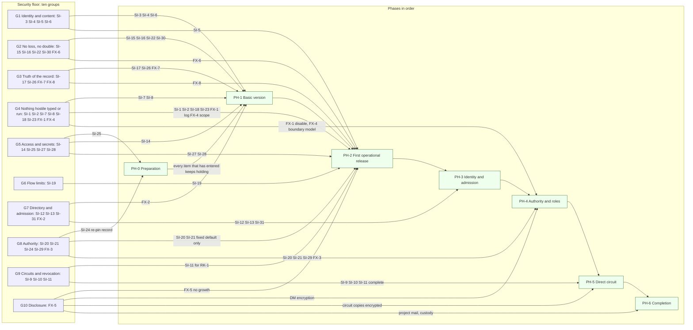
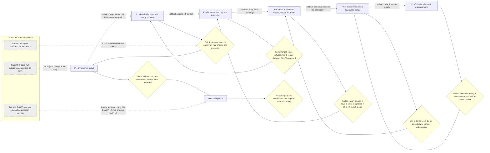

# Interactive agent communication: step 3, security floor and phasing

**Task:** T-3352 · **Arc:** arc-011 · **Chain:** arc-011-design, step 3 · **Role:** security floor and phasing (MVP specialist)
**Status:** DRAFT v0.1 for the operator. Nothing in this document is approved. The floor, the phasing and every risk acceptance are the operator's to confirm (card, section 5). Everything tagged **[P]** is a proposal; the operator decides. The open questions are in section 13 and are meant to be taken one at a time.
**Review link:** none. This project's Watchtower has no inline design-review page (profile P2.1). The operator reads this file in the repository.

## 0 Version history

| Version | Date | Change | Task |
|---|---|---|---|
| 0.1 | 2026-10-11 | First complete draft, batch mode. Security floor (31 invariants plus 8 extra items), prioritisation of the 82 requirements, the basic version, seven phases with exit criteria and rollback, 30 hypotheses, the GP-12 numbers, CAND-3 staging, the four items the operator's rulings left to this step (accounts, risk classes, policy format, interim controls) and the outage-log reconciliation rules, 8 risk-acceptance requests, 16 operator questions, drawings D-1 and D-2. | T-3352 |

## 1 Inputs of record

1.1 The two inputs the hand-over named. The hashes are the full sha256 values I computed myself at the start of this step (`sha256sum`); they match the values in the hand-over. Had either differed I would have stopped and reported.

| Short | Path | Version | sha256 |
|---|---|---|---|
| REQ | `docs/design/interactive-agent-communication-01-requirements.md` | v0.5.2, approved by the operator 2026-10-11 | `d2d839fb743eb4c542f337f2b3d244e3df4a47ac40807ebbc5f7dda5ead0a3d4` |
| TM | `docs/design/interactive-agent-communication-02-threat-model.md` | v0.3.7, residual risks accepted by the operator 2026-10-11 | `88961693384966502f4ca4eb515ed4b0590a29c3d61ac0c619e17ea4562693f3` |

1.2 The operator's rulings I treated as binding and did not reopen. A ruling is cited by its id (OQ-n, CR-n, RR-n, D4 to D7, OD-n, CAND-n, GP-n).

| Short | Where | sha256 of the file read |
|---|---|---|
| RULINGS | TM section 22.18 (the rulings register) | part of TM |
| T3351 | `.tasks/completed/T-3351-arc-011-role-chain-step-2-threat-modeler.md`, section "Decisions" | `d17ce3da1a7798a55a0867bfd3e4ac1d71cb52a7a4491479d0e23cba377a93f5` |
| T3388 | `.tasks/completed/T-3388-arc-011-step-1-reopen-requirements-v05-f.md`, section "Decisions" | `571d472c2445d8a5f1c7b25dadfa04fa0c0f94027bc2dfb202f5603b0b97140c` |
| HANDOFF | REQ 13.1 (row for step 3) and 13.5.1 | part of REQ |

1.3 Also read, in the order the hand-over gave. The hashes are of the bytes as read.

| Short | Path | sha256 |
|---|---|---|
| RULES | `CLAUDE.md`, lines 1 to 2820, the project sections above `## Core Principle` | `54c2ceb4dc48bcf79c15d40f3668594faa06393f13626a86608f4447e57b451c` |
| COMMON | `docs/design/roles/cards/_common.md` | `cca38806358d7a6c09e64289164977a825f2cf57e914f672076ff77a2bdb5563` |
| CARD | `docs/design/roles/cards/mvp-specialist.md` | `04fa87539950fd1ce74d63ecdacf36bb4d90d53fb3b60d79d23d83d8273be66e` |
| ADAPTER | `docs/design/roles/adapters/aef.md` | `d840a77649888cdbfd37d1166c15eecd6cd3c8399d497fb6b1b2c52455c6c4a4` |
| PROFILE | `docs/design/roles/profiles/termlink.md` | `b6bc160242d96ca9a8fc167c6845e292529c162fa23faa2945d4742b676e7b21` |
| README | `docs/design/roles/README.md` | `3881d5302313a0d0ca4c9ef1b4688dae101b6d693df823be962e9b70946368e0` |
| CHAIN | `docs/design/interactive-agent-communication-role-chain.yaml` | `91c9c1ab63988e90ab906ab6103825f48a91a72c4220afaf5ee47f004690464d` |
| SCHEMA | `docs/design/roles/schemas/role-handback-1.schema.json` | `288a4e312f00bac978a4b2a87e57ee8a05cb14f916d77c397e601e03c703c148` |
| LOG | `docs/design/interactive-agent-communication/interview-step-01.md` (the GP-12 ruling, gap review item 3) | `aad8308e1924df293270d628b224dafc4814f675a4a61485dd2c1797a7114edd` |
| GP12 | `docs/reports/T-3344-gp12-review/` (`brief.md`, `comparison.md`; the five real failures) | not hashed |

1.4 How this step was run.
1.4.a Mode: batch. No human was present (`_common.md` 5.2). Every question I could not answer from a ruling is in section 13 as an operator question with options and a recommendation.
1.4.b Where the AEF adapter names ring20 paths or commands this project lacks (`role-chain.py`, `fw reviewer judge`, `design-render-check.py`, the `docs/designs/agent-authorization-broker/` paths), the profile governs (P2.1, P4.5). The drawings were checked with `mmdc` and the local Chromium, the method the step-2 document used (section 16).
1.4.c I did not change REQ, TM, the role-chain file or any task file. Where an earlier step needs a change, it is a change request in section 12 (CX-n).
1.4.d Facts about what runs today come from REQ, TM, `CLAUDE.md` and the profile, tagged **[H]**. Three read-only host facts I did read myself on 2026-10-11, used only for the price of per-agent accounts (10.1): `ps` shows 86 process lines that mention `claude` run as `root` and 16 as the operator's own login; `stat` shows `/opt/termlink`, `.git`, `.tasks` and `.context` are `root:root` mode 775 and `git config core.sharedRepository` is unset; `useradd`, `sudo` and `setfacl` are installed. The 86 lines are processes, not agents (one agent has several), so they do not replace the "19 Claude agents" of R-82.a (1).
1.4.e Nothing was sent outside the project. The policy-record format that 055 is waiting for (10.3) is written here; sending it is the orchestrator's and the operator's act, not mine (`_common.md` 4.1).
1.4.f I did not use an in-process sub-agent or a vendor peer channel (R-79).

## 2 How to read this document

2.1 Identifiers. Each kind is numbered once in this document. Ids of earlier steps are unchanged and are cited, never redefined.
2.1.a New here: `FX-n` an extra floor item (3.4). `PH-n` a phase (section 6). `BV` the basic version (section 5). `FP-n` a proposal of this step (for example the numbers of section 7). `RA-n` a risk-acceptance request (section 11). `OP-n` an operator question (section 13). `CX-n` a change request to an earlier step (section 12). `RC-n` a reconciliation rule (10.5). `IC-n` an interim control (10.4). `C-n` in 10.2 a class of Tier 0 event. `H-14` and up are new hypotheses; `H-1` to `H-13` are TM's and keep their numbers. `D-1` and `D-2` are this document's drawings (each document numbers its own).
2.1.b From earlier steps and used as they are defined there: `R-n`, `OD-n`, `CAND-n`, `GP-n`, `ADV-n` (REQ); `SI-n`, `TH-n`, `PR-n`, `PN-n`, `RR-n`, `CR-n`, `OQ-n`, `BP-n`, `RK-n`, `TB-n`, `F-1` to `F-7` (TM).
2.2 Authority tags, as in REQ 6.1.h. **[R]** operator ruling. **[R~]** a ruled principle with the orchestrator's detail, which may be changed with evidence. **[H]** historical fact from the record. **[A]** my assumption. **[P]** my proposal. A statement without a tag restates a source and cites it.
2.3 Plain meaning of the words this step adds.
2.3.a **Security floor.** The list of controls that must hold wherever their subject exists. It is not a priority class and it is not traded against other work. Section 3.
2.3.b **Subject.** The thing a floor item protects: the doorbell, a circuit, a grant. A floor item "enters" in the first phase where its subject exists and "completes" in the phase where every part of it holds.
2.3.c **Ship gate (SG).** A feature may be switched on for a real target only when every floor item that belongs to it passes its probe, and the probe's negative control has been seen to fail when the control is removed (R-69, kill-checked). This is what stops the phasing from deferring the floor.
2.3.d **No knob before its lock (NK).** A phase ships no way to configure an authority (a grant, an allow-list, an eligibility, a membership change) before the control that protects that configuration exists. Before then the only authority in the system is a fixed built-in default that nothing can widen. This keeps the first releases small and honest.
2.3.e **Strength flags A and K.** Some floor items cannot fully hold against a process on the same host until two things exist: **A**, one operating-system account per agent (R-82); **K**, the operator key with its confirmation provider (R-76). A floor item that needs a flag holds in a weaker form until the flag exists, and the status call says which flags are absent (3.1.e). The weaker form is what TM already accepted as RR-2 (host root, always), RR-16 and RR-18; this step only says for how long (RA-1, RA-4).
2.4 Reading rule. Purpose and intent over form (the operator's rule of 2026-10-08, REQ 6.17.2): where a wording and its purpose disagree, the purpose decides and the disagreement is reported to the operator, not settled silently.
2.5 Style. Everything is numbered. Choices are lettered A to D with a recommendation. RFC 2119 words mark what is normative.

## 3 The security floor (card 3.1)

3.1 What the floor is and the rules that bind it.
3.1.a **Definition.** The floor is every security invariant SI-1 to SI-31 of TM section 18, plus every requirement that prevents an unauthorised irreversible action and is not already an invariant (the extras FX-1 to FX-8 of 3.4). It sits outside Must, Should and Could (card 3.1).
3.1.b **Ship gate (SG, 2.3.c).** Binding on every phase. A phase's exit criteria always include the green probes of the floor items that enter or complete in it.
3.1.c **No knob before its lock (NK, 2.3.d).** Binding on every phase.
3.1.d **Rollback keeps the floor.** A rollback removes a subject together with its floor items. It never leaves a subject running without its floor item, and it never turns a control off to make a rollback easier. Where a rollback would have to remove a protection (for example decrypting content that was encrypted), the phase says so and the rollback stops short of it (6.5).
3.1.e **Status honesty.** The status call of R-6.e MUST name each strength flag that is absent ("no per-agent accounts", "no operator key", "no confirmation provider") and MUST NOT claim a defence against an adversary the present strength does not stop. This restates R-76.e and R-82.e as one floor rule; it is cheap and it is the control against ADV-3 applied to the floor itself.
3.1.f **Deferral rule.** If a floor item cannot hold in full in a phase where its subject exists, the gap is a risk-acceptance request (section 11). Nothing in the floor is listed as Must, Should or Could to reduce it.
3.2 What counts as an unauthorised irreversible action. I used six classes to decide the extras. A control belongs to the floor if its failure allows one of them.
3.2.a **IR-a** An action on a host or in an agent that cannot be undone by rolling the system back: a keystroke typed into a session, a command run, a file written, a push, an agent started or resumed.
3.2.b **IR-b** Loss of an accepted message, or a false record that hides a loss. After STORED the sender is released, so the loss cannot be recovered by the sender.
3.2.c **IR-c** Disclosure of content or of a secret. It cannot be un-read.
3.2.d **IR-d** A grant of authority that outlives the mistake: admission of a hub, a key replacement, a re-home, a re-pin, a grant, a role takeover, an account. It can be revoked, but what happened before the revocation stays.
3.2.e **IR-e** Destroying the evidence that proves what happened (a sweep or trim of the record before delivery is proven).
3.2.f **IR-f** One instruction acted on twice (a double hand-over, a replay).
3.3 The 31 invariants as floor items. Statements are shortened; the full wording and the probe of each are in TM 18.1 and 18.2 and are binding. Columns: **Parents** the requirements the invariant restates or depends on. **Enters** the first phase in which the subject exists and the item must hold. **Complete** the phase in which all of it holds. **Needs** a strength flag (2.3.e) for the part that stops a process on the same host or the operator's impersonator. **Standing** E existing in a ruled requirement; R proposal now ruled by the named accepted change request; P proposal that no change request carried, so the operator confirms it by confirming the floor (OP-6).

| Id | Statement (short) | Parents | Enters | Complete | Needs | Standing |
|---|---|---|---|---|---|---|
| SI-1 | The typed line is fixed text, a decimal count and 32-hex ids; no peer byte reaches it; inert in a shell | R-23 | PH-2 | PH-2 | none | R CR-5 |
| SI-2 | Nothing typed unless READY and the foreground process is the harness, both re-checked just before; activity veto; never from the screen | R-19.r, R-20, R-21, R-22, R-81 | PH-2 | PH-2 | none | E, R CR-5 |
| SI-3 | Every message signed by the sending agent's own key, verified at receiver and hub | R-75, R-34.e | PH-1 | PH-1 | A for same-host attackers | R CR-2 |
| SI-4 | Identity is (sender, conversation, message id) bound to a digest; same identity with another digest is a conflict | R-51 | PH-1 | PH-1 | none | E, R CR-3 |
| SI-5 | Same sender, conversation and number with another digest is equivocation; numbers beyond the window refused | R-59 | PH-2 | PH-2 (circuit part PH-5) | none | E, R CR-4 |
| SI-6 | Receipts and stage records signed by the recorder, forward-only, `up_to` only the highest contiguous stored number | R-59, R-45 | PH-1 (stage records) | PH-2 (`up_to`) | none | E, R CR-4 |
| SI-7 | Peer content only inside a frame built by the receiving side with a random boundary | R-50 | PH-1 | PH-4 (every other rail) | none | E, R CR-6 |
| SI-8 | No peer message grants, approves or raises trust; a CR-18 route decides, never message content | R-50, R-72 | PH-1 | PH-3 | none | E, R CR-6, CR-18 |
| SI-9 | Circuit credential sender-constrained, instance-bound, one conversation, counted from establishment, never reset | R-46 | PH-5 | PH-5 | none | R CR-7, OQ-3 |
| SI-10 | The hub mints a credential only after checking key, instances, liveness and cap; it does not apply the interrupt allow-list | R-46, R-62 | PH-5 | PH-5 | none | E, R CR-7 |
| SI-11 | Each revocation scope takes effect within its stated bound; reachable and partitioned bounds never conflated; failed pull is not an empty list | R-46, R-57 | PH-2 (RK-1, RK-6) | PH-5 (RK-2, RK-3, RK-5) | none | R CR-7, OQ-3 |
| SI-12 | A card is accepted only if signed by a roster hub for a project it homes, within its time-to-live, with a rising sequence number | R-60, R-77 | PH-3 | PH-3 | K for enrolment codes | R CR-8, OQ-8 |
| SI-13 | An approval is bound to the digest of the full action including executor and target, single-use by atomic consumption, short-lived | R-72, R-76 | PH-3 | PH-3 | K for the full form | R CR-14, CR-18 |
| SI-14 | The send and status API is an owner-only local socket with a caller check; admin is a separate credential | PR-8 | PH-1 | PH-2 (three scopes) | A for "owner-only" to mean anything | P |
| SI-15 | STORED only after record and directory entry are on stable storage with a checksum; reconciled with the hub record on start | R-15, R-16.a | PH-1 | PH-2 (reconciliation, host-crash test) | A for F-7 prevention | E, R OQ-5 |
| SI-16 | Exactly one sidecar holds an agent's store lock; exactly one identity consumes an inbox | R-49 | PH-1 | PH-2 (consumer visibility on the hub) | none | E |
| SI-17 | HANDED_OVER evidence is the delivery nonce inside a harness-written record type; never an assistant record or a tool result | R-24 | PH-1 | PH-1 | A narrows RR-7 | R CR-17 |
| SI-18 | Priority, urgency and trust class are decided at the receiver from the verified sender, signed fields and allow-list; a downgrade is recorded, never a drop | R-52, R-63 | PH-2 | PH-2 | none | E, R CR-2 |
| SI-19 | Open-message cap, size limits, per-sender quota and aggregate ceiling enforced at the receiver; reserved shares for receipts and own project | R-56 | PH-2 | PH-2 | none | E (sender cap), P (receiver side, PR-28) |
| SI-20 | Role eligibility, priority and pin come from operator-signed configuration at the home hub | R-67, R-78 | PH-2 (pin only) | PH-4 | A and K | R CR-13, CR-14 |
| SI-21 | A grant, allow-list or roster entry takes effect only with a valid operator signature or a record the hub or an operator-owned store holds and the sidecar verifies; epoch checked | R-63, R-64, R-78 | PH-2 (fixed default only) | PH-4 | A and K | R CR-13, CR-14 |
| SI-22 | Stage records and the local log hash-chained per conversation; receipts carry the chain head; truncation inside the anchored prefix detected | R-45 | PH-1 (chain) | PH-2 (heads, daily compare) | A against same-user rewrite | R CR-1 |
| SI-23 | The operator can switch off mid-turn delivery for one agent and for the fleet, within one tick, audited | none ruled | PH-2 | PH-2 | none | P |
| SI-24 | Every break-glass action is operator-initiated, logged with who, when and why, and shown in needs-attention | R-67.a | PH-0 (re-pin record) | PH-4 | none | E (override of main), P (the rest) |
| SI-25 | No secret appears in logs, status output, the doorbell, a frame, a stage record or the hub record | `_common.md` 4.2 | PH-0 | PH-0 and every later phase | none | E in part |
| SI-26 | A message to an exact instance reaches only that instance and fails loudly if it has ended | R-34, R-62 | PH-1 | PH-4 (hand-over fence) | none | E |
| SI-27 | The installed sidecar and adapters are verified against release checksums at install and in every status call; an incompatible protocol is refused with a reason | R-57, R-69 | PH-2 | PH-2 | none | E in part, P (checksums) |
| SI-28 | A blob is stored only under its own digest in a private directory; no peer name or path is used as a file name | R-11 | PH-2 | PH-2 | none | E in part, P (path rule) |
| SI-29 | Membership changes only by a signed, countersigned, recorded event; a membership epoch on every turn; fenced copies refused | R-74, R-62 | PH-4 | PH-4 | none | R CR-15, OQ-12, OQ-17 |
| SI-30 | At most one delivery attempt open per message: one atomic claim before content leaves the store; redeliver only on proof of absence | R-51.a, R-24.e | PH-1 | PH-1 | none | R CR-17 |
| SI-31 | A high-impact approval takes effect only after an active out-of-band confirmation bound to its digest; never on silence; operator key revocable | R-76 | PH-3 | PH-3 | K | R CR-14, OQ-14 |

3.3.1 Reading the table. 3.3.1.a Two items enter before any message path exists: SI-25 (a scan for secrets in the artifacts of every test run, from the first line of new code) and SI-24's earliest form (the record of every re-pin and `tofu clear`, T-3384, ruled in OQ-8 D″). 3.3.1.b SI-20 and SI-21 enter in PH-2 only in the form NK allows: the built-in default "own project only" and an operator-pinned main, with no way to configure either. They complete in PH-4 when the configuration surface and its lock arrive together. 3.3.1.c SI-8 enters in PH-1 as "message content approves nothing" and completes in PH-3, when the first Tier 0 route exists and the sentence "a route decides" has something to point at.
3.4 The extra floor items. Each prevents an unauthorised irreversible action (3.2) and has no invariant of its own. FX-7 and FX-8 go beyond the strict criterion and are marked.

| Id | Statement | Source | Class | Enters | Complete | Needs | Probe |
|---|---|---|---|---|---|---|---|
| FX-1 | All delegation goes through TermLink. Vendor peer channels and vendor in-process sub-agents are disabled by the harness adapter where the harness allows, and every use is logged and shown in needs-attention where it cannot be disabled | R-79, R-47.a, BP-14 | IR-a | PH-2 (log and show) | PH-4 (disable, after T-3386, see RA-5) | none | Use the vendor channel on a harness that cannot disable it and require a log row and a needs-attention entry; on a harness that can, require the channel refused |
| FX-2 | The project's mail hub is declared by canonical id and address; the client verifies `hub_id` and refuses on mismatch; no local fallback | R-54, BP-8 | IR-b, IR-c | PH-1 | PH-3 (every client) | none | Answer the declared address with another hub's id and require refusal and a status line; rotate the certificate and require no change |
| FX-3 | A resume of an exact instance happens only when the home hub's DEAD is signed and sequenced and the host-local supervisor has verified that no process holds the session | R-65.a, TH-54 | IR-a | PH-4 | PH-4 | none | Hub says DEAD while a process holds the session: require no resume and an operator flag; unsigned DEAD: refused |
| FX-4 | The founding verbs (inject, pty inject, exec, remote exec) have their own scope; every use is logged with the caller; the owner session may refuse; cross-project use is a Tier 0 event | R-4.o, PR-29, BP-1, BP-2 | IR-a | PH-2 (scope and log) | PH-4 (boundary model, see RA-2) | none | Call each verb with an Observe-scope token and require refusal; every allowed call leaves a log row; a cross-project call without a route decision is refused |
| FX-5 | Disclosure does not grow. No feature writes content to a hub in a form a token holder or the hub operator can read beyond what today's rails already expose; a circuit turn copied to the hub is encrypted per message to its authorised readers | R-80, TH-22 | IR-c | PH-2 (no growth) | PH-5 (circuit copies), PH-6 (project mail, custody) | A for custody; K for break-glass | Hold a topic read token and read an encrypted turn: envelope only. Count plaintext content fields on the hub per phase: never above the PH-0 baseline |
| FX-6 | Evidence is kept. Every hub admin RPC is logged; a sweep or trim of a conversation topic below its open messages is refused | BP-7, R-35.o (3) | IR-e | PH-2 | PH-2 | none | Sweep a topic with an open message and require refusal and a log row |
| FX-7 **[P]** | Nothing reports a message "delivered" without a recorded HANDED_OVER; until then every tool says "accepted" or "stored" | R-42, R-24 | beyond IR (false assurance leads to action on a false belief; ADV-3, 2026-10-03) | PH-1 | PH-1 | none | A post with no HANDED_OVER is reported as accepted or stored by the hub and by every sender tool |
| FX-8 **[P]** | A deaf agent is never CLEAR: CLEAR needs recent surfacing progress, never a fresh heartbeat alone | R-29.e, R-53 | beyond IR (the 32,205-refusal sidecar; ADV-3) | PH-2 | PH-2 | none | A sidecar with a seconds-old heartbeat that refuses every confirmation reads NOT CLEAR |

3.4.1 Why FX-7 and FX-8 are in. They do not meet the strict test of the card. I put them in because they close the one failure class the record proves, the false green: three real failures fired nothing (R-66.c), and both cost nothing in time because they ship in PH-1 and PH-2 anyway. The operator can move either out (RA-8).

3.5 Every requirement that REQ types as a security invariant, and where it stands. 33 requirements carry that type (REQ 6, line "b" of each). None is silently outside the floor: each is in it through an invariant or an extra, or is listed with its reason.

| R-n | Floor status | Through | Note |
|---|---|---|---|
| R-2 | Floor (parent) | SI-6, SI-17, SI-22, FX-7 | The truth of the stage is floor. Showing the stage to the sender is a Must feature (4.2) |
| R-15 | Floor | SI-15 | |
| R-19 | Floor in part | SI-1, SI-2 | "Nothing typed into a busy prompt" in the wording CR-5 gave it. The urgent route (hook channel) is a Must feature, gated by SI-23 and SI-18 |
| R-22 | Floor | SI-2 | |
| R-24 | Floor | SI-17, SI-30 | |
| R-28 | **Not floor** | RA-8 | A reply or a "no action" is an obligation whose breach is made visible (STUCK, owed list). It prevents no irreversible action. Must, PH-1 and PH-2 |
| R-29 | Floor in part | FX-8 | The CLEAR rule is floor. The agent's halting behaviour is a Must feature |
| R-34 | Floor | SI-26 | |
| R-42 | Floor | FX-7 | |
| R-45 | Floor in part | SI-22, SI-6 | The integrity of the record is floor. "Record first" behaviour is Must |
| R-46 | Floor | SI-9, SI-10, SI-11 | PH-5 |
| R-49 | Floor | SI-16 | |
| R-50 | Floor | SI-7, SI-8 | |
| R-51 | Floor | SI-4, SI-30 | |
| R-54 | Floor | FX-2 | |
| R-56 | Floor in part | SI-19 | Receiver-side caps are floor. Re-send jitter, hop limit, coalescing are Must |
| R-60 | Floor | SI-12 | |
| R-62 | Floor | SI-26, SI-29 | |
| R-63 | Floor | SI-18, SI-21 | |
| R-64 | Floor | SI-21 | |
| R-65 | Floor | FX-3, SI-21 | |
| R-67 | Floor | SI-20, SI-24 | |
| R-72 | Floor | SI-13, SI-8, SI-24 | |
| R-73 | Floor in part | SI-21 | The integrity of rule records is floor. The rule engine is a Must feature |
| R-74 | Floor | SI-29 | |
| R-75 | Floor | SI-3 | |
| R-76 | Floor | SI-13, SI-31 | Needs K for the full form (RA-4) |
| R-77 | Floor | SI-12 | |
| R-78 | Floor | SI-20, SI-21 | Needs A and K (RA-1, RA-4) |
| R-79 | Floor | FX-1 | RA-5 |
| R-80 | Floor in part | FX-5 | "Disclosure does not grow" is floor in every phase. The encryption stages are phased (RA-3) |
| R-81 | Floor | SI-2 | |
| R-82 | Committed target | RA-1 | The ruling commits the target and fixes no phase. Not a first-release item |

3.6 What is outside the floor, and why. The card asks that nothing leave the floor silently. These do not meet the test of 3.2, and each is placed, with its reason, in section 4 or here. The operator can move any of them in (RA-8).
3.6.a **R-28** reply or "no action" (above). 3.6.b **PR-11** a scan of outgoing content for known secret patterns on the send path (TH-27). It would reduce exfiltration through a prompt-injected agent (RR-1, accepted). It is a proposal of TM that no change request carried, so it is a requirement of no ruling; I place it as Should in PH-4 (4.2, row PR-11). 3.6.c **R-71** the end of the `sidecar:` alias (BP-9 open until then): Should, tied to a calendar event. 3.6.d **R-37, R-66** alarms and the canary: they detect, they do not prevent, so they are Must and not floor. 3.6.e **R-53** the reachability card: Must. 3.6.f **R-9** the startup chain: Deferred; a feature that starts agents is not shipped before its grants exist, so nothing starts without a lock.
3.7 What the floor stops, by adversary and by strength. "Base" is the strength with neither flag: it holds against honest failures, outages, drift and attackers that are not on the agents' host. "A" adds one account per agent. "K" adds the operator key with its confirmation provider. "Residual" is the risk TM lists and the operator accepted on 2026-10-11.

| Adversary | Stopped by | Base | With A | With K | Residual |
|---|---|---|---|---|---|
| ADV-1 confused or overloaded agent | SI-2, SI-7, SI-15, SI-17, SI-30, FX-7, FX-8 | holds | | | none: a failure, not an attack |
| ADV-2a compromised session on the same host | SI-3, SI-14, SI-15, SI-20, SI-21, SI-22 | attribution and detection only | holds for keys, stores, sockets and policy files | policy records unforgeable | RR-2, RR-7, and the new lateral path RA-7 |
| ADV-2b compromised remote peer | SI-3, SI-7, SI-8, SI-18, SI-19, SI-26 | holds | | | RR-1, RR-3 |
| ADV-3 component reporting success it did not earn | SI-6, SI-17, SI-22, FX-7, FX-8, the canary | holds against defects | narrows RR-7 | | RR-7 |
| ADV-4 outage | SI-15, SI-22; ladders and states | delivery stops visibly while a hub is down (PH-2 to PH-4); circuits from PH-5 | | | RR-5, RR-11, RR-20 |
| ADV-5 hurried or mis-heard operator | SI-13, SI-31, typed-back fingerprint (PR-14) | digest binding and interim double approval from PH-3 | | out-of-band confirmation | RR-9 |
| ADV-6 stale or wrong binding | FX-2, SI-16, SI-26, SI-12 | holds | | | RR-14 |
| ADV-7 privileged process on the host | nothing stops it | detection only | does not stop root | does not stop root | RR-2, for the lifetime of the design |
| ADV-8 flooding or looping peer | SI-19, SI-18, R-56 | holds | | | RR-12 |
| ADV-9 stale or partitioned authority holder | SI-20, the tests of R-68 | from PH-4 | | | RR-8 |
| ADV-10 estate drift | SI-27, R-57, canaries | holds | | | RR-2 (root replaces the checker) |
| ADV-11 compromised or rogue hub | SI-12, SI-10, SI-3, SI-22, FX-2 | from PH-3 | | | RR-4 |
| ADV-12 unadmitted joiner | SI-12, SI-13, R-72 | from PH-3 | | enrolment codes | RR-14 |
| ADV-13 network attacker | SI-9, SI-5, SI-6; TLS | TLS on the hub path now; circuit proofs from PH-5 | | | none beyond what TLS cannot give |
| ADV-14 holder of the operator's approval device | SI-13, SI-31 | **not defended** before K | | second factor and out-of-band confirmation | RR-16 |

3.7.1 The honest summary of 3.7. Before accounts, the floor does not stop a hijacked agent from reading a sibling's keys, because on this host the agents are `root` **[H]** (1.4.d). That is RR-2, accepted "for now" (OQ-2). It means that RR-1 and RR-3 (prompt injection, accepted) end in a root shell on this host until A exists. This is the strongest argument for starting Track A early (10.1).

**Drawing D-2 — floor map: each group of floor items and the phase in which it enters (every item holds in every later phase)**

3.8 Text equivalent of D-2.
3.8.1 The floor has ten groups of items, G1 to G10, each listed in the drawing with its item ids. The seven phases run in order from PH-0 to PH-6. Every arrow from a group to a phase means: the named items enter in that phase.
3.8.2 The rule drawn along the phase chain: an item that has entered keeps holding in every later phase. That is the meaning of "the floor holds in every phase", read with the fact that an item cannot hold where its subject does not exist (3.1.a).
3.8.3 PH-0: SI-25 (secrets in artifacts) and the early form of SI-24 (the re-pin record). PH-1: SI-3, SI-4, SI-6 (stage records), SI-15, SI-16, SI-22 (the chain), SI-30, SI-17, SI-26, FX-7, SI-7, SI-8, SI-14, FX-2. PH-2: SI-5, FX-6, FX-8, SI-1, SI-2, SI-18, SI-23, FX-1 (log and show), FX-4 (scope and log), SI-27, SI-28, SI-19, SI-20 and SI-21 in their fixed-default form, SI-11 for agent keys, FX-5 (no growth of what the hub exposes).
3.8.4 PH-3: SI-12, SI-13, SI-31. PH-4: SI-20 and SI-21 with their configuration surface, SI-29, FX-3, FX-1 (disable), FX-4 (boundary model), and the first encryption stage. PH-5: SI-9, SI-10, SI-11 complete, and encrypted circuit copies. PH-6: project mail and custody.
3.8.5 Items that depend on a strength flag (A or K) are marked in the table of 3.3 and 3.4; the drawing shows when they enter, the table shows when they are fully strong.

## 4 Prioritisation of the requirements (card 3.2)

4.1 Method.
4.1.a Classes. **Floor**: in the floor (section 3); outside Must, Should and Could. **Must**: the goal (R-1 to R-3) or a floor item cannot be met or kept usable without it. **Should**: needed for a solid system, and the goal is met for a while without it. **Could**: wanted, can wait. **Deferred**: needed, but its prerequisite is later or outside this arc. **Excluded**: dropped or merged by a ruling.
4.1.b The priorities P1, P2 and P3 of step 1 are collector proposals, never rulings (REQ 6.1.c). I re-derived each class from evidence and say where I differ. A row reading "Floor + Must" has a floor part (3.5) and a feature part; the phase is the feature's.
4.1.c Evidence, as the card allows (card 3.2): an incident, a recorded weakness, a threat (TH-n), a derived invariant, or a ruling. A control does not need a past incident to be necessary. The incidents, named once here and cited by letter:
4.1.c.a INC-a 2026-10-03: mail stored, receipted and never surfaced (REQ 2.4a, `RQ` 5). 4.1.c.b INC-b 2026-10-04: a stray second hub split 32 sessions from their inboxes (G-060, T-3340). 4.1.c.c INC-c 2026-10-06: three identities consumed one inbox; wake-ups went to the wrong session (REQ 2.4a.2). 4.1.c.d INC-d: the sidecar whose signing key was filed under another agent's name refused 32,205 confirmations with a fresh heartbeat (T-3346). 4.1.c.e INC-e T-2396: input typed into a busy prompt was lost. 4.1.c.f INC-f 2026-10-06: about 94 already-handled messages replayed at the first receiver start (REQ 2.4a.5). 4.1.c.g INC-g 2026-10-06: a re-vendor overwrote 15 files and put 21 local fixes at risk (G-062). 4.1.c.h INC-h: ring20-manager's 8 unanswered requests (REQ OD-18). 4.1.c.i INC-i: G-058, G-063, G-069, "shipped but not live".
4.2 The table. The 82 requirements of REQ, then one row for a proposal that has no R-n.

| R-n | Requirement | Class | Phase | Evidence and reason |
|---|---|---|---|---|
| R-1 | Interactive conversation | Must | PH-1 one to one; PH-4 many to many; operator leg Deferred | The goal. The operator's "20 times" (REQ QS-1), INC-a. The operator leg waits for GP-11 |
| R-2 | The sender always knows | Floor + Must | PH-1 | The truth of the stage is floor (3.5). Showing it is the operator's complaint "you've been telling me it works" (INC-a) |
| R-3 | No one has to be attached | Must | PH-2 | Working sessions by hook, idle sessions with a typable terminal by the doorbell. An idle session without one shows WAITING FOR RECIPIENT until the launcher is adopted (PL-237, OD-6) |
| R-4 | Keep injection and read-back | Must | exists; FX-4 PH-2 and PH-4 | The founding verb; kept, with tightened authorization (R-4.o) |
| R-5 | Conversation over the hub | Must | exists | Built; the base of every path |
| R-6 | One sidecar per agent, simple | Must | PH-1 | Delivery must not depend on an LLM turn. Accepted by behaviour (R-70, section 7), not by counts |
| R-7 | Independent of the hub | Must | PH-5 | The operator's reason: "the hub goes down". Until PH-5 an outage stops delivery visibly (WAITING, UNKNOWN). The order is ruled (OD-1 C) |
| R-8 | Always respawns | Must | PH-2 | A sidecar that stays dead is a silent deaf agent; supervision today is 5 minutes and not verified on macOS (R-8.g) |
| R-9 | Startup chain | Deferred | PH-6 | Starting an agent is irreversible (IR-a) and needs grants (R-64, PH-4). Nothing in PH-1 to PH-4 needs it. P2 in step 1 |
| R-10 | Re-resolve a moved peer | Should | PH-5 | Matters for direct push across hosts. The hub path uses declared addresses (R-54) |
| R-11 | Hand the message to the own sidecar | Must | PH-1; blobs PH-2 | The one local point where identity and durability apply. Blobs under SI-28 |
| R-12 | Sidecar to sidecar, push first | Must | PH-5 | Ruled for established conversations (OD-1 C) |
| R-13 | The hub is the fallback | Must | exists | Built; the path of every phase before PH-5 |
| R-14 | RECEIVED | Must | PH-1 | The sender learns of arrival; informational (OD-4) |
| R-15 | STORED, durable | Floor | PH-1 | SI-15 |
| R-16 | Flag raised after the store | Must | PH-1 | Ordering protects against a doorbell for mail a crash then loses (ADV-3, ADV-4) |
| R-17 | 30-second tick | Must | PH-1 loop; PH-2 supervised | INC-a: the installed driver ran every 5 minutes and checked no prompt |
| R-18 | Highest priority first | Must | PH-2 | A fixture with three messages; the BV carries one message |
| R-19 | Urgent by a route that cannot lose it | Floor in part + Must | PH-2 | Own-project senders only until PH-4, behind SI-23 and SI-18. INC-e |
| R-20 | Non-urgent only when the prompt is free | Floor in part + Must | PH-2 | SI-2. INC-e |
| R-21 | Readiness reported by the harness | Floor + Must | PH-2 | SI-2; the adapter contract (R-47) |
| R-22 | Not inferred from the screen | Floor | PH-2 | SI-2 |
| R-23 | One short line | Floor | PH-2 | SI-1 |
| R-24 | HANDED_OVER only with evidence | Floor | PH-1 | SI-17, SI-30 |
| R-25 | Flag down only when the queue is empty | Must | PH-2 | A recorded weakness: the injector re-serves the oldest offset (`RQ` 8 item 5). P2 in step 1; I raise it because a lowered flag hides mail |
| R-26 | ANSWER READY | Must | PH-1 | The reply path; hub record first, the call is a fast notice (OD-5) |
| R-27 | Roles swap for the reply | Should | PH-1 | The BV reply uses the same path, so it is met by construction |
| R-28 | A woken agent replies or says no action | Must | PH-1; owed list PH-2 | INC-h. Not floor (3.5) |
| R-29 | Deaf means halt | Floor (CLEAR) + Must | PH-2 | FX-8; INC-d |
| R-30 | Two polling ladders | Must | PH-2 | The chase is sidecar code, never an LLM turn (operator, 2026-10-06). A simulated-clock test already in PH-1 |
| R-31 | Ladders are the default | Should | PH-2 | One schedule per class for polls and re-sends. P2 |
| R-32 | Five-level circuit address | Must | PH-1 | `to_circuit` is built (T-3325); parser fixture |
| R-33 | Two identities per level | Must | PH-0 hub and project ids; PH-3 all | A certificate regeneration renames inboxes (PL-021 class); T-3345 is done |
| R-34 | Never across projects | Floor | PH-1 | SI-26 |
| R-35 | Timestamped events, copied to the hub | Should | PH-2 | The hub record already carries stage times; retention classes as ruled. P2 |
| R-36 | Daily digest | Could | PH-6 | P3; nothing depends on it until someone reads telemetry |
| R-37 | Alarms only for urgent; needs-attention | Must | PH-2 | Every floor item that "shows in needs-attention" needs the surface. G-063, write-only sinks |
| R-38 | Observability database, learning | Deferred | after arc-011 | "Later" by the operator. The telemetry stays readable by the test reader (R-38.e) |
| R-39 | Ships with every deployment | Must | PH-2 | About 13 scripts run only from the checkout today. Also a security property once A exists (10.1.c) |
| R-40 | Native consumer | Excluded | | Merged into R-28 (OD-13) |
| R-41 | Typed assignment and result messages | Deferred | PH-6 or step 8 | Ruled "later slice" with expiry, execution-time authorisation and a fencing token (OD-13) |
| R-42 | No "delivered" without HANDED_OVER | Floor | PH-1 | FX-7 |
| R-43 | Startup chain, duplicate | Excluded | | Dropped as a duplicate of R-9 (OD-13) |
| R-44 | Message states and "stuck" | Must | PH-1 four labels; PH-2 DEAD as dead letter only; PH-3 signed DEAD | INC-a was a "waiting" nobody could see |
| R-45 | The hub record is the truth | Floor in part + Must | PH-1; outage exception PH-5 | SI-22, CR-1 |
| R-46 | The direct circuit | Floor | PH-5 | SI-9, SI-10, SI-11 |
| R-47 | The harness adapter contract | Must | PH-1 Claude adapter; second adapter when it exists | The parity test per release. Without it GP-8 stays open |
| R-48 | Hook delivery; the launcher | Must | PH-1 hook; PH-2 launcher by natural restarts | PL-237 |
| R-49 | One receiver per inbox | Floor | PH-1; hub-side visibility PH-2 | SI-16. INC-c |
| R-50 | Peer content is untrusted | Floor | PH-1 | SI-7, SI-8 |
| R-51 | Idempotence per stage | Floor | PH-1 | SI-4, SI-30. INC-f |
| R-52 | How urgent is marked | Must | PH-2 | Priority field, clamp, downgrade never drop. The send tooling lacks `--priority` |
| R-53 | Reachability as a visible state | Must | PH-2 | INC-d: nothing showed that mail reaches the agent. Peers see yes or no only (CR-11) |
| R-54 | Mail-hub declaration | Floor | PH-1; every client PH-3 | FX-2. INC-b |
| R-55 | Send-and-wait | Should | PH-3 primitive (T-3347); tool PH-6 (AEF) | Asked for on 2026-04-26 and 2026-05-25. The tool is AEF's (REQ 13.3) |
| R-56 | Flooding and storm control | Floor in part + Must | PH-2; expiry, cancellation and advertised window (the P2 part) Should PH-4 | SI-19; ADV-8; jitter, cap 100, hop limit, three message classes |
| R-57 | One clock; versions | Must (P1 part) PH-2; Should (P2 part) PH-3 | Every deadline on the observer's own clock from the start. The NTP check, the skew flag and cross-host version refusal come with a second host |
| R-58 | The owed-answers list | Must | PH-2 | INC-h |
| R-59 | Sender-assigned numbers | Floor | PH-2; circuit part PH-5 | SI-5, SI-6 |
| R-60 | Directory, project identity | Floor | PH-3 | SI-12 |
| R-61 | Hub identity | Must | PH-0 canonical id; PH-3 signing key apart from the certificate | A certificate regeneration must not rename inboxes |
| R-62 | Exact instance, never redirect | Floor | PH-1; PH-4 hand-over | SI-26, SI-29. INC-c |
| R-63 | Interrupt consent | Floor | PH-2 fixed default; PH-4 configurable | SI-18, SI-21 |
| R-64 | Mail starts an agent only under a grant | Floor | PH-4 | SI-21 |
| R-65 | Resume an exact instance | Floor | PH-4 | FX-3 |
| R-66 | The daily end-to-end canary | Must | PH-2 | Three failures fired nothing (R-66.c); G-063 |
| R-67 | The role "main" | Floor | PH-2 pin only; PH-4 lease, duplicates, forwarding | SI-20. INC-h |
| R-68 | Two standing tests for "main" | Must | PH-4 | The two failures the external review named |
| R-69 | The closing rule, four tiers | Must | from PH-0 | A standing rule. Staging in section 8 |
| R-70 | Inventories and tripwires | Must | PH-0 | The GP-12 ruling. Numbers in section 7 |
| R-71 | The `sidecar:` alias ends | Should | PH-3, or one release after the T-3342 re-vendor, whichever is later | BP-9; `sidecar:999` still holds 30 messages |
| R-72 | Admission as Tier 0 events | Floor | PH-3 | SI-13, SI-8, SI-24 |
| R-73 | One policy model | Floor in part + Must | format now (10.3); engine PH-4 | 055 needs the format now; the engine needs the configuration lock of PH-4 |
| R-74 | Conversation membership | Floor | PH-4 | SI-29; many to many waits for it |
| R-75 | Every message is signed | Floor | PH-1 | SI-3 |
| R-76 | Operator key and confirmation provider | Floor | contract and stub PH-3; real provider PH-6 | SI-13, SI-31; needs K. T-3385 |
| R-77 | Fleet admission, signed advertisements | Floor | PH-3 | SI-12. Gate: T-2470 |
| R-78 | Authority from operator-signed configuration | Floor | PH-4 | SI-20, SI-21; needs A and K |
| R-79 | Delegation only through TermLink | Floor | PH-2 log; PH-4 disable | FX-1; RA-5 |
| R-80 | Confidentiality (B′) | Floor in part | PH-3 pin card keys; PH-4 DM encryption; PH-5 circuit copies; PH-6 project mail, custody, break-glass | FX-5; RA-3 |
| R-81 | Activity veto, busy bit | Floor | PH-2 | SI-2; T-3387 |
| R-82 | Per-agent operating-system accounts | Committed target | Track A: pilot in PH-2; A3 before PH-4 exit (recommended) | RA-1, OP-1 |
| PR-11 | Scan outgoing content for secrets (TM, no R-n) | Should | PH-4 | TH-27 (likelihood medium, impact high); RR-1 accepted; cheap; no ruling |

4.3 Counts, over the 82 requirements, counted from the table by a script (the row class decides): **Floor** (alone, "Floor + Must" or "Floor in part"): 35. **Must**: 34 (R-57 also has a Should part). **Should**: 6. **Could**: 1. **Deferred**: 3 (R-9, R-38, R-41), plus the operator leg of R-1, which waits for GP-11. **Excluded**: 2 (R-40, R-43). **Committed target**: 1 (R-82). 35 + 34 + 6 + 1 + 3 + 2 + 1 = 82.
4.4 Where I differ from step 1's proposed priorities.
4.4.a R-25 is raised from P2 to Must (recorded weakness). 4.4.b R-9 stays P2 in step 1 and is Deferred here because it cannot ship before its grants. 4.4.c R-7 is P1 and a Must, and its phase is PH-5: priority and phase are different things. The operator should see that the independence they asked for in R-7 arrives last of the P1 items; what they get in the meantime is a hub-path system whose failures are visible (6.4). 4.4.d R-55 is P1 in step 1 (CAND-10 ruled P1) and is Should here, because the tool is AEF's and the TermLink primitive it needs is PH-3; the operator can raise it. 4.4.e No P1 or P2 requirement is left without a phase; the Deferred ones carry the prerequisite that defers them.

## 5 The basic version (card 3.3)

5.1 What it must show. The core promise, once: **two real agents hold a conversation while they work; the sender always knows where its message is; nobody is attached.** One message goes from agent A to agent B, B's own transcript shows it, B replies, and A's record shows every stage with its time. And the one thing that makes the promise worth anything: every way of breaking it ends in a visible state, never in silence. The basic version (BV) is the first slice of the receiver the operator ruled (`termlink sidecar`, OD-9 C), not a throwaway; step 4 decides how it is composed.
5.2 The estate it runs in. Disposable targets and disposable credentials only (card 3.3).
5.2.a **E-1** A throwaway hub: its own runtime directory in a temporary tree, its own canonical hub id, secret and certificate, on a non-default loopback port. **E-2** `HOME` and `TERMLINK_RUNTIME_DIR` pointed into that tree, so that `~/.termlink`, the known-hub pins and the production hub secret are never read. **E-3** Two project directories that contain nothing but a scratch task. **E-4** Two agents, A and B: real Claude Code sessions with scratch working directories and no write access to `/opt/termlink`; B's task is to answer a question from the message text alone. This is the simulated target: nothing B can do reaches a protected system (profile P3.2). **E-5** Per-agent signing keys generated for the test and deleted after. **E-6** No production inbox (`inbox:cacc73ea32b121dd/010-termlink` is never touched, INC-c), no production hub, no real peer. **E-7** [P] The agents run as an unprivileged account (the host already has `testdev`, uid 1001), not as `root`. That keeps the test unable to read root's files, and it is also the first measurement of the account move (10.1, H-28). [A] Claude Code's own login for that account is a real credential but not a privileged one; whether it can be provided without copying the operator's is a step-4 question.
5.3 What is in. R-1 (one to one), R-2, R-5, R-6, R-11 (without blobs), R-13, R-14, R-15, R-16, R-17 (a test-driven loop), R-24, R-26, R-27, R-28, R-30 (the rung times, on a simulated clock only), R-32, R-34, R-42, R-44 (the four labels WAITING, WAITING FOR RECIPIENT, STUCK, UNKNOWN), R-45, R-47 (the Claude adapter's reports), R-48 (the mail check in PostToolUse and Stop hooks), R-49, R-50, R-51, R-62 (a conversation bound to instance ids at creation), R-75.
5.4 What is out, and why it is out of the first demonstration. 5.4.a Typing a doorbell (R-19 to R-23, R-81): it is the riskiest piece (SI-1, SI-2, the race RR-19) and the promise can be shown without it. An idle receiver therefore shows WAITING FOR RECIPIENT, which is the honest answer and is itself a negative control (FC-7). The doorbell arrives in PH-2, wave W2. 5.4.b Circuits, other hosts, roles, grants, membership beyond two fixed participants, encryption, blobs, supervision, install from the release artifact, the canary and the owed list: later phases, none of them needed to show the promise once. 5.4.c Operator approvals: there are no Tier 0 events yet (NK).
5.5 The demonstration. Each step names its evidence.
5.5.1 **BV-1** Start the hub, register A and B (fresh keys, runtime ids), start both sidecars. B works on its scratch task and makes tool calls. Evidence: the status call of each sidecar answers, names its hub id and its missing strength flags (3.1.e).
5.5.2 **BV-2** A hands m1 (conversation c1, a question) to its sidecar; the call returns a message id. Evidence: A's record shows SENT with a time.
5.5.3 **BV-3** A's sidecar signs m1 and posts it to B's inbox on the hub; the hub verifies the signature. Evidence: the hub record has the post; a copy with a bad signature is refused (FC-1).
5.5.4 **BV-4** B's sidecar pulls m1, verifies, writes the record (temporary name, flush, rename, flush the directory, checksum), reports RECEIVED then STORED, raises the flag. Evidence: A's record has RECEIVED and STORED with B's times, and the message can be read from B's store.
5.5.5 **BV-5** At B's next tool call the hook asks the sidecar for pending mail. The sidecar takes the atomic claim (SI-30), returns m1 inside a frame with a fresh random boundary, the verified sender and a delivery nonce. Evidence: B's own transcript contains a hook-context record carrying the nonce; the sidecar finds the nonce in that record type and reports HANDED_OVER.
5.5.6 **BV-6** B replies in its own turn through the send API (REPLIED). Evidence: A's sidecar receives the reply, A reads it from the hub record.
5.5.7 **BV-7** A prints its record for m1. Expected: SENT, RECEIVED, STORED, HANDED_OVER, REPLIED, five rows, each with a time, in order (R-2.e).
5.5.8 **BV-8** The fail-closed matrix of 5.6 is run, each row with its negative control removed to show it goes red.
5.6 Fail closed on every error and crash. The rule behind the table: **default deny.** Any error that has no row below leaves the message where it is, advances no stage, and creates a needs-attention entry with the reason. The BV never guesses. Each row has a negative control that is kill-checked: the control is removed (the implementation mutated) and the test must fail (R-69).

| Id | Error or crash | What the BV does | Floor | Proof |
|---|---|---|---|---|
| FC-1 | Signature missing, wrong key (the shared host key, a sibling's key) or altered after signing | Refused at the hub and at the receiver; never stored, never flagged, never handed over; the refusal is recorded | SI-3 | Remove the check: the forged message reaches HANDED_OVER |
| FC-2 | Store write fails, or the disk is full | STORED is not reported; the message stays with the sender, which keeps chasing; a needs-attention entry | SI-15 (F-3) | Remove the check: STORED is reported for a message that is not on disk |
| FC-3 | Sidecar killed at any instruction of the store write | After restart the message is either absent and not reported STORED, or present with the same id; never reported and missing | SI-15 (F-1) | Stop the fixture after STORED and before the flush: a missing message is found |
| FC-4 | Sidecar killed between the hand-over and its record | No second hand-over. The nonce is looked for in the transcript: found means HANDED_OVER. Absent with no "transcript complete" point means "hand-over uncertain", waiting for the operator | SI-30 | Remove the claim: the double delivery appears in B's transcript |
| FC-5 | Ready flag missing, unreadable or stale | Reads not ready; nothing delivered by a path that needs it | R-21 | Make a missing flag read ready: the delivery goes out |
| FC-6 | The hook is not installed or is switched off (the 2026-10-03 failure, INC-a) | The message stays STORED; the sender sees STUCK with the stalled step after the deadline; never HANDED_OVER | SI-17 | Treat "flag raised" as evidence: A sees delivered |
| FC-7 | B idle at its prompt, no hook will fire | The sender sees WAITING FOR RECIPIENT, never delivered (R-3.e (2)) | R-44 | Treat storage as delivery: A sees delivered |
| FC-8 | The hub is unreachable | A new conversation waits; the sender sees WAITING, then UNKNOWN since a time; nothing is lost; on the hub's return the message goes on | R-7.e (2) | Make the sidecar drop on a hub error: the message is gone |
| FC-9 | A second sidecar, or a second consumer, on B's store or inbox | The second is refused and shown; one identity consumes | SI-16 | Remove the lock: both run (INC-c) |
| FC-10 | The same message identity with a different content digest | Recorded as a conflict; the first signed copy stays untouched | SI-4 | Remove the digest binding: the second overwrites the first |
| FC-11 | B's own output contains the nonce, or a tool result does | Not evidence; no HANDED_OVER | SI-17 | Accept any transcript record: an echo counts |
| FC-12 | Hostile instruction inside the content, a copy of the boundary, an approval phrase | Framed as untrusted data; no action; no state change | SI-7, SI-8 | Remove the frame: the text reaches B as an instruction |
| FC-13 | The transcript is unreadable | The attempt is not closed; "hand-over uncertain"; needs-attention | SI-30 | Treat unreadable as absent: redelivery |
| FC-14 | The hub that answers is not the declared one (a stray hub, a rotated certificate keeps the id) | A wrong id is refused and shown; a rotated certificate with the same id continues | FX-2 | Remove the id check: messages go to the stray hub (INC-b) |
| FC-15 | A record in the log is altered, inserted or removed in the middle | Detected on the next read and shown | SI-22 | Remove the chain: nothing notices |
| FC-16 | A post is reported "delivered" with no HANDED_OVER | Every tool says "accepted" or "stored" | FX-7 | Report hub acceptance as delivered: A sees delivered |
| FC-17 | A secret canary placed in the environment | It appears in no log, status output, frame or record | SI-25 | Log the environment: the scan finds the canary |

5.7 Floor items present in the BV. SI-3, SI-4, SI-6 (stage records), SI-7, SI-8, SI-14, SI-15, SI-16, SI-17, SI-22 (the chain), SI-25, SI-26, SI-30, FX-2, FX-7. That is 15 of the 39. The rest have no subject yet (3.3 "Enters").
5.8 Why this and not smaller or larger.
5.8.a Smaller (a simulated receiver, or hub delivery with no hook) would repeat the failure the operator named: "you've been telling me it works" while mail sat unseen (INC-a). Profile P1.2.e: nothing is called working without two real agents and a negative control.
5.8.b Larger (adding the doorbell) puts the typing risk into the first demonstration and makes the first thing the operator sees a thing that can type into their prompt. The doorbell comes one wave later, after the safer path has run.
5.9 Exit criteria of the BV (they are also the exit criteria of PH-1).
5.9.1 **X1** BV-1 to BV-7 run from a clean state, and the record of m1 shows the five rows with times.
5.9.2 **X2** FC-1 to FC-17 pass, and each negative control goes red when its control is removed. A control never seen to fail does not count.
5.9.3 **X3** The probes of the 15 floor items in 5.7 pass.
5.9.4 **X4** The estate touched no production credential, inbox, hub or pin: shown by running under a separate `HOME` and runtime directory and by a listing of every path opened outside the temporary tree (must be empty of production paths).
5.9.5 **X5** H-16 (duplicates and losses under random kill points) and H-17 (every listed error ends visibly) meet their thresholds (section 9).
5.9.6 **X6** The operator has seen the demonstration run, and records that in the step task. The move to PH-2 is the operator's decision.
5.10 What the BV does not show, stated so it is not read as more. It does not show delivery to an idle agent, any use of the doorbell, any cross-host path, hub independence (R-7), roles, grants, many-to-many, or protection against a process on the same host (3.7.1). It uses plaintext on a throwaway hub. It shows that the chain can work and that it fails visibly; it does not show that it keeps working under load or over weeks (H-14, PH-2).

## 6 Phases (card 3.4)

6.1 Rules that bind every phase.
6.1.a **Order.** A phase starts when the previous phase's exit criteria are met, its external gates (6.6) are open, and the operator has confirmed the move. Three tracks run across phases and do not wait for them: **M** measurements, **A** per-agent accounts, **K** the operator key and confirmation provider (6.5).
6.1.b **Exit criteria are pass or fail and checkable.** Each phase's list includes (i) the probes of the floor items that enter or complete in it, green, with kill-checked negative controls; (ii) the hypotheses of the phase measured against their thresholds, or the miss recorded with the operator's decision; (iii) the inventories of R-70 updated and any tripwire crossing reviewed; (iv) the status call tells the truth about the missing strength flags; (v) no bypass route newly open (TM section 17, H-26).
6.1.c **Rollback** says how to return to the state of the phase before it, what happens to messages in flight (nothing is dropped; STORED messages are kept for the 14 days of R-35.o or handed to the older path), and what the rollback must not do (3.1.d).
6.1.d **Waves.** Where a phase touches a real target it goes in waves, each ending with the live two-agent test and a negative control on the installed artifact.
6.1.e **No dates.** I do not know the operator's calendar or the build effort; phases are ordered, not dated **[A]**. The 30-day measurement of H-1 is the one fixed duration.
6.2 The phases.
6.2.1 **PH-0 Preparation and measurement.** No new message path.
6.2.1.a Scope. (1) Start track M: T-3383, the 30-day measurement of hub outage durations (H-1). It is `captured`, horizon `later`; its clock gates PH-5, so I recommend horizon `now`. (2) Baselines from data that already exists, read only: message sizes (H-5), agents per project (H-6), blob sizes (H-7), the share of today's messages that reach an agent's transcript (H-15), the age of re-sends (H-30). (3) T-3384, the record of every TOFU re-pin and `tofu clear` (SI-24 early, RR-18 interim). (4) The standing controls as fixtures (R-69): the three real failures (INC-a, INC-b, INC-d) and failures 4 and 5 of the GP-12 list (several cooperating processes, a second hub), run against today's system, where they MUST fail. (5) The inventories of R-70 as one version-controlled file carrying the numbers of section 7, with a check that counts them. (6) The SI-25 scan of the artifacts of every test run. (7) Identity hygiene: this project's id in `.framework.yaml` verified, and the hub's canonical id (T-3345) written down as the project's mail-hub declaration, the groundwork of FX-2.
6.2.1.b Floor entering: SI-25, SI-24 (early form).
6.2.1.c Exit. (1) The T-3383 collector has run at least 7 days and a canary detects it if it stops. (2) The five standing controls exist and are red on today's system, each for its named reason (H-15). (3) T-3384 is shipped: a deliberate `tofu clear` leaves a record in needs-attention, and with the recorder removed the control goes red. (4) The baselines are written to `docs/reports/`. (5) The inventory file exists, its counts equal the starting inventory of section 7, and the check runs in the guard layer. (6) The SI-25 scan runs on the new code's tests.
6.2.1.d Rollback. Delete the collector jobs, the fixtures and the check. The re-pin recorder is an addition, not a gate, and has an off switch that returns re-pin behaviour to today's.
6.2.1.e Gates: none outside this project. The operator sees: the re-pin record in needs-attention, and the numbers.
6.2.2 **PH-1 Basic version.** Section 5 is the scope; 5.9 is the exit. Rollback: tear down the disposable estate and delete its keys. Nothing in production changed, and `termlink sidecar` is not started by any supervisor. The operator sees the demonstration (5.9.6).
6.2.3 **PH-2 First operational release.** One host (the host where this project's agents run), one project, the hub path, real agents and real credentials. The first phase where the floor protects something that matters.
6.2.3.a Scope. (1) `termlink sidecar` in the binary (R-6, R-39; OD-9 C) with the Claude Code adapter (R-47, R-21), supervised (R-8), reaching working sessions by their hooks (R-48) and idle sessions with a typable terminal by the doorbell (R-19 to R-23, R-81, T-3387). (2) The whole delivery chain for one host: R-11 with blobs (SI-28), R-14 to R-18, R-24 to R-26, R-30 and R-31 with the chase as sidecar code, R-44, R-45, R-51, R-52, R-56, R-58, R-59. (3) Visibility: the reachability card (R-53), the CLEAR rule (R-29, FX-8), the needs-attention surface (R-37), the daily canary (R-66), the status call and the five standing fault injections (R-6.e, R-70). (4) Identity and consent in their NK form: per-agent keys registered (PR-1a), revocation of an agent key (RK-1, SI-11), the hub declared and verified (FX-2), exact-instance conversations (R-62), the fixed default allow-list "own project", an operator-pinned main and nothing else (SI-20, SI-21). (5) FX-1 (log and show every vendor channel use), FX-4 (own scope, logged), FX-5 (no growth), FX-6, SI-23 (kill switch). (6) Install and upgrade from the release artifact, clean host, rollback and restart (R-39.e, SI-27). (7) Track A, stage A0: a pilot agent under its own account (10.1).
6.2.3.b Waves. **W1** one pair of this project's agents on this host, hook delivery only, doorbell off; the kill switch is exercised. **W2** the same pair, doorbell on; the activity veto is live; H-11 is measured for 7 days. **W3** every agent of this project on this host that starts through the reachable launcher. **W4** AEF's receiver and the legacy notify-sidecar are switched off on this host, only after the W3 two-agent acceptance test with a negative control passes (R-49.a (3)). Exactly one receiver serves an inbox at every moment of every wave.
6.2.3.c Floor entering: SI-1, SI-2, SI-5, SI-18, SI-19, SI-23, SI-27, SI-28, SI-11 (RK-1, RK-6), SI-20 and SI-21 (fixed default), FX-1 (log), FX-4 (scope), FX-5, FX-6, FX-8; completing: SI-6, SI-14, SI-15, SI-16, SI-22.
6.2.3.d Exit. (1) The probes of 6.2.3.c are green, with kill-checked negative controls. (2) The two-agent live test and negative control pass on the installed artifact on this host, then run daily as the canary (R-66) for 14 days with no silent failure (H-14). (3) The five fault injections of GP-12 are each diagnosed by the status call within the bound of FP-1, and recovery needs zero manual steps (H-18, H-19). (4) The kill switch turns mid-turn delivery off within one tick. (5) A clean host installs from the release artifact, upgrades, rolls back and restarts; the macOS CI job stays green (T-3271) and the platform-lock check (T-2693) has an entry saying how the activity veto behaves where `/proc` is absent (R-81.a (3)). (6) The status call names the absent strength flags. (7) H-3, H-7, H-11, H-13, H-20, H-28 and H-30 are measured (section 9). (8) The inventories are updated.
6.2.3.e Rollback, per wave. Stop `termlink sidecar` for the agent. Before the old receiver starts, the sidecar refuses new mail (senders keep chasing) and every STORED message not yet handed over is re-posted to the agent's old inbox with its original id and signature, or kept; the count is compared. Only then does the old receiver start, so exactly one receiver serves the inbox. The store is kept for 14 days. For W4 the AEF receiver stays installed, switched off, until PH-3 exits.
6.2.3.f Must not: run both receivers; drop a STORED message; leave the doorbell on while the kill switch is the only way to stop it and that switch has not been tested.

6.2.4 **PH-3 Identity, directory and admission.** More than one hub: the fleet over the hub path. OD-1 C, steps 1 and 2 of its build order (identity hygiene and the directory with liveness; conversations bound to an instance).
6.2.4.a Scope. (1) The directory and project identity (R-60); the hub signing key apart from the TLS certificate (R-61); the roster, signed cards with a sequence number and time-to-live, home-hub binding as R-60.a (2e) rules it, the project root key, signed key rotation and "moved to", the no-guess rule, the optional per-hub list of project ids, the registration cap (R-77). (2) Tier 0 events and the route registry (R-72, 10.2): who asks, what, evidence, digest; one audit trail; a human-route event expires visibly after 10 minutes (PN-15); approvals digest-bound and single-use (SI-13); the confirmation-provider contract with a **stub provider for tests** and the interim controls of 10.4 (R-76.a (6)). (3) Every client verifies the declared hub id (R-54, FX-2 complete). (4) DEAD is signed and sequenced (R-60.a, R-65.a). (5) Versions on the card, the NTP check, the skew flag, cross-host refusal of an incompatible version (R-57 second part). (6) T-3347, the cross-hub read of a message's stage and reply by id, so a sender on one hub reads the record on another. (7) Cross-project and cross-hub conversations with admitted peers over the hub path. (8) Principle B′, stage 1: pin hub card-signing keys out of band (R-80). (9) The TOFU repair paths gated by a Tier 0 event (BP-19, PR-14). (10) The end of the `sidecar:` alias (R-71). (11) Peers see only reachable yes or no and the version class (R-53, CR-11).
6.2.4.b Floor entering: SI-12, SI-13, SI-31; completing: SI-8, FX-2.
6.2.4.c Exit. (1) A forged card, a replayed old card, a restored roster, an unsigned hub-key change and a competing project claim are each refused or flagged, and the original binding still resolves (fixtures, then a two-hub live test with a negative control). (2) A Tier 0 event is decided on each route: the policy route for the ruled class, recorded; a human-route event unanswered for 10 minutes expires visibly and nothing takes effect; an approval whose digest differs, or whose executor or target differs, is refused; a replayed approval is refused; with no provider, the interim double approval is required and the status shows "no confirmation provider"; with the stub provider unreachable, a high-impact approval fails closed. (3) A mixed-version pair is refused loudly; a sender host 10 minutes fast makes no deadline judged from its timestamps. (4) A cross-hub message from an admitted peer reaches HANDED_OVER with the same five rows as a local one. (5) H-2, H-12, H-21, H-22 and H-23 are measured. (6) T-2470, the charter rewording, is approved by the operator (6.6).
6.2.4.d Rollback. Stop exchanging cards: single-hub operation of PH-2 resumes; cross-hub mail waits and the sender sees WAITING (fail closed). The roster and keys are kept. Pending Tier 0 events expire and no state change takes effect.
6.2.5 **PH-4 Authority, roles and many to many.** OD-1 C step 2 completed, and the consent rules.
6.2.5.a Scope. (1) The rule engine and the policy record of 10.3 (R-73); the allow-list (R-63) and grants (R-64) as instances of it, so the NK configuration surface and its lock arrive together. (2) Grants and the Tier 2 and Tier 3 starts (R-64); resume of an exact instance (R-65, FX-3). (3) The role "main": the readiness-gated lease, takeover after lapse plus quiet period plus cooldown, duplicate mains resolved by the home hub, stray role mail forwarded once (R-67 with R-67.a1, R-68). (4) Conversation membership: join, leave, removal, hand-over, intent, history share, epochs, fencing; the three-agent conversation (R-74, R-1). (5) Authority only from operator-signed configuration (R-78). (6) The founding verbs under the boundary model, cross-project use a Tier 0 event (FX-4 complete); vendor channels disabled where the harness allows, once T-3386 exists (FX-1 complete). (7) Principle B′, stage 2: encryption of direct messages to each authorised reader (R-80). (8) The outgoing secret scan (PR-11). (9) Peer text framed on every other rail, the pickup rail first (SI-7 complete, BP-12). (10) The second harness adapter and the parity test, when 055 supplies it (R-47). (11) Expiry, cancellation and the receiver-advertised window (R-56 second part).
6.2.5.b Floor entering: SI-20, SI-21, SI-29, FX-3; completing: SI-7, SI-24, SI-26, FX-1, FX-4, FX-5 (first stage).
6.2.5.c Exit. (1) The two standing tests of R-68 each end in a visible takeover. (2) A duplicate main is resolved within one tick plus one pull and no forwarded message is processed twice (H-24). (3) A three-agent conversation runs live; a resume-refused case runs live; a hand-over fences the old copy, whether it sends under its old epoch or a claimed newer one. (4) Rule-engine fixtures: nesting, narrowing, an attempt to widen is flagged, the default profile, and every decision names its rule. (5) An agent that writes its own grant, allow-list entry or eligibility has no effect, and at base strength the write is detected within one tick and shown (H-25). (6) A token holder reads the envelope of an encrypted message and not its content; the custodian releases nothing of a live agent's mail. (7) The bypass inventory is re-run and no route is newly open (H-26). (8) T-3386 is done before FX-1 is switched to "disable".
6.2.5.d Rollback. Grants off: nothing starts, which is the fail-closed state. Main returns to the operator-pinned form of PH-2. Membership events are disabled: conversations are two-party. The rule engine is off: the fixed defaults apply. Encryption is not rolled back below its floor: no new encrypted conversation is created, existing ones keep working (3.1.d).
6.2.6 **PH-5 The direct circuit.** OD-1 C step 3. Established conversations run sidecar to sidecar and survive a hub outage.
6.2.6.a Scope. (1) The circuit and its conditions: hub set-up, sender-constrained credential, set-up window, scope of one conversation, lifetime counted from establishment, revocation pulled each tick, the stale rule, the set-up rate (R-46, PN-1 to PN-3, PN-6, PN-12, PN-13). (2) Push first for established conversations; hub independence for them (R-12, R-7.e (1)); re-resolution of a moved peer (R-10). (3) The circuit part of the sender numbers: bounded buffering, gap reports with resend, resume from the last acknowledged number (R-59). (4) The outage exception: stages in the receiver's local hash-chained log, replayed and reconciled on return by the rules of 10.5; replies on the circuit; the sender's state computed from receipts and labelled "unreconciled" (R-45.a, R-44.a, CR-1). (5) The bounded encrypted copy of circuit turns on the hub, the recovery path for F-5 (R-80, FX-5). (6) Revocation scopes RK-2, RK-3, RK-5 complete (SI-11).
6.2.6.b Floor entering: SI-9, SI-10; completing: SI-5, SI-11, FX-5.
6.2.6.c Entry gates beyond 6.1.a. The T-3383 data is complete and H-1 passes, or the operator re-rules PN-1; direct-message encryption (PH-4) is done, because a circuit turn is content on the hub (FX-5); the operator has seen the H-27 baseline (6.2.6.f).
6.2.6.d Exit. (1) A broken circuit falls back to the hub path with the same ids, stages and order, nothing lost and nothing delivered twice (R-46.e). (2) With both hubs stopped, turns continue until the credential expires and the first turn after it waits (R-7.e). (3) Each of these is refused: a credential presented from another connection, an establishment nonce older than 60 seconds, a circuit older than its lifetime even if renewed in place, a revocation list restored to an older state (detected against the home hub's head), an urgent turn from a sender not on the allow-list is downgraded and not dropped. (4) The restore-from-backup case is recorded as the known limit RR-20, not read as a pass. (5) The reconciliation fixtures RC-1 to RC-9 pass. (6) H-1, H-4, H-8 and H-27 are measured.
6.2.6.e Rollback. The hubs stop minting credentials. Established circuits end at expiry, at most PN-1, and the conversations continue on the hub path with the same ids. This is the cleanest rollback of the arc because R-46.e requires it. The encrypted hub copy stays.
6.2.6.f The value check on the ruling. The operator ruled the circuit (OD-1 C). AEF's condition for building a socket was a measurement: the hub path costs more than about 10% of the median turn time, or hub outages break more than a few conversations a week. That measurement is part of the circuit's first build (R-46.e). H-27 states it as a hypothesis with a threshold. It does not reopen OD-1; if the circuit turns out not worth its upkeep the operator is told and decides (6.2.6.g).
6.2.6.g If H-27 is refuted the operator gets a decision brief (stop at PH-4 and keep hub-path delivery, or build for hub independence regardless). I do not decide it.
6.2.7 **PH-6 Completion.** What is left, and the arc's closing conditions.
6.2.7.a Scope. (1) Principle B′, stage 3: project mail and the custody key with its release rules; break-glass once K exists (R-80). (2) Track A, stage A4: the orchestrator no longer runs as `root` (10.1). (3) Track K: the real confirmation provider connected (T-3385 outcome); GP-11, the operator as a party to a conversation (R-1.e (3)). (4) R-36 digests; R-9 the startup chain, now that grants exist; R-41 typed work messages (planner); R-55 the send-and-wait tool (AEF). (5) Retire the shell sidecars. (6) Arc closing: every dimension of R-69 has run (section 8); every tripwire reviewed; the bypass inventory re-run; `scripts/arc-live-probe.sh` passes on every hub that needs the capability, so "shipped" means "live" (G-069).
6.2.7.b Exit: the closing conditions of 6.2.7.a (6), and the register says what actually operates (A-6). Rollback: per item; none is a security control that can be turned off to roll back.
6.3 Placement check. Every requirement of REQ has a row in 4.2 with a phase or a reason it has none. The CAND-n and OD-n items of the step-1 rulings became requirements (REQ OD-17.T) and are placed through them. The items outside the R-n numbering that REQ 13.1 and 13.5.1 handed to this step are placed as follows: the GP-12 numbers (section 7); CAND-3 staging (section 8); the ordering of the P1 and P2 items (4.2, section 6); the policy format, the risk classes, accounts and the interim controls (section 10); the reconciliation details of the outage log (10.5); the durability floor (SI-15 in 3.3, with F-1 to F-7 in the proof of FC-2, FC-3 and in 6.2.3.d); the defence against ADV-1 to ADV-14 (3.7).
6.4 What the operator can rely on after each phase, and what is still not true. This is the answer to "what do I get, when".

| After | The operator can rely on | Still not true |
|---|---|---|
| PH-0 | Numbers about today's chain; every re-pin leaves a record | Nothing is delivered any differently |
| PH-1 | A sealed-room proof that a message reaches a working agent's transcript, the reply comes back, and every listed failure ends visibly | Nothing runs for real; idle agents are not reached |
| PH-2 | On this host, between this project's agents: honest stages, delivery to working sessions and to idle sessions with a typable terminal, a status call that tells the truth, a daily canary, supervision, a kill switch for interruptions | A hub outage stops delivery between agents (visibly); no cross-host trust; no roles, grants or many-to-many; hub content readable as today; agents still share one user (RR-2) |
| PH-3 | Cross-host conversations with admitted peers; forged cards ignored; admissions and key changes are Tier 0 events with an audit trail | Still a hub-path system; the operator key and OTP not real (interim approval); roles and grants not configurable |
| PH-4 | Roles, grants, resume, many-to-many, the boundary rules, encrypted direct messages | Hub independence for established conversations; project mail encryption; break-glass |
| PH-5 | Established conversations survive a hub outage until the credential expires; the outage log reconciles on return | The operator as a party to a conversation (GP-11); the real confirmation provider if T-3385 has not delivered |
| PH-6 | The arc is closed against its own tests; the register matches what operates | Host root remains (RR-2) |

6.5 The three tracks. They are not phases: they have their own stages and they gate phases at stated points.
6.5.1 **Track M, measurement.** M1 T-3383 collects 30 days of hub outage durations from PH-0 (H-1); it gates PH-5. M2 the PH-0 baselines. M3 each hypothesis of section 9 is measured as an acceptance item of the first build of its subject (OQ-9 D). M4 the circuit value check (H-27).
6.5.2 **Track A, per-agent accounts.** Stages A0 to A4 are in 10.1. A0 starts in PH-1 or PH-2; A3 is recommended before PH-4 exits; A4 is in PH-6.
6.5.3 **Track K, the operator key and the confirmation provider.** K1 T-3385 decides the engine and the contract (owner human, `started-work`). K2 the contract and the stub provider arrive with PH-3. K3 ring20-manager builds the facility (its schedule is theirs). K4 the operator key is created and registered, with its recovery key. K5 the real provider connects (PH-6). K6 break-glass (PH-6). The tracks do not block PH-3 or PH-4: the interim controls of 10.4 are ruled to carry them (R-76.a (6)).
6.6 External gates and dependencies. "Status" is what the record shows **[H]**.

| Dependency | Needed by | Status | If it slips |
|---|---|---|---|
| T-3383 outage measurement | start PH-0; gates PH-5 | captured, horizon later | PH-5 waits; PN-1 stays a starting value |
| T-3384 re-pin record | PH-0 | captured, horizon next | RR-18 stays unmitigated; BP-19 open |
| T-3387 activity veto, busy bit | PH-2 wave W2 | captured, horizon next | The doorbell stays off; W1 hook delivery still works |
| T-3347 cross-hub read of stage and reply | PH-3 | captured, horizon next | Cross-hub senders cannot read the hub record; cross-host stays unsupported |
| T-2470 charter rewording (card exchange) | PH-3 | an operator decision, pending (REQ 13.2.2) | PH-3 cannot ship the card exchange; cross-hub trust stays pairwise HMAC as today |
| T-3386 lightweight TermLink dispatch | PH-4 (FX-1 disable) | captured, horizon next | Vendor channels stay logged, not disabled (RA-5) |
| T-3385 OTP inception; ring20-manager's facility | Track K; PH-6 | started-work, owner human | Interim approvals continue (RA-4) |
| AEF: split of the receive side and who supplies the Claude adapter (REQ 13.2.3); offsets 314, 318, 319 (vocabulary, ladders, priority field) | PH-2 | proposed, not ruled | I assume TermLink writes the Claude adapter and the hook if AEF does not **[A]**; the AEF receiver stays until W4 |
| T-3342, T-3370 re-vendor of AEF | PH-2 install on AEF-governed projects; R-71 date | T-3370 `started-work` | The `sidecar:` alias date moves with it |
| 055: the opencode adapter | PH-4 parity test; the policy format (10.3) | 055 waits for the format | The parity test is Deferred and the sender sees "unreachable by design" for that harness (R-47.e) |

6.7 Drawing D-1.

**Drawing D-1 — phase timeline: the phases in order, their exit criteria and rollback points, and the three tracks that cross them**

6.8 Text equivalent of D-1.
6.8.1 The seven phases run in a line from PH-0 to PH-6. Between each phase and the next sits a gate drawn as a diamond: the phase's exit criteria. A phase does not start until the gate before it is met and the operator has confirmed the move.
6.8.2 The exit criteria drawn, in order. Exit 0: the outage collector running, the five standing controls red on today's system, the re-pin record live. Exit 1: the demonstration seen by the operator, the 17 fail-closed rows passing, the 15 floor probes green. Exit 2: the daily canary clean for 14 days, the five faults of GP-12 each diagnosed within 60 seconds, the kill switch tested. Exit 3: forged cards refused, Tier 0 events decided on each route, T-2470 approved. Exit 4: the two takeover tests, the three-agent run, the rule engine and encrypted direct messages. Exit 5: fallback to the hub path live, both hubs stopped, restore limits recorded. The last gate is the arc's closing: every test dimension run and the register matching what operates.
6.8.3 The dotted arrows going backward are the rollback points. PH-1 rolls back to PH-0 by tearing down the estate. PH-2 rolls back one wave at a time by draining to the old receiver. PH-3 rolls back by stopping card exchange. PH-4 rolls back by turning grants off and leaving only the pinned main. PH-5 rolls back by stopping the minting of credentials, which returns conversations to the hub path.
6.8.4 The three tracks sit above the line. Track M's 30 days of outage data gate the entry to PH-5. Track A's third stage is recommended before the gate of PH-4. Track K does not gate PH-3 or PH-4, because interim approvals are ruled to carry them; the real provider is expected by PH-6.

## 7 GP-12: the diagnosis-time bound and the message-state cap (set here as [P] values)

7.1 What the ruling handed over. The operator ruled "very simple" (R-6) is accepted by verified behaviour, not by counts (GP-12 A revised, 2026-10-06; R-6.e, R-70). Two numbers were left to this step: the declared time within which the status call names the specific diagnosis of each real failure (R-6.e (2)), and a cap on the number of message states (GLM's finding 16, the "state cap" of the interview log 3c). A third item was left open: applying the rule to AEF's Python sidecar (R-6.g). The five real failures are those of the GP-12 brief: (1) a signing key filed under another agent's name, 32,205 refusals with a fresh heartbeat; (2) two receivers on one inbox; (3) one agent excluded from the waker by a receipt-identity defect; (4) several cooperating processes per agent; (5) a second hub that split sessions from inboxes.
7.2 **FP-1 [P] The diagnosis-time bound.** Three clocks, because "time to diagnose" hides three different times.
7.2.a **Detection to diagnosis: 60 seconds.** From the onset of any of the five failures, within two ticks (2 × 30 s, R-17), the status call and a needs-attention entry name the specific cause and the thing to fix. For the checks that run at start-up or on every tick the bound is 30 seconds.
7.2.b **Query time: 5 seconds.** The status call returns within 5 seconds (95th percentile), also while a fault is injected. Every field carries its freshness stamp; a field older than its freshness limit reads "unknown", never green.
7.2.c **Drilled human time: 5 minutes.** A person (or an agent) who has not seen the system, given only the status output, names the cause and the remedy of a reported "my message did not arrive" within 5 minutes.
7.2.d The five failures, how each is seen, and its bound.

| # | Failure | What the status call must say | Seen by | Bound |
|---|---|---|---|---|
| 1 | A key under another agent's name | "signing key found under `<other agent>`; none under this agent's name" | the start-up check, and the first refused confirmation | 30 s from start; 60 s from the first refusal |
| 2 | Two receivers on one inbox | "inbox consumed by two identities: `<A>`, `<B>`" | the store lock for a second sidecar; the hub's list of consumers each tick for an outside consumer (PH-2 hub-side visibility) | refusal at once; 60 s after an outside consumer's first act |
| 3 | An agent outside the waker, receipts under a different identity | "receipts are signed as `<X>`; this agent is `<Y>`" | the adapter and identity check each tick | 60 s |
| 4 | One of several cooperating processes dead | "`<component>` last seen `<n>` s ago: dead", listing every component and its freshness | the 30-second component heartbeat; two missed beats | 60 s, even if supervision restarts it only within its 5-minute interval (R-8.e) |
| 5 | A second hub, a wrong runtime directory | "answering hub id `<X>`; declared `<Y>`" | the hub-id check each tick (FX-2) | 30 s |
| (INC-a) | Mail stored and never surfaced | "STORED `<n>` min ago, not handed over: hook absent" naming the stalled step | the R-44 deadline | one tick after the deadline of about 1 minute |

7.2.e What the bound buys. The record shows these failures lasting until the operator noticed: the key failure ran 32,205 refusals; the unsurfaced mail of INC-a was found by the operator asking. With a 60-second bound, a person reads the cause about a minute after it starts, and the "empty log = healthy" canaries stop being the only line of defence. What it costs: a 30-second heartbeat per component, hub-side visibility of an inbox's consumers, and a risk of false alarms on a slow host (measured in H-18, H-20).
7.2.f How it is measured. The five failures are standing fault injections (R-69, R-70): tier 1 on a simulated clock, then tier 3 on the installed artifact, 20 injections each, 100 of 100 inside the bound (H-18). The drilled time is measured with three first-time readers, median at most 5 minutes, all three correct. The daily canary (R-66) is the backstop for anything the checks above miss.
7.2.g Options for the operator (OP-5): A, the bound above. B, tighter: 30 seconds everywhere (one tick; costs a faster heartbeat and more false alarms). C, looser: 5 minutes, the supervision interval (the cheapest; a person learns of the cause as late as the supervisor restarts it). D, a per-failure table only, no single number. Recommendation **A**: it equals two ticks, the same unit the ruled stuck deadline uses (R-44.e), so one rhythm explains both.
7.3 **FP-2 [P] The message-state cap.** The inventory at requirements v0.5.2.
7.3.a **States of the chain (9, ruled or derived):** SENT, RECEIVED, STORED, QUEUED, ATTEMPTED, HANDED_OVER, REPLIED, ACKNOWLEDGED_NO_ACTION, DEAD (REQ 3.3, D-3).
7.3.b **Labels the sender sees beside the chain (4 more; DEAD is shared):** WAITING, WAITING FOR RECIPIENT, STUCK, UNKNOWN (R-44). That is **13 distinct state values.** REJECTED is a collector proposal that no ruling names (REQ 13.2.5); it would be the 14th.
7.3.c **Markers (7), which qualify a state and are not states:** "hand-over uncertain" (R-51.a), "unreconciled" (CR-1), "late" (R-55), "downgraded" (R-52), "conflict" (SI-4), "suspect" (equivocation, TH-11), "lost-after-STORED" (F-5).
7.3.d **The cap:** at most **14 state values** and **8 markers**. Today's count is 13 and 7, so the cap leaves exactly one slot for each, and the state slot is the one REJECTED needs if the operator adopts it. The headroom is small on purpose: the second addition of either kind trips the cap.
7.3.e A tripwire, not an acceptance criterion (R-70.e): crossing it opens a review and does not fail a build. A new state or marker MUST answer three questions in the review: which failure does it tell apart that no existing value does; what does a sender do differently because of it; which test fails without it.
7.3.f What it buys. The sender and the operator read one chain of stages and one label per message; the operator's burden at diagnosis time is bounded. GLM's observation was that the ruled states already approach a dozen. What it costs: a review per addition. How measured: the inventory file of PH-0 holds the lists; a check counts them against the cap; the drill of 7.2.c includes a case for each label.
7.3.g Options for the operator (OP-6): A, the cap above (14 and 8). B, a cap on states only, markers uncapped (cheaper, and markers are where complexity hides). C, no cap, inventory only (R-70 already requires the inventory). D, the cap equal to today's exactly (13 and 7), so REJECTED is the first review. Recommendation **A**.
7.4 **FP-3 [P] Applying the rule to AEF's receiver.** While AEF's receiver is the running receiver on a host (R-49.a (1), until wave W4 of PH-2), the same behavioural acceptance applies to it: the five fault injections, a truthful status call, and the inventory of its message vocabulary. The size and count tripwires apply only to code this project owns. The fixtures are given to AEF through `framework:pickup`; this project does not patch AEF's code (G-062). The same fixtures are the acceptance test of the W3 to W4 switch, so both receivers are held to one standard. If AEF's receiver fails an injection, it stays in service until W4 under RA-6, with the failure shown in the status call.
7.5 **FP-4 [P] One rule for judging the starting numbers.** TM section 19 and the OQ-9 ruling left every [R~] number to be measured in the first build. Without a rule each measurement would be argued afresh. Proposal: for a number V that bounds something and an observed maximum M over the measurement window.
7.5.a **Keep V** if M is at most V/2 and nothing legitimate was refused by V (a headroom of 2).
7.5.b **Raise V** if a legitimate event was refused or M exceeds V/2: propose V' = 2 × M, rounded up, and tell the operator.
7.5.c For an abuse limit only (PN-5, PN-6, PN-7, PN-10, PN-11): if V exceeds 16 × M it protects little; propose V' = 4 × M and tell the operator.
7.5.d For a time window (PN-1, PN-12, PN-15) use the 95th percentile in place of M, with the same headroom.
7.5.e Every change is recorded in the inventory, as REQ 6.1.h allows for an [R~] number, and needs no new ruling. The thresholds of section 9 apply this rule.

## 8 CAND-3 staging: each test dimension, the phase of its subject, and the phase from which its test is required

8.1 The rule (R-69.a, ruled): each dimension is required once its subject exists, and all of them before arc-011 closes. "Required" means the test exists, passes, has a kill-checked negative control, and runs in the guard layer or the canary. A dimension whose subject does not exist yet is not tested early by a stand-in; that is the false assurance R-69 was ruled against.

| # | Dimension | Subject | Subject exists from | Test required from | What passes |
|---|---|---|---|---|---|
| T-1 | Tier 1 fixtures | any new code | PH-0 | PH-0 | the fixture passes and its negative control fails when the control is removed |
| T-2 | Tier 2 live hub | the hub path | PH-1 | PH-1 | the same, against a throwaway hub |
| T-3 | Tier 3: one real agent plus a scripted peer, through the scheduler and hooks, per harness | adapter, hooks, scheduler | PH-1 (hook, driven by the test); PH-2 (installed scheduler) | PH-1; PH-2 for the installed scheduler; each further harness from the release that first includes it | delivery with transcript evidence, per harness |
| T-4a | Tier 4: two real agents, one round trip | the chain | PH-1 | PH-1 | five stage rows with times |
| T-4b | Tier 4: a round trip ending in "no action" | R-28 | PH-1 | PH-1 | ACKNOWLEDGED_NO_ACTION visible to the sender |
| T-4c | Tier 4: three-agent many to many | membership | PH-4 | PH-4 | A's post and B's reply reach C |
| T-4d | Tier 4: resume refused | R-65 | PH-4 | PH-4 | no resume on UNKNOWN or when a process holds the session |
| T-5 | Two hubs | the directory, cross-hub mail | PH-3 | PH-3 (hub path); PH-5 (circuit) | the five rows across two hubs; a competing claim flagged |
| T-6 | Crash of a process | the store, the claim | PH-1 | PH-1 | H-16: 0 lost, 0 doubled in 1000 kill points |
| T-7 | Host crash or power loss (F-2) | the durable store | PH-1 (fixture with simulated flush failure) | PH-1 fixture; PH-2 on a real host (virtual machine killed mid-write) | STORED survives |
| T-8 | Reboot | the installed supervisor | PH-2 | PH-2 | sidecar back, runtime directory persisted (PL-021), canary clean |
| T-9 | The installed system: release artifact on a clean host, upgrade, rollback, restart | the artifact | PH-2 | PH-2 | R-39.e |
| T-10 | Negative controls kill-checked | every control | PH-1 | PH-1 and after | reverting the fix reddens the control |
| T-11 | The standing controls: the three real failures | INC-a, INC-b, INC-d | PH-0 (fixtures, red on today's system) | PH-0; green from PH-2; run per release | red before, green after, red again on revert |
| T-12 | The daily canary from the installed artifact; staleness; re-run after a rotation, a re-vendor and a reboot | R-66 | PH-2 | PH-2 | a stopped injector gives an entry by the next session; a stopped canary is detected |
| T-13 | Mutants per push, for invariants only | the probes of the floor items | PH-1 | from each item's "Enters" phase | the mutant that removes the control fails the probe |
| T-14 | A second operating system | the activity veto, the supervisor | PH-2 | PH-2: the macOS CI job (T-3271) stays green; start, status and supervision on macOS are claimed only once tested (R-8.g) | no `/proc` read without an entry in the platform-lock check |
| T-15 | A mixed-version pair | upgrade | PH-2 | PH-2 for upgrade; PH-3 across hosts | refused loudly, not dropped |
| T-16 | Clock skew | deadlines | PH-2 (single observer) | PH-2 for the observer's own clock; PH-3 for cross-host | no deadline from a remote timestamp |
| T-17 | Restore from backup | the store (F-5); counters, lists, consumed approvals | PH-2 (store); PH-5 (credentials, lists) | PH-2 for F-5; PH-5 for RR-20 | detected and flagged; the RR-20 limit recorded, not read as a pass |
| T-18 | Reconciliation after an outage | the local log | PH-5 | PH-5 | RC-1 to RC-9 |
| T-19 | A second harness adapter: parity | the adapter contract | when 055's adapter exists (PH-4 or later) | the release that includes it | the same four reports, the same meaning |
| T-20 | Account isolation: agent A cannot read agent B's key | accounts | Track A stage A1 onward | each Track A stage (R-82.d) | the read fails; host root still can, and the status says so |
| T-21 | A 14-day soak | the whole chain, real agents | PH-2 | PH-2 | H-14 |

8.2 Dimensions that will not exist until late stay untested and are listed as such in each phase's exit criteria; none is dropped. The count at the close of PH-6 is the 21 rows above (some run in several phases).

## 9 Hypotheses and their measurements (card 3.5)

9.1 How to read this section.
9.1.a A hypothesis is a claim with a measurement and a threshold. Missing a threshold is a decision for the operator, not a failure of the build: the table says who decides and what moves. The threshold of a starting number follows FP-4 (7.5).
9.1.b Two hypotheses can refute the whole approach, not just a number: **H-14** (the delivery chain does not work in practice) and **H-21** (the operator cannot bear the approval load). They are marked **REFUTES THE APPROACH**. The card's example for an approval broker, approval latency or approval errors beyond what the human tolerates, is H-21; the equivalent for a delivery system is H-14.
9.1.c Safety is measured beside convenience, as the card asks: mistaken approvals and comprehension (H-22), duplicate suppression (H-16), recovery outcomes (H-19), remaining bypass routes (H-26), and forged inputs refused (H-23, H-25).
9.1.d H-1 to H-13 are TM's and keep their numbers and their wording of the claim (TM 7.3.a, 19.1). H-9 and H-10 were retired or dropped by rulings and are not here. H-14 to H-30 are new. The OQ-9 ruling put the measurement of H-3 to H-8, H-12 and H-13 into the first build of their subject; the "Phase" column says which. T-3383 is H-1. T-3387 builds the veto that H-11 measures.
9.2 The table.

| Id | Phase | Claim | Measurement | Pass threshold | If it is missed |
|---|---|---|---|---|---|
| H-1 | start PH-0, decides at PH-5 entry | A typical hub outage or restart lasts minutes to an hour (PN-1 = 1 hour keeps its headroom) | 30 days of hub outage durations from the hub journals and `fleet history` (T-3383), on every hub of the fleet | 95th percentile at most 30 minutes, and no outage over 60 minutes | The operator is asked to re-rule PN-1 (OQ-3 ruled a re-check) |
| H-2 | PH-3 | The hub process being down on a host whose agents are up is small | Minutes per month the local hub is unreachable while the host is up, from the same T-3383 data | Under 0.5% of host time (about 3.6 hours a month) | OQ-4 is revisited as the ruling said: a local start of a new conversation without the hub, once accounts exist |
| H-3 | PH-2 | A reorder window of 256 is larger than any realistic burst | The largest number of sequence numbers held above `up_to` in one conversation | Maximum at most 128 (FP-4); if 256 exceeds 16 times the maximum, propose 4 × maximum | Adjust PN-5 by FP-4 |
| H-4 | PH-5 | 10 circuit set-ups per minute per agent key, burst 20, is above what an agent needs | The largest set-ups per minute per key in the first build | Maximum at most 5 per minute | Adjust PN-6 by FP-4 |
| H-5 | start PH-0, confirmed PH-2 | 8 KiB covers an inline message; larger goes by blob | The size distribution of messages already on the hub topics, then of the new chain | 99.9th percentile at most 4 KiB | Adjust PN-7 by FP-4 |
| H-6 | PH-0 count, PH-3 enforce | 64 registrations per project is above any real project | The largest number of agents of one project in the directory | Maximum at most 32 | Adjust PN-10 |
| H-7 | PH-0 count, PH-2 enforce | 16 MiB covers a legitimate blob | The largest blob sent today and in PH-2 | At most 8 MiB | Adjust PN-11 |
| H-8 | PH-5 | A set-up across two hubs fits in 60 seconds | Set-up latency from the nonce to the first valid presentation | 99th percentile at most 30 seconds | Adjust PN-12 by FP-4 (time window) |
| H-11 | PH-2 (W2) | The window between the last readiness re-check and the keystrokes is short, and the activity veto blocks the right things | (a) the interval between the last check and the first keystroke; (b) stray typed lines per 1000 doorbells; (c) vetoes that blocked while the agent was idle and ready; (d) doorbells typed while a turn began within 2 seconds | (a) 99th percentile at most 100 ms **[P]**; (b) at most 1 per 1000; (c) at most 10% of ticks; (d) at most 1 per 1000 | Tune the veto thresholds from 055's numbers (T-3387); if (a) is far above 100 ms, the race is wider than RR-19 assumed and the operator is told |
| H-12 | PH-3 | A single-use approval's 10-minute validity fits how the operator works | Time from prompt to decision for each human-route event | Median at most 3 minutes, 95th percentile at most 5 minutes, at least 90% decided before expiry | Adjust PN-15 by FP-4; a high share of expiries is also evidence for H-21 |
| H-13 | PH-2 | Receipts and own-project traffic stay inside their reserved shares (10% and 20%) | Receipt share and own-project share of the aggregate ceiling | Receipts at most 5%, own project at most 10% | Adjust the shares of PN-17 |
| H-14 **REFUTES THE APPROACH** | PH-2 (soak) | The chain delivers to real agents, and every failure is visible | 14 days, at least 500 messages, real agents on the first real host. Denominator: messages to an agent that was READY, or whose hook fired, within twice the R-44 deadline after STORED. Messages outside it are counted apart and each must show a sender state by its deadline | At least 95% of the denominator reach HANDED_OVER with transcript evidence in time; 100% of the rest shown as WAITING FOR RECIPIENT, STUCK or UNKNOWN by their deadlines; zero messages shown HANDED_OVER without evidence; zero STORED messages missing | Below 95%, or any silent loss or false green that survives one fix cycle: the doorbell and hook transport does not work well enough in practice. The operator gets a decision brief (a harness-native channel, or a narrower scope). The build stops at PH-2 |
| H-15 | PH-0 | The standing controls can see the real failures | Run the five fixtures against today's system | 5 of 5 are red for their named reason. Also record the share of today's messages that reach an agent's transcript (baseline, no threshold) | A control that stays green is vacuous: it is fixed before it counts |
| H-16 | PH-1 | No stored message is lost and none is handed over twice | 1000 randomised kill points across the store, the claim and the record | 0 lost after STORED, 0 handed over twice | A defect: PH-1 does not exit |
| H-17 | PH-1 | Every listed error ends visibly | The 17 rows of 5.6 | 17 of 17 visible; each control goes red when removed | A defect: PH-1 does not exit |
| H-18 | PH-2 | The five real failures are diagnosed inside FP-1 | 20 injections of each of the five failures; the status call's time (100 runs); three drills with first-time readers | 100 of 100 inside the bound; status 95th percentile at most 5 s; drill median at most 5 minutes, all correct | Fix the diagnosis or revise FP-1 with the operator |
| H-19 | PH-2 | Recovery from a process death needs no manual step | 500 injected process kills | At least 99% recover within the supervision interval; the rest end in a visible needs-attention entry; none silent | Fix; a silent case is a defect |
| H-20 | PH-2 | The system does not overload the operator's attention | Averaged over 14 days: needs-attention entries per day, urgent alarms per day, stray doorbell lines per 1000 | At most 5, at most 1, at most 1 | Coalesce or retune; above 3 times these values is evidence for H-21 |
| H-21 **REFUTES THE APPROACH** | PH-3 | The operator can bear the approval load and decide correctly | At least 20 human-route Tier 0 events over at least 14 days: events per day, time to decision, share expired unanswered, and a yes or no from the operator, asked once, "is this load tolerable" | At most 10 events per day on average, median decision at most 5 minutes, at least 90% decided before expiry, and the operator says yes | More than 20% expire, or more than 10 a day, or no: routing every admission through a human is not tolerated. Rethink the routes (more policy rules, fewer events); the operator decides. Approvals that are not read are the risk RR-9 names |
| H-22 | PH-3 | Approvals are understood and wrong ones are refused | At least 10 drilled events: after each, ask "what did you approve, for whom, with what effect"; seed wrong fingerprints; count approvals later reverted | Comprehension at least 90%; 10 of 10 seeded wrong fingerprints refused; at most 5% reverted | Change what the approval shows (PR-14); this is the mistaken-approval measure of the card |
| H-23 | PH-3 | Forged, replayed and restored inputs are refused | The fixtures of 6.2.4.c (1) | 100% refused or flagged; each succeeds when its control is removed | A defect |
| H-24 | PH-4 | A duplicate main is resolved fast and forwarding never double-processes | 20 induced duplicates; 1000 forwarded role messages | Resolved within one tick plus one pull in 20 of 20; 0 processed twice | A defect |
| H-25 | PH-4 | An agent cannot create or widen authority | 30 scripted attempts through the API; 30 by direct file write | 30 of 30 refused through the API. By file write at base strength: 30 of 30 detected and shown within a tick (detected, not prevented, RR-2); prevented once Track A is complete | If an attempt succeeds silently: a defect |
| H-26 | each phase exit | Bypass routes do not grow | Re-run TM section 17 at each exit | No route newly open; open routes never more than the phase before; each moves on its schedule: BP-15 PH-2, BP-16 W4, BP-8 and BP-19 PH-3, BP-1, BP-2 and BP-14 PH-4 | The phase does not exit until a new route is closed or accepted by the operator |
| H-27 | PH-5 | The circuit is worth building | From the telemetry of PH-2 to PH-4: the hub path's share of the median turn time; conversations broken by a hub outage per week (AEF's condition, `RV2` 62) | Over 10% of turn time, or at least 3 broken conversations a week | If neither holds, the circuit's value is unproven: the decision brief of 6.2.6.g. OD-1 is not reopened by me |
| H-28 | Track A, stage A0 (PH-2) | An agent can do its ordinary work under its own account | One pilot agent runs a normal task cycle: read and edit in the shared checkout, commit with `fw git commit`, run tests, use TermLink, send and receive through the sidecar | At most 5 distinct permission fixes and no use of `root` | More than 15 distinct failures: the group-shared checkout of 10.1 needs another design before the migration is priced |
| H-29 | PH-6 | Custody releases a dead agent's mail only as ruled | 100 tests | 0 releases while the original is alive; every release after DEAD plus a same-role lease successor plus an explicit hand-over, 100% logged | A defect |
| H-30 | start PH-0, measured PH-2 | Re-sends older than 14 days do not occur | The sender-side ledger: a send of an id more than 14 days after a stage of STORED or later for that id | 0 | The OQ-15 revisit trigger fires: the question of a longer per-message record returns to the operator |

9.3 Coverage. Every phase has at least one hypothesis: PH-0 H-1, H-5, H-6, H-7, H-15, H-30; PH-1 H-16, H-17; PH-2 H-3, H-11, H-13, H-14, H-18, H-19, H-20, H-28; PH-3 H-2, H-12, H-21, H-22, H-23; PH-4 H-24, H-25; PH-5 H-4, H-8, H-27; PH-6 H-29; H-26 at every exit. The two that can refute the whole approach are H-14 and H-21. 28 hypotheses in all: 11 from TM and 17 new.

<!-- CONTINUE -->
