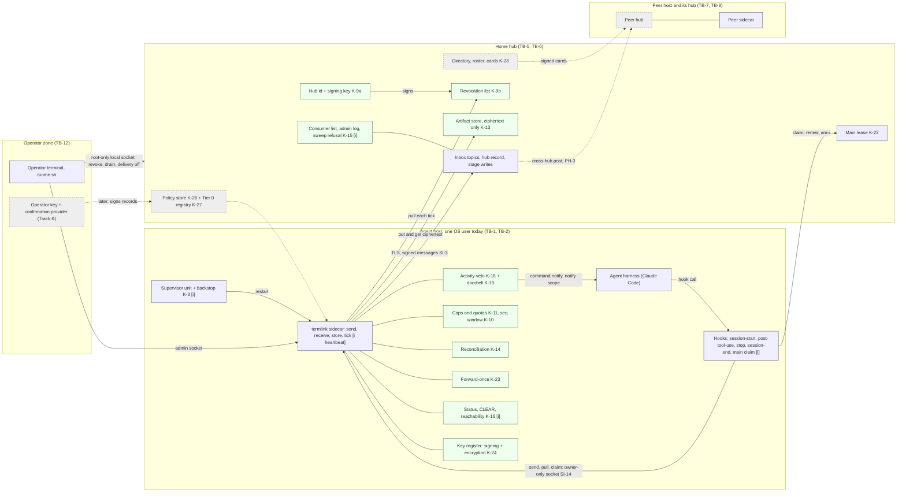
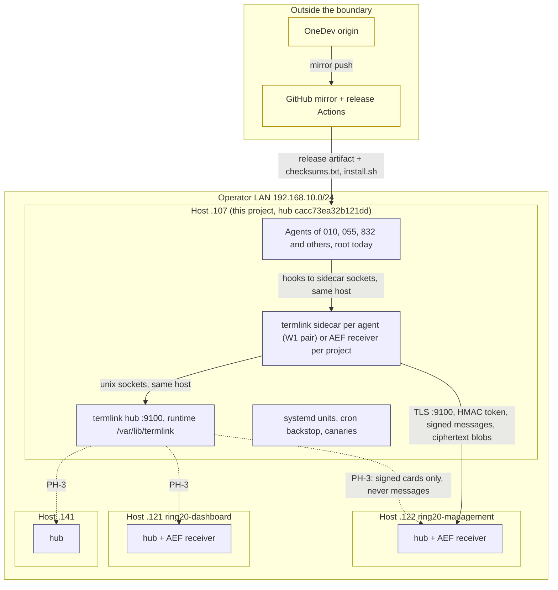
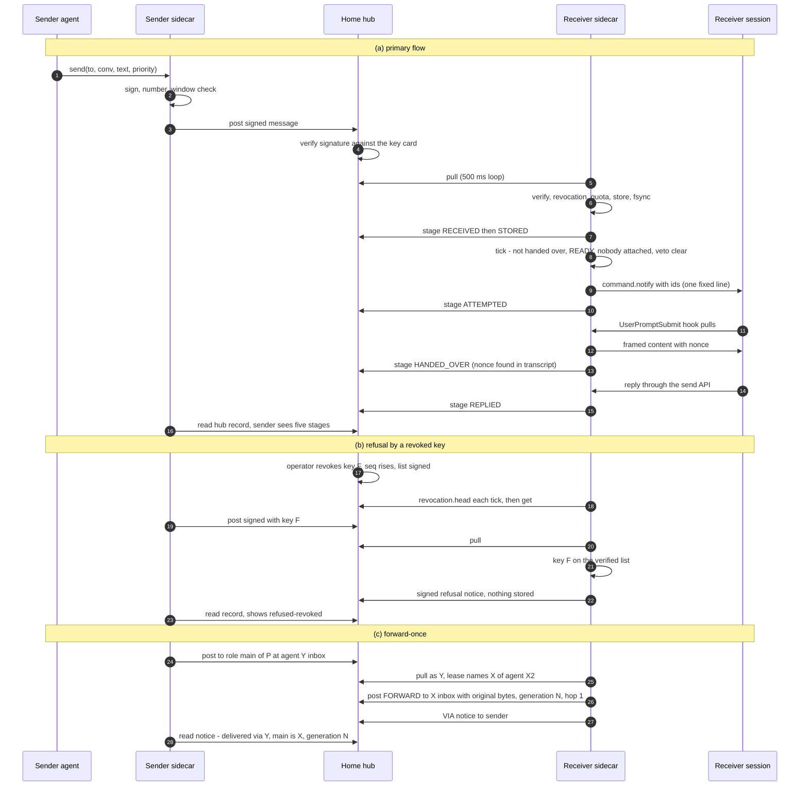
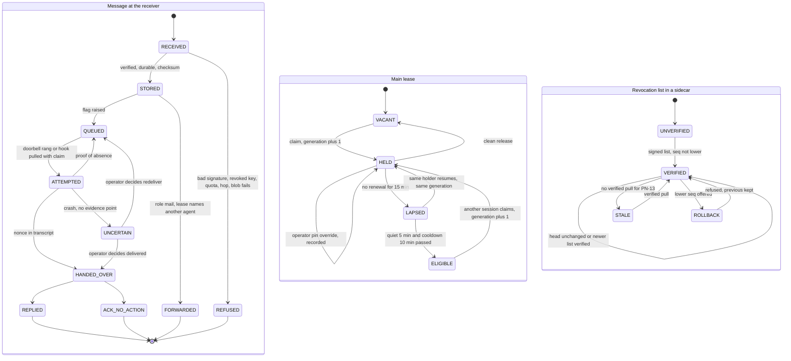
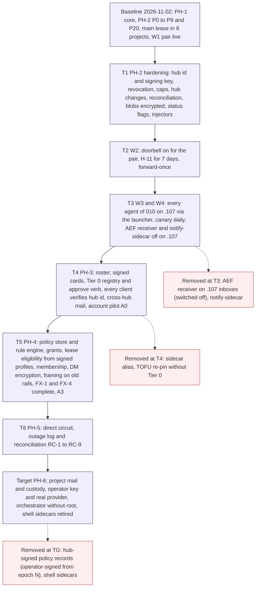

# Interactive agent communication: step 4, architecture

**Task:** T-3353 · **Arc:** arc-011 · **Chain:** arc-011-design, step 4 · **Role:** architect
**Status:** DRAFT v0.1 for independent review, then the operator. Nothing in this document is approved. Every
decision record (section 18) is **proposed** until the operator accepts it (card section 5). Everything tagged
**[P]** is a proposal; **[B]** marks a fact about what is built and live today, read from the repository on
2026-11-02 and recorded as baseline, not redesigned.
**Review link:** none. This project's Watchtower has no inline design-review page (profile P2.1); the operator reads
this file in the repository.
**Sub-documents** (card 4.1), each reviewable on its own:
1. this file, the architecture;
2. `docs/design/interactive-agent-communication-04a-traceability.md`, the traceability tables both ways (card 3.6,
   4.2): every R-n, TH-n, SI-n and FX-n to a design element, and every design element to what it serves.

## 0 Version history

| Version | Date | Change | Task |
|---|---|---|---|
| 0.1 | 2026-11-02 | First complete draft, batch mode. Baseline recorded from the PH-1/PH-2 build (ARCH, ARCH2, the main lease); the eleven PH-2 rows without tasks designed (P10, P11, P13, P15 to P19, P21, P22, P24) plus R-67.a1 (4) forward-once; the step-4 open values decided as [P] starting values or listed open; views D-1 to D-5; TCB; bypass closure; measurement; ownership split; 14 decision records; 6 change requests; a 24-row build table. | T-3353 |

## 1 Inputs of record

1.1 The step-4 inputs the chain names. Hashes are the full sha256 of the bytes read at the start of this step
(`sha256sum`, 2026-11-02).

| Short | Path | Version | sha256 |
|---|---|---|---|
| REQ | `docs/design/interactive-agent-communication-01-requirements.md` | v0.5.2, approved 2026-10-11 | `d2d839fb743eb4c542f337f2b3d244e3df4a47ac40807ebbc5f7dda5ead0a3d4` |
| TM | `docs/design/interactive-agent-communication-02-threat-model.md` | v0.3.7, residual risks accepted 2026-10-11 | `88961693384966502f4ca4eb515ed4b0590a29c3d61ac0c619e17ea4562693f3` |
| FP | `docs/design/interactive-agent-communication-03-floor-and-phasing.md` | v0.2.1 as ruled 2026-10-11 (e12bb7298) plus the two later rulings of the same day (f0e99b302 OP-1 extension, d44495678 OP-21 B); file at d44495678 | `8f4b8c060af635317f91a4a38dfa3f9059897937b2135e0b560fcc10b5cc8fe1` |
| RUL | `docs/reports/T-3344-step1-rulings-summary.md` (section 11 row 4, section 12) | | `6381769f3b2a98f3bdc1e1cfe6c6c16c35891b5e5c9fedca55014ceaff13e418` |

1.1.a The brief names e12bb7298 as the confirmation commit. The file read is two commits later; both later commits
are operator rulings of 2026-10-11 (OP-1 tightenings with the "security level per project" direction, and OP-21 B).
They are binding here. The file at e12bb7298 hashes `da18389a…7db77`; the difference is 3 lines (`git diff --stat`).

1.2 What was built since step 3, read as baseline.

| Short | Path | sha256 |
|---|---|---|
| ARCH | `docs/design/arc-011-ph1-architecture.md` (PH-1, the core) | `d99b4141a0604d4329a20ee37ee50550ff38451d90529cafe51c4a494569047f` |
| ARCH2 | `docs/design/arc-011-ph2-architecture.md` (PH-2 build table, rulings OQ-a..OQ-j, P7-1..P7-4, R-37T, FX-5A) | `b8a941e5563b72707bb3abbe89677ba42ab5560dc1882721b59f59390d84d589` |
| GAP | `docs/reports/T-3426-arc011-ph2-gapmap.md` | `e9fb34e305f371f0b6c3c28f5dc6d52e28b80135540ad91f40cc9ac625f943e9` |
| LEASE | `docs/operations/main-lease.md` (T-3654, T-3660; lease 15 min, quiet 5, cooldown 10) | `f4d79119a1105f94fc47c88715d9d7368402ae7b44bb3867ddc52b4d21bcf743` |
| CODE | `crates/termlink-sidecar/src/*.rs`, `crates/termlink-hub/src/{tls,router,artifact}.rs`, `crates/termlink-session/src/{auth,handler}.rs` at `f1ca9f841` | not hashed; cited by file and line |

1.3 Role inputs, in the order given (README 3.3).

| Short | Path | sha256 |
|---|---|---|
| RULES | `CLAUDE.md` (project sections above `## Core Principle`) | `a8d3a7b90fad560eff0514487f6eef77b4d5e548e419253f01b8f988fb7141b5` |
| COMMON | `docs/design/roles/cards/_common.md` | `cca38806358d7a6c09e64289164977a825f2cf57e914f672076ff77a2bdb5563` |
| CARD | `docs/design/roles/cards/architect.md` | `2caf043e41b315be4835f668edd25328b638ad20a6bd35d9d63123ecbd962c48` |
| ADAPTER | `docs/design/roles/adapters/aef.md` | `d840a77649888cdbfd37d1166c15eecd6cd3c8399d497fb6b1b2c52455c6c4a4` |
| PROFILE | `docs/design/roles/profiles/termlink.md` | `b6bc160242d96ca9a8fc167c6845e292529c162fa23faa2945d4742b676e7b21` |
| README | `docs/design/roles/README.md` | `3881d5302313a0d0ca4c9ef1b4688dae101b6d693df823be962e9b70946368e0` |
| CHAIN | `docs/design/interactive-agent-communication-role-chain.yaml` | `91c9c1ab63988e90ab906ab6103825f48a91a72c4220afaf5ee47f004690464d` |
| SCHEMA | `docs/design/roles/schemas/role-handback-1.schema.json` | `288a4e312f00bac978a4b2a87e57ee8a05cb14f916d77c397e601e03c703c148` |

1.4 How this step was run.
1.4.a Batch mode: no human present (`_common.md` 5.2). Every question I could not answer from a ruling is a decision
record (section 18) and an operator question (section 21).
1.4.b Where the adapter names ring20 paths this project lacks (`role-chain.py`, `design-render-check.py`,
`docs/designs/agent-authorization-broker/`), the profile governs (P2.1, P4.5). Drawings were checked with `mmdc` and
the local Chromium, the method of steps 2 and 3 (section 24).
1.4.c I changed no earlier output, task file other than T-3353, or code. Where an earlier step needs a change it is a
change request (section 20, XR-n).
1.4.d Read-only host facts used (2026-11-02, `.107`): the hub's runtime directory `/var/lib/termlink` holds 365
topic logs, 59 MB in all, the largest 8 MB, and a 64 MB artifact store; the hub audit logs (`rpc-audit.jsonl`,
39 MB live plus a 101 MB rotation) exist. Used only for the retention ceilings (8.3).

## 2 How to read this document

2.1 Identifiers new here: `K-n` components (K-1 to K-21 are ARCH2's and keep their numbers; K-22 and up are new),
`DR-n` decision records, `XR-n` change requests to earlier steps, `B-n` build items, `AR-n` residual risks proposed
for the register, `O-n` operator questions, `V-n` the step-4 values of section 8. Drawings D-1 to D-5 are this
document's. Ids of earlier steps are cited as defined there (R-n, CAND-n, OD-n, GP-n from REQ; TH-n, SI-n, PR-n,
PN-n, RK-n, RR-n, BP-n, TB-n from TM; FX-n, PH-n, FP-n, H-n, RA-n, OP-n, IC-n, C-n, RC-n from FP; P-n rows, W-n
waves and OQ-x rulings from ARCH2).
2.2 Tags as in REQ 6.1.h and FP 2.2: [R] ruling, [R~] ruled principle with an overturnable detail, [H] historical,
[A] assumption, [P] proposal; plus [B] built and live (2.1 of the status line).
2.3 Reading rule: purpose over form (FP 2.4). Where a built fact and a ruled text disagree, the disagreement is
named (XR-n or DR-n), never settled silently.
2.4 RFC 2119 words mark normative text. Choices are lettered A to D with a recommendation.

## 3 Scope, constraints and what this step decides

3.1 **The constraint, not an input to weigh (FP 14.1.a).** The floor (SI-1..SI-31, FX-1..FX-8) with its five binding
rules (ship gate, no knob before its lock, rollback keeps the floor, status honesty, deferral rule; FP 3.1.b..f,
ruled OP-10 A) binds every element below. Every floor item has a place (04a, table 1) and a probe (section 15).
3.2 **The operator's priority for this step** (brief, 2026-11-02): arc-011 live for all projects. Therefore section 6
designs the eleven PH-2 rows that had no task, section 7 the R-67.a1 (4) forward-once that the main-lease rollout
left out, and section 8 the step-4 values. PH-3 to PH-6 are designed at the level the card requires (target view,
transitions, TCB, bypass closure) in sections 11 and 12, with their detailed designs named as open sub-designs
where a gate (T-2470, T-3385, Track A) has not opened.
3.3 **What is built and live is baseline (brief).** I record it (section 4) and design only what an input requires to
change. Three built facts do conflict with a ruled text; each is a DR or XR, not a silent redesign: the main lease
built in PH-2 with every session eligible (DR-9, XR-3), the doorbell line of T-3533 outside the SI-1 alphabet (DR-6),
and the re-post-with-signature rollback that cannot exist (XR-1, already ruled OQ-j A).
3.4 **Step-3 questions still unruled that this step builds on.** OP-5 (where the interim approval sits), OP-12
(hypothesis thresholds), OP-22 (who writes the receive side) and OP-23 (RA-9) carry no ruling marker in FP 13.2. The
build has followed OP-22 A in fact (TermLink wrote the Claude adapter and hooks, K-7). I assume A for OP-5, OP-22
and OP-23 and the thresholds as written for OP-12 **[A]**, and list them as O-6 so the operator can rule them.

## 4 Baseline view: what runs today (2026-11-02)

4.1 [B] The core (PH-1, ARCH, acceptance X1..X6): durable per-agent store with a hash-chained log, signed wire,
local API with three sockets (send, status, admin), receive with stage records, hand-over only with transcript
evidence, OQ-2 E admission (held, allow, deny), the Claude adapter by hooks, the per-agent delivery switch,
exact-instance addressing, hub declared and verified.
4.2 [B] PH-2 rows done: P0 (ARCH stale text), P1 `termlink sidecar` in the binary with a production root (T-3365),
P2 30 s tick and the R-44.e deadlines (T-3428), P3 supervisor unit, component heartbeat, cron backstop (T-3435), P4
drain and count compare (T-3429), P5 needs-attention for every entry (T-3430), P6 kill switch verb and fleet form
(T-3431), P7 real-agent wiring with key register, address book and pinned main (T-3438), P8 FX-5 baseline 9 incl.
the artifact store (T-3427, T-3432), P9 packaging, checksums in status, clean-host test (T-3442), P20 activity
veto and busy bit (T-3387, `activity.rs`).
4.3 [B] Since ARCH2: the pinned main's liveness note and alarm (T-3619, T-3646, `liveness.rs`); the main lease
(T-3654, T-3660, LEASE): a hub claim on offset 0 of `main:<project>`, signed `main.lease.v1` records, generation,
lease 15 min, quiet 5 min, cooldown 10 min, operator pin first, fail-closed `am-i`; the sidecar reads it every 15 s
and withholds role mail from a non-main session of the same agent (`lease.rs`). Live in 8 projects by their hooks.
4.4 [B] The session-side doorbell action `command.notify` (T-3533): a `notify` token scope below `interact`, ids
validated, one composed line plus Enter (`termlink-session/src/handler.rs:611`). The sidecar does not yet call it:
the TermLink sidecar's doorbell (K-19) is not built.
4.5 [B] Waves: W1 running since 2026-10-14 (the pair `claude-termlink` and `claude-termlink-alt`, hook delivery,
doorbell off); kill-switch drill passed 2026-10-16; the main session joined W1 2026-10-18. W2 to W4 not started.
4.6 [B] Hub identity today: `hub_id` is the first 16 hex of the TLS fingerprint, derived on every `hub.version`
call (`termlink-hub/src/tls.rs:48`), `null` when the hub has no certificate (a hub started without `--tcp`). No
hub signing key exists; `webhook.rs` signs with HMAC only.
4.7 [B] Files: `artifact put` stores bytes by sha256 in the hub's artifact store and now posts its notice to the
hub-qualified inbox; `file send` chunk loss fixed (T-3661). `artifact put --hub` (a remote hub's store) is T-3614,
captured.
4.8 [B] Other receivers: AEF's receiver (`fw sidecar`) serves the inboxes of the other projects on their hosts
(R-49.a (1)); AEF T-5014 gates its receiver hook on `termlink main am-i`.

## 5 Target architecture: components and placement

5.1 The components (ARCH2's K-1..K-21 plus the new ones). "Owner" is the TermLink/AEF split of section 16.

| id | Component | Runs in | Owner | Status |
|---|---|---|---|---|
| K-1..K-8 | production mode, tick, supervisor, drain, needs-attention, kill switch, wiring, packaging | sidecar, systemd, runme | TermLink | [B] |
| K-9a | Hub identity: minted canonical id + hub signing key (P10) | hub | TermLink | new, 6.1 |
| K-9b | Revocation list, signed numbered hub state, pulled each tick (P11) | hub + sidecar | TermLink | new, 6.2 |
| K-10 | Sequence window, `up_to`, gap wait (P12, T-3362) | sidecar | TermLink | task exists; values 8.6 |
| K-11 | Caps, quotas, hop limit, adaptive window (P13) | sidecar | TermLink | new, 6.3 |
| K-12 | Sender ladders, `--priority`, owed answers (P14, T-3358) | sidecar | TermLink (ladder vocabulary: AEF, 16) | task exists |
| K-13 | Blobs, encrypted to the recipient (P15) | sidecar + hub artifact store | TermLink | new, 6.4 |
| K-14 | Reconciliation on start + daily head compare (P16) | sidecar | TermLink | new, 6.5 |
| K-15 | Hub changes: consumer list, admin log, sweep refusal, founding-verb scope, agent key card, dead letter (P17) | hub | TermLink | new, 6.6 |
| K-16 | Status, CLEAR, reachability card, strength flags (P18) | sidecar | TermLink | new, 6.7 |
| K-17 | Fault injectors (P19) | tests, scripts | TermLink | new, 6.8 |
| K-18 | Activity veto + readiness re-check (P20) | sidecar | TermLink | [B] veto; re-check in 6.9 |
| K-19 | Doorbell (P21) | sidecar → session `command.notify` | TermLink | new, 6.9 |
| K-20 | Vendor-channel log (P22) | hooks | TermLink (adapter) | new, 6.10 |
| K-21 | Daily canary (P23, T-3361) | cron, testdev pair | TermLink | task exists |
| K-22 | Main lease | hub claim + session hooks | TermLink (lease); AEF (its receiver's gate, T-5014) | [B] |
| K-23 | Forward-once of role mail + sender notice (R-67.a1 (4)) | sidecar | TermLink | new, section 7 |
| K-24 | Per-agent encryption key register (part of B′ stage 2, pulled forward for blobs) | `/etc/termlink-sidecar/keys`, hub card | TermLink | new, 6.4 |
| K-25 | Mail-hub declaration | `.framework.yaml` + sidecar config | AEF file, TermLink reader | value 8.7 |
| K-26 | Policy store (signed records of FP 10.3) and policy head | hub + sidecar | TermLink (format ruled OP-4 A) | PH-4, 12.3 |
| K-27 | Tier 0 event registry, approve verb, audit trail | hub admin scope | TermLink; surfaces: runme, Watchtower, cockpit | PH-3, 12.2 |
| K-28 | Directory: roster, signed cards, project root key | hub | TermLink | PH-3, 12.1 |
| K-29 | Circuit: minting, sender-constrained credential, outage log | hub + sidecar | TermLink | PH-5, 12.5 |
| K-30 | Account helper and template (Track A) | host, one sudoers entry | TermLink | A0 in PH-3, 12.6 |
| K-31 | Custody key holder and release (B′ stage 3) | supervisor account | TermLink | PH-6, 12.7 |

5.2 **Drawing D-1 — component view (structure): components, interfaces and the trust boundaries TB-1 to TB-13 of TM
section 5 that they sit across; instrumentation points marked [i]**

5.3 Text equivalent of D-1.
5.3.1 Four zones, each a trust boundary of TM 5: the operator zone (terminal and `runme.sh` today; the operator key
and confirmation provider later), the agent host (one OS user today, so TB-1 and TB-2 separate nobody until Track
A), the home hub, and a peer host with its own hub.
5.3.2 On the agent host the harness calls its hooks; the hooks call the sidecar over its owner-only local sockets
(send, pull, claim). The sidecar holds the new parts: the activity veto and doorbell (which type one fixed line into
the session through the `notify` scope), caps and the sequence window, reconciliation, forward-once, the status
call, and the key register with a signing and an encryption key per agent. The supervisor restarts the sidecar.
5.3.3 The sidecar talks to its home hub over TLS with signed messages: inbox topics and stage writes, a revocation
pull each tick, ciphertext blobs in the artifact store. The hooks claim and renew the main lease at the hub. The
hub holds its minted id and its signing key, which signs the revocation list; its consumer list, admin log and
sweep refusal sit beside the inbox topics.
5.3.4 The operator acts through the hub's root-only local socket (revoke, drain, delivery off) and the sidecar's
admin socket, both reached by `runme.sh`. Dashed (later phases): the operator key signs policy records that
sidecars verify, the directory exchanges signed cards with peer hubs, and cross-hub posting reaches a peer hub and
its sidecars.
5.3.5 Instrumentation points ([i]): the hooks (main claim results, hand-over evidence), the sidecar heartbeat per
component, the status call, the supervisor and backstop logs, and the hub's consumer list and admin log.

5.4 **Drawing D-2 — deployment view (structure): hosts, networks and what crosses each boundary**

5.5 Text equivalent of D-2.
5.5.1 All fleet hosts sit on the operator's LAN: .107 (this project's host and hub `cacc73ea32b121dd`), .122
(ring20-management), .121 (ring20-dashboard), .141. Each runs a hub; .122 and .121 also run AEF's receiver.
5.5.2 On .107 the agents (all `root` today), their sidecars (the W1 pair) or AEF's receiver (other projects), the
hub on TCP 9100 with its runtime directory `/var/lib/termlink`, and the systemd units, cron backstop and canaries.
Inside the host everything crosses Unix sockets.
5.5.3 Between hosts only TLS on port 9100 crosses: a client authenticates with an HMAC token and pins the hub's TLS
fingerprint; every message is signed by its agent; blobs travel as ciphertext. Cards between hubs (dashed) arrive in
PH-3 and carry directory entries only, never messages (charter, T-2470).
5.5.4 Outside the boundary: OneDev (origin) mirrors to GitHub, whose Actions publish the release artifact and its
checksums, which `install.sh` installs on each host (SI-27 verifies them in status).

## 6 The remaining PH-2 rows

Each row: what it does, interfaces, failure paths, the floor items it carries, how it is proven, and its build item.

### 6.1 P10 — hub identity: minted id and hub signing key (K-9a; R-61, OD-12, V-1)

6.1.1 **Mint once, store, never derive [P].** At start the hub reads `<runtime_dir>/hub.id` (one line, 16 lowercase
hex). If the file is absent and the runtime directory holds no prior hub state (no `hub.secret`, no `hub.cert.pem`,
no signing key), the hub mints: the first 16 hex of the current TLS fingerprint when a certificate exists (so every
existing hub keeps its id and no inbox is renamed, R-61.a), else 64 random bits as 16 hex. It writes the file
atomically (temp, fsync, rename, fsync dir), mode 0644.
6.1.2 **Refuse a silent re-mint.** If `hub.id` is absent but prior hub state exists, the hub MUST NOT mint: it refuses
to start with "hub.id missing beside existing state; restore it or re-home (runme)". A new id is a new hub (R-54.a),
and senders would refuse it; the volatile-/tmp class (PL-021) then fails loudly instead of renaming inboxes.
6.1.3 `hub.version` reads the file, never the fingerprint. `tls::hub_id_from_fingerprint` is used only by the mint.
The id no longer depends on `--tcp`: a socket-only hub has an id (fixes the clean-host finding of ARCH2 6.7.5).
6.1.4 **Signing key.** An ed25519 key `<runtime_dir>/hub.signing.key` (0600) is created with the id and persisted
like the secret (persist-if-present, T-933 pattern); separate from the TLS certificate (R-61.a). `hub.version`
returns `signing_key: "ed25519:<fingerprint>"`. A certificate regeneration changes neither the id nor the key
(R-61.e). Replacement of the key is C-2a (signed by the old key, policy route) or C-2b (human), which exist from
PH-3; in PH-2 the only path is a runme action that the operator runs, logged.
6.1.5 **Pinning the key in PH-2.** Each sidecar records the hub's signing-key fingerprint in its store on first
verified contact over the local socket (or TLS with the pinned certificate) and refuses a different key afterwards
with a needs-attention entry naming both fingerprints. Out-of-band pinning of card-signing keys is B′ stage 1, PH-3
(R-80); this TOFU pin is its interim, with the same limit as the TLS pin (RR-18).
6.1.6 Failure paths: unreadable `hub.id` or key → refuse to start, needs-attention via the backstop; the client sees
"hub unreachable" (UNKNOWN), never a different id.
6.1.7 Floor: FX-2 (id check stays), SI-25 (the key never printed), enables SI-11. Proof: fixtures for mint, keep,
refuse-on-partial-state, certificate rotation keeps id and key; mutant: derive from fingerprint on each call (the
rotation test goes red). Build item B-1.

### 6.2 P11 — revocation list (K-9b; RK-1, SI-11, OQ-h A)

6.2.1 **The record [P].** Signed numbered hub state, not a topic (OQ-h): `<runtime_dir>/revocations.json`, canonical
JSON (RFC 8785): `{schema: "termlink.revocation/1", hub_id, seq, issued_at, prev_digest, entries: [{scope: "agent_key",
key: "ed25519:<fpr>", project, agent, reason, revoked_at, by: "operator"|"self", event}], digest, signature}`.
`signature` is by the hub signing key over `termlink.revocation/1\n<digest>` (the domain-separated form of FP
10.3.2.c). `seq` rises by one per change; `prev_digest` chains the versions.
6.2.2 **Who revokes.** (a) The operator: `runme.sh` action → hub root-only local socket `admin revoke --key F --why`.
(b) The agent's own project: a statement signed by the old key (`revocation.request`), accepted by the hub without
the operator (OQ-h). Every revocation: an admin-log row, a needs-attention entry, the list re-signed.
6.2.3 **Pull each tick (PN-3).** The sidecar calls `revocation.head` (returns `seq` and `digest`, about 100 bytes) every
tick and `revocation.get` only when they changed. It verifies the signature against the pinned signing key (6.1.5),
refuses a `seq` lower than the one it holds (rollback, TH-58) and keeps the last verified list in its store.
6.2.4 **A failed pull is not an empty list (SI-11).** Status shows `revocation: verified seq N at T` or `unverified since
T`. After PN-13 (1 h, equal to PN-1) without a verified pull: the interrupt allow-list narrows to the agent's own
project's verified roster, urgent mail from others is downgraded (never dropped), and a needs-attention entry
appears. Messages from keys on the last verified list stay refused.
6.2.5 **Effect.** A message signed by a revoked key is refused at the receiver (and at the hub on post, once K-15's
key card exists) and recorded; the refusal is visible to the sender as a signed notice. Mail to the revoked agent
waits (RK-1, TM 11.1). Bound: the next tick with the hub reachable (SI-11).
6.2.6 Proof: revoke and send within one tick, require refusal; restore an older list, require refusal and the flag;
stop the hub for PN-13, require the narrowing. Mutant: treat a failed pull as an empty list. Build item B-5
(depends on B-1).

### 6.3 P13 — caps, quotas, hop limit, adaptive window (K-11; SI-19, R-56, PN-17, V-4)

6.3.1 **Receiver side (SI-19, floor) [P].** At STORED time the receiver checks, in order: inline size ≤ 8 KiB
(PN-7); blob ≤ 16 MiB (PN-11); per-sender open quota ≤ 32 messages from one sender identity not yet final;
aggregate ceiling ≤ 256 open messages and 64 MiB per agent store; reserved shares inside the aggregate: 10% for
protocol receipts, 20% for the own project (PN-17). Receipts are never counted against the sender quota (R-56.a).
6.3.2 **Over a limit.** The message is not STORED; the receiver posts a signed `QUOTA` notice naming the limit; the
sender keeps it in its outbox and shrinks its window (6.3.3); the receiver writes one coalesced needs-attention entry
per sender per tick. Nothing is dropped (SI-18 rule: downgrade or wait, never drop).
6.3.3 **Sender window (R-56.a (2), V-4).** Start 100 open messages per agent (ruled); additive increase +5 per tick in
which receipts advanced and no `QUOTA` came back, to a ceiling of 400; multiplicative decrease ×0.5 on a `QUOTA`
notice, floor 10. Overflow waits at the sender with a needs-attention entry.
6.3.4 **Hop limit.** Every message carries `hop` (signed). Deliberate content starts at 0; automatic content (marked,
R-56.a) and a forward (section 7) each add 1; a receiver refuses `hop` > 3 with a notice. Nothing automatic answers
anything automatic; receipts answer nothing (R-56.a).
6.3.5 **Jitter on re-sends (V-4).** Each ladder rung waits its interval times a uniform factor in [0.8, 1.2]; a
re-send earlier than 0.8 of the rung is refused by the sender's own ledger (R-56.a (1)).
6.3.6 Proof: the R-56.e cases (auto-reply loop stops at the hop limit; the 101st waits; receipts flow), quota at 32
and 256, H-13 measured. Mutant: count receipts against the quota (the receipts-flow case goes red). Build item B-7.

### 6.4 P15 — blobs, and file delivery across hubs (K-13, K-24; SI-28, R-11, FX-5A C′, T-3614, T-3661)

6.4.1 **The ruling binds the shape (FX-5A C′).** A new hub-readable copy of a content class is FX-5 growth. Blobs
MUST therefore be encrypted to the recipient (no hub credential opens them) or travel sidecar to sidecar. The
sidecar-to-sidecar path needs the circuit (PH-5). So the design is encryption to the recipient **[P]** (DR-4).
6.4.2 **Encryption keys (K-24).** Each agent gets an X25519 encryption key next to its ed25519 signing key, separate
from it (R-80.a (3)): private key in the agent's store (0600), public key in the root-owned register
`/etc/termlink-sidecar/keys/<agent>.x25519.pub`, written by the same runme provisioning as P7-2 and refused on
mismatch. This pulls the key half of B′ stage 2 into PH-2; direct-message content encryption stays PH-4 (XR-5).
6.4.3 **Send.** `send` with a file path: the sidecar reads it (≤ 16 MiB), computes `sha256(plain)`, encrypts it with a
random content key (XChaCha20-Poly1305), wraps the content key to the recipient's X25519 key (sealed box), computes
`sha256(cipher)`, and uploads the ciphertext with `artifact put` to the **recipient's home hub** (the hub the
recipient pulls from, so cross-hub needs no relay). The message carries `blob: {cipher_sha256, plain_sha256, size,
wrapped_key, name_hint}` inside the signed payload; `name_hint` is display text only.
6.4.4 **Receive.** The receiver fetches by `cipher_sha256` (chunked `artifact get`, 256 KiB chunks), checks the
digest, unwraps, decrypts, checks `plain_sha256`, and writes `<store>/blobs/<plain_sha256>` (0600) through temp,
fsync, rename. Only then does it report STORED (R-11.e [P] adopted). A peer name or path is never a file name
(SI-28). Failure (digest mismatch, missing chunk, cannot decrypt): not STORED, signed refusal to the sender,
needs-attention. A partial transfer never reads as success (the T-3661 lesson).
6.4.5 **The hub's artifact store** holds ciphertext only for arc-011 blobs. The FX-5A check: today's artifact writers
stay allow-listed (the baseline of 9); any new writer must go through the wrapper (it stores only objects whose first
bytes are the wrapper's magic and version), plus the plaintext size cap on message fields so content cannot be
tunnelled. Retention of blob objects follows their message (8.3).
6.4.6 **Cross-hub file delivery outside the sidecar (T-3614).** `termlink artifact put --hub <addr>` writes into a remote
hub's store. Under FX-5A that is a new hub-readable copy unless it is encrypted. Proposal: `--hub` is accepted only
with `--encrypt-to <agent>` (the wrapper of 6.4.3, recipient key from the register or the hub key card), and a
plaintext cross-hub put is refused with a reason. This is DR-5 and operator question O-1, because ring20 asked for a
plaintext pool (T-3614 name) and the answer changes what they get.
6.4.7 Proof: H-7 (largest blob ≤ 8 MiB), round trip of 1, 5 and 16 MiB, a corrupted chunk refused, a path-traversal
`name_hint` stored under the digest, a token holder reads only ciphertext (FX-5 probe). Mutant: store under
`name_hint`. Build items B-11 (keys + wrapper + writer check), B-12 (blobs on the chain), B-13 (T-3614 re-scoped).

### 6.5 P16 — reconciliation on start, daily head compare, host crash (K-14; SI-15, SI-22, RC-2..RC-6)

6.5.1 **On start [P]**, after the PH-1 checksum pass (FP 3.3.1.d): for every conversation with a non-final message the
sidecar reads the hub record (its stage writes) and compares it with its local stage records and the newest signed
receipts it holds, including the chain heads (RC-2).
6.5.2 **Outcomes, the hub-path subset of RC-1..RC-9.** Local stage not on the hub: write it (idempotent by message
identity and stage, RC-1, RC-3). Hub stage for an own message at STORED or later that the store lacks:
`lost-after-STORED` marker, needs-attention, and a signed `RESEND-REQUEST` to the sender; if the sender no longer
holds the payload, both sides show the loss (F-5), never silence (RC-4). Different digest or chain link: conflict,
both kept, "unreconciled", needs-attention, the operator decides (RC-5). The label clears per conversation only
after a clean pass (RC-6). The circuit rules RC-7..RC-9 wait for PH-5.
6.5.3 **Daily head compare (SI-22).** Once per day and on start, each conversation's local chain head is compared with
the head the hub recorded from the receiver's last receipt; a mismatch is a fork: needs-attention, "unreconciled".
6.5.4 **Host crash (F-7, T-7).** A virtual machine killed mid-write on a real disk image; after boot no STORED message
is missing and no record fails its checksum unflagged.
6.5.5 Proof: fixtures for each outcome; mutant: merge a conflicting record silently. Build item B-10.

### 6.6 P17 — hub changes (K-15; SI-16, FX-6, FX-4, PR-1a rest, R-44 DEAD)

6.6.1 **Consumer list per inbox [P].** The hub records, per inbox topic, every identity that subscribed, acked or
claimed it, with first and last time (bounded: 16 identities per inbox, oldest evicted, eviction logged). RPC
`inbox.consumers <topic> [--window S]`. The sidecar checks it each tick: any identity but its own within the window
(V-11, 24 h) is "inbox consumed by two identities: A, B" in status and needs-attention (FP-1 failure 2, 60 s).
6.6.2 **Refuse later, flag now.** During W1 to W3 a second receiver can be legitimate for minutes in a switch, so the
hub flags. After W4 for an inbox, `runme.sh` binds it (`admin inbox bind <topic> <identity>`) and the hub refuses ack
and claim from any other identity (R-49.e "refused or flagged"). DR-11.
6.6.3 **Admin log and sweep refusal (FX-6).** Every admin-scope RPC is appended to the hub's audit log with caller,
method, params digest and result (the existing `rpc-audit.jsonl` gains an `admin: true` field and is never rotated
away under 30 days). `channel.sweep`, `set-retention` and trim on an `inbox:` or conversation topic are refused when
they would remove an offset whose message is not final in the hub record.
6.6.4 **Founding-verb scope (FX-4).** Built: `inject` needs `control`, `exec` needs `execute`, neither is in `observe`
or `notify` (`termlink-session/src/auth.rs:129`). Added: every `command.inject`, `pty inject`, `command.execute` and
`remote exec` is logged with the caller identity at the session and the hub; a session may refuse callers other than
its owner (`--owner-only` on spawn, default on for sidecar-launched sessions). Cross-project use stays logged-only
until PH-4 (RA-2).
6.6.5 **Agent key card (P7-2 rest).** The hub keeps a card per agent: signing key, encryption key, project, instance
ids, registered by the runme provisioning; a replacement is accepted only as a statement signed by the old key
(C-6a, built-in route from PH-3) or a runme action; the card is what the hub checks a post's signature against.
6.6.6 **Dead letter for a retired instance.** When provisioning retires an instance id (runme), the hub writes a
signed, sequenced `DEAD` statement (hub signing key, seq per project); a sender's conversation mail to it yields
DEAD and stops polling (R-44, R-62). Signed DEAD from liveness alone is PH-3 (R-60.a).
6.6.7 Proof: second consumer flagged within 60 s, refused after bind; sweep with an open message refused; inject with
an `observe` token refused and logged; DEAD unsigned refused. Build items B-2, B-3, B-4, B-6.

### 6.7 P18 — status, CLEAR, reachability card, strength flags (K-16; R-53, R-29, FX-8, FP 3.1.e, V-8)

6.7.1 **Status fields [P]**, each with its freshness stamp; a stale field reads "unknown" (FP-1 7.2.b): `mode`,
`binary` (built), `supervision` (built), `main` (built), `hub {id, declared, match}`, `revocation`, `quota`,
`consumers`, `reachability`, `clear`, `strength {per_agent_accounts: no, same_user_separation: "absent: agents run as
root", operator_key: no, confirmation_provider: no, policy_records: "none (fixed defaults)"}`. Answer within 5 s at
the 95th percentile, also under an injected fault.
6.7.2 **Reachability card (R-53).** The sidecar publishes its four fields on its home hub with its liveness note
(generalising T-3646 to every agent): receiver up, right hub, adapter present, last surface time (latest real
HANDED_OVER or confirmation, never a heartbeat). Readers: the agent's own project and the operator; peers of other
projects see reachable yes or no and the version class (CR-11; enforced by the hub's read scope from PH-3, when there
are peers of other projects on the path).
6.7.3 **The no-surfacing threshold (V-8).** The field "last surface time" is bad when a STORED message is not handed
over 2 ticks after the agent last became READY (the ruled R-44.e "not handed over" deadline), or 2 ticks after the
first hook call that did not hand it over. An idle agent with nothing pending is never bad by age alone; its age is
shown. A silent back channel reads UNKNOWN, never DEAD.
6.7.4 **CLEAR (FX-8).** CLEAR only when no field is bad and, if anything was pending in the last hour, at least one
real surfacing happened after it. A seconds-old heartbeat with refused confirmations reads NOT CLEAR (INC-d).
6.7.5 Proof: the 32,205-refusal injection reads NOT CLEAR with the field bad; mutant: count the heartbeat as surfacing.
Build item B-14.

### 6.8 P19 — fault injectors and the drill (K-17; GP-12, R-6.e, R-70, H-18, H-19)

6.8.1 One script `scripts/arc011-fault-inject.sh <fault> --tier 1|3`, six faults: (1) a signing key filed under another
agent's name (swap the register entry); (2) a second consumer of the inbox (a raw subscribe and ack with another
identity); (3) receipts under another identity (wrong `--agent-id` in the hook environment); (4) a dead component
(tier 1: the estate seam silences one loop; tier 3: SIGSTOP of the whole sidecar, so the heartbeat ages, which is
the honest limit in production mode where seams are refused); (5) a second hub or wrong runtime directory (the
config points at a throwaway hub with another id); (6) unsurfaced mail (hooks removed from the session's settings).
6.8.2 Tier 1 on a simulated clock, tier 3 on the testdev canary pair (OQ-i) on the installed artifact; 20 injections
each; pass when status names the cause and the fix within 60 s (30 s for start-up checks), 100 of 100, and recovery
needs zero manual steps once the fault is removed (H-18, H-19). The drill: three first-time readers, given only the
status output, median ≤ 5 minutes, all correct.
6.8.3 Each injector has a negative control: with the diagnosis code removed the run fails. Build item B-15.

### 6.9 P21 — the doorbell and H-11 (K-19 with K-18; SI-1, SI-2, R-19..R-23, R-81, V-8)

6.9.1 **When it rings [P].** Once per tick, for each own session that is a TermLink PTY session launched by the
reachable launcher: mail is STORED and not handed over, no hook fired for it within 1 tick, the session's adapter
flag says READY (written by the Stop hook, cleared by UserPromptSubmit and PreToolUse), and **no terminal client is
attached to the session** (DR-6). An attached session means a person may be typing; their next prompt runs the
UserPromptSubmit hook, which hands the mail over without any typing, so the doorbell is never needed there.
6.9.2 **Immediately before typing**, in this order, each failing closed: the kill switch (SI-23); READY re-read and its
age ≤ 1 tick; the foreground process of the PTY is the registered harness; the activity veto (built, T-3387); still
no client attached. The interval from the last check to the keystrokes is logged (H-11 (a)).
6.9.3 **What is typed (SI-1).** The sidecar calls the session's `command.notify` with at most 4 message ids (32 lowercase
hex). The built line (`[sidecar] N peer messages waiting (ids …). …`) uses `[`, `]`, `(` and `)`, outside the SI-1
alphabet (letters, digits, spaces and `. , : -`). P21 changes it to: `sidecar: N peer messages waiting, ids X Y. The
prompt hook shows them as untrusted data.` First word `sidecar:` is not an installed command. DR-6.
6.9.4 **Afterwards.** The doorbell records ATTEMPTED (a ring is not a hand-over). The UserPromptSubmit hook that the
typed line triggers pulls with the atomic claim and the nonce; HANDED_OVER follows from transcript evidence only
(SI-17, SI-30). No hand-over within 2 ticks: next ring after 4, then 8 ticks, at most every 10 minutes; the R-44.e
"not handed over" deadline then makes it STUCK with a notice. One ring per session per tick at most.
6.9.5 **Known hazard to test (T-3591):** Claude Code restored a stale doorbell line from its last-prompt history. The
line carries ids, so a restored ring for mail already handed over pulls nothing; the hook records it as a stray ring
(H-11 (b)).
6.9.6 **H-11 harness:** (a) check-to-keystroke interval, (b) stray lines per 1000 rings, (c) vetoes while idle and
ready, (d) rings within 2 s of a turn start; 7 days in W2. Kill switch proven on the typed path (exit 4). Build item
B-16; W2 is the operator's runme action (B-17).

### 6.10 P22 — vendor-channel use logged and shown (K-20; FX-1, R-79, RA-5)

6.10.1 A PreToolUse hook in the project's `.claude/settings.json`, matcher `SendMessage|Agent|Task`, calls `termlink
sidecar hook vendor-channel` with the tool name; the sidecar appends a row to its admin chain and a routine
needs-attention entry of kind `vendor-channel-use` (coalesced per session per day, R-37T A′ rules apply). The hook
never blocks the call in this row.
6.10.2 **The disable half.** RA-5 ends when T-3386 is done and the operator configures the disable. T-3386 is done
[B]. The disable is a `permissions.deny` entry for `SendMessage` in the project settings, an operator act. The
in-process sub-agent tool stays logged-only while the vendored framework's dispatch protocol uses it. Operator
question O-4; FX-1 completes when both are disabled or the remaining one is ruled.
6.10.3 Proof: call each tool in a fixture session, require the row and the entry. Build item B-18.

### 6.11 P24 — W3 acceptance and the PH-2 exit report

6.11.1 W3 (every agent of this project on this host started through the reachable launcher) is the operator's runme
action after W2's H-11 bound is met and the canary (P23) runs daily (ARCH2 3).
6.11.2 P24 runs the two-agent live test with a negative control on the installed artifact, re-runs the fault drill,
checks the PH-2 exits 1 to 8 (ARCH2 4) and writes `docs/reports/<task>-ph2-exit.md` with each exit's evidence; gives
AEF the FP-3 fixtures through `framework:pickup` (an act the orchestrator performs, FP 14.6). W4 follows only on the
operator's go. Build items B-21 (W3), B-22 (P24), B-23 (W4).

### 6.12 Rows with tasks already (P12, P14, P23)

6.12.1 P12 (T-3362): the gap-wait bound is V-6. P14 (T-3358): `--priority`, the ladders as sidecar code, the owed list;
the per-message answer deadline and "no action" deferred from P2 land here. P23 (T-3361): the canary's staleness
threshold is V-13. No design change from this step.

## 7 R-67.a1 (4): forward-once of role mail to a main behind another sidecar or host (K-23)

7.1 **What exists [B].** The lease names a session, agent and host. A sidecar withholds role mail from a non-main
session of its own agent (`lease.rs`). When main is a session of another agent, the sidecar delivers as before (fail
open). AEF-received projects share one project inbox and are gated per session by AEF T-5014 (`am-i`), so forwarding
is needed only where agents have their own inboxes: TermLink sidecars.
7.2 **Rule [P].** A sidecar Y that receives a message addressed to a role (`to: main` or the project, not an exact
instance) while the lease, read within its 15 s period, names a valid holder X of another agent of the same project:
7.2.a stores it (STORED is Y's promise and stays true);
7.2.b forwards once: posts to X's inbox on the project's home hub a `FORWARD` envelope signed by Y, carrying the
original signed message bytes unchanged (with the topic they were signed for), `generation`, `hop` +1, `via: Y
instance`. The original signature binds the original topic (ARCH2 6.4.4), so the original cannot be re-posted
bare; the envelope keeps it intact and verifiable (XR-2);
7.2.c tells the sender with a signed `VIA` notice: "delivered via Y; main is X (generation N); resolve via the home hub",
and marks its own copy `forwarded` (final at Y, never handed over at Y);
7.2.d never forwards conversation mail bound to an exact instance (R-62.a), never forwards a `FORWARD` (hop rule), and
never forwards on an unknown, stale or vacant lease (it delivers as before and says so in status).
7.3 **At X.** X verifies the outer signature (Y is in the same project's roster), the inner signature against the
original topic (a role address of X's project), and `generation` against the lease it reads. Match: process the
inner message as its own (identity triple, R-51: a second copy is the same message). Mismatch (X is no longer main):
X stores it, does not forward it, and posts `FORWARD-STALE` to the sender, whose ladder re-resolves through the home
hub and re-sends the same message id (normal resolution, no bounce, R-67.e).
7.4 **Cross-host.** All agents of a project use the declared home hub (R-54), so the forward is always a post to that
hub; X may be on another host. A forwarder on a host that cannot reach the home hub has no lease (unknown) and does
not forward.
7.5 Proof: two agents of one project on two sidecars, lease on X, role mail to Y: X hands over, Y shows forwarded,
the sender shows the VIA line; lease moves between forward and arrival: FORWARD-STALE and one hand-over at the new
main; H-24 (0 processed twice in 1000 forwards). Mutant: forward without the generation check. Build item B-20.

7.6 **Drawing D-3 — request sequences (behaviour): (a) the primary flow with the doorbell, (b) a refusal by a revoked
key, (c) forward-once**

7.7 Text equivalent of D-3.
7.7.1 (a) The sender agent calls send on its sidecar, which signs and numbers the message, checks its window and
posts it to the receiver's inbox on the home hub; the hub verifies the signature against the agent's key card. The
receiver's sidecar pulls it, verifies signature and revocation, checks quotas, stores and flushes it, and writes
RECEIVED and STORED to the hub record. At the next tick, with the message not handed over, the session READY, no
client attached and the veto clear, it calls `command.notify` with the ids and records ATTEMPTED. The typed line
makes the session's UserPromptSubmit hook pull; the sidecar returns the framed content with a nonce and records
HANDED_OVER once the nonce is in the transcript. The receiver replies through its send API; REPLIED is recorded.
The sender reads the hub record and sees the five stages.
7.7.2 (b) The operator revokes key F at the hub; the list's sequence number rises and the hub signs it. The receiver
sidecar sees the new head on its tick and fetches the list. A message signed with F is pulled, found on the list,
refused with a signed notice and never stored; the sender's record shows it refused because the key is revoked.
7.7.3 (c) A message for the role main of project P reaches agent Y's inbox. Y's sidecar reads the lease, which names
session X of another agent; it posts a FORWARD to X's inbox carrying the original bytes, the generation and hop 1,
and sends the sender a VIA notice, which the sender reads as "delivered via Y, main is X, generation N".

## 8 The step-4 open values (RUL section 11 row 4, REQ 13.1 and 13.4.3, FP 14.1.b)

8.1 Rule for every number below: it is an [R~]-style starting value **[P]**, its measurement is an acceptance item of
the first build of its subject (OQ-9 D), and it moves by FP-4 (7.5) without a new ruling; the change is recorded in
the R-70 inventory file.

| V | Item | Source | Value [P] | Subject built in |
|---|---|---|---|---|
| V-1 | Hub-id minting | OD-12, R-61 | Minted once at first start, stored in `hub.id`; fingerprint-derived for hubs that have a certificate, 64 random bits otherwise; never re-minted beside existing state (6.1) | B-1 |
| V-2 | Grant fields and storage | OD-15, R-63..R-65 | Fields: the `rules` record of FP 10.3.4 with `may: start|resume` and `limits {budget, restarts, per}` (ruled format, OP-4 A). Storage: the policy store K-26, signed numbered hub state at the home hub like the revocation list; fetched with the policy head each tick; cached in the sidecar store; verified for signature, epoch, expiry before use; failed fetch is a failure; after PN-13 without a verified head, grant starts stop and the allow-list narrows to the own project (FP 10.3.11) | PH-4 (NK) |
| V-3 | Retention ceilings | OD-16, R-35 | Journey events: 14 days after final (ruled [R~]); never cut while open. Ceilings per inbox or conversation topic: 50,000 records or 32 MiB; per hub for arc-011 classes: 2 GiB; blobs: 14 days after their message is final, artifact store ceiling 4 GiB; digests 1 year, ceiling 64 MiB. Past a ceiling: oldest final first, loudly; open only as last resort with needs-attention (R-35.o (3)). Grounding: today 365 topics hold 59 MB, the largest 8 MB (1.4.d) | B-3 (hub trim refusal), B-12 |
| V-4 | Jitter, adaptive cap, hop limit | CAND-12, R-56 | Jitter factor uniform 0.8..1.2 per rung; window start 100, +5 per clean tick to 400, ×0.5 on a quota notice, floor 10; hop limit 3 | B-7 |
| V-5 | Skew bound | CAND-13, R-57 | Deadlines on the observer's monotonic clock only (ruled). Skew estimate from hub round trips; telemetry tagged with it; flag "clock skew" at more than 2 s; cross-host delay figures marked unusable at more than 30 s; NTP sync state checked by the status call where `timedatectl` or `chronyc` exists, else shown "unchecked" | B-14 (PH-2 single observer), PH-3 cross-host |
| V-6 | Gap-wait bound | CAND-18, R-59 | Messages beyond a gap are STORED at once and held from hand-over; after 2 ticks a signed resend request for the gap; after 10 ticks (5 min) the later messages are handed over marked "gap before N" and needs-attention names the gap; window 256 (PN-5) | B-8 (T-3362) |
| V-7 | Mail-hub declaration format | CAND-8, R-54 | In the project's `.framework.yaml`: `mail_hub: {id: <16 hex>, address: <host:port>}`; the sidecar config carries a copy that MUST equal it at start (refuse otherwise); clients verify `hub_id` from `hub.version`; no runtime-directory fallback. Owner of the file: AEF (DR-7) | B-1 (reader), AEF (key) |
| V-8 | Idle no-surfacing threshold | CAND-6, R-53, R-29.e | Bad when a STORED message is not handed over 2 ticks after the agent became READY or after the first hook call that did not hand it over; never bad by age alone when nothing is pending (6.7.3) | B-14 |
| V-9 | "main" lease durations, quiet period, cooldown | OD-18, R-67 | Lease 15 min, quiet 5 min, cooldown 10 min [B] (T-3654 Decisions); worst-case takeover 20 min; idle readiness check = a renewal from UserPromptSubmit or PostToolUse | built |
| V-10 | "main" priority format | OD-18, R-67 | `main_priority`: integer 0..9 in the agent's `profile` policy record (FP 10.3), default 0; with `eligible_for_main` (default `no`, OP-4 A); read by the hub at vacancy only; PH-2 interim in DR-9 | PH-4 (K-26) |
| V-11 | One-receiver observation window | R-49.e | 24 h of the hub's consumer list per inbox, checked each tick | B-2 |
| V-12 | Detection of a second live copy of a project | R-60.e | Same hub: within 1 tick of the second registration. Across hubs (PH-3): within 2 × PN-9 (20 min) of the first card exchange after the second copy registers | B-2, PH-3 |
| V-13 | Daily canary staleness | R-66.e | Stale when no completed run for 26 h (daily plus 2 h slack); detected by the canary meta-check (T-1723) | B-19 (T-3361) |
| V-14 | GP-4 offline behaviour | GP-4 | 8.2 | B-14 |
| V-15 | Per-project security levels (FP 10.1.8.g operator direction) | OP-1 extension | 8.4, DR-13 | PH-3/PH-4 |
| V-16 | GP-11, the operator as a party | GP-11 | **Open**: not ruled; no design (R-1.e (3), R-37 urgent channel) | — |

8.2 **GP-4 offline [P].**
8.2.1 Receiver's host offline for days: its liveness card expires (PN-9, 600 s), so the sender sees WAITING FOR
RECIPIENT, not STUCK; its message stays on the home hub, never trimmed while open (V-3); the ladder keeps polling at
its slowest rung; the owed list carries it. If the receiver's home hub is itself unreachable: UNKNOWN since T.
8.2.2 Sender's own host without network: `send` still returns a message id and the message is durable in the sender's
outbox (SENT, local); the sender sees WAITING with "home hub unreachable since T"; nothing claims RECEIVED; the window
caps the outbox at its current size; on return the sender reads the hub record first (R-45.a) and posts what is not
there.
8.2.3 Same host, hub down: a new conversation waits for the hub (ruled OQ-4: always needs the hub, R-7.e); established
conversations continue only on a circuit (PH-5).
8.3 **Retention ceilings, why these sizes.** The ceilings are an allocation-sink guard, not a budget: 32 MiB per topic
is four times today's largest topic; 2 GiB per hub is about 35 times today's total; blobs share the 4 GiB store with
16 MiB per blob (PN-11). FP-4 moves them after measurement.
8.4 **Per-project security levels [P] (operator direction, FP 10.1.8.g).** A level selects which costly strength a
project requires; it never switches a floor item off (the floor is not traded, FP 3.1.a).
8.4.1 **L0 base** (today, every project): the floor at base strength; status names the absent flags.
8.4.2 **L1 accounts**: requires Track A for the project's agents (A3); the project's sidecars refuse to run as root.
8.4.3 **L2 keyed**: L1 plus the operator key: policy records must be operator-signed (`require_operator_signature_from
_epoch`), high-impact classes need the confirmation provider, and direct messages are encrypted (B′ stage 2).
8.4.4 The level is the `security_level` field of the project's `profile` record; raising it is a human-route Tier 0
event; lowering it is high-impact (a new class, C-17 **[P]**, XR-6). The Tier 0 override stays available at every
level as break-glass: operator-initiated, logged, shown (SI-24).

## 9 Flows: failure and timeout paths not shown in D-3

9.1 Hub unreachable at send: WAITING, then UNKNOWN since T; nothing lost; ladder continues (FC-8).
9.2 Store write fails or disk full: not STORED, sender chases, needs-attention (FC-2).
9.3 Hand-over uncertain after a crash with no evidence-complete point: waits for the operator (FC-4, RR-17).
9.4 Quota exceeded: `QUOTA` notice, the sender's window halves, message waits (6.3.2).
9.5 Revocation unverified past PN-13: allow-list narrows, urgent downgraded (6.2.4).
9.6 Lease unknown: role mail delivered as before, no forward; `am-i` says unknown and surfaces nothing (LEASE fail
directions).
9.7 Blob fetch fails: not STORED, refusal, needs-attention (6.4.4).
9.8 Doorbell vetoed or attached client: retried next tick; after the deadline STUCK names "not handed over" (6.9.4).
9.9 Second consumer: flagged (W1..W3), refused after bind (6.6.2).
9.10 Hub id mismatch: client refuses, status names both ids (FX-2, FC-14).

## 10 State view

10.1 **Drawing D-4 — state view (behaviour): (a) a message at the receiver, (b) the main lease, (c) the revocation list
as a sidecar holds it**

10.2 Text equivalent of D-4.
10.2.1 (a) A message at the receiver starts RECEIVED. It is REFUSED (final) for a bad signature, a revoked key, a quota,
the hop limit or a failed blob; otherwise STORED once verified and durable. Role mail whose lease names another
agent becomes FORWARDED (final at this receiver). Otherwise the flag makes it QUEUED; a doorbell ring or a hook pull
with the claim makes it ATTEMPTED; the nonce in the transcript makes it HANDED_OVER; a crash without an evidence point
makes it UNCERTAIN, which only the operator resolves (to HANDED_OVER or back to QUEUED); proof of absence returns it
to QUEUED. From HANDED_OVER it ends REPLIED or acknowledged with no action. (REFUSED and FORWARDED are receiver-side
outcomes, not new sender states: the sender sees them as notices on the existing states, so the FP-2 cap is unchanged,
see XR-4.)
10.2.2 (b) The lease starts VACANT; a claim makes it HELD and raises the generation; the session's renewals keep it
HELD; 15 minutes without renewal make it LAPSED, from which the same holder may resume at the same generation; after
the quiet period and cooldown it is ELIGIBLE and another session's claim makes it HELD with a new generation. A clean
release makes it VACANT. An operator pin overrides a live holder and is recorded.
10.2.3 (c) A sidecar's revocation list starts UNVERIFIED and becomes VERIFIED with a signed list whose sequence is not
lower. It stays VERIFIED while heads are unchanged or newer lists verify; PN-13 without a verified pull makes it
STALE until the next verified pull; a lower sequence is a ROLLBACK that is refused, keeping the previous list.

## 11 Transitions: baseline to target

11.1 **Drawing D-5 — transition view (behaviour): baseline, the intermediate states and the target, with what each step
adds or removes**

11.2 Text equivalent of D-5.
11.2.1 Baseline (2026-11-02): the PH-1 core, PH-2 rows P0 to P9 and P20, the main lease in 8 projects, the W1 pair.
11.2.2 T1, PH-2 hardening (no wave change): the hub's minted id and signing key, the revocation list, caps and
quotas, the hub changes (consumer list, admin log, sweep refusal, founding-verb log, key card, dead letter),
reconciliation on start, encrypted blobs with encryption keys, status flags and the reachability card, the fault
injectors.
11.2.3 T2, wave W2: the doorbell on for the pair with the H-11 measurement for 7 days, and forward-once.
11.2.4 T3, waves W3 and W4: every agent of this project on .107 through the launcher, the daily canary; then AEF's
receiver and the legacy notify-sidecar switched off for this host's inboxes (removed, kept installed until PH-3
exits).
11.2.5 T4, PH-3: roster and signed cards, the Tier 0 registry with the approve verb, every client verifying the hub
id, cross-hub mail, the account pilot A0. Removed: the `sidecar:` alias, TOFU re-pin without a Tier 0 event.
11.2.6 T5, PH-4: the policy store and rule engine, grants, lease eligibility from signed profiles, membership,
encrypted direct messages, framing on the old rails, FX-1 and FX-4 complete, accounts at A3.
11.2.7 T6, PH-5: the direct circuit with the outage log and RC-1 to RC-9.
11.2.8 Target, PH-6: project mail and custody, the operator key and the real confirmation provider, the orchestrator
without root, the shell sidecars retired. Removed: hub-signed policy records (operator-signed from an epoch), the
shell sidecars.
11.3 Every transition keeps the floor items that have entered (FP 3.1.d) and has the rollback of its phase (FP 6);
the PH-2 transitions use the drain of K-4 with the kept-and-listed rule of OQ-j A.

## 12 Later phases at architecture level (PH-3 to PH-6)

12.1 **PH-3 identity, directory, admission (K-28).** Roster `termlink.roster/1` record, signed by the hub signing key
in the interim (IC-3), each entry `{hub_id, signing_key, address, admitted_at, event_digest}`, rising `seq` carried in
every hub-to-hub exchange (R-77). Cards `termlink.card/1` signed by the originating hub with `seq` and TTL 600 s
(PN-9). Project root key per project, held by the operator's runme in L0/L1, by the operator key in L2. "Moved to"
and hub-key rotation as signed statements. Enrolment: C-1 human route through the approve verb with the typed-back
fingerprint (PR-14). Gate: T-2470 (charter rewording) **open**. Detailed sub-design: open (`04b`, after T-2470).
12.2 **Tier 0 events and the approval surface (K-27).** One registry table (FP 10.2, classes C-1..C-16, routes as
ruled OP-2 A and OP-3 A). Events are records `{class, who, what, evidence, digest}` on the hub's admin scope; one
`approve <digest>` verb (IC-2) that every surface calls: the operator's terminal via runme first, Watchtower and the
cockpit later (OP-5 A assumed, O-6). Every decision in one audit trail and needs-attention. Expiry 10 min (PN-15).
12.3 **Policy store (K-26).** Signed numbered hub state, one counter per (scope, kind), the head in every fetch (FP
10.3.2.d); fetched each tick with the revocation head; cut-over to operator signatures by
`require_operator_signature_from_epoch` (IC-3 → K4).
12.4 **Credentials and audit.** Agent signing keys (ed25519, built), encryption keys (X25519, 6.4.2), hub signing key
(6.1), operator key (Track K, off agent hosts). Audit: the hub admin log, the sidecar admin chains, the Tier 0 trail;
SI-25 scan on every artifact.
12.5 **PH-5 circuit (K-29).** As ruled (R-46.a (1)..(5), PN-1, PN-2, PN-6, PN-12, PN-13): minted by the hubs after the
SI-10 checks, sender-constrained to a TLS exporter value, one conversation; outage log per RC-1..RC-9. Transport:
TLS between sidecars with the credential presented in the first frame. Detailed sub-design: open (gated by H-1 and
H-27).
12.6 **Track A account helper (K-30) [P].** `/usr/local/libexec/termlink-account-helper create <agent> --event
<digest>`, the only command in one sudoers entry; fixed template (home 0700, no login shell, no sudo, group
`tl-agents`); refuses unless the hub returns a decided C-15 event receipt for that digest; logs to the hub's admin
log. Shared checkout by group per FP 10.1.6. Hook wiring at A1: Claude Code's managed settings file under
`/etc/claude-code/` pins the hooks root-owned **[A]**, to verify in A0. Comes with the A0 pilot (FP 10.1.8.g (3)).
12.7 **PH-6 custody and break-glass (K-31).** Custody key in a supervisor account; release only under C-10 conditions
(R-80.a (5)); break-glass after K. Re-wrap cost for history sharing (R-74, R-80): content keys are re-wrapped (32 bytes
per message per new reader), content is never re-encrypted; sizing open until PH-4 data.
12.8 **Migration.** Per host: the PH-2 wave pattern (W1..W4) repeated, with the drain of K-4; per project on AEF's
receiver: the switch only after the two-agent acceptance with a negative control on that host (R-49.a (3)).

## 13 Trusted computing base

13.1 **Must be trusted today:** host root on each agent host; the kernel, filesystem and fsync; the hub process, its
runtime directory (secret, TLS key, signing key, `hub.id`, revocation list); the installed `termlink` binary and the
release path that built it (OneDev, the mirror, GitHub Actions, `checksums.txt`); the key register under
`/etc/termlink-sidecar/` (root-owned); the harness (Claude Code) writing transcripts and running hooks; the hook wiring
in `.claude/settings.json` (in the writable checkout, RA-7); systemd and cron.
13.2 **What an adversary with full rights on an agent host can still do** (ADV-7, RR-2, for the lifetime of the
design): read every key on that host (agents', and the hub's when the hub runs there, as on .107), impersonate any
local agent and the local hub to local sidecars, rewrite stores and chains (detected only where an independent copy
exists on another host), type into any session, silence canaries and their heartbeats.
13.3 **What it cannot do once the later phases exist:** forge messages of agents whose keys live on other hosts;
forge cards of other hubs (PH-3, signed with their keys); forge operator-signed records (K4); approve a high-impact
event without the out-of-band confirmation (K5); read encrypted content of agents on other hosts (PH-4). Until Track
A, a hijacked agent equals this adversary on its host (FP 3.7.1).

## 14 Closing the bypass inventory (TM 17)

| BP | Route | Design element | Removed / monitored residual |
|---|---|---|---|
| BP-1 | `inject`, `pty inject` | K-15 founding-verb log and owner-only (6.6.4); PH-4 boundary model | monitored now; open by design (RR-13) |
| BP-2 | `exec`, `remote exec` | same | monitored; open by design |
| BP-3 | direct post with the hub secret | SI-3 at hub and receiver, K-15 key card | closed for posting; envelope reading open (RR-6) until PH-4 encryption |
| BP-4 | store, flag, queue files | checksums, chain, K-14 reconciliation | monitored; prevention needs Track A |
| BP-5 | transcript and ready flag | nonce in harness record type (SI-17); missing flag = not ready | monitored; well-formed forgery RR-7 |
| BP-6 | secrets at rest | status checks file modes; SI-25 | open under one user (RR-2); Track A |
| BP-7 | hub admin RPCs | K-15 admin log and sweep refusal (6.6.3) | monitored |
| BP-8 | stray second hub | V-1 minted id, V-7 declaration, FX-2 | removed (refused); FC-14 |
| BP-9 | `sidecar:` alias, broadcast topics | R-71 end date (PH-3); framing | removed at T4 |
| BP-10 | backups and snapshots | K-14 reconciliation, receipts' chain heads, revocation seq | monitored; RR-20 |
| BP-11 | root, units, cron | install-drift check, backstop logs | open (RR-2) |
| BP-12 | other inbound rails | SI-7 on every rail (PH-4, RA-9) | open until PH-4 |
| BP-13 | operator terminal | none | open by design |
| BP-14 | Claude Code SendMessage | K-20 log (6.10); deny entry (O-4) | monitored now; removed on O-4 |
| BP-15 | second inbox consumer | K-15 consumer list (6.6.1) | monitored now; removed (refused) after W4 bind |
| BP-16 | AEF loopback API | W4 on .107 | removed per host at its switch |
| BP-17 | OneDev, mirror, release | SI-27 checksums; canaries | monitored |
| BP-18 | cron canary files | canary meta-check, install drift | monitored; root residual |
| BP-19 | TOFU repair paths | T-3384 record (built); Tier 0 C-7 in PH-3 | monitored now; gated at T4 |
| BP-20 [P] | shared writable checkout and its hook wiring (FP CX-1) | managed hook settings and hash check at A1 (12.6) | monitored from A1; RR-21 |
| BP-21 [P] | `artifact put --hub` plaintext to a remote hub store (new route, 6.4.6) | wrapper-only writers, `--encrypt-to` | removed if O-1 A |

## 15 Measurement per component

| Component | Property that proves it works in production | How it is checked | What it does NOT prove |
|---|---|---|---|
| K-9a hub id | id unchanged across restart and certificate rotation | status `hub.match` each tick; fixture on rotation | that the id is the right hub after a full restore (RR-20) |
| K-9b revocation | a revoked key is refused within one tick | status `revocation` freshness; drill | anything while the hub is down longer than PN-13 beyond narrowing |
| K-10 seq window | no gap undetected, no reuse accepted | H-3; receipts' `up_to` | ordering outside a conversation |
| K-11 caps | floods wait, receipts flow | H-13; quota notices count | fairness between projects |
| K-13 blobs | a blob round-trips with both digests checked; hub holds ciphertext | H-7; FX-5 inventory probe | confidentiality against the host's root |
| K-14 reconciliation | no silent divergence after start | daily head compare count | prevention of same-user rewrite (RR-2) |
| K-15 hub | second consumer seen within 60 s; sweep of open mail refused | FP-1 failure 2 injection | that a root process on the hub host cannot edit the log |
| K-16 status | names the cause within 60 s, answers in 5 s | H-18 injections | causes outside the six faults |
| K-19 doorbell | rings reach idle sessions without stray lines | H-11 (a)..(d) | absence of the check-to-keystroke race (RR-19) |
| K-20 vendor log | every vendor-channel use leaves a row | fixture per tool | uses in sessions without the hook |
| K-21 canary | daily two-agent round trip with negative control | canary log and staleness (V-13) | delivery for pairs not in the rotation |
| K-22 lease | one main per project, takeover visible | `termlink main status`; R-68 tests | that main is the right session for the operator's intent |
| K-23 forward | no role mail lost or doubled across copies | H-24 | conversation mail (never forwarded by design) |

## 16 Ownership split TermLink / AEF (OD-7, OD-9, CAND-10, RUL section 12)

| Element | TermLink | AEF |
|---|---|---|
| Adapter contract (R-47) | owns the contract and the Claude Code adapter + hooks (built, OP-22 A in fact) | supplies adapters for harnesses it runs, if any; 055 supplies opencode's |
| Receive side (OD-9 C) | `termlink sidecar`, the only receiver after a host's switch | its receiver serves its inboxes until that host's switch (R-49.a (1)); gates its hook on `termlink main am-i` (T-5014) |
| Send-and-wait (CAND-10, R-55) | the primitive: cross-hub read of stage and reply by id (T-3347) | the tool |
| Re-send ladders, `priority` field, HANDED_OVER vocabulary and five states (R-30, R-31, R-52, R-44) | the chase as sidecar code (K-12) | carries the field and the vocabulary; replaces D-600 for agent mail |
| Project id minting and fork re-mint (R-60) | reads it | owns it |
| Mail-hub declaration (R-54, V-7) | reads and verifies | owns the `.framework.yaml` key (DR-7) |
| Main lease (R-67) | the lease, `am-i`, the sidecar gate, forward-once | its receiver's gate |
| Hub, revocation, policy store, Tier 0 registry, directory, circuit | all | none |
| GP-11 channel standard | — | owns (open) |
| Amended D-660 text | — | owns |

## 17 Harness and transport neutrality (card 3.9)

17.1 The send and status API is a local socket with a JSON request format (ARCH), harness-independent; the adapter is
the only harness-specific part and its four reports are a contract (R-47). The doorbell is a session RPC with ids
only. Forwarding, revocation, blobs and the lease use hub RPCs over the existing transport (Unix socket or TLS); the
circuit (PH-5) is a second transport under the same delivery contract (R-46.a (3)). Nothing depends on a vendor
channel (R-79).

## 18 Decision records (all proposed; the operator decides)

| DR | Context | Options | Recommendation | Consequences |
|---|---|---|---|---|
| DR-1 | Hub id minting (V-1) | A mint once, fingerprint-derived for existing hubs, refuse re-mint beside state; B keep deriving from the fingerprint; C random id for all, rename inboxes | **A** | no inbox renamed; PL-021 fails loudly; socket-only hubs get ids |
| DR-2 | Hub signing key pinning in PH-2 | A TOFU pin in each sidecar store, mismatch refused; B no pin until PH-3 out-of-band | **A** | revocation list unforgeable to a remote attacker now; same limit as TLS TOFU |
| DR-3 | Receiver quotas (V-4, 6.3) | A numbers of 6.3; B sender cap only | **A** | SI-19 holds at the receiver (floor) |
| DR-4 | Blob confidentiality (FX-5A) | A encrypt to the recipient's X25519 key, ciphertext in the recipient's home hub store; B wait for the circuit; C plaintext with RA | **A** | needs encryption keys now (K-24, XR-5) |
| DR-5 | `artifact put --hub` (T-3614) | A only with `--encrypt-to`, plaintext refused; B allow plaintext between hubs of this operator, with a risk acceptance; C defer T-3614 to PH-4 | **A** | ring20 gets encrypted pool transfers, not plaintext (O-1) |
| DR-6 | Doorbell conditions and line (6.9) | A ring only when no client is attached; line inside the SI-1 alphabet; B ring when attached too; C keep the T-3533 line | **A** | no typing into a person's half-written prompt; one built line changes |
| DR-7 | Mail-hub declaration location | A `.framework.yaml` `mail_hub` (AEF's file) with a verified copy in the sidecar config; B a TermLink file `.termlink/mail-hub.toml` | **A** | one place per project; AEF must accept the key |
| DR-8 | Revocation stale rule effect in PH-2 | A narrow allow-list to own project, downgrade urgent; B stop all delivery | **A** | never stops all mail on a hub blip |
| DR-9 | Main eligibility while no policy record exists | A record the built lease (every session of the project's agents eligible) as the PH-2 interim under the 2026-11-02 instruction; OP-4's default `no` applies when profiles exist (PH-4); B restrict now to the pinned main's agent; C only pinned sessions | **A** | matches what runs in 8 projects; XR-3 |
| DR-10 | Forward-once envelope (section 7) | A outer FORWARD signed by the forwarder carrying the original signed bytes; B re-sign the content as the forwarder | **A** | original signature kept (R-67.a1 (4)); XR-2 |
| DR-11 | Second inbox consumer | A flag during waves, refuse after W4 bind; B refuse at once | **A** | wave switches stay possible |
| DR-12 | Gap wait (V-6) | A store at once, hold hand-over, release after 5 min marked; B hold indefinitely; C no hold | **A** | bounded head-of-line wait |
| DR-13 | Security levels (8.4) | A L0/L1/L2 selecting only costly strength, floor never off; B a free per-item matrix | **A** | small, auditable; lowering is high-impact (XR-6) |
| DR-14 | Retention ceilings (V-3) | A the numbers of 8.1; B measure first, no ceiling | **A** | allocation sinks bounded from the first build |

## 19 Residual risks for the operator

19.1 Nothing accepted earlier is reopened (RR-1..RR-20, RA-1..RA-9). New or sharpened by this design:
19.2 **AR-1** The hub signing key's first pin is TOFU (DR-2): a host that is already compromised at first contact can
pin a rogue key. Ends at PH-3 out-of-band pinning. Same class as RR-18.
19.3 **AR-2** The doorbell's check-to-keystroke race (RR-19) remains for unattended sessions; an attached session is
never rung (DR-6), which removes the operator's own prompt from it.
19.4 **AR-3** A lost `RESEND-REQUEST` answer (sender no longer holds the payload) makes a lost-after-STORED message
unrecoverable before PH-5's encrypted hub copy; it is shown to both sides, never silent.
19.5 **AR-4** On .107 the hub runs on the agents' host, so a hijacked root agent holds the hub signing key: revocation
and dead letters are forgeable locally until the hub runs under its own account (Track A, FP 10.1.5 "hub access").

## 20 Change requests to earlier steps (requests, not edits)

20.1 **XR-1 (step 3).** FP 6.2.3.e says STORED messages are "re-posted to the agent's old inbox with its original id and
signature, or kept". Re-post is impossible as worded (the signature binds the topic, ARCH2 6.4.4); OQ-j ruled "kept
and listed". Reword to "kept in the store and listed to the operator in the rollback report".
20.2 **XR-2 (step 1).** R-67.a1 (4) "keeping the original signature": add "inside a forward envelope signed by the
forwarding copy; the original bytes are carried unchanged" (DR-10), so the requirement does not read as a bare
re-post.
20.3 **XR-3 (step 3).** FP 4.2 row R-67 "PH-2 pin only; PH-4 lease, duplicates, forwarding": the lease and the non-main
gate were built in PH-2 on the operator's instruction of 2026-11-02 (T-3654), and forward-once is proposed for PH-2
(B-20). Update the row, and record under NK that eligibility in PH-2 is the fixed built-in "every session of the
project's agents" until profile records exist (DR-9).
20.4 **XR-4 (step 3).** FP-2 counts state values. REFUSED and FORWARDED appear here as receiver-side outcomes shown to the
sender as notices on its existing states. Confirm they do not count as new state values; if they do, REJECTED's
reserved slot is taken and FORWARDED trips the cap review (7.3.e).
20.5 **XR-5 (step 3).** FP 4.2 row R-80 places agent encryption keys with DM encryption in PH-4. FX-5A C′ (ruled
2026-10-13) requires encrypted blobs in PH-2, so per-agent encryption keys enter in PH-2 (K-24); DM content
encryption stays PH-4.
20.6 **XR-6 (step 3).** Add class C-17 "lower a project's security level" (human, high-impact) and C-18 "raise it"
(human) to FP 10.2.2, for the operator direction of FP 10.1.8.g (DR-13).

## 21 Open questions for the operator (one at a time, in this order)

21.1 **O-1** Cross-hub file delivery: encrypted only (DR-5 A), or plaintext allowed between this operator's hubs with a
risk acceptance (B), or defer (C). Recommendation A.
21.2 **O-2** The doorbell rings only for sessions nobody is attached to (DR-6 A). Recommendation A.
21.3 **O-3** Who may be main until signed profiles exist (DR-9). Recommendation A.
21.4 **O-4** Switch off Claude Code's SendMessage for this project now that T-3386 is done (6.10.2); keep the
sub-agent tool logged. Recommendation: yes for SendMessage.
21.5 **O-5** The starting numbers of section 8 as one package under FP-4 (DR-3, DR-12, DR-14, V-4..V-13).
Recommendation: accept.
21.6 **O-6** The four step-3 questions without a ruling that this design assumes: OP-5 A, OP-12 as written, OP-22 A
(already built so), OP-23 A. Recommendation: rule them as assumed.
21.7 **O-7** The security levels L0/L1/L2 (DR-13). Recommendation A.
21.8 GP-11 stays open (V-16); not a question for this step.

## 22 Build table (dependency order; each one deliverable, one session)

| B | Row | Deliverable | Depends on | Task |
|---|---|---|---|---|
| B-1 | P10 | Minted hub id + hub signing key + `hub.version` fields + mail-hub declaration reader (6.1, V-7) | — | new |
| B-2 | P17a | Consumer list per inbox, sidecar check each tick, bind-and-refuse verb (6.6.1-2) | — | new |
| B-3 | P17b | Admin RPC log flag + sweep/trim refusal on open mail + retention ceilings (6.6.3, V-3) | — | new |
| B-4 | P17c | Founding-verb use log at session and hub, owner-only sessions (6.6.4) | — | new |
| B-5 | P11 | Revocation list: hub state, admin revoke, self-revoke, tick pull, stale rule (6.2) | B-1 | new |
| B-6 | P17d | Agent key card on the hub, post-time signature check, signed dead letter for retired instances (6.6.5-6) | B-1 | new |
| B-7 | P13 | Receiver quotas, sender window, hop limit, jitter (6.3) | — | new |
| B-8 | P12 | Sequence window, `up_to`, gap wait (V-6) | — | T-3362 |
| B-9 | P14 | `--priority`, ladders as sidecar code, owed list, answer deadline | B-7 | T-3358 (extend) |
| B-10 | P16 | Reconciliation on start, daily head compare, VM host-crash test (6.5) | B-8 | new |
| B-11 | P15a | Per-agent encryption keys in the register + the encryption wrapper + artifact writer check (6.4.2, 6.4.5) | — | new |
| B-12 | P15b | Blobs on the chain with both digests, H-7 (6.4.3-4) | B-11 | new |
| B-13 | T-3614 | `artifact put --hub` with `--encrypt-to` only (6.4.6, O-1) | B-11, O-1 | T-3614 (re-scope) |
| B-14 | P18 | Status strength flags, reachability card, CLEAR, skew, GP-4 lines (6.7, V-5, V-8, 8.2) | B-2, B-5 | new |
| B-15 | P19 | Six fault injectors, tier 1 and tier 3, drill (6.8) | B-14 | new |
| B-16 | P21 | Doorbell: conditions, re-checks, SI-1 line, back-off, H-11 harness (6.9) | B-14, O-2 | new |
| B-17 | W2 | Operator runs the W2 runme action | W1 7 days, B-16 | runme |
| B-18 | P22 | Vendor-channel log hook; SendMessage deny if O-4 yes (6.10) | — | new |
| B-19 | P23 | Daily canary on the installed artifact, staleness 26 h (V-13) | — | T-3361 |
| B-20 | R-67.a1 (4) | Forward-once, VIA and FORWARD-STALE notices, H-24 (section 7) | B-6 | new |
| B-21 | W3 | Operator runs the W3 runme action | W2 bound, B-19 | runme |
| B-22 | P24 | W3 two-agent acceptance + PH-2 exit report + FP-3 fixtures to AEF (6.11) | all above | new |
| B-23 | W4 | Operator runs the W4 runme action | B-22 | runme |
| B-24 | XR | Fold accepted XR-1..XR-6 into steps 1 and 3 (orchestrator reopens them) | operator | orchestrator |

22.1 Every build item ships its floor probe with a mutant that turns it red (FP 3.1.b) and its own `## Verification`.
The order is dependency order; B-1 to B-4, B-7, B-11 and B-18 have no dependency and may run in any order.

## 23 Coverage: the card and the task

23.1 Card completion conditions. 6.1 every R-n, TH-n, SI-n addressed, no unexplained element: 04a tables 1 to 4. 6.2
baseline, transitions, target with boundaries and instrumentation: sections 4, 5 (D-1, D-2), 11 (D-5), 12. 6.3 every
bypass route removed or monitored: section 14 (BP-1..BP-19 plus BP-20, BP-21). 6.4 every open decision a decision
record with options and recommendation: section 18. 6.5 drawings D-1..D-5 with ids, captions, text equivalents,
rendering: 5.2, 5.4, 7.6, 10.1, 11.1, section 24.
23.2 T-3353 agent criteria: inputs of record with hashes (section 1); every row-4 value decided or open (section 8,
V-1..V-16); ownership per component (section 16 and 5.1); role-chain step 4 `task: T-3353` (already set in CHAIN).
23.3 Limits. PH-3 to PH-6 are at architecture level; their detailed sub-designs are open where their gates are
closed (T-2470, T-3385, H-1, H-27, Track A). I did not measure the numbers; they are starting values.

## 24 Render check of the drawings

24.1 Method as steps 2 and 3: each Mermaid block extracted in order and rendered with `mmdc -p <puppeteer config> -i
bN.mmd -o bN.svg`, config `{"executablePath":"/usr/bin/chromium","args":["--no-sandbox"]}`; no `render_check` record
(the checker is not adopted, profile P4.5).
24.2 Result, 2026-11-02, on v0.1. Block order in the file: D-1 (5.2), D-2 (5.4), D-3 (7.6), D-4 (10.1), D-5 (11.1).
Every block exit code 0; SVG sizes 47324, 26237, 43435, 73445 and 24588 bytes; no "syntax error" or "parse error" in
any log or SVG. D-1 and D-4 were also rendered to PNG and read: D-1 shows the four zones with the new components
green and later ones dashed; D-4 shows the three state machines side by side with every transition labelled. No
semicolon in any sequence message or note.
