# Interactive agent communication: step 6, pseudo-code

**Task:** T-3355 · **Arc:** arc-011 · **Chain:** arc-011-design, step 6 · **Role:** pseudo-coder
**Status:** v0.3 (2026-11-12): the step 7 change requests CR-6.1..CR-6.42 (06 part) and the operator's ruling D on
F-20 folded in after the operator approved step 7 (T-3356; T-3689); marked "(changed in v0.3 by CR-6.n)" in the
text and `# CR-6.n` in the pseudo-code. Below, the v0.2 status as it stood: DRAFT v0.2, batch mode (no human present, `_common.md` 5.2). This step does not decide (`decides: false`);
it iterates with step 5 (evidence specialist). Nothing here is approved. Values that are not ruled numbers are tagged
**[P]**; ruled numbers carry their source; **[B]** marks logic written as built (read from the code at `24d15fba3`).
**Standing rules applied throughout (CLAUDE.md):** nothing working is switched off as a side effect (**NID**);
thresholds measure reliability, never usage (**RNU**).
**Review link:** none. This project's Watchtower has no inline design-review page (profile P2.1); the operator and
the reviewers read the files in the repository.
**Sub-documents** (split per phase, card 5.1 and the brief's ~1500-line rule), each reviewable on its own:
1. this file: conventions, the answers to step 5's questions, the PH-2 delivery path (AL-1 to AL-16, the operator's
   priority: activity meter, doorbell D+ and watchdog, lease tightening, waiting-mail signal, forward-once), the
   FAILS CLOSED WHEN register for all three files, residual risks and change requests;
2. `docs/design/interactive-agent-communication-06a-pseudo-code-ph2-hardening.md`: the rest of PH-2 (AL-17 to AL-40:
   hub id and signing key, canonical signed state with test vectors, revocation, receive admission and caps, blobs and
   keys, status and CLEAR, hub changes, reconciliation, gap wait and owed list, fault injectors, vendor channels,
   wave gates);
3. `docs/design/interactive-agent-communication-06b-pseudo-code-later-phases.md`: PH-3 to PH-6 (AL-41 to AL-53: the
   approval broker scope of the card, grants, policy records, roster and cards, circuit, membership, break-glass,
   custody, account helper, security levels).

## 0 Version history

| Version | Date | Change | Task |
|---|---|---|---|
| 0.1 | 2026-11-11 | First complete draft, batch mode. 53 algorithms AL-1..AL-53 in the card's form 4.a..4.h across three files; answers to step 5's questions 14.3 (a)..(i); FAILS CLOSED WHEN register FCW-1..FCW-190 with the AFC each refines and its spec or a change request; drawings D-1 (state machines) and D-2 (interaction sequences); canonicalisation test vectors; residual risks QR-n; change requests ZR-n. | T-3355 |
| 0.3 | 2026-11-12 | Step 7 change requests folded (07-review 6.6, approved 2026-11-12, T-3356), in this file: CR-6.1 typing re-check for both `via` values (AL-6, AL-8 inv. 1); CR-6.2 READY and foreground re-read after the veto (AL-6); CR-6.3 S2 only on turn events and READY changes (AL-1, AL-3); CR-6.4 receiver-checked origin and the claim carries it (AL-1, AL-11); CR-6.5 provisional take only for interactive sessions (AL-11); CR-6.6 origin reporting per harness by operator act (AL-11); CR-6.7 STALLED (AL-7, AL-8); CR-6.8 watchdog typed from every state (AL-7); CR-6.9 stale-checks before the intent (AL-6); CR-6.10..CR-6.14 forward-once (AL-14, AL-15); CR-6.15 `store.lock` not re-entrant (3.2.a); CR-6.18 non-main withhold is role mail only (AL-12, AL-9); CR-6.19 harness identity (AL-1, AL-2, AL-5, AL-6); CR-6.20 tick budget (AL-3, AL-8); CR-6.21 hub receive stamp for `last_human_at` (AL-11, AL-13); CR-6.22 Touch signer (AL-11); CR-6.23 `last_prompt` persisted, QR-2 closed (AL-1, AL-4); CR-6.24 READY ordering and the turn end (AL-1, AL-4); CR-6.25 S2 unknown on a failed `lstat` (AL-3); CR-6.27 one watchdog fire per agent per tick (AL-8); CR-6.28, CR-6.29 waiting-mail OOB outcome and re-raise (AL-13); CR-6.30 inner topic is the poster's inbox (AL-15); CR-6.34 `VENDOR_TOOLS` (AL-1); CR-6.35 `offerable` (AL-9); CR-6.37 ZR-1 count 46 (9.1); CR-6.38 attempt bound (AL-9); CR-6.39 one nonce per pull (AL-9); CR-6.40 failed re-check refuses (AL-9); CR-6.41 terminal replies (AL-2); ruling D: interim `ps` veto on macOS (AL-6, AL-8, QR-5). 06a and 06b carry their own rows. New FCW-195..FCW-210; register regenerated. Drawings D-1.2, D-1.3, D-1.7 changed. | T-3689 |
| 0.2 | 2026-11-11 | Remediation of independent review r1 (amber, F-1..F-6), nothing else changed: F-1 06b AL-43 consume is one conditional step at the hub under event.lock (compare-and-set APPROVED → CONSUMED with the consumed-set insert in one transaction), AL-42 lock rule for cancel, revoke and the expiry sweeper, FCW-191; F-2 06b AL-46 check and use are one reserve at the hub under grant.lock (counter insert with a limit), revoke or expiry between check and use, FCW-192, FCW-193; F-3 06b AL-44 recover() follows the crash table (no-dispatch-row case, `already_done` before the post-condition, at most one re-apply), FCW-194; F-4 concurrency item or explicit single writer for every state-changing algorithm, 10.3 rewritten; F-5 AL-35 and AL-36 drawn (06a D-1.14, D-1.15), 7.0 and 7.0.1 corrected; F-6 the SI-1 line of 5.6.c.1 is 150 bytes (measured). Register now FCW-1..FCW-194; ZR-1 (f) added; render check 11.4. | T-3355 |

## 1 Inputs of record

1.1 Full sha256 of the bytes read on 2026-11-11 (`sha256sum`), at commit `24d15fba3`.

| Short | Path | Version | sha256 |
|---|---|---|---|
| ARC4 | `docs/design/interactive-agent-communication-04-architecture.md` | v0.3.1, approved 2026-11-08 | `29c6d1f7de9f18898cab105651f17977ebf97da30f32d16501819bad217dd69c` |
| TRACE | `docs/design/interactive-agent-communication-04a-traceability.md` | v0.3 (part of ARC4) | `c516a290997e0c75957c0be95af4d611e58155cd818d2fbae961c0f4ad6d4667` |
| EV5 | `docs/design/interactive-agent-communication-05-evidence.md` | v0.1; review green V-20261109-454c9bbb | `29be80ae3ad8d32b71ef53caa00f9fdc6d03426c901215eaed85c019f889526e` |
| EV5A | `docs/design/interactive-agent-communication-05a-coverage.md` | v0.1 (part of EV5) | `16a4aa77b23cad191cf1b9153e60016a266ffc763c54674cb2d6e1f6341824fc` |
| HB5 | `docs/design/interactive-agent-communication/role-handback-step-05.json` | step-5 hand-back (open questions, item 11 of T-3354) | `03fbef422d071ba1b322216cae46515b2472901eff68fbc03c967b06185315b6` |
| REQ | `docs/design/interactive-agent-communication-01-requirements.md` | v0.5.3 | `f6ce42a2984bd18e049f1f4dda05e6eaab2cc3508396fe373060c6fc527193c9` |
| TM | `docs/design/interactive-agent-communication-02-threat-model.md` | v0.3.7 (SI-1..SI-31 read in full, section 18) | `88961693384966502f4ca4eb515ed4b0590a29c3d61ac0c619e17ea4562693f3` |
| FP | `docs/design/interactive-agent-communication-03-floor-and-phasing.md` | v0.3 | `e4de2e3e102ee59f6434db584e099e5bb180c6b33dfd823ae217e6ebb4e5a8c4` |

1.2 Built and live facts, written as built where the architecture keeps them (brief).

| Short | Path | sha256 |
|---|---|---|
| ARCH2 | `docs/design/arc-011-ph2-architecture.md` | `b8a941e5563b72707bb3abbe89677ba42ab5560dc1882721b59f59390d84d589` |
| LEASE | `docs/operations/main-lease.md` | `c95c12e76e0e3b8166badf4919e262916210c89b427ac2d4be996cda65c51e9a` |
| CODE | `crates/termlink-session/src/main_lease.rs` (`plan_claim`, `claim_inner`, `Timing::from_env`), `crates/termlink-session/src/handler.rs` (`doorbell_line`, `handle_command_notify`), `crates/termlink-sidecar/src/{lease,activity,deliver,hook,api,beat,liveness,estate}.rs`, `crates/termlink-session/src/offline_queue.rs` (`mint_client_msg_id`) at `24d15fba3` | not hashed; cited by path |

1.3 Role inputs, in the order given (README 3.3).

| Short | Path | sha256 |
|---|---|---|
| RULES | `CLAUDE.md` (project sections above `## Core Principle`) | `a9b38fd1aeed0145289c6a8c89c491c2ae077d06e1847110209827f33e172aa3` |
| COMMON | `docs/design/roles/cards/_common.md` | `cca38806358d7a6c09e64289164977a825f2cf57e914f672076ff77a2bdb5563` |
| CARD | `docs/design/roles/cards/pseudo-coder.md` | `4801aa19de42c170e347ac1d5517b0ee6106cd94eb76a2cc7d856e601ab65f76` |
| ADAPTER | `docs/design/roles/adapters/aef.md` | `d840a77649888cdbfd37d1166c15eecd6cd3c8399d497fb6b1b2c52455c6c4a4` |
| PROFILE | `docs/design/roles/profiles/termlink.md` | `b6bc160242d96ca9a8fc167c6845e292529c162fa23faa2945d4742b676e7b21` |
| README | `docs/design/roles/README.md` | `3881d5302313a0d0ca4c9ef1b4688dae101b6d693df823be962e9b70946368e0` |
| CHAIN | `docs/design/interactive-agent-communication-role-chain.yaml` | `6ed4d708b8364428a5f9f2996519e8956be02b31e5a10817b55df29be99b8752` |
| SCHEMA | `docs/design/roles/schemas/role-handback-1.schema.json` | `288a4e312f00bac978a4b2a87e57ee8a05cb14f916d77c397e601e03c703c148` |

1.4 How this step was run.
1.4.a Batch mode. Every question I could not answer from an input is a change request (section 9) or a residual
risk (section 8), never a silent assumption.
1.4.b Where the adapter names ring20 paths this project lacks (`role-chain.py`, `design-render-check.py`,
`role-handback-check.py`), the profile governs (P2.1, P4.5). Drawings were checked with `mmdc` and the local
Chromium, the method of steps 2 to 5 (section 11).
1.4.c I changed no earlier output and no code. Where a built fact must change for an algorithm to hold, it is named
as a build delta inside the algorithm (marked **Δ**) and, where it touches a ruled text, as a change request.
1.4.d The test vectors of 06a section 2.4 and 06b were computed with `.context/working/t3355/vectors.py` (Python,
PyNaCl) using the public RFC 8032 test key 1, never a key of this estate (SI-25).

## 2 How to read this document

2.1 Identifiers new here: `AL-n` algorithms, `FCW-n` FAILS CLOSED WHEN conditions (section 6 is the register),
`OBS-n` observation points the evidence runner reads (answer 4.9), `ZR-n` change requests to earlier steps,
`QR-n` residual risks of this step, `D-1.n` and `D-2.n` the parts of the two required drawings. Ids of earlier steps
are cited as defined there (R-n, SI-n, TH-n, RR-n, FX-n, PN-n, H-n, K-n, B-n, V-n, DR-n, AR-n, XR-n, E-n, AFC-n,
EP-n, YR-n). The PH-1 architecture's own `FC-n` are cited as **ARCH FC-n** (as step 5 does).
2.2 Each algorithm has the card's form: **a** SERVES; **b** PROBLEM and APPROACH; **c** ALGORITHM (language-neutral
steps in a `text` block, a state table where it is a state machine); **d** INVARIANTS; **e** FAILS CLOSED WHEN (each
an FCW-n); **f** EDGE CASES (forged, replayed, expired, altered input; clock and its source; canonical forms;
concurrency; a **crash table** for every state-changing step); **g** EXECUTION SEMANTICS; **h** CRYPTOGRAPHY. A line
**OBS** after **h** lists what the evidence runner reads.
2.3 RFC 2119 words are normative for the build items that implement an algorithm. The language of the build is the
build's choice (card 1); names in the pseudo-code (`store.chain_append`, `hub.stage`) are roles, not function names
in the code.
2.4 Reading order for the build, the operator's priority (brief): AL-1 to AL-9 (B-27, then B-16), AL-11 to AL-13
(B-25), AL-14 and AL-15 (B-20), then 06a in its order, then 06b.

## 3 Conventions shared by every algorithm

3.1 **Clocks (V-5, R-57; answers 4.3).**
3.1.a `mono()` is the observer's monotonic clock in milliseconds since boot, with `boot_id` (Linux
`/proc/sys/kernel/random/boot_id`; elsewhere a per-boot value the sidecar records at start). Every deadline, window,
age and back-off below is computed on `mono()` of the process that decides. A value stamped on another boot reads
**absent**.
3.1.b `wall()` is the wall clock, used only for display, records meant for other hosts, and the lease (whose built
logic uses the claimer's wall clock, AL-11 3.f). A wall value is never subtracted from a `mono()` value.
3.1.c `TICK` = 30 000 ms **[B]** (`deadline::TICK_MS`, OQ-d A). "Within 1 tick" means `≤ TICK` on `mono()`. The
tick thread evaluates every per-tick routine once per tick; the 500 ms loop keeps pulling **[B]**.
3.1.d `sidecar_epoch` is a random 64-bit value minted at every sidecar process start; records that only this process
may trust (the READY flag for the doorbell, AL-1) carry it.

3.2 **Primitives** (each built unless marked Δ).
3.2.a `store.lock` the per-agent store lock (SI-16) **[B]**; (changed in v0.3 by CR-6.15) it is **not re-entrant** and
is **never held across an RPC**, a network read or a blob fetch: a routine that needs one takes it, releases it, and
takes it again for the next local step; `store.chain_append(line)` appends a hash-chained line
under the lock and fsyncs it **[B]**; `atomic_write(path, bytes)` = write temp, fsync, rename, fsync directory **[B]**.
3.2.b `attention(kind, why, coalesce_key)` writes a needs-attention entry; with a `coalesce_key` at most one entry
per key per coalescing period (stated where used) **[B]** (kinds and R-37T A′ rules as built).
3.2.c `admin_row(kind, fields)` appends to the sidecar's admin chain **[B]**.
3.2.d `hub.stage(msg, stage, extra)` writes a signed stage record to the hub record; idempotent by (message identity,
stage, attempt) **[B]**. `notice(to, kind, fields)` posts a signed notice **[B]** (`wire::NOTICES`).
3.2.e `session_rpc(session, method, params, timeout)` calls the TermLink session with the agent's `notify`-scope token
**[B]**; a timeout or transport error returns `Err`.
3.2.f `delivery_on()` reads the per-agent kill switch from the store at the moment of the call **[B]** (`admin
delivery on|off`, SI-23).
3.2.g `lease_view()` is the sidecar's last lease read with its read time (AL-12) **[B]**.

3.3 **Strict JSON** (every parser that reads peer or adapter bytes). UTF-8 only; duplicate keys refused; depth ≤ 8;
total size bounded per format (stated where used); numbers only integers in [−(2^53−1), 2^53−1] where a schema has
numbers (no fractions, no exponents, no `-0`); unknown top-level fields ignored and counted, never used. Refusal is
a value (`Err(reason)`), never a crash.

3.4 **Test seams** are honoured only through AL-16 (answer 4.8). No algorithm below reads an environment variable
directly.

## 4 Answers to step 5's questions (EV5 14.3 a..h, and HB5 item 11)

4.1 **(a) The FCW-n list.** Section 6 is the register: every FAILS CLOSED WHEN condition of the three files with its
id, the routine it sits in, the AFC-n it refines (or "new") and the E-n that covers it, or the change request to
step 5 (ZR-1) where no spec exists yet. Totals are in 6.1.

4.2 **(b) The back-off schedule as a function (AL-7).** For one session, an episode starts at the first normal ring
after the last progress (a HANDED_OVER to that session, or the pending set becoming empty). Ring `k` of the episode
(`k = 0, 1, 2, ...`) MAY happen no earlier than tick `T0 + O(k)`, where `T0` is the tick of ring 0 and
`O(0) = 0`, `O(1) = 4`, `O(2) = 12`, `O(k) = 12 + 20·(k − 2)` for `k ≥ 3`; that is, intervals `I(1) = 4`, `I(2) = 8`,
`I(k ≥ 3) = 20` ticks (20 ticks = 10 min). A ring happens at the first tick `≥ T0 + O(k)` at which AL-5's gate and
AL-6's re-checks pass; a held tick does not move the schedule. At most one ring per session per tick. While a ring has
had no submit (AL-7 state `UNSUBMITTED`) no normal ring happens at all; only the watchdog may type (AL-8). The R-44.e
"not handed over" deadline (2 ticks after READY **[B]**) produces the `OVERDUE-HANDOVER` notice and the sender's STUCK
independently of this schedule; rings continue after STUCK because the message stays owed. Expected table for E-5
(60 simulated minutes, session READY and idle, nothing ever submitted): one normal ring at tick 0, then none (the
line is unsubmitted); with a fake adapter that submits every line, lets the hook pull, and then reports the
evidence-complete point without the nonce (proof of absence, so the message is QUEUED again, AL-9): rings at ticks 0,
4, 12, 32, 52, 72, 92, 112 (8 rings in 120 ticks). Without the complete point the first pull leaves the message
UNCERTAIN for the operator (SI-30) and no further ring happens.

4.3 **(c) On which clock READY age is measured.** On the **receiver's** `mono()`, stamped when the receiver accepts the
`ready` report (`rx_mono`, ARC4 17.2: the receiver uses its own receive time for deadlines). The adapter's `at_ms`
orders reports of one session (a report older than the one applied is dropped; a tie between BUSY and READY keeps
BUSY) and is displayed; it is never subtracted from `mono()`. The words "READY re-read and its age ≤ 1 tick" of ARC4
6.9.2 are read as: the re-check re-reads the receiver's current flag record, which MUST still be READY, MUST carry the
same `ready_seq` as the snapshot the gate used (no report of any kind arrived in between), MUST carry the current
`sidecar_epoch`, and the re-read MUST be taken within 1 tick before the keystrokes. The flag's own age (time since the
READY report) is bounded only by the built 24 h (`READY_MAX_AGE_MS` **[B]**, now on `mono()`): a READY reported an
hour ago by an idle agent is still READY, which is what lets the doorbell ring an idle agent at all. The other reading
("the READY report is at most 30 s old") would never ring an agent that has been idle for more than 30 s, so it is not
taken; ZR-2 asks step 4 to word 6.9.2 this way.

4.4 **(d) "Owed answer" for `conversation = agent` (AL-4).** The ledger is the sidecar's own stage records, the only
place that sees both directions for that session (ARC4 6.14.1 S3). A conversation `c` has an **owed answer** at time
`t` when it holds a message `m` with (i) `m` handed over to this session's agent (HANDED_OVER at this receiver) and no
REPLIED or ACKNOWLEDGED_NO_ACTION from this agent for `m`; or (ii) `m` sent by this session's agent and no REPLIED or
ACKNOWLEDGED_NO_ACTION from the peer for `m` in the sender's view of the hub record; and in both cases `m` is not ended
(not DEAD, not REFUSED, not past its R-44.e "not answered" deadline: 1 h, 5 min urgent, or the per-message deadline once
P14 builds it). Receipts, notices and marked automatic content never create an owed answer (R-56.a). The value
`agent` holds for `c` while `owed(c)` and the last S3 event of `c` is within 120 s (V-19); it ends at whichever comes
first: the answer is recorded, the message ends, or 120 s pass without an S3 event in `c`. When P14's owed list
(K-12, T-3358) exists it MUST be the same computation (one function, two readers), so that the two never disagree.

4.5 **(e) The provisional claim and `last_human_at` (AL-11).** A provisional claim is taken at SessionStart, which is
not a human prompt, so it **does not** stamp `last_human_at`: the acquire record carries `provisional: true`,
`valid_until = wall() + 5 min` (claim TTL 300 000 ms) and `last_human_at: null`. `null` reads as "no human prompt",
older than any threshold. A human-origin prompt in the provisional holder's own session **promotes** it to HELD at the
same generation and stamps `last_human_at`; one in another session takes it at once with generation + 1 (6.13.2). So
E-23 (a) and E-24 both hold: E-23 (a) by the provisional rule, E-24 because a provisional holder is never checked
against the 5-minute threshold. The provisional take itself raises the generation (it is a holder change, and LEASE
says "+1 on every holder change"); D-4 (b) labels only the PROVISIONAL→HELD edge with "generation plus 1", which is
true for a take by another session and not for a promotion in the same session (ZR-3).

4.6 **(f) The 15 s lease freshness boundary for forward-once (AL-14).** Forward-once uses its own rule, stricter than
the built withhold (which trusts a read for `STALE_READS × 15 s` = 60 s **[B]**, `lease.rs`): Y forwards only on a lease
read that **completed after the message was STORED at Y** and whose age, measured on Y's `mono()` from the moment the
read's response was received to the moment the FORWARD post is issued, is **≤ 15 000 ms inclusive** (15 000 forwards,
15 001 does not). If the periodic read does not qualify, Y makes one synchronous read (timeout 10 s, the built
`RPC_TIMEOUT`); if that fails, Y does not forward and delivers as before (ARC4 7.2.d, LEASE fail direction). The bound
is a narrowing, not the safety: the safety is X's generation check (AL-15), which turns any forward on a lease that
moved into FORWARD-STALE. YR-4 (c) lapses with this answer.

4.7 **(g) Which revocation RPC failures count as a failed pull (AL-22).** Per tick the sidecar makes one pull
attempt. It is **verified** only in two cases: (1) `revocation.head` answers with a head whose signature verifies with
the pinned hub signing key and whose `(seq, digest)` equals the list held; or (2) the head shows a higher `seq`, and
`revocation.get` returns a list whose canonical form hashes to the head's digest, whose signature verifies with the
pinned key, whose `seq` equals the head's and whose `prev_digest` chains when `seq` = held + 1; the list is then
installed atomically. **Every other outcome is a failed pull**: transport error, timeout (10 s per RPC), a hub error or
refusal response on either RPC, `get` failing after a good head, a head or list with a bad or missing signature or a
signature by an unpinned key, a digest mismatch, a lower `seq` (rollback, TH-58), a broken `prev_digest` chain, a
malformed or oversized body (> 1 MiB). Timeout and refusal are treated alike for the stale rule (PN-13); they differ
only in what status says and in one thing: a signature failure, a wrong key or a rollback also raises an immediate
needs-attention entry (`revocation-tamper`, coalesced per hour), because they are evidence of interference, not of an
outage. `unverified_since` is the `mono()` time of the last verified pull, never of the first failure.

4.8 **(h) Test seams and their refusal in production (AL-16).** One gate decides every seam: a seam is honoured only
when the process runs in a marked test estate (`estate::Mode::Estate`, ARCH E-1..E-3 **[B]**), and a production-mode
process that finds a seam variable set **refuses to start** with a reason naming the variable (the sidecar), or
answers **unknown, exit 2** with that reason (the `termlink main` verbs). The seams:

| Seam | Where | Built gate today | Rule |
|---|---|---|---|
| `TERMLINK_SIDECAR_TEST_HEARTBEAT_MS`, `_STALE_MS`, `_FREEZE` | `beat.rs` | estate only, silently ignored in production **[B]** | AL-16: production start refused if set (Δ) |
| `TERMLINK_SIDECAR_TEST_LEASE_EVERY_MS` | `lease.rs` | estate only **[B]** | same |
| `TERMLINK_SIDECAR_TEST_LIVENESS_EVERY_MS`, `_LIVENESS_STALE_MS` | `liveness.rs` | estate only **[B]** | same |
| `TERMLINK_MAIN_TEST_LEASE_MS`, `_QUIET_MS`, `_COOLDOWN_MS` | `main_lease.rs` `Timing::from_env` | **none: honoured in production** **[B]** | AL-16: honoured only inside an estate; elsewhere unknown, exit 2 (Δ, B-25; QR-1) |
| `TERMLINK_SIDECAR_TEST_CLOCK` (simulated tick clock: a file the test advances) | new, B-16, B-27 | — | estate only |
| `TERMLINK_SIDECAR_TEST_FAKE_SESSION` (a socket path of a fake session answering `session.input_activity` and foreground) | new, B-27 | — | estate only |
| `TERMLINK_MAIN_TEST_CLOCK` (the lease's wall clock for `last_human_at`) | new, B-25 | — | estate only |
| `TERMLINK_SIDECAR_TEST_CEILINGS`, `TERMLINK_HUB_TEST_CEILINGS` (shrunk quotas and retention ceilings) | new, B-7, B-3 | — | estate only; the hub refuses to start with it outside an estate runtime directory |

4.8.a Mutants (diagnosis removed, a check removed) are build-time patches (`scripts/arc011-mutants.sh` **[B]**), never
environment variables, so no production binary carries them. A fake adapter needs no seam: it reports through the
same owner-only socket as a real one.
4.8.b The production scan (E-101 style, ZR-1 asks step 5 for a spec): every unit environment
(`/etc/termlink-sidecar/*.env`, `systemctl show -p Environment termlink-sidecar@*`), the hooks' environment in the
project settings and every running sidecar's `/proc/<pid>/environ` is searched for `TERMLINK_*TEST*`; a hit is exit 1.

4.9 **(i) Where the `termlink.evidence/1` record is emitted.** **By the spec runner, never by a production routine.**
A routine that graded its own run would make the evidence depend on the code under test. Each algorithm instead
names its **observation points** (`OBS` lines): decision records, audit rows, stage rows, status fields and counters
that the routine writes anyway. The runner (tier 1 and 2 test harness, tier 3 and 4 report generators, the L7
aggregated invariant check of YR-3) reads them after ACT, computes ASSERT and writes one `termlink.evidence/1` line per
run with the spec id, commit, artifact hash, tier, level, estate, verdict and the control's verdict (EV5 5.1). Three
rules: (1) an OBS that cannot be read makes the run `TOOLING` (exit 2), never `PASS`; (2) every OBS carries
`mono()` and `wall()` stamps and the `sidecar_epoch`, so a runner can order them and can see a restart; (3) no OBS
carries a secret, a key or a nonce in clear beyond the first 8 hex characters (SI-25).

4.10 **YR-4 lapses.** Its three ambiguities are settled by 4.2 (back-off), 4.5 (provisional and `last_human_at`) and
4.6 (15 s boundary).

## 5 PH-2 delivery path (the operator's priority: B-27, B-16, B-25, B-20)

### 5.1 AL-1 — Adapter report intake and the READY flag (K-32 S2, K-18; ARC4 17.2..17.6; B-27, B-29)

5.1.a **SERVES:** R-21, R-47, R-20, SI-2, SI-14, SI-17; TH-7, TH-16; AFC-14, AFC-15.
5.1.b **PROBLEM:** the doorbell, the watchdog, the conversation signal and the lease all depend on what the harness
reports; a report can be malformed, reordered, lost, forged by another local user, or claim more than it may.
**APPROACH:** one intake routine on the owner-only hook socket parses strictly, keeps per session a READY record
ordered by the adapter's clock but aged on the receiver's, and checks the prompt origin against what the receiver can
see itself (its own ring log and the PTY input counters).
5.1.c **ALGORITHM:**
```text
on_report(raw, peer):                                   # one JSON object per connection, owner-only socket
 1  if peer.uid != owner_uid: close; return                           # SI-14 [B]; FCW-1
 2  if len(raw) > 65536: count("unparseable", "too-large"); return    # FCW-2
 3  obj = strict_json(raw)                       # 3.3; Err -> count("unparseable", reason); return  (FCW-2)
 4  require obj.schema == "termlink.adapter/2"   # exact, case-sensitive
    require obj.event in {ready, session_start, prompt_submit, tool_start, tool_end, turn_stop,
                          session_end, evidence, complete}
    require obj.agent_id == MY_AGENT; obj.session_id matches ^[A-Za-z0-9._:-]{1,128}$; obj.at_ms integer >= 0
    any failure -> count("unparseable", reason); keep last 16 reasons; return               # FCW-2
    ord = (obj.boot_id, obj.mono_ns) if both present and valid else ("rx", rx.mono)  # CR-6.24 (ARC4 17.2.a): never at_ms
 5  rx = (mono(), wall(), boot_id, sidecar_epoch)
 6  sess = sessions.get(obj.session_id)
    if none: if count(live sessions of MY_AGENT) >= 64: attention("session-table-full", coalesce=hour); return  # FCW-7
             sess = new(obj.session_id)
 7  with sess.lock:
      case obj.event:
       ready:
         require obj.state in {READY, BUSY, NOT_RUNNING} else count unparseable; return
         if older(ord, sess.ready.ord): count("ready-reordered"); goto 8                  # FCW-3; CR-6.24
         if ord == sess.ready.ord and sess.ready.state == BUSY and obj.state != BUSY: goto 8   # tie keeps BUSY
         changed = (obj.state != sess.ready.state)                                         # CR-6.3
         sess.ready = {state: obj.state, at_ms: obj.at_ms, ord, rx, seq: sess.ready.seq + 1}
         persist sess.ready (atomic_write)          # read back by the built R-44.e notice logic [B]
         if changed: sess.s2_at = sess.s2_report_at = rx.mono   # CR-6.3: a repeated ready, same state, is not activity
       session_start:
         sess.interactive = obj.interactive (bool, required)
         sess.harness_pid = obj.harness_pid (integer, required)                          # CR-6.19 (ARC4 17.4.a)
         sess.harness = registry_entry(proc_identity(obj.harness_pid))   # (exe_realpath, script_path); none -> FCW-24
         sess.harness_pgid = pgid(obj.harness_pid)
         sess.transcript = validate_transcript_path(obj.transcript_path)  # absent, or regular file, no symlink,
                                                    # under the harness's project directory; else none + count  (FCW-8)
       prompt_submit:
         (origin, basis) = check_origin(sess, obj)                        # below
         sess.last_prompt = {origin, basis, at_ms: obj.at_ms, ord, rx, doorbell_ids: valid_ids(obj.doorbell_ids)}  # CR-6.24
         persist sess.last_prompt with sess.ready (atomic_write)          # CR-6.23: survives a sidecar restart
         reply_extra = {origin_checked: origin}                           # CR-6.4: the hook claims with this (AL-11)
         ring_log.on_submit(sess, sess.last_prompt)                       # AL-7
       tool_start, tool_end: sess.tool = {name: obj.tool (<= 128 bytes), rx}
                              if obj.event == tool_start and obj.tool in VENDOR_TOOLS: vendor_log(sess, obj.tool)  # AL-39
                              # CR-6.34: VENDOR_TOOLS is exactly AL-39's matcher set (06a), one list
       turn_stop:   sess.turn_stopped = rx
       session_end: sess.ready = {state: NOT_RUNNING, at_ms: obj.at_ms, rx, seq: +1}; persist
       evidence:    deliver.evidence(obj.nonce, obj.record_ref, sess)     # AL-9; never sets READY or origin
       complete:    deliver.complete(obj.turn_boundary | obj.exited, sess) # AL-9
      if obj.event in {prompt_submit, tool_start, tool_end, turn_stop, session_start, session_end}:
          sess.s2_at = sess.s2_report_at = rx.mono                        # S2 (a): turn events only (CR-6.3);
                                                                          # ready only on a state change (above);
                                                                          # evidence and complete never
 8  reply {ok: true} + reply_extra

check_origin(sess, obj):                                   # CR-6.4 (ARC4 17.5.e): every human claim of a PTY session
 1  o = obj.origin; b = obj.basis
    valid = {human: {pty-input, inferred}, automated: {doorbell, non-interactive, harness-mark, pty-input},
             unknown: {absent}}
    if o not in valid or b not in valid[o]: count("origin-inconsistent"); return (unknown, absent)   # FCW-4
 2  if o == human and ring_log.typed_within(sess, TICK)
       and (obj.doorbell_ids intersects ring_log.ids(sess, TICK)
            or no client byte since the last line the receiver typed (AL-2; client_auto not counted)):
       count("origin-overridden"); return (automated, doorbell)                          # FCW-5; doorbell_ids not needed
 3  if o == human and sess.pty_launched:                    # basis pty-input AND inferred (CR-6.4)
       src = pty_last_source_before(sess, rx.mono)          # AL-2 counters; client_auto is ignored, never a source
       if src in {notify, inject}: count("origin-overridden"); return (automated, pty-input)    # FCW-5
       if no client byte since the previous submit of sess: count("origin-overridden"); return (automated, pty-input)  # FCW-195
       if src == unknown: return (human, inferred)          # the receiver cannot confirm pty-input
 4  return (o, b)
```
5.1.d **INVARIANTS:** (1) a report never makes a session READY, human or handed-over unless it parses, names this
agent and arrives on the owner-only socket; (2) per session the applied READY records have non-decreasing `at_ms` and a
strictly increasing `seq`; (3) the receiver never upgrades an origin (unknown never becomes human; automated never
becomes human); it only downgrades; (4) S2 moves only on valid reports, and among them only on turn events and on a
READY state change (changed in v0.3 by CR-6.3); a repeated `ready` with the same state, `evidence` and `complete`
never move it.
5.1.e **FAILS CLOSED WHEN:**
5.1.e.1 **FCW-1** [new; E-96] the reporting peer is not the socket's owner → the connection is closed, nothing is read.
5.1.e.2 **FCW-2** [AFC-14; E-16, E-84] the report is larger than 64 KiB, not strict JSON, not schema
`termlink.adapter/2` exactly, has an unknown event, a wrong type, or another agent's id → ignored and counted; it never
reads as READY, human or evidence.
5.1.e.3 **FCW-3** [new; ZR-1] a `ready` report is older than the applied one (changed in v0.3 by CR-6.24: ordered by
`(boot_id, mono_ns)`, or by the receive stamp when the adapter sends neither, never by `at_ms`) → dropped and counted; a
tie between BUSY and READY keeps BUSY.
5.1.e.4 **FCW-4** [AFC-15; E-16, ZR-1] origin and basis do not match the contract's table → the prompt is recorded as
`unknown` (not human for the lease, human for the conversation signal).
5.1.e.5 **FCW-5** [AFC-16; E-27, E-85, ZR-1] a prompt reported `human` carries ids of a line the receiver typed in the
last tick, or the session's input counters show the last input before it came from `notify` or `inject` → recorded
`automated`.
5.1.e.6 **FCW-6** [AFC-14; ZR-1] the READY record was received by another sidecar process (`sidecar_epoch`) or on
another boot → absent for the doorbell gate (AL-5) until the next report.
5.1.e.7 **FCW-7** [new; E-16 allocation cap] 64 live sessions of the agent already exist → a report for a new session
is refused with a coalesced needs-attention entry.
5.1.e.8 **FCW-8** [new; ZR-1] the transcript path is absent, a symlink, not a regular file or outside the harness's
project directory → S2 (b) is not used for that session (turn events only).
5.1.e.9 **FCW-195** [AFC-16; E-153] (changed in v0.3 by CR-6.4) a prompt reported `human` from a session under a
TermLink PTY, with any basis, has no client byte (`client_auto` excluded) since the previous submit, or follows a
line the receiver typed with no client byte after it → recorded `automated`, and the hook's lease claim carries
`automated`.
5.1.f **EDGE CASES:**
5.1.f.1 Forged: another local user cannot reach the socket (SI-14); a same-user process can (RR-2, BP-5) and can
forge READY or `human`; the doorbell's re-checks (AL-6) and the PTY-counter override are the remaining defence; the
residue is RR-7 and AR-6.
5.1.f.2 Replayed: a replayed old `ready` report is dropped by `at_ms`; a replayed `evidence` report is harmless (AL-9
writes HANDED_OVER once per attempt and checks the nonce against the transcript itself).
5.1.f.3 Clock: (changed in v0.3 by CR-6.24) reports are ordered by `(boot_id, mono_ns)` from the adapter (ARC4
17.2.a), which a wall-clock step does not move; an adapter that sends neither is ordered by the receive stamp. A new
`boot_id` orders after every report of the previous boot. `at_ms` is kept for display only. Ages use `rx.mono` only
(4.3).
5.1.f.4 Concurrency: two hook processes report at once (Stop and UserPromptSubmit in quick succession); `sess.lock`
serialises them; the `at_ms` rule makes the result independent of arrival order.
5.1.f.5 Crash table:

| Crash between | State after restart | Effect |
|---|---|---|
| 5 and 7 (report accepted, nothing applied) | previous READY record | the report is lost; the hook got no reply and does not retry (it cannot block a turn); a lost BUSY leaves a stale READY: AL-6's re-checks (foreground, veto, typing) and FCW-6 (new epoch after the restart) hold the doorbell; a lost READY leaves the session not ready: the watchdog bounds the wait |
| `sess.ready` set and persist | in memory only for this epoch; the new epoch reads absent (FCW-6) | the doorbell waits for the next report; the built notice logic reads the older persisted record |
| persist and reply | applied and persisted | none |

5.1.g **EXECUTION SEMANTICS:** intake has no effect outside the receiver; a report is applied at most once per
`(session, at_ms, event)`; duplicates of `ready` are dropped by the ordering rule; duplicates of other events move S2
twice, which changes nothing observable.
5.1.h **CRYPTOGRAPHY:** none; the boundary is the owner-only socket (SI-14). Reports are not signed (same host, same
user as the harness, ARC4 17.2).
**OBS:** OBS-1 counters `adapter_reports_unparseable`, `ready_reordered`, `origin_inconsistent`, `origin_overridden`
with the last 16 reasons; OBS-2 the per-session READY record `{state, at_ms, rx_mono, seq, sidecar_epoch}` in status
`activity`; OBS-3 the `last_prompt` record.

### 5.2 AL-2 — PTY input counters per source, in the TermLink session (K-32 S1; ARC4 6.14.1, 6.14.2; B-27)

5.2.a **SERVES:** R-20, R-81, SI-2; TH-16, TH-62; AFC-9, AFC-13.
5.2.b **PROBLEM:** "nobody is typing" must be measured, and the doorbell's own keystrokes must not count as typing.
**APPROACH:** the session tags every write into the PTY's input by its source and keeps the last time per source;
the sidecar reads them through a `notify`-scope RPC. The session also reports its foreground process.
5.2.c **ALGORITHM:**
```text
session side, every write w to the PTY master input:
 1  src = client   if w came from an attached client's input stream
          notify   if w came from command.notify                           (AL-6)
          inject   if w came from command.inject, pty inject, interact or batch input
          client   otherwise                         # cannot classify -> counts as typing (FCW-10)
 2  if src == client: split w into terminal replies and the rest      # CR-6.41: coalesced replies are split
       replies recognised (TERMINAL_REPLIES): cursor-position ESC[<r>;<c>R, focus ESC[I / ESC[O, device attributes
         ESC[?...c and ESC[>...c, OSC colour and palette replies ESC]4;..|ESC]10;..|ESC]11;..|ESC]12;.. ending BEL or
         ESC\, mode reports ESC[?..$y, window and cell size reports ESC[4;..t ESC[6;..t ESC[8;..t, keyboard-protocol
         reply ESC[?..u, bracketed-paste guards alone (ESC[200~ESC[201~ with nothing between)
       each recognised reply counts as client_auto; if nothing else remains, src = client_auto     # not a person
       an ESC-introduced sequence that is neither a recognised reply nor a key sequence: counted as client (the safe
         side) and as unrecognised_reply += 1, last_unrecognised_mono = mono()            # CR-6.41 measure
 3  ctr[src].bytes += len(w); ctr[src].last_mono = mono(); ctr[src].writes += 1

RPC session.input_activity (scope: notify or above):              # FCW-9: observe scope refused
 reply {boot_id, mono_now: mono(),
        sources: {client, client_auto, notify, inject}: {last_mono | null, bytes, writes},
        unrecognised_reply: {count, last_mono | null},                             # CR-6.41
        launched: {pid, exe_realpath, script_path | null, launched_mono},          # CR-6.19: what the session started
        foreground: {pgid, leader_pid, exe_realpath | null, script_path | null, comm}}   # tcgetpgrp on the PTY master
 # CR-6.19 identity: exe_realpath from /proc/<pid>/exe (macOS proc_pidpath); script_path = resolved first
 # non-option argument when exe is a registered interpreter (/proc/<pid>/cmdline; macOS KERN_PROCARGS2), else null.
 # A foreground leader_pid that differs from the last one seen is a new harness instance (ARC4 17.4.a).
```
5.2.d **INVARIANTS:** (1) a `command.notify` write is never counted as `client`; (2) every byte written to the PTY input
is counted under exactly one source; (3) the counters only grow.
5.2.e **FAILS CLOSED WHEN:**
5.2.e.1 **FCW-9** [AFC-13; E-15] the caller's token has only `observe` → `session.input_activity` is refused.
5.2.e.2 **FCW-10** [new; ZR-1] a write's source cannot be classified → it counts as `client` (someone may be typing).
5.2.e.3 **FCW-11** [AFC-13; ZR-1] the sidecar's `boot_id` differs from the session's → the sidecar treats S1 as
unknown (AL-3).
5.2.f **EDGE CASES:** (1) a person pasting: one large client write, counted as typing (correct); (2) a terminal that
sends periodic focus events counts as `client_auto`, never holds the doorbell; anything else unrecognised holds it
(the safe side); (changed in v0.3 by CR-6.41) the list of recognised replies is wider and coalesced replies are split,
and every ring held by `typing` whose last client write was an unrecognised reply is counted (`held_by_unrecognised`,
OBS-4), so the list can be extended from evidence; (3) concurrency: writes are serialised by the PTY writer; counter updates are atomic per write;
(4) crash of the session: the session ends, the harness is gone, the foreground check (AL-6) fails; counters are in
memory and need no recovery.
5.2.g **EXECUTION SEMANTICS:** read-only for the caller; the counters describe writes that already happened.
5.2.h **CRYPTOGRAPHY:** none; the scope check is the built token scope (`notify` below `interact`, T-3533) **[B]**.
**OBS:** OBS-4 the RPC reply per tick (sidecar ring log keeps the S1 age per decision).

### 5.3 AL-3 — Activity meter: S1, S2, S3 and last activity (K-32; ARC4 6.14.1..6.14.3, 6.14.5; B-27)

5.3.a **SERVES:** R-19, R-20, R-44, R-29; FX-8; AFC-9, AFC-10, AFC-13, AFC-27.
5.3.b **PROBLEM:** the watchdog fires on "nothing happened for 300 s"; a source that cannot be read must not look
silent. **APPROACH:** three sources, each with its own time and a known/unknown state; `last_activity` is their maximum
and the watchdog refuses to run when a source it needs is unknown.
5.3.c **ALGORITHM:**
```text
meter_all():                                        # CR-6.20: once per tick, before AL-5 and AL-8
 1  start the input-activity RPC of every session in parallel (at most 16 in flight), each with timeout 2 s
 2  wait until all answered or TICK_BUDGET = 5 s [P] has passed since the tick began
 3  for each sess: meter_tick(sess, reply or MISSING)   # a reply not in by the budget is MISSING this tick (FCW-196)

meter_tick(sess, r):
 1  if r is MISSING or Err or r.boot_id != boot_id: sess.s1 = UNKNOWN(since = sess.s1.known_until or now)    # FCW-12
    else: sess.s1 = KNOWN(at = r.sources.client.last_mono or r.launched.launched_mono)   # CR-6.25: no client input
                                                         # yet counts from the launch, never "none"
          sess.fg = r.foreground; sess.launched = r.launched; sess.s1_read = mono()
          sess.pty_launched = (r.launched is present)                                         # CR-6.19
 2  sess.tr_ok = true
    if sess.transcript: st = lstat(sess.transcript)
        if st fails: sess.tr_ok = false                                                       # CR-6.25
        elif (st.size, st.mtime) != sess.tr_last: sess.tr_last = (st.size, st.mtime); sess.s2_at = mono()
 3  report_fresh = sess.s2_report_at and mono() - sess.s2_report_at <= 300 s      # last S2 (a) event
    sess.s2_known = (sess has had >= 1 valid report since boot or sess.transcript != none)
                    and (sess.tr_ok or report_fresh)                                          # FCW-13, CR-6.25
 4  # S3 is written synchronously, not here: send API on each own send from sess, AL-9 on each HANDED_OVER to sess
 5  known = [s for s in (s1, s2, s3) if known]
    sess.last_activity = max(at of known); sess.last_source = argmax
 6  status.activity[sess] = {s1_at, s2_at, s3_at, last, source, conversation (AL-4), stamped_at: mono()}

never counted (6.14.2): arrivals (STORED), receipts, notices, marked automatic content, keep-alive traffic,
                        notify and inject keystrokes, client_auto bytes                       # FCW-14
```
5.3.d **INVARIANTS:** (1) `last_activity` moves only on S1 client input, a turn event or a READY state change from a
valid adapter report (changed in v0.3 by CR-6.3), transcript growth, an own send from the session, or a hand-over to
it; (1a) (changed in v0.3 by CR-6.20) the meter of every session is done within TICK_BUDGET of the tick's start, so
AL-5 and AL-8 run at most TICK_BUDGET late; (2) a source that is unknown is never read as "no activity".
5.3.e **FAILS CLOSED WHEN:**
5.3.e.1 **FCW-12** [AFC-13; E-15, ZR-1] the input-activity RPC fails, times out (2 s) or answers from another boot →
S1 is unknown: no normal ring (AL-5) and no watchdog (AL-8) for that session.
5.3.e.2 **FCW-13** [AFC-10; E-10] the session has no valid adapter report since boot and no transcript path, or
(changed in v0.3 by CR-6.25) its transcript cannot be read (`lstat` fails) and no S2 (a) event is fresh (within 300
s) → S2 is unknown: status `watchdog: unavailable`, no fire.
5.3.e.3 **FCW-14** [AFC-9; E-9, E-17] arrivals, receipts, notices, automatic content, keep-alives, `notify`, `inject`
and `client_auto` input → never activity.
5.3.e.4 **FCW-15** [AFC-27; E-19] a status `activity` field older than 2 ticks → reads `unknown`, never its last value.
5.3.e.5 **FCW-196** [AFC-13; E-154] (changed in v0.3 by CR-6.20) a session's input-activity reply is not in by the
tick budget (5 s from the start of the tick) → S1 is unknown for that session this tick (no ring, no watchdog), and
the other sessions are decided on time.
5.3.f **EDGE CASES:** (0) (changed in v0.3 by CR-6.20) 64 sessions with slow sessions: at most 16 RPCs in flight, each
2 s, so all 64 answer within 8 s in the worst case; with the 5 s budget the slowest are MISSING this tick and read
again next tick; (1) a transcript rotated or truncated: size changes, counts as S2 activity once (harmless, it
delays a fire by at most 300 s); (2) the mtime is wall-clock but only compared for change, never subtracted; (3) a
session whose PTY ended: RPC fails, S1 unknown, no typing at all; (4) concurrency: S3 writes come from the send API and
AL-9 under `sess.lock`; the tick reads under the same lock; (5) crash: the meter is in memory; after a sidecar restart
every session starts with S1 read at the first tick and S2 unknown until its first report or a transcript path is
known, so no watchdog fires in the first moments after a restart (FCW-13); S3 restarts empty, which makes the session
look *more* silent; that is safe only because S1 and S2 must also be known and silent.
5.3.g **EXECUTION SEMANTICS:** no effect outside the sidecar; recomputed every tick.
5.3.h **CRYPTOGRAPHY:** none.
**OBS:** OBS-5 status `activity` per session with stamps; OBS-6 per ring and watchdog decision the three ages (AL-6,
AL-8).

### 5.4 AL-4 — Conversation signal (K-32; ARC4 6.14.4; B-27; answer 4.4)

5.4.a **SERVES:** R-20, R-81, SI-2; TH-62; AFC-15.
5.4.b **PROBLEM:** a doorbell line must not land while a person is working with the agent, or in the middle of an
agent-to-agent exchange about something else. **APPROACH:** a per-session value computed from S1, S2 (a), S3, the
prompt origin and the owed-answer ledger, never from READY.
5.4.c **ALGORITHM:**
```text
conversation(sess, now):
 1  p = sess.last_prompt
    if p and p.origin in {human, unknown, absent}:                     # FCW-16: unknown fails toward "a person"
        stopped = the first turn_stop, or ready report with state READY, of sess ordered after p.ord, else none
                                                            # CR-6.24: p carries at_ms and ord (AL-1)
        end = (stopped.rx.mono if stopped else max(p.rx.mono, last S2 event of sess after p)) + 120 s  # FCW-17
        if sess.s1 is KNOWN and sess.s1.at > p.rx.mono: end = max(end, sess.s1.at + 120 s)
        if now <= end: return operator
 2  ledger = owed_ledger(sess)            # answer 4.4; Err -> return unknown                   (FCW-18)
    C = {c : ledger.owed(c, now) and now - ledger.last_s3(c) <= 120 s}
    if C nonempty: return agent(C)
 3  return none

owed(c, now): exists m in c with
     (m handed over to this session's agent and no REPLIED / ACKNOWLEDGED_NO_ACTION by this agent for m)
  or (m sent by this session's agent and no REPLIED / ACKNOWLEDGED_NO_ACTION by the peer for m in the hub record)
  and m not ended (DEAD, REFUSED, or past its R-44.e "not answered" deadline); receipts, notices and marked
  automatic content are never m
```
5.4.d **INVARIANTS:** (1) the READY flag is not an input; the same events give the same value for every READY value;
(2) an `automated` prompt never produces `operator`; (3) `agent` never holds mail of the conversation under way.
5.4.e **FAILS CLOSED WHEN:**
5.4.e.1 **FCW-16** [AFC-15; E-18] the last prompt's origin is `unknown` or `absent` → `operator` (no ring).
5.4.e.2 **FCW-17** [new; ZR-1] no turn stop follows the prompt → `operator` lasts until 120 s after the last S2 event
after the prompt, not 120 s after the prompt.
5.4.e.3 **FCW-18** [new; ZR-1] the owed-answer ledger cannot be read → `unknown`: AL-5 treats it like `operator`
(no normal ring); the watchdog is unaffected.
5.4.f **EDGE CASES:** (1) a person reading for longer than 120 s without typing is not seen (ARC4 15 K-32 "does not
prove"); (2) many short conversations: `agent(C)` holds only other conversations' mail; with 20 parallel owed
conversations everything outside C still rings; (3) the stage memory ages out after 14 days (SI-4): an owed answer
older than that is ended by its deadline long before; (4) concurrency: computed under `sess.lock` from records that are
themselves written under it; (5) crash: recomputed from durable records (stage chain) and in-memory reports;
(changed in v0.3 by CR-6.23) `last_prompt` is persisted with `sess.ready` (AL-1), so after a sidecar restart on the
same boot it is read back and a person mid-conversation stays protected; on a new boot the session itself has
restarted. QR-2 is closed.
5.4.g **EXECUTION SEMANTICS:** pure function of recorded facts; no effect.
5.4.h **CRYPTOGRAPHY:** none.
**OBS:** OBS-7 `conversation` in status `activity` and in every ring decision record.

### 5.5 AL-5 — Doorbell ring decision, the gate (K-19; ARC4 6.9.1; B-16)

5.5.a **SERVES:** R-19, R-20, R-21, R-3; SI-2; TH-16, TH-62; AFC-1, AFC-5, AFC-13.
5.5.b **PROBLEM:** decide, once per tick, whether a session gets a doorbell line and which ids it names.
**APPROACH:** evaluate the four ruled conditions (O-2 D+) plus the schedule on a snapshot, choose at most one session per
agent, and hand the snapshot to AL-6 for the re-checks.
5.5.c **ALGORITHM:**
```text
ring_tick():                                                       # once per tick, after meter_tick for all sessions
 1  for sess in sessions of MY_AGENT: decide(sess) -> decision record (always written, OBS-8)
 2  candidates = [sess with decision == ring]
    if len(candidates) > 1: keep the one with the largest last_activity; ties: lowest session id   # FCW-26
 3  for the chosen sess: type_ring(sess, decision.ids, decision.count, decision.snapshot)        # AL-6

decide(sess):
 1  P = [m for m in store.pending(MY_AGENT)
         if m.stage == STORED and no HANDED_OVER and no open claim (AL-9) and not held (gap wait AL-36, OQ-2 held,
            drained) and not forward_intent (AL-14) and lease.would_hand_over(m, sess) (AL-12)
            and m.attempts < MAX_ATTEMPTS (AL-9, CR-6.38)]                                           # FCW-19
 2  P = [m in P if now - m.stored_mono >= TICK and now - m.last_pull_mono >= TICK]                   # FCW-20
 3  if P empty: return hold("nothing")
 4  if not sess.pty_launched or sess.harness is none: return hold("not-a-termlink-pty")              # FCW-24
                                    # CR-6.19: sess.harness from session_start (AL-1), pty_launched from AL-2/AL-3
 5  r = sess.ready
    if r.state != READY or r.sidecar_epoch != sidecar_epoch or now - r.rx.mono > 24 h:
        return hold("not-ready")                                                                     # FCW-21
 6  if sess.s1 is UNKNOWN or (sess.s1.at and now - sess.s1.at < 30 s): return hold("typing")          # FCW-22, V-17
 7  cv = conversation(sess, now)                                                                     # AL-4
    if cv in {operator, unknown}: return hold("conversation")                                        # FCW-23
    if cv == agent(C): P = [m in P if m.conversation in C]; if P empty: return hold("conversation")
 8  if not schedule.may_ring(sess, now): return hold(schedule.reason)                                # FCW-25 (AL-7)
 9  order P by priority desc, stored_mono asc                    # the built hand-over order [B]
    return ring(ids = first 4 of P, count = len(P),
                snapshot = {ready_seq: r.seq, s1_read: sess.s1_read, conversation: cv})
```
5.5.d **INVARIANTS:** (1) a ring decision implies all of 1..8 held on one snapshot; (2) at most one session of an agent
and at most one ring per session per tick; (3) every decision, ring or hold, is recorded with its inputs and their
ages.
5.5.e **FAILS CLOSED WHEN:**
5.5.e.1 **FCW-19** [AFC-1; E-1] no message is STORED, not handed over, without an open claim, not held, not being
forwarded and not withheld from this session by the lease → no ring.
5.5.e.2 **FCW-20** [AFC-1; E-1] every pending message was stored, or touched by a hook pull, less than 1 tick ago →
no ring (the hook path goes first).
5.5.e.3 **FCW-21** [AFC-1, AFC-14; E-1] READY is not READY, is absent, was received by another sidecar process or is
older than 24 h → no ring.
5.5.e.4 **FCW-22** [AFC-1, AFC-13; E-1, E-15] client input in the last 30 s, or S1 unknown → no ring.
5.5.e.5 **FCW-23** [AFC-1; E-1, E-18] conversation `operator` or `unknown` → no ring; `agent(C)` → only mail of C.
5.5.e.6 **FCW-24** [AFC-13; E-15] the session is not a TermLink PTY session started by the reachable launcher, or its
harness executable is not registered → no ring (and no watchdog, AL-8). (changed in v0.3 by CR-6.19) "Registered"
means: the session reported `session_start` with a `harness_pid`, and that process's `(exe_realpath, script_path)` is a
registry entry (ARC4 17.4.a); a harness restarted inside the PTY is unregistered until its own `session_start`.
5.5.e.7 **FCW-25** [AFC-5; E-5] the schedule (AL-7) does not allow a ring yet, or a typed line is unsubmitted → no ring.
5.5.e.8 **FCW-26** [new; ZR-1] more than one session of the agent could be rung → only one is.
5.5.f **EDGE CASES:** (1) a message arriving for a session that is withheld by the lease (another session of this agent
is main) is never rung there: `lease.would_hand_over` is the same predicate as the built withhold (AL-12); (2) time:
every comparison on `mono()`; `stored_mono` is the receiver's own STORED time; (3) concurrency: the hook path may pull
between `decide` and `type_ring`; AL-6 re-reads; a ring for mail just handed over is a stray ring counted by AL-9
(FCW-47); (4) crash: `decide` writes only its decision record; a crash loses at most one tick's decisions.
5.5.g **EXECUTION SEMANTICS:** decides only; typing is AL-6.
5.5.h **CRYPTOGRAPHY:** none.
**OBS:** OBS-8 the decision record per session per tick `{tick, session, outcome: ring|hold:<reason>, ids, count,
inputs: {pending, ready: {state, seq, age}, s1_age, conversation, schedule}}`.

### 5.6 AL-6 — Pre-typing re-checks, the fixed line, and the keystrokes (K-19, K-18; ARC4 6.9.2, 6.9.3; B-16)

5.6.a **SERVES:** SI-1, SI-2, SI-23, R-22, R-23, R-81; TH-6, TH-16, TH-40, TH-62; AFC-2, AFC-3, AFC-12.
5.6.b **PROBLEM:** between the gate and the keystrokes the session can change; and the typed bytes must be inert and
carry no peer byte. **APPROACH:** re-check in the ruled order, each failing closed, immediately before typing; build
the line from a fixed template, a decimal count and validated ids on both sides of the RPC; write a durable intent
before the keystrokes and the outcome after.
5.6.c **ALGORITHM:**
```text
type_ring(sess, ids, count, snap, via = doorbell, intent = none):   # via = watchdog from AL-8 (checks differ; its
                                                 # intent is the admin-chain row AL-8 passes in)
 0  t0 = mono()                                   # start of the re-checks
 1  if not delivery_on(): return held("kill-switch")                                  # FCW-27 (AL-10)
 2  if via == doorbell:
      r = reread(sess.ready)
      if r.state != READY or r.seq != snap.ready_seq or r.sidecar_epoch != sidecar_epoch:
          return held("ready")                                                         # FCW-28
 3  fg = session_rpc(sess, session.input_activity, 2 s)
    if Err or not is_harness(sess, fg.foreground): return held("foreground")          # FCW-29
       # is_harness (CR-6.19): leader_pid == sess.harness_pid and (exe_realpath, script_path) == sess.harness
    if fg.client.last_mono and mono() - fg.client.last_mono < 30 s: return held("typing")   # FCW-31; CR-6.1, both via
 4  v = activity.measure(sess.harness_pid tree)       # built process-tree veto over /proc, 1.5 s window [B]
    if v == Unmeasurable and host is macOS:                        # ruling D on F-20 (ARC4 6.9.7.f), built with B-16
        v = activity.measure_ps(sess.harness_pid tree)   # Δ interim: `ps` twice, 1.5 s apart: Active("child") if the
                     # tree has a running child process (state R or D, or any child not the harness's own idle
                     # helpers in the registry entry); Active("cpu") if the tree's CPU time grew by >= 30 ms [P]
                     # over the window (2 % of one core); else Quiet; ps unusable -> Unmeasurable
        status.watchdog[sess] = "degraded (macOS, ps veto)"
    if v == Active(sig): return held("veto:" + sig)                                    # FCW-30
    if v == Unmeasurable and via == watchdog: return held("veto-unmeasurable")         # FCW-41 (AL-8)
    # via == doorbell and Unmeasurable: no veto, readiness decides (OQ-16 D 3, ruled) [B]
 5  # after the veto window, immediately before the keystrokes (CR-6.1, CR-6.2):
    s1 = session_rpc(sess, session.input_activity, 2 s)          # re-read, both via values
    if Err or not is_harness(sess, s1.foreground): return held("foreground")           # FCW-29, CR-6.2
    if s1.client.last_mono and mono() - s1.client.last_mono < 30 s: return held("typing")   # FCW-31, CR-6.1
    if via == doorbell:
      r = reread(sess.ready)                                                           # CR-6.2: after the veto
      if r.state != READY or r.seq != snap.ready_seq or r.sidecar_epoch != sidecar_epoch: return held("ready")  # FCW-28
      if conversation(sess, mono()) not compatible with snap.conversation and ids: return held("conversation")  # FCW-32
 6  line = compose(ids, count)                        # Err -> refuse; flag every id that failed     (FCW-33)
 7  if mono() - t0 > TICK: return held("stale-checks")                # CR-6.9: tested BEFORE the intent (FCW-28)
 8  t_last = mono()                               # end of the last re-check (step 5's re-reads are the last)
    rec = intent or ring_log record; rec += {ring_id: new_id(), sess, ids, count, via, checks: [1..5 results],
                                           t_first_check: t0, t_last_check: t_last}           # CR-6.2: both logged
    if Err(durable append of rec (ring log; for via = watchdog the admin chain)): return held("intent-unrecorded")  # FCW-35, FCW-42
 9  res = session_rpc(sess, command.notify, {ids, count}, timeout 5 s)
10  ring_log.append_outcome(ring_id, typed | failed(<error>) | unknown(timeout), check_to_keystroke_ms = mono() - t_last,
                         first_check_to_keystroke_ms = mono() - t0)                                       # CR-6.2
11  if res is typed or unknown:                                                         # FCW-36: unknown = maybe typed
        for m in ids: hub.stage(m, ATTEMPTED, {via, ring_id}); store.chain_append(ATTEMPTED m via ring_id)
        schedule.on_typed(sess, ring_id, ids, via)                                      # AL-7
        sess.last_typed_mono = mono()
12  return res

compose(ids, count):                                            # sidecar side; the session repeats 1..3
 1  require 1 <= len(ids) <= 4 and ids distinct and every id matches ^[0-9a-f]{32}$
 2  require count is an integer and len(ids) <= count <= 1000000
 3  return "sidecar: " + decimal(count) + " peer messages waiting, ids " + join(" ", ids)
            + ". The prompt hook shows them as untrusted data."

session side, command.notify {ids, count}:                     # Δ replaces the built handler (T-3533 line)
 1  validate as compose 1..2; failure -> INVALID_PARAMS, nothing typed                  # FCW-34
 2  write compose(ids, count) as one write, then Enter as a second write, both tagged source = notify (AL-2)
```
5.6.c.1 Test vector (SI-1): `ids = [0123456789abcdef0123456789abcdef, fedcba9876543210fedcba9876543210]`, `count = 5`
→ `sidecar: 5 peer messages waiting, ids 0123456789abcdef0123456789abcdef fedcba9876543210fedcba9876543210. The prompt
hook shows them as untrusted data.` (150 bytes, then Enter; measured as `len(line.encode("utf-8"))` of the string compose() builds from these inputs, python3, 2026-11-11; v0.1 said 152, which was wrong). Refused: an id of 31 or 33 hex, upper-case hex, an empty
id, five ids, two equal ids, `count = 1` with two ids, `count = "5"` (a string), `count = 5.0`.
5.6.c.2 The line matches EV5 E-3's regular expression and SI-1's alphabet (letters, digits, spaces, `.`, `,`, `:`);
its first word `sidecar:` is not an installed command (E-125).
5.6.d **INVARIANTS:** (1) no byte of a message other than its validated id reaches the line; (2) every keystroke has an
intent record written before it; (3) a typed line never produces HANDED_OVER (only AL-9 does); (4) the interval from
the last re-check to the keystrokes is recorded for every ring (H-11 (a)), and (changed in v0.3 by CR-6.2) the interval
from the first check too; (5) (changed in v0.3 by CR-6.1) no line, doorbell or watchdog, is typed when a client wrote
to the session in the 30 s before the re-read made after the veto window; (6) (changed in v0.3 by CR-6.9) a held
ring writes no intent.
5.6.e **FAILS CLOSED WHEN:**
5.6.e.1 **FCW-27** [AFC-12; E-2, E-12] delivery is switched off → nothing typed.
5.6.e.2 **FCW-28** [AFC-2; E-2, ZR-1] the READY record re-read (changed in v0.3 by CR-6.2: after the veto window) is
not READY, has another `seq` or `sidecar_epoch`, or the checks began more than 1 tick before the intent would be
written (changed in v0.3 by CR-6.9: tested before the intent, so a held ring leaves no intent) → nothing typed.
5.6.e.3 **FCW-29** [AFC-2; E-2, E-8] the foreground process is not the registered harness, or cannot be read, before
the veto or (changed in v0.3 by CR-6.2) at the re-read after it → nothing typed.
5.6.e.4 **FCW-30** [AFC-2; E-2] the process-tree veto reports activity (on macOS, changed in v0.3 by ruling D: the
interim `ps` veto reports a running child or CPU growth) → nothing typed.
5.6.e.5 **FCW-31** [AFC-2; E-2, E-7] the step 3 reply or the re-read after the veto shows client input in the last
30 s, or the re-read fails → nothing typed (changed in v0.3 by CR-6.1: for `via = watchdog` too, ARC4 6.9.7.b).
5.6.e.6 **FCW-32** [AFC-2; E-2] the conversation signal changed to `operator`, `unknown`, or `agent` of another
conversation → nothing typed.
5.6.e.7 **FCW-33** [AFC-3; E-3] an id is not 32 lowercase hex, more than 4 ids, duplicate ids, or a count that is not
a decimal integer in [number of ids, 10^6] → no line; the message is flagged.
5.6.e.8 **FCW-34** [AFC-3; E-3] the session's `command.notify` receives such parameters → it types nothing and answers
INVALID_PARAMS.
5.6.e.9 **FCW-35** [new; ZR-1] the ring intent cannot be written durably → nothing typed.
5.6.e.10 **FCW-36** [AFC-5; ZR-1] the notify RPC times out → the outcome is `unknown`, treated as typed for the
schedule (no re-ring until a submit or the watchdog) and never as handed over.
5.6.f **EDGE CASES:**
5.6.f.1 Forged ids: a peer chooses its message id; ids are validated at STORED (AL-23) and again here and at the
session; an id that fails is never typed. Altered: the line has no peer text to alter.
5.6.f.2 Race (RR-19, AR-2): a turn that starts after step 5 and before step 9 receives the line in a busy prompt; the
race is narrowed (each check re-read after the veto window, changed in v0.3 by CR-6.2; the interval from the first and
from the last check logged), not closed; E-14 is its limit probe.
5.6.f.3 Concurrency: AL-8 and AL-6 for the same session are serialised by `sess.ring_lock` (one typed line per session
at a time); the hook pull may hand the mail over during the checks; the line then names handed-over ids and the
resulting pull is a stray ring (AL-9).
5.6.f.4 Crash table:

| Crash between | State after restart | Recovery |
|---|---|---|
| 1..7 and 8 | nothing recorded | none; the next tick decides again (changed in v0.3 by CR-6.9: a stale-checks hold is here, before any intent) |
| 8 and 9 (intent, no keystrokes) | intent without outcome | treated as `unknown` (typed, unsubmitted) by AL-7 (FCW-37); at worst one ring is skipped until the watchdog interval |
| 9 and 10 (keystrokes, no outcome) | intent without outcome | same; the H-11 (e) counter counts it if no submit follows |
| 10 and 11 (outcome, no ATTEMPTED stage) | outcome recorded | on start, every intent with outcome `typed` or `unknown` and no ATTEMPTED line is completed (stage writes are idempotent) |

5.6.g **EXECUTION SEMANTICS:** at most one `command.notify` per intent (no retry inside a tick); the target effect
(a line in the prompt) can happen while the record says `unknown`; the state `unknown` is reconciled not by
re-typing but by the submit or its absence (AL-7) and by the evidence check (AL-9). Target binding before dispatch:
the foreground process is checked against the registered harness pid and executable (step 3), not only afterwards.
5.6.h **CRYPTOGRAPHY:** none; the `notify` token scope is the binding **[B]**.
**OBS:** OBS-9 the ring log `{ring_id, session, ids, count, via, checks, t_last_check, outcome,
check_to_keystroke_ms}`; OBS-10 the hub stage ATTEMPTED with `via` and `ring_id`.

### 5.7 AL-7 — Ring schedule: back-off and the unsubmitted line (K-19; ARC4 6.9.4, 6.9.5; B-16; answer 4.2)

5.7.a **SERVES:** R-20, R-25, R-44; SI-2; AFC-5, AFC-6.
5.7.b **PROBLEM:** a ring that does not lead to a hand-over must not be repeated every tick, and a line sitting unsent
in the input must not be typed over. **APPROACH:** a per-session state machine with the back-off function of 4.2.
5.7.c **ALGORITHM (state table; D-1.2 draws it):**

| State | Event | Guard | Next | Action |
|---|---|---|---|---|
| IDLE | typed (AL-6, `via = doorbell`) | — | AWAIT_SUBMIT | `k = 0`, `T0 = tick`, `last = tick`, `pending_ring = ring_id` |
| BACKOFF | typed (`via = doorbell`) | — | AWAIT_SUBMIT | `k = k + 1`, `last = tick`, `pending_ring = ring_id` |
| any but STALLED | watchdog typed (AL-8) (changed in v0.3 by CR-6.8: from every state) | — | AWAIT_SUBMIT | `pending_ring = ring_id`, `last = tick`; k unchanged; from IDLE also `k = 0`, `T0 = tick` |
| AWAIT_SUBMIT | prompt_submit (any origin) | within 1 tick of the ring | BACKOFF | `pending_ring = none`; if its `doorbell_ids` are all handed over or unknown: stray + 1 (H-11 (b)) |
| AWAIT_SUBMIT | tick | more than 1 tick since the ring, no submit, `pending_ring.via = doorbell` | UNSUBMITTED | H-11 (e) + 1 |
| AWAIT_SUBMIT | tick | more than 1 tick since the ring, no submit, `pending_ring.via = watchdog` (changed in v0.3 by CR-6.7) | STALLED | H-11 (e) + 1; `attention("session-stalled", coalesce = episode)`; status `doorbell: stalled since T` |
| UNSUBMITTED | prompt_submit (any origin) | — | BACKOFF | the input buffer was submitted, whatever it held |
| STALLED | prompt_submit (any origin) | — | BACKOFF | the episode ends (CR-6.7) |
| any but STALLED | HANDED_OVER to sess, or pending set empty | — | IDLE | progress: `k = 0` |
| any | session_start or NOT_RUNNING | — | IDLE | a new session has a new input buffer |

```text
may_ring(sess, now):                            # used by AL-5 step 8
 1  if sess.ring_state in {AWAIT_SUBMIT, UNSUBMITTED, STALLED}: return no("unsubmitted")          # FCW-25
 2  if sess.ring_state == IDLE: return yes
 3  O(k) = 0 if k = 0;  4 if k = 1;  12 if k = 2;  12 + 20 (k - 2) if k >= 3     # ticks after T0 for ring k
    if tick(now) < T0 + O(k + 1): return no("backoff")                                              # FCW-25
 4  if tick(now) == sess.last: return no("one-per-tick")
 5  return yes

on_start():                                     # after a sidecar restart
 1  for each ring intent with no outcome, or outcome typed|unknown and no submit recorded after it:
        set its session UNSUBMITTED (pending_ring = that ring)                                     # FCW-37
```
5.7.d **INVARIANTS:** (1) normal ring `k` of an episode is no earlier than `T0 + O(k)`; (2) while a typed line has no
submit, no normal ring; (3) at most one ring per session per tick; (4) progress resets the episode; (5) (changed in v0.3
by CR-6.7) within one unsubmitted episode at most one watchdog line is typed: when it is not submitted either the
session is STALLED and nothing more is typed until a submit or a session restart, so an unsubmitted episode holds at
most two typed lines; (6) (changed in v0.3 by CR-6.8) a watchdog line is defined from every state and never moves
`k`.
5.7.e **FAILS CLOSED WHEN:**
5.7.e.1 **FCW-25** (defined in AL-5) the schedule or an unsubmitted line forbids a ring.
5.7.e.2 **FCW-37** [AFC-5; ZR-1] after a restart a ring intent has no outcome, or a typed line has no recorded submit →
the session is UNSUBMITTED (no normal ring until a submit or the watchdog), or STALLED when that line was the
watchdog's (changed in v0.3 by CR-6.7).
5.7.e.3 **FCW-197** [AFC-5; E-5, E-7] (changed in v0.3 by CR-6.7) a watchdog line was not followed by a submit within 1
tick → STALLED: no typed line of any kind into the session until a submit or a session restart; one needs-attention
entry per episode.
5.7.f **EDGE CASES:** (1) a restored stale line (T-3591): a submit whose `doorbell_ids` are all handed over pulls
nothing and counts as stray; it moves AWAIT_SUBMIT or UNSUBMITTED to BACKOFF, which is correct (the buffer was
submitted); (2) a person types their own text on top of an unsent line and submits: one submit, state BACKOFF; the
mail is pulled by that prompt's hook (no harm, it is framed as untrusted data); (3) time: ticks counted on `mono()`;
(4) concurrency: transitions under `sess.ring_lock`; (5) crash: table above (on_start), the state is otherwise
rebuilt from the ring log and the submit records.
5.7.g **EXECUTION SEMANTICS:** decides only.
5.7.h **CRYPTOGRAPHY:** none.
**OBS:** OBS-11 ring state per session in status `activity.doorbell {state, k, next_tick}`; H-11 (b) and (e) counters
with numerator and denominator (rings).

### 5.8 AL-8 — Doorbell watchdog, 300 s, independent of READY (K-33; ARC4 6.9.7, 6.14.3; B-16)

5.8.a **SERVES:** R-19, R-44, R-24; SI-2, SI-23; AFC-7, AFC-8, AFC-10, AFC-11, AFC-13.
5.8.b **PROBLEM:** a stuck or false READY flag (or a stuck conversation value) must never hold mail forever, yet the
watchdog types even when READY says busy, so it must be safe without READY. **APPROACH:** its own loop, keyed on
measured silence of all three sources, with only the checks that cannot be stuck (kill switch, foreground, veto), an
audit row for every fire and every hold, and a silence count that restarts at every typed line.
5.8.c **ALGORITHM (D-1.3 draws its states):**
```text
watchdog_tick(sess):                                # its own loop, once per tick, after meter_tick
 1  P = pending mail for sess as AL-5 step 1 (no 1-tick hook grace)
    if P empty: sess.wd = QUIET; return
 2  if not sess.pty_launched or sess.s1 is UNKNOWN or not sess.s2_known:
        sess.wd = UNAVAILABLE(reason); status "watchdog: unavailable (<reason>)"; return        # FCW-39
 2a if sess.ring_state == STALLED: sess.wd = HELD("stalled"); row once per episode; return    # FCW-197, CR-6.7
 3  since = max(sess.last_activity, sess.last_typed_mono, sess.wd_last_fire)                    # FCW-38
    if mono() - since < 300 s: sess.wd = COUNTING; return                                        # V-18
    return DUE(P)                                                   # CR-6.27: fired by watchdog_agent_tick, below

watchdog_agent_tick():                                              # CR-6.27: once per tick per agent
 1  due = [sess of MY_AGENT with watchdog_tick(sess) == DUE]
 2  if len(due) > 1: keep the one with the largest last_activity; ties: lowest session id; others stay COUNTING
                                                                                                     # FCW-198
 3  for the chosen sess with its P: fire(sess, P)

fire(sess, P):
 4  row = {kind: "doorbell-watchdog", session, at: (mono, wall), silent_for_s, ready_flag: busy|ready|absent,
           ready_age_s, last_activity: {s1, s2, s3}, checks: [], outcome: pending, message_ids}
    res = type_ring(sess, first 4 ids of P by priority and age, len(P), snap = none, via = watchdog, intent = row)
       # AL-6 runs steps 1 kill switch, 3 foreground and typing, 4 veto (Unmeasurable holds; on macOS the interim
       # ps veto, ruling D), 5 the re-reads after the veto (foreground, typing), then 6..11; it does not check READY
       # or the conversation (changed in v0.3 by CR-6.1: it does check typing, ARC4 6.9.7.b). Its step 8 writes `row`
       # (checks filled) to the ADMIN CHAIN as the intent, before any keystroke (FCW-42); its step 10 appends the
       # outcome typed | failed | unknown to that row.
 5  if res is held(check):
        if (sess, check) not already rowed in this silence episode: admin_row(row with outcome = held:<check>)  # FCW-40
        return
 6  sess.wd_last_fire = mono(); sess.wd = FIRED
    if row.ready_flag == busy: attention("ready-busy-while-silent", "READY flag busy for N s while nothing happened",
                                         coalesce = (sess, day))
```
5.8.c.1 Note on order: the audit row is part of AL-6's intent (step 7 of AL-6 writes the intent; for `via =
watchdog` the intent record **is** the admin row, written to the admin chain before the keystrokes, and its outcome
is appended after). So a fire without a row is impossible, and a row with outcome `unknown` means "may have typed".
5.8.d **INVARIANTS:** (1) (changed in v0.3 by CR-6.1) every fire is preceded by at least 300 s, up to the tick's meter
read, in which no S1, S2 or S3 event happened and no line was typed into the session, and by no client input in the
30 s before the re-read made after the veto window, immediately before the keystrokes; (2) if mail stays pending, the
session stays silent and unvetoed, all sources are known, the session is not STALLED, no other session of the agent is
chosen in its place and the switch is on, a fire happens within 300 s + 1 tick + TICK_BUDGET (changed in v0.3 by
CR-6.20); (2a) (changed in v0.3 by CR-6.27) at most one watchdog fire per agent per tick; (3) every fire and every hold kind has an admin row; (4) READY
and the conversation signal are never inputs.
5.8.e **FAILS CLOSED WHEN:**
5.8.e.1 **FCW-38** [AFC-7, AFC-11; E-7, E-11] less than 300 s since the latest of: the last activity, the last line
typed into the session (doorbell or watchdog), the last fire → no fire.
5.8.e.2 **FCW-39** [AFC-10, AFC-13; E-10] the session is not a TermLink PTY session, or S1 or S2 is unknown → no fire;
status says `watchdog: unavailable` with the reason.
5.8.e.3 **FCW-40** [AFC-8; E-8] the switch is off, the foreground is not the harness, or the veto reports activity →
held, with one audit row per hold kind per silence episode.
5.8.e.4 **FCW-41** [AFC-8; ZR-1, ZR-4] the veto cannot measure → held (the watchdog never types blind; the normal ring
keeps OQ-16 D 3). (changed in v0.3 by ruling D on F-20 and CR-4.12) On macOS the interim `ps` veto measures instead
(status `watchdog: degraded (macOS, ps veto)`), so this holds only where neither `/proc` nor `ps` can measure; then
status says `watchdog: unavailable (veto unmeasurable)` and a needs-attention entry is raised once per session per day,
not a routine row.
5.8.e.5 **FCW-42** [new; ZR-1] the audit row cannot be written → nothing typed.
5.8.e.6 **FCW-198** [new; E-7] (changed in v0.3 by CR-6.27) more than one session of the agent is due in the same tick
→ only one fires (largest last activity, then lowest session id); the others are reconsidered next tick.
5.8.f **EDGE CASES:** (0) (changed in v0.3 by ruling D on F-20) macOS: the interim `ps` veto sees a running child or CPU
growth but not network or disk, so a job that waits only on network or disk with no child and no CPU is not seen and
the line arrives as the next prompt (ARC4 AR-7); the full veto is T-3688 and replaces the interim one only once proven
(NID); (1) a long, silent tool run with CPU, network or disk in the agent's tree: the veto holds (AR-5's
case narrows to an idle wait); (2) an idle wait inside a turn (no CPU, no output): the watchdog types; the line waits in
the harness's input as the next prompt (AR-5, ruled acceptable by O-2); (3) a normal ring that was not submitted
restarts the silence count, so the watchdog never types over it within 300 s (ARC4 6.9.5 "after its full silence
interval"); (4) clock: `mono()` only; (5) concurrency: `sess.ring_lock` as AL-6; (6) crash: `wd_last_fire` and
`last_typed_mono` are rebuilt from the admin chain and the ring log at start (both durable), so a restart never shortens
the 300 s.
5.8.g **EXECUTION SEMANTICS:** as AL-6 (intent before keystrokes, outcome after, `unknown` treated as typed).
Delivery stays strict: a fire is ATTEMPTED with `via: watchdog`; HANDED_OVER only from evidence (AL-9).
5.8.h **CRYPTOGRAPHY:** none.
**OBS:** OBS-12 the admin-chain rows `kind: doorbell-watchdog`; OBS-13 hub stage `via: watchdog`; OBS-14 the
needs-attention entry `ready-busy-while-silent`; OBS-15 status `watchdog` per session (`available`, `degraded (macOS,
ps veto)`, `unavailable (<reason>)`; changed in v0.3 by ruling D); OBS-15a the needs-attention entry `session-stalled`
(CR-6.7).

### 5.9 AL-9 — Pull, claim, hand-over evidence and HANDOVER_UNCONFIRMED (K-18 path; ARC4 6.9.4, 17.6; as built plus Δ)

5.9.a **SERVES:** R-24, R-42, R-51, FX-7; SI-17, SI-30; TH-7, TH-63; AFC-4, AFC-6.
5.9.b **PROBLEM:** a ring is not a delivery; HANDED_OVER must come only from evidence in a harness-written record, and
one message must never be handed over twice. **APPROACH:** as built (ARCH C-9, C-11, `deliver.rs`): an atomic claim per
attempt before content leaves the store, a nonce in the frame, a finalizer that looks for the nonce in the transcript.
Δ for B-16: the UserPromptSubmit hook pulls; the 90 s label HANDOVER_UNCONFIRMED is posted to the sender; doorbell ids
in a submitted prompt are matched for the stray count.
5.9.c **ALGORITHM:**
```text
pull(sess, hook):                                            # [B] deliver.rs, from a hook (post-tool-use, Δ user-prompt-submit)
 1  if not delivery_on(): refuse "delivery-off"                                             # FCW-50 (AL-10)
 2  W = {m : lease.withhold(MY_AGENT, sess, m)}       # CR-6.18 (ARC4 7.1.a): role mail only; Δ the built pull
    if W nonempty: reply the one line, once per generation                     # withholds all mail (T-3654) [B]
 3  items = []
    n = new nonce (32 hex)                                          # CR-6.39: one nonce per pull, before the loop, as built
    for m in store.offerable(MY_AGENT) ordered by priority, age:     # STORED, allow-listed, not handed over, no open
                                                                    # claim, not held (gap wait AL-36) (CR-6.35)
        if m in W: continue                                                                  # FCW-48
        if Err(rerun receiver checks (policy, revocation AL-22, switch)):   # [B] the second run of ARCH 7.1
            refuse(m, reason); continue                     # CR-6.40: REFUSED, signed refusal notice to the sender,
                                                            # removed from the pending set of AL-5 and AL-8    (FCW-200)
        if store.claim(m.id, m.next_attempt, n, now) == AlreadyClaimed: continue           # FCW-43 [B] O_CREAT|O_EXCL
        atomic_write(delivery-<n>, {msg, attempt, nonce, ts, session}); chain_append(CLAIMED m)
        items += m
 4  if items: spawn finalizer(n)                                     # [B] detached, re-execs the binary
    return frame(items, n)                                           # [B] SI-7 frame with the nonce in its header

finalize(n, final_check):                                    # [B], every few seconds up to the window
 1  rec = attempt(n); ev = adapter.find(transcript(rec.session), header_prefix(n))
    ev only counts in a harness-written hook-context or user record                         # FCW-44 [B] SI-17
 2  if ev found: chain_append(HANDED_OVER m, attempt); hub.stage(m, HANDED_OVER, {record_ref}); S3(sess) = now; done
 3  if transcript unreadable: chain_append(UNCERTAIN); attention("hand-over uncertain"); attempt stays open   # FCW-46
 4  if now - rec.ts >= 90 s and not labelled(n):                                              # Δ
        notice(sender, ATTEMPTED, {label: HANDOVER_UNCONFIRMED, attempt}); mark labelled(n)   # FCW-45; once per attempt
 5  if complete point after rec.ts reached (adapter `complete`, AL-1) and ev absent:
        chain_append(ABSENT m, attempt); m offered again as attempt + 1 with a new nonce     # [B] proof of absence
 6  elif final_check: chain_append(UNCERTAIN); attention; attempt stays open for the operator # FCW-46 [B] SI-30

on_submit doorbell ids (from AL-1 prompt_submit):            # Δ stray count, H-11 (b)
 1  for id in doorbell_ids: if id is HANDED_OVER, or not in the ring log of the last 24 h: stray += 1   # FCW-47

on ATTEMPTED written for m (AL-6 step 11, or a claim here):  # CR-6.38: attempt bound
 1  m.attempts += 1
    if m.attempts >= MAX_ATTEMPTS (8 [P], FP-4; floor-and-phasing CR-3.2):
        m leaves the ring pipeline: AL-5 and AL-8 no longer ring for it (a hook pull still offers it)
        attention("delivery-attempts-exhausted", m.id, coalesce = m.id); status per message     # FCW-199
```
5.9.d **INVARIANTS:** (0) (changed in v0.3 by CR-6.39) one nonce per pull, minted before the loop, frames every item
of that pull **[B]**; (1) the only writer of HANDED_OVER is `finalize` step 2 **[B]**; (2) at most one open attempt per
message **[B]**; (3) every attempt ends HANDED_OVER, ABSENT (then a new attempt) or UNCERTAIN (operator), never by a
timeout alone **[B]**; (4) HANDOVER_UNCONFIRMED is a label on ATTEMPTED, posted at most once per attempt, never a state.
5.9.e **FAILS CLOSED WHEN:**
5.9.e.1 **FCW-43** [AFC-6; E-98, E-6] the claim for `(message, attempt)` already exists → that message is not handed out
again.
5.9.e.2 **FCW-44** [AFC-4; E-4, E-97] the nonce appears only in an assistant record, a tool result, or nowhere → never
HANDED_OVER.
5.9.e.3 **FCW-45** [AFC-4; E-4] no evidence 90 s after the claim → the sender is told HANDOVER_UNCONFIRMED; the message
stays ATTEMPTED and owed.
5.9.e.4 **FCW-46** [AFC-4; E-98] the transcript cannot be read, or the final check passes with no evidence-complete
point → UNCERTAIN, needs-attention, no redelivery until the operator decides.
5.9.e.5 **FCW-47** [AFC-6; E-6] a submitted prompt names doorbell ids that are already handed over or were never rung
→ nothing is pulled for them; a stray ring is counted.
5.9.e.6 **FCW-48** [AFC-16; ZR-1] a fresh lease names another session of this agent as main → the pull hands out
no role mail and prints the one line once per generation (changed in v0.3 by CR-6.18, ARC4 7.1.a: role mail only;
mail to an exact instance is handed out; the built pull withholds all mail and changes to this).
5.9.e.7 **FCW-199** [AFC-5; E-5] (changed in v0.3 by CR-6.38) a message has reached MAX_ATTEMPTS (8 [P]) delivery
attempts → no further ring or watchdog line for it; a per-message needs-attention entry; a hook pull may still hand
it over.
5.9.e.8 **FCW-200** [AFC-22; E-39] (changed in v0.3 by CR-6.40) the second run of the receiver checks fails at pull
time (key revoked since STORED, a policy that no longer admits it; the switch is step 1, never a refusal) → the message is REFUSED with a signed notice to the sender and leaves
the pending set of AL-5 and AL-8; it is never left STORED and rung for.
5.9.f **EDGE CASES:** (1) replay of a frame's nonce by the agent's own output: assistant record, not evidence; a
same-user process writing a well-formed user record is RR-7 (limit probe E-97); (2) two hooks pulling at once: one
claim wins **[B]**; (3) clock: the 90 s window on `mono()` of the finalizer; (4) crash table **[B]** (`KillPoint`):

| Crash between | State after restart | Recovery |
|---|---|---|
| claim file and attempt record (`AfterClaim`) | claim exists, no record | the claim blocks a second hand-over; the attempt is resolved by the evidence search on start; no evidence and no point: UNCERTAIN |
| record and CLAIMED (`AfterRecord`), CLAIMED and frame (`AfterClaimed`) | attempt open | the same search; the frame may not have reached the agent: ABSENT only with the complete point |
| evidence found and HANDED_OVER line (`BeforeHandedOver`) | attempt open, evidence in transcript | the next search finds it and writes HANDED_OVER once |
| proof of absence and ABSENT (`BeforeAbsent`) | attempt open | the search repeats and writes ABSENT |
| 90 s label and its mark (Δ) | label sent, not marked | the label may be sent twice; notices are idempotent by (message, attempt, label) at the sender |

5.9.g **EXECUTION SEMANTICS:** at-most-once hand-out per attempt (claim before content) is not exactly-once effect:
the frame may reach the agent while the record says nothing; the "outcome unknown" state is the open attempt, reconciled
by the evidence search and the complete point (SI-30); without the point the operator decides (RR-17).
5.9.h **CRYPTOGRAPHY:** the nonce is 128 random bits **[B]**; stage records to the hub are signed by the recorder (SI-6)
**[B]**.
**OBS:** OBS-16 chain lines CLAIMED, HANDED_OVER (with `record_ref`), ABSENT, UNCERTAIN; OBS-17 the
HANDOVER_UNCONFIRMED notice; OBS-18 the stray counter.

### 5.10 AL-10 — The kill switch on every typed path (K-6; SI-23; ARC4 6.9.2, 6.9.7.b; as built plus the typed paths)

5.10.a **SERVES:** SI-23, SI-24, R-63; TH-40, TH-53; AFC-12.
5.10.b **PROBLEM:** delivery off must stop the hook path, the doorbell and the watchdog within one tick, and a switch
that cannot be read must not read as on. **APPROACH:** one read function used at every decision point (`delivery_on`,
3.2.f); the built admin verb and fleet form unchanged.
5.10.c **ALGORITHM:**
```text
delivery_on():
 1  v = store.read_flag("receive.delivery")              # [B] written by `admin delivery on|off --why` (admin socket)
    if Err: return false                                 # Δ: unreadable reads as off                       (FCW-49)
 2  return v == on
read at: AL-9 pull step 1 [B]; AL-6 step 1 (doorbell and watchdog); AL-8 through AL-6.
on off: urgent mail is delivered as normal at the next tool call or turn end (downgraded, recorded), never dropped [B] (FCW-50)
admin delivery off|on --why [--all]: [B] each flip read back and logged where it happened; one admin row; needs-attention (SI-24)
```
5.10.d **INVARIANTS:** (1) after the tick in which the switch reads off, no keystroke and no mid-turn hand-over;
(2) every flip has an admin row and a needs-attention entry **[B]**.
5.10.e **FAILS CLOSED WHEN:**
5.10.e.1 **FCW-49** [AFC-12; ZR-1] the switch cannot be read → off.
5.10.e.2 **FCW-50** [AFC-12; E-12] the switch is off → no keystrokes on either typed path and no hand-over by the hook
(`delivery-off`); urgent mail downgraded, not dropped.
5.10.f **EDGE CASES:** (1) partitioned host: the switch is local (store), so it works without the hub (SI-23); (2) a
flip during AL-6 between step 1 and step 9: at most the one line already past step 1 is typed; the next tick reads off
(the "within one tick" bound); (3) crash: the flag is durable; a restart reads it; (4) concurrency: the flag has one writer at a time,
the switch command, which writes it under `store.lock` and reads it back; every typed path reads it at its step 1, so
a concurrent flip is seen by the next check, as (2) bounds.
5.10.g **EXECUTION SEMANTICS:** a flip is idempotent; read-back verifies it **[B]**.
5.10.h **CRYPTOGRAPHY:** none; the admin credential is separate from the agent's (SI-14) **[B]**.
**OBS:** OBS-19 admin rows of flips; ring log `held:kill-switch`; pull refusals `delivery-off`.

### 5.11 AL-11 — Main lease claim with prompt origin: provisional, fast takeover, `last_human_at` (K-22; ARC4 6.13.0..6.13.4; B-25)

5.11.a **SERVES:** R-67, R-68; SI-20 (interim, DR-9), SI-24; TH-33, TH-41; AFC-16, AFC-17; answers 4.5.
5.11.b **PROBLEM:** a forgotten session must not keep main through automated prompts, the session the operator uses
must get main fast, and projects whose hooks send no origin must keep working (NID). **APPROACH:** keep the built
lease (a hub claim on offset 0 of `main:<project>`, signed `main.lease.v1` records, generation, operator pin, the
claimer computing over hub primitives **[B]**) and change only the claim decision for projects that report origin.
Human activity is stamped on a separate topic so that a flood of records can never push lease records out of the
newest-1000 retention.
5.11.c **ALGORITHM:**
```text
hooks (Δ, TermLink's own hooks; AEF's adapter T-5054 does the same through `termlink main`):
  SessionStart      -> claim(kind = session-start, origin from the adapter, basis, interactive)   # CR-6.5
  UserPromptSubmit  -> claim(kind = prompt, origin = origin_checked, basis)
                       # CR-6.4: origin_checked is the receiver's reply to the hook's AL-1 report (the lower of the
                       # hook's and the receiver's view); no reply from the sidecar -> origin = unknown, never human
  PostToolUse       -> no lease call (Δ: was claim/renew)             # 6.13.1
  SessionEnd        -> release [B]

records: on main:<p>         Acquire{generation, holder, claim_id, at_ms, reason, from, lapsed_at_ms, obligations,
                                     origin, basis, provisional: bool, holder_human_age_s?}   [B fields + Δ fields]
                             Promote{generation, holder, claim_id, at_ms, origin, basis}               Δ
                             (OriginReporting moved to main-config, CR-6.6)
                             Release, Lapse, Pin [B]
         on main-touch:<p>   Touch{generation, session, claim_id, at_ms, basis}  (one per human-counted renewal) Δ
         on main-ignored:<p> Ignored{session, origin, basis, hook, at_ms}                                Δ
         on main-config:<p>  OriginReporting{harness, at_ms, by: operator act}   (CR-6.6, ARC4 6.13.1.a: posted only
                             by a runme operator action after the harness's adapter passes the fixtures; never by
                             a claim; the topic is exempt from count retention, FX-6 sweep refusal)           Δ
         every record carries hub_rx_ms, the hub's own receive time (CR-6.21)                         Δ [A: B-25
                             checks whether the built envelope time is the hub's; if not, the hub adds the field]

claim(p, me, origin, basis, kind):
 1  if seam_gate(TERMLINK_MAIN_TEST_*) == refuse: return unknown("test seam set outside a test estate")   # FCW-60
 2  (f, row, v) = snapshot(p); Err -> return unknown(exit 2)                                   # FCW-51 [B]
 3  rep = harness_reporting(p, me.harness)        # CR-6.6: an OriginReporting record for this harness on
                                                  # main-config:<p>; read error -> return unknown(exit 2)  (FCW-201)
    if origin is absent and not rep: return built_claim(p, me) with every record marked origin: absent;
                                     outcome adds "this harness's hooks do not report prompt origin"   # NID [B]
    if origin is absent and rep: origin = unknown                                              # FCW-53
    # CR-6.6: a claim never posts OriginReporting (not a non-human claim, not a failed one, not the first with an
    # origin field); an origin field from a non-reporting harness is recorded but the claim is decided as built
 4  s = lease_state(v, f)        # VACANT | PROVISIONAL(h) | HELD(h) | LAPSED(prev) | ELIGIBLE(prev)
                                 # VACANT: no live claim and (never held, or clean release, or a provisional that ran out)
 5  pl = plan(s, me, origin, kind, v.pinned, now = wall())                    # table below
 6  execute pl with the built primitives: claim (compare-and-set on offset 0), renew, force_release, post;
    on Conflict re-snapshot and re-plan, at most 3 times, then "contended" [B]
 7  return outcome(am_i(view after), action)                                  # exit 0 main, 1 not-main, 2 unknown [B]

last_human(h, g):                                # the holder's last human-counted prompt at generation g, hub ms
 1  xs = {a.hub_rx_ms : a in Acquire|Promote of h at g with origin == human}                  # CR-6.21: hub clock
       U {t.hub_rx_ms : t in Touch on main-touch:<p> with t.session == h.session and t.generation == g
                        and t.claim_id == h.claim_id and verify(key(h.agent), t)}             # CR-6.22  (FCW-202)
 2  return max(xs) if xs else unknown            # read error of main-touch -> unknown                  (FCW-55)
hub_now(f): the hub_rx_ms of the newest record the snapshot f read, or the hub's time in the snapshot reply (CR-6.21)
```

| State | kind / origin | Guard | Plan | Generation | Record |
|---|---|---|---|---|---|
| any | prompt, origin ≠ human | — | Ignored | same | Ignored on `main-ignored` (FCW-52) |
| any | session-start | pinned == me | Take "pin" **[B]** | +1 | Acquire |
| VACANT | session-start | `interactive == true` (changed in v0.3 by CR-6.5) | TakeProvisional (claim TTL 5 min) | +1 | Acquire `provisional: true`, `last_human` none |
| VACANT | session-start | `interactive` false or absent (CR-6.5) | Answer only | same | none (FCW-203) |
| VACANT | prompt, human | pinned ∈ {none, me} | Take "first" or "after-release" | +1 | Acquire `origin: human` |
| PROVISIONAL(me) | prompt, human | — | Promote (renew TTL 15 min) | same | Promote |
| PROVISIONAL(other) | prompt, human | — | force_release, Take "over-provisional" | +1 | Acquire `from` |
| HELD(me) | prompt, human | — | Touch, then renew **[B renew]** | same | Touch |
| HELD(other) | prompt, human | pinned == me | PinOverride **[B]** | +1 | Acquire `reason: pin-override` |
| HELD(other) | prompt, human | pinned == other | Held | same | none |
| HELD(other) | prompt, human | `hub_now(f) − last_human(other) > 300 s` (changed in v0.3 by CR-6.21: both times are the hub's, so no cross-host margin) | FastTakeover | +1 | Acquire `reason: fast-takeover, from, holder_human_age_s` |
| HELD(other) | prompt, human | otherwise, or `last_human` unknown | Held | same | none (FCW-54, FCW-55, FCW-56) |
| LAPSED / ELIGIBLE (prev = me) | prompt, human | — | Resume **[B]** | same | Acquire `reason: resume` |
| LAPSED / ELIGIBLE (prev ≠ me) | prompt, human | — | Take "takeover-after-lapse" (no quiet, no cooldown, 6.13.4) | +1 | Acquire |
| PROVISIONAL, HELD, LAPSED, ELIGIBLE | session-start | pinned ≠ me | Answer only | same | none (FCW-57) |

```text
execute Renew (HELD(me)):                       # order matters: stamp first, then extend
 1  post Touch{generation, me.session, claim_id, at_ms = wall(), basis}; Err -> return unknown              # FCW-58
 2  channel_renew(claim_id, ttl = 15 min) [B]; Expired|NotFound -> re-snapshot (3 tries) [B]
execute FastTakeover:
 1  re-read last_human(other) on a fresh snapshot; if now within threshold -> Held                         # race narrowing
 2  force_release(other.claim_id, "fast-takeover by " + me.session) [B primitive]
 3  claim offset 0 (CAS); Conflict -> re-plan [B]
 4  post Acquire; Err -> release the claim, return unknown [B "never hold an unrecorded lease"]
execute Ignored:
 1  post Ignored; Err -> outcome "ignored-unrecorded" (the lease is unchanged either way)                   # FCW-59
```
5.11.d **INVARIANTS:** (0) (changed in v0.3 by CR-6.6) origin reporting is per harness and set only by an operator act;
(1) for an origin-reporting harness (v0.2: project), a claim with origin other than `human` never changes the
holder, the generation or the claim's expiry; (2) at most one live claim on offset 0 **[B]**; (3) the generation never
decreases and rises on every holder change, including a provisional take **[B]**; (4) a pinned holder is displaced only
by the pinned session's claim **[B]**; (5) every holder change has an Acquire record **[B]**; (6) a project that has never
sent an origin field behaves exactly as built (NID); (7) a renewal of a reporting project's lease is always preceded by a
Touch record (so `last_human` is never older than the holder's last counted renewal).
5.11.e **FAILS CLOSED WHEN:**
5.11.e.1 **FCW-51** [AFC-16; E-20] the lease cannot be read, or a record cannot be posted after a claim → unknown
(exit 2), never main **[B]**.
5.11.e.2 **FCW-52** [AFC-16; E-20, E-21, E-27] origin `automated` or `unknown` in a reporting project → no renewal, no
acquire, no takeover; recorded `ignored: origin`.
5.11.e.3 **FCW-53** [AFC-17; E-22] a claim without an origin field in a project that has reported origin → treated as
`unknown` (ignored).
5.11.e.4 **FCW-54** [AFC-16; E-24] the holder is the pinned session → never fast-taken.
5.11.e.5 **FCW-55** [new; ZR-1] the holder's `last_human` cannot be determined (records unreadable or gone) → no fast
takeover; the claim waits for lapse.
5.11.e.6 **FCW-56** [AFC-16; E-24, ZR-1 for the cross-host margin] the holder's last human prompt is at most 5 min old
→ no fast takeover. (changed in v0.3 by CR-6.21) Both the prompt's time and "now" are the hub's receive stamps, one
clock (R-57.a), so the 30 s cross-host margin of v0.2 is gone.
5.11.e.7 **FCW-57** [AFC-16; E-21, E-23] SessionStart on a lease that is not VACANT → no provisional take.
5.11.e.8 **FCW-58** [new; ZR-1] the Touch record cannot be posted → the renewal is not made; unknown (exit 2).
5.11.e.9 **FCW-59** [new; ZR-1] the Ignored record cannot be posted → the lease is unchanged; the outcome says
`ignored-unrecorded`.
5.11.e.10 **FCW-60** [new; ZR-1] a `TERMLINK_MAIN_TEST_*` seam is set outside a test estate → unknown (exit 2) (AL-16).
5.11.e.11 **FCW-201** [AFC-17; E-22] (changed in v0.3 by CR-6.6) the harness's origin-reporting record cannot be read
→ unknown (exit 2), never a guess either way; the record is set only by an operator act and never reverts by
retention.
5.11.e.12 **FCW-202** [AFC-16; E-24] (changed in v0.3 by CR-6.22) a Touch record not signed by the holder's agent key, or
with another `claim_id` than the live claim → not counted for `last_human`.
5.11.e.13 **FCW-203** [AFC-16; E-23] (changed in v0.3 by CR-6.5) a SessionStart of a non-interactive session (print
mode, background or dispatched worker) on a vacant lease → no provisional take; answered only.
5.11.f **EDGE CASES:**
5.11.f.1 Forged origin: a same-user process can call `termlink main claim --origin human` (RR-2, AR-6); the receiver
side of AL-1 downgrades a doorbell line (FCW-5), but a hook-independent call is outside its view; recorded in QR-3.
5.11.f.2 Replayed or old records: the fold reads records by offset **[B]**; a Touch of an earlier generation is never
counted for the current one (`last_human` filters by generation).
5.11.f.3 Clock: (changed in v0.3 by CR-6.21) record timestamps stay the claimer's `wall()` **[B]** for display; every
age the lease decides on (`last_human`, fast takeover, the waiting-mail "reading" test of AL-13) uses the hub's
receive stamp `hub_rx_ms` on both sides, so host skew cannot cause an early takeover (R-57.a "one clock, never across
hosts").
5.11.f.4 Concurrency: (a) two sessions claim a vacant lease at once: the claim CAS lets one win, the other re-plans and
reads HELD **[B]**; (b) the holder's human prompt and another session's fast takeover race: if the taker's fresh
re-read (FastTakeover step 1) misses the holder's Touch, the taker wins; the holder's renew then fails, it re-plans and
reads HELD(taker) with a fresh `last_human`, and is told it lost main; the record names the takeover. Bounded by one
RPC round trip; QR-4. (c) a provisional holder and a human prompt elsewhere: the human claim force-releases and takes;
the provisional holder's own later prompt reads HELD(other).
5.11.f.5 Crash table:

| Crash between | State after restart | Recovery |
|---|---|---|
| Touch and renew | Touch recorded, claim not extended | the claim may lapse at its expiry; the session's next human prompt resumes it (same generation) |
| force_release and claim (fast takeover, pin override) | no live claim, current = old holder | a lapse-like vacancy **[B]**: the next human prompt anywhere takes (or the old holder resumes); the hub's claim log shows the force-release |
| claim and Acquire post | live claim, no record | built self-heal: the holder's next renew posts `record-repair` **[B]**; until then `consistent: false` in status |
| OriginReporting post fails (runme operator act, CR-6.6) | harness still non-reporting | the runme action reads it back and reports FAILED; absent claims count until then (NID direction) |

5.11.g **EXECUTION SEMANTICS:** each plan is a hub claim operation followed by a record; "never hold an unrecorded
lease" **[B]** is the target-side rule; the claim CAS is the idempotency for concurrent takers. A fast takeover's
effect (S1 loses main) is visible to S1 at its next claim and in `termlink main status`.
5.11.h **CRYPTOGRAPHY:** `main.lease.v1` records are signed **[B]** (the claimer's identity key as built); Touch,
Ignored, Promote and OriginReporting use the same signing as the built records (Δ: same message type family,
`main.lease.v1` with a `kind` field). No new algorithm.
**OBS:** OBS-20 `termlink main status --json` (holder, generation, provisional, `last_human_at`, `origin_reporting`,
recent records including Ignored with basis); OBS-21 the outcome JSON of every claim (action, verdict, reason).

### 5.12 AL-12 — The sidecar's lease read and the non-main withhold (K-22; LEASE; as built plus Δ)

5.12.a **SERVES:** R-67.a1 (minimum), R-62; SI-20 interim; AFC-16, AFC-19.
5.12.b **PROBLEM:** the sidecar must know who main is without writing the lease. **APPROACH:** as built: read every
15 s on its own thread, trust a read for 4 periods, withhold mail from a non-main session of the same agent, fail open
on anything unknown **[B]**; Δ: a provisional holder is a holder, and the view exposes `last_human_at` and the state
for AL-13 and AL-14.
5.12.c **ALGORITHM:**
```text
reader thread [B]: every 15 s: r = LeaseClient.status(project); shared.set(mono(), r)       # Ok(view) | Err(why)
view(now): last = shared.last
   if last is none or Err or now - last.at > 4 x 15 s: return UNKNOWN(why)                  # FCW-61 [B]
   return last.view      # Δ: with state, provisional, last_human_at of the holder (AL-11 last_human)
withhold(agent, session, m, now):     # CR-6.18 (ARC4 7.1.a): per message; [B] withholds every message, Δ role only
   if m.to is an exact instance: return none                            # exact-instance mail is never withheld
   v = view(now); if UNKNOWN or no holder: return none                  # fail open: deliver as before
   if v.holder.session == session or v.holder.agent != agent: return none
   return line("this session is not main of P; peer mail is left unread for main S (generation N)"), once per (session, generation)
would_hand_over(m, sess) = (withhold(MY_AGENT, sess, m, now) is none)
```
5.12.d **INVARIANTS:** (1) the sidecar never writes the lease **[B]**; (2) an unknown lease never stops delivery **[B]**;
(3) (changed in v0.3 by CR-6.18) only role mail is withheld from a non-main session; the built pull (T-3654), which
withholds all mail, changes to this in a build item after the step 7 fold (the **[B]** note above records today's
behaviour, not the target).
5.12.e **FAILS CLOSED WHEN:** 5.12.e.1 **FCW-61** [AFC-16, AFC-19; E-34 (f)] the last read failed or is older than
4 periods (60 s) → unknown: no withhold (delivery as before), no forward (AL-14), status `main.lease.state: unknown`
**[B]**. (This is "fail open" for delivery and "fail closed" for every lease-based decision.)
5.12.f **EDGE CASES:** (1) the withhold trusts a 60 s read while forward-once needs 15 s (4.6): the two directions
differ on purpose (withholding keeps mail where it is; forwarding moves it); (2) crash: the view is in memory; a
restart reads within 15 s; until then unknown; (3) concurrency: read-only for the decision; the view has one
writer, the lease read, which replaces it whole, so the withhold reads the old view or the new one, never a mix.
5.12.g **EXECUTION SEMANTICS:** read-only. 5.12.h **CRYPTOGRAPHY:** the records' signatures are checked by the fold
**[B]**.
**OBS:** OBS-22 status `main.lease` with `checked_at_ms`.

### 5.13 AL-13 — "Mail waiting, main not reading" (K-34; ARC4 6.13.5, 17.7; B-25, B-28)

5.13.a **SERVES:** R-67, R-53, R-29, R-37; FX-8; AFC-18.
5.13.b **PROBLEM:** role mail can sit unread because nobody is a reading main; the operator must learn it, and an
unavailable channel must never read as "sent". **APPROACH:** one definition, computed per tick by whichever receiver
holds the role mail (TermLink sidecar here, AEF's receiver for its inboxes, the same function by contract 17.7);
landing places escalate with age; the out-of-band notice is rate-limited per project through a hub claim.
5.13.c **ALGORITHM:**
```text
mail_waiting_tick():                                       # once per tick
 1  W = [m in store: m.to is a role (main or the project), not an exact instance; STORED; not HANDED_OVER;
         not FORWARDED; not REFUSED]                                                              # FCW-64
    # CR-6.18 transition: while the built pull still withholds all mail (T-3654), exact-instance mail withheld from a
    # non-main session of this agent is counted in W as well, so nothing withheld is silent
 2  old10 = [m in W : mono() - m.stored_mono >= 10 min]                                            # V-21
 3  L = lease view (AL-12)
    reading = L.state == HELD and not L.provisional and L.last_human_at known
              and L.hub_now - L.last_human_at <= 10 min                          # CR-6.21: both the hub's clock
              and L.holder.agent == MY_AGENT          # CR-6.12 (ARC4 6.13.5): role mail held here, unforwarded, for a
                                                      # holder of another agent is "not reading" for this receiver
    # vacant, lapsed, provisional, unknown, a holder silent for 10 min, or a holder of another agent -> not reading
    #                                                                                            FCW-65, FCW-204
 4  if old10 nonempty and not reading and not active:
        active = true; since = mono(); episode = new id; gen0 = L.generation
        attention("main-mail-waiting", coalesce = episode)
 4a if active:                                                                    # CR-6.29: re-raise within an episode
        for m in W with m.priority == urgent and mono() - m.stored_mono >= 10 min and m not yet re-raised:
            attention("main-mail-waiting", "urgent message " + m.id, coalesce = (episode, m.id))
        if L.generation != gen0: gen0 = L.generation
            attention("main-mail-waiting", "lease moved to generation N, mail still waiting", coalesce = (episode, N))
 5  if active and old10 empty: active = false                     # clears only when the old mail is handed over
 6  status.main.mail_waiting = active ? {count: len(W), oldest_age_s, holder, holder_human_age_s, since, oob} : null
 7  oob step: if active and oldest_age >= 30 min and episode.oob_set_by_me is none:      # CR-6.28: once per episode
        if no out-of-band channel is configured (GP-11 not live): oob = "not available"                      # FCW-62
        elif hub.claim("oob:" + project, offset 0, ttl = 60 min) == Conflict:
              oob = outcome recorded by the claim holder on oob:<project>, shown with its author and time,
                    or "pending at <holder>" until it is recorded                                          # FCW-63
        else: r = channel.send(project, "MAIL WAITING ...");
              oob = (r has the channel's own delivery receipt) ? "sent at T" : "not confirmed"
              post {episode, by: me, outcome: oob, at} on oob:<project>      # CR-6.28: others show this outcome
              episode.oob_set_by_me = oob                                    # never overwritten in this episode
session-start line: scripts/session-start-alerts.sh reads status.main.mail_waiting and prints one line [B-script, Δ field]
non-main line: AL-9 withhold path, when active and the prompt's origin is human: one line per (session, generation)
```
5.13.d **INVARIANTS:** (1) the status never says "sent" without the channel's receipt, and (changed in v0.3 by CR-6.28)
an outcome this receiver set is not overwritten within the episode; another receiver shows the claim holder's recorded
outcome; (2) at most one out-of-band
notice per project per hour, across every receiver of the project; (3) the weekly count of episodes is reported, never
capped (RNU).
5.13.e **FAILS CLOSED WHEN:**
5.13.e.1 **FCW-62** [AFC-18; E-28] no out-of-band channel exists, or it gives no delivery receipt → status `oob: not
available` or `not confirmed`; never "sent".
5.13.e.2 **FCW-63** [AFC-18; E-28, ZR-1] another receiver of the project holds the per-project out-of-band claim (a
notice within 60 min) → no second notice.
5.13.e.3 **FCW-64** [AFC-18; E-28 control] mail to an exact instance → never counted.
5.13.e.4 **FCW-65** [AFC-18; E-28] the lease is unknown, vacant, lapsed or provisional, or the holder's last human
prompt is unknown or older than 10 min (changed in v0.3 by CR-6.21: on the hub's clock) → "no reading main" (the
signal can rise).
5.13.e.5 **FCW-204** [AFC-18; E-28] (changed in v0.3 by CR-6.12) role mail is held here, not forwarded, while the
holder is a session of another agent → "not reading" for this receiver, however active the holder is.
5.13.f **EDGE CASES:** (1) a reading main that does not take the mail is not this signal's case; R-44.e's
OVERDUE-HANDOVER and V-8 cover it; (2) clock: mail ages on `mono()`, the holder's age on the lease's `wall()` (AL-11);
(3) concurrency: two receivers of one project raise the signal independently; the OOB claim makes the notice single;
(3a) (changed in v0.3 by CR-6.29) an episode already active re-raises the needs-attention entry once for each urgent
message that crosses 10 min and once for each new lease generation, coalesced per (episode, message or generation);
(4) crash: `active` and `since` are recomputed from durable mail ages at the next tick; a restart may re-raise the
needs-attention entry once (coalesced per episode by key `(project, oldest message id)`).
5.13.g **EXECUTION SEMANTICS:** the OOB notice is at-most-once per hour per project by the claim; the claim taken and
the send failing gives `not confirmed` and no retry within the hour (the status shows it, the next hour retries).
5.13.h **CRYPTOGRAPHY:** none beyond the hub claim's authentication **[B]**.
**OBS:** OBS-23 status `main.mail_waiting`; OBS-24 needs-attention `main-mail-waiting`; OBS-25 the `oob:<project>`
claim history and the channel receipt.

### 5.14 AL-14 — Forward-once of role mail at the receiving copy Y (K-23; ARC4 7.1, 7.2, 7.4; B-20; DR-10)

5.14.a **SERVES:** R-67.a1 (4), R-51, R-62, R-56; SI-3, SI-4, SI-30; TH-33; AFC-19, AFC-26.
5.14.b **PROBLEM:** role mail that reaches agent Y while main is a session of agent X of the same project must reach X
once, keep its original signature and tell the sender. **APPROACH:** Y stores it (its promise), records a durable
forward intent, posts a FORWARD envelope signed by Y that carries the original bytes, marks its copy final, and sends a
VIA notice; every step is idempotent by the envelope identity `(Y, "forward", m.id)`.
5.14.c **ALGORITHM:**
```text
forward_tick() at Y:                                       # CR-6.12 (ARC4 7.2.f): once per tick
 1  for m in store: role mail, STORED, no forward intent open, not handed over, no open claim, not FORWARDED:
        after_stored(m)                                    # the start-up predicate, every tick (FCW-205)

after_stored(m) at Y:                                      # called after AL-23 makes m STORED, and by forward_tick
 1  if m.to is an exact instance, or m is a FORWARD envelope, or m.to is not a role of Y's project: return   # FCW-66
 2  if m.hop >= 3: return                                   # hop limit (V-4); deliver as before             (FCW-69)
 3  L = lease view; if not (L.ok and L.read_rx_mono >= m.stored_mono and mono() - L.read_rx_mono <= 15000):
        L = LeaseClient.status(project) synchronously, timeout 10 s; Err -> status_note(m, "no forward: lease unknown"); return  # FCW-67
 4  if L.holder is none (vacant, lapsed): return            # deliver as before, status says why                 (FCW-68)
    X = L.holder.agent
    if X == MY_AGENT: return                                # same agent: the withhold of AL-12 applies
    if X not in roster(project): attention("main outside roster"); return                                     (FCW-68)
 5  with store.lock: if forward_intent(m, m.admission) exists: return     # CR-6.11: one intent per admission
                    chain_append(FORWARD_INTENT m.id, admission = m.admission, generation = L.generation, to = X)  # FCW-70
                                                            # store.lock released here (3.2.a, CR-6.15)
 6  env = {schema: "termlink.forward/1", project, generation: L.generation, hop: m.hop + 1,
           via: Y.instance, inner_topic: m.posted_topic, inner_sha256: sha256(m.raw), inner_b64: base64(m.raw)}
    if m.blob: k = unwrap(Y.x25519, m.blob.wrapped_key)          # CR-6.14 (ARC4 6.4.3.a): Y opens the content key
               env.wrapped_key_to_x = seal(xkey(X), k)            # re-wrapped to X inside the signed envelope
               Err (cannot unwrap, no key card for X) -> chain_append(FORWARD_ABANDONED m.id); attention; return
    sig = sign(Y.key, "termlink.forward/1\n" + sha256_hex(jcs(env)))
 7  r = post(inbox:X on the home hub, {env, sig}, idempotency id = (Y, "forward", m.id, m.admission))
    if r is Ok: goto 8
    if r is a definite refusal by the hub (not stored): retry next tick; after 1 min (R-44.e "not accepted"):
        chain_append(FORWARD_ABANDONED m.id); attention("forward failed"); return  # offered at Y again    (FCW-71)
    # CR-6.10 (ARC4 7.2.e): ambiguous (timeout, lost reply) -- the hub may hold it
    q = hub.read(inbox:X, idempotency id)                       # a definite "present" or "not present", or Err
    if q == present: goto 8
    if q == not present: retry next tick (or re-run after_stored if the lease no longer names X)
    if no definite answer within 1 min of the first post:
        chain_append(UNCERTAIN m.id, "forward presence unknown"); attention; m is never offered at Y and never
        re-posted until the operator decides (delivered at X, or redeliver at Y)                            # FCW-71
 8  chain_append(FORWARDED m.id, to X, generation); hub.stage(m, FORWARDED, {via: Y, main: X, generation})
 9  notice(m.sender, VIA, {msg: m.id, via: Y, main: X, generation})     # "delivered via Y; main is X (generation N)"
while FORWARD_INTENT(m) without FORWARD_ABANDONED: m is not offerable at Y (pull, ring, watchdog)          # FCW-71

on_duplicate(m_new, m_local) at any receiver:   # CR-6.11 (ARC4 7.3.a): called by AL-23's identity-triple dedupe
 1  if m_local.state != FORWARDED: return dedupe as built [B]
 2  if m_local.admission >= 3 (hop limit PN-17): deliver locally: m_local -> STORED, offered here, never forwarded
        again; attention("re-sent message delivered here after 3 forwards", m.id)                          # FCW-206
 3  else: with store.lock: m_local -> STORED, m_local.admission += 1, chain_append(READMITTED m.id, reason)
    after_stored(m_local)                         # forwarded to the current holder, or delivered here
```
5.14.d **INVARIANTS:** (1) the inner bytes posted equal the bytes Y received; (2) a message is forwarded at most once by
Y per admission (one intent per message and admission; changed in v0.3 by CR-6.11, at most 3 re-admissions); (3) a forwarded message is never handed over at Y; (4) never forwarded: exact-instance mail,
a FORWARD, mail with hop ≥ 3, mail on an unknown, stale or vacant lease.
5.14.e **FAILS CLOSED WHEN:**
5.14.e.1 **FCW-66** [AFC-19; E-34 (d), (e)] the mail is to an exact instance, is itself a FORWARD, or is not role mail
of Y's project → no forward.
5.14.e.2 **FCW-67** [AFC-19; E-34 (f)] no lease read completed after STORED within 15 s, and the synchronous read fails
→ no forward; delivered at Y as before; status says why.
5.14.e.3 **FCW-68** [AFC-19; E-34 (f)] the lease is vacant or lapsed, names this agent, or names an agent outside the
project's roster → no forward.
5.14.e.4 **FCW-69** [AFC-26; E-53, E-34] the message's hop is already 3 → no forward.
5.14.e.5 **FCW-70** [new; ZR-1] the forward intent cannot be written durably → no forward; delivered at Y as before.
5.14.e.6 **FCW-71** [new; E-35, ZR-1] while a forward intent is open, the message is never offered at Y; if the hub
definitely refused the envelope for 1 min the forward is abandoned (recorded, needs-attention) and the message is
offered at Y as before. (changed in v0.3 by CR-6.10) A post that failed ambiguously is never abandoned on time alone:
Y reads `inbox:X` for the forward's idempotency id; "present" makes it FORWARDED, "not present" lets it retry, and no
definite answer within 1 min makes it UNCERTAIN for the operator, never offered at Y meanwhile.
5.14.e.7 **FCW-205** [AFC-19; E-33] (changed in v0.3 by CR-6.12) role mail stored while the lease was unknown, stale or
vacant stays in the forward decision: it is re-evaluated every tick and forwarded once a fresh lease names a holder of
another agent; it is never left to the start-up scan alone.
5.14.e.8 **FCW-206** [AFC-26; E-35] (changed in v0.3 by CR-6.11) a re-sent copy arrives for an id whose local copy is
FORWARDED → it is re-admitted (FORWARDED → STORED) and the forward rule runs again; after 3 re-admissions it is
delivered here; it is never deduped into a state with no offerable copy anywhere.
5.14.f **EDGE CASES:**
5.14.f.1 Forged or altered: X verifies both signatures (AL-15); Y cannot change the inner bytes without breaking the
inner signature.
5.14.f.2 Replayed: a re-posted envelope (retry, crash) has the same idempotency id; X dedupes the inner message by its
identity triple (R-51) **[B]**.
5.14.f.3 Clock: the 15 s bound on Y's `mono()` (4.6).
5.14.f.4 Canonical form: the envelope is canonicalised by RFC 8785 under 3.3's integer rule; test vector V-FWD-1 in
06a 2.4.
5.14.f.5 Concurrency: the lease moves between Y's read and X's pull: X answers FORWARD-STALE (AL-15); two forwards of
one message cannot happen (one intent under the store lock).
5.14.f.6 Crash table:

| Crash between | State after restart | Recovery |
|---|---|---|
| STORED and intent | STORED, no intent | `after_stored` runs again for stored role mail without intent or hand-over (start-up scan) |
| intent and post | intent, nothing posted | re-post (same idempotency id) at the next tick |
| post and FORWARDED | posted, intent open | re-post; X dedupes by the inner identity triple; then FORWARDED |
| FORWARDED and VIA | final at Y, no VIA | start-up scan: FORWARDED without a VIA line sends VIA (notices idempotent by (message, kind)) |
| ambiguous post and the presence read (CR-6.10) | intent open, presence unknown | the presence read repeats; the 1 min bound runs from the first post, recorded in the intent |
| READMITTED and its intent (CR-6.11) | STORED, admission n, no intent | forward_tick runs after_stored for it |

5.14.g **EXECUTION SEMANTICS:** at-least-once posting with receiver-side idempotency (the identity triple) gives one
hand-over (H-24 forward half). The target can commit (X stores) while Y's record says intent only: the start-up scan
re-posts and X dedupes. Target binding before dispatch: X is the holder of a lease read within 15 s, in the roster.
5.14.h **CRYPTOGRAPHY:** the forwarder signs with its ed25519 agent key **[B key]** over the domain-separated digest
`termlink.forward/1\n<sha256(jcs(envelope))>` (ARC4 6.2.1's form, applied to the envelope; DR-10). No new key or
algorithm.
**OBS:** OBS-26 chain lines FORWARD_INTENT, FORWARDED, FORWARD_ABANDONED; OBS-27 hub stage FORWARDED; OBS-28 the VIA
notice in the sender's record.

### 5.15 AL-15 — Accepting a FORWARD at X (K-23; ARC4 7.3; B-20)

5.15.a **SERVES:** R-67.a1 (4), R-67.e, R-51; SI-3, SI-4, SI-11, SI-19; TH-33; AFC-19, AFC-22, AFC-25, AFC-26.
5.15.b **PROBLEM:** X must accept only a genuine forward of genuine role mail of its own project, and only while X is
still main at the forward's generation. **APPROACH:** verify outer, then inner, then the generation against X's own
lease read; on mismatch store, do not forward, tell the sender to re-resolve.
5.15.c **ALGORITHM:**
```text
on_forward(env, sig, poster) at X:
 1  strict_json(env); require env.schema == "termlink.forward/1"; require the decoded inner message within the
    inline cap (PN-7, 8 KiB; a blob travels as its reference, AL-26) and the envelope within 16 KiB -> else refuse  # FCW-72
 2  Ykey = key card / roster entry of poster; require poster in roster(X.project) and env.project == X.project
    require verify(Ykey, "termlink.forward/1\n" + sha256_hex(jcs(env)), sig)                               # FCW-72
 3  inner = base64_decode(env.inner_b64); require sha256(inner) == env.inner_sha256
    m = parse(inner); require verify_message(m, topic = env.inner_topic)            # the original signature, SI-3
    require env.inner_topic == inbox(poster) and poster is an agent of X.project, and m.to is a role of X.project
                                                       # CR-6.30: the poster's own inbox, not any inbox    # FCW-73
 4  require m is not a FORWARD and env.hop == m.hop + 1 and env.hop <= 3                                   # FCW-74
 5  run AL-23 checks on m as if received directly: revocation of m's key, sequence window, quota of m's sender  # FCW-76
 6  L = lease view at X with the 15 s rule of AL-14 step 3 (sync read on miss)
    if L unknown: store env (STALE); notice(m.sender, FORWARD-STALE, {msg: m.id, reason: lease-unknown}); return   # FCW-75
    if L.holder.agent != MY_AGENT:                       # CR-6.13: X is no longer main (ARC4 7.3)
        store env (STALE); notice(m.sender, FORWARD-STALE, {msg: m.id, generation_seen: L.generation}); return     # FCW-75
    audit(env.generation, L.generation)                  # CR-6.13: a generation change between two sessions of X
                                                         # is recorded, not refused
 7  if m.blob: m.blob_key_source = env.wrapped_key_to_x  # CR-6.14: AL-27 opens with the key re-wrapped to X
    process m as received (identity triple dedupe R-51 [B]; a STALE envelope at X is never a copy for that dedupe,
    CR-6.11); mark env consumed
```
5.15.d **INVARIANTS:** (1) X hands over only messages whose inner signature verifies against the original topic;
(2) a FORWARD that reaches X while X's agent is no longer main is never handed over at X (changed in v0.3 by CR-6.13:
the holder agent decides, the generation is audit); (3) X never forwards a FORWARD.
5.15.e **FAILS CLOSED WHEN:**
5.15.e.1 **FCW-72** [AFC-19; E-34 (a)] the envelope is malformed, too large, signed by a key that is not a roster member
of X's project, or its outer signature fails → refused, recorded, signed refusal notice to the poster.
5.15.e.2 **FCW-73** [AFC-19; E-34 (b), (c)] the inner bytes do not match their digest, the inner signature fails
against the inner topic, the inner topic is not the poster's own inbox (changed in v0.3 by CR-6.30), or the address
is not a role of X's project → refused.
5.15.e.3 **FCW-74** [AFC-19, AFC-26; E-34 (d)] the inner message is itself a FORWARD, or the hop does not add up, or
exceeds 3 → refused.
5.15.e.4 **FCW-75** [AFC-19; E-33] X's lease is unknown or names another agent → stored as stale, not handed over,
FORWARD-STALE to the original sender. (changed in v0.3 by CR-6.13) Another generation with the holder still an
agent-X session is accepted and the generation difference recorded.
5.15.e.5 **FCW-76** [AFC-22, AFC-25; E-39, E-50] the original sender's key is revoked, its sequence number is refused, or
its quota at X is full → refused or held exactly as a direct message would be.
5.15.f **EDGE CASES:** (1) replay of an old envelope at a later generation: generation mismatch, FORWARD-STALE; the
sender's ladder re-resolves and re-sends the same id, which the new main dedupes; (2) a FORWARD-STALE loop is bounded:
Y forwards only on a fresh lease and the sender re-resolves through the hub; each loop step is a visible notice;
(3) clock: X's 15 s rule on its own `mono()`; (4) concurrency: two copies of the envelope (Y retried): the second dedupes
by identity triple; (5) crash: between store and the STALE notice: start-up scan of STALE envelopes without a notice sends
it.
5.15.g **EXECUTION SEMANTICS:** acceptance is idempotent by the identity triple; FORWARD-STALE is idempotent by (message,
generation).
5.15.h **CRYPTOGRAPHY:** two ed25519 verifications (outer, inner) with keys from the roster / key card (AL-33); the
domain prefix `termlink.forward/1` separates envelope signatures from message signatures.
**OBS:** OBS-29 refusal records with the failed check; OBS-30 FORWARD-STALE notices; OBS-31 hand-over of the inner
message (AL-9).

### 5.16 AL-16 — The test-seam gate (EV5 14.3.g; answer 4.8)

5.16.a **SERVES:** R-6, R-39; SI-27, SI-25; FP 3.1.b (floor probes stay honest); EV5 3.2.b.
5.16.b **PROBLEM:** test seams (shortened timers, frozen components, simulated clocks, shrunk ceilings) must never be
on in an installed system. **APPROACH:** one gate function; production refuses loudly instead of ignoring silently, so
a seam left in a unit file is found at start, not by a later surprise.
5.16.c **ALGORITHM:**
```text
SEAMS = the table of 4.8 (names and prefixes TERMLINK_SIDECAR_TEST_, TERMLINK_MAIN_TEST_, TERMLINK_HUB_TEST_)
seam(name, mode):                         # the only way any routine reads a seam
 1  if mode is Estate(root): return env(name)           # honoured
 2  return none                                         # production: never honoured
startup_check(mode, process):             # sidecar start, hub start, every `termlink main` verb
 1  if mode is Estate: return ok
 2  set = [v in environ if v starts with any SEAMS prefix]
 3  if set nonempty:
       sidecar, hub: refuse to start, exit 2, reason "test seam <v> set outside a test estate"          # FCW-77
       termlink main: answer unknown (exit 2) with that reason                                        # FCW-60
mode for `termlink main` (Δ): Estate when HOME and the runtime directory lie in a marked estate (estate::guard_any) [B guard]
```
5.16.d **INVARIANTS:** (1) no seam value reaches any decision in production; (2) a production process with a seam
variable set does not run its function.
5.16.e **FAILS CLOSED WHEN:** 5.16.e.1 **FCW-77** [new; ZR-1] a seam variable is set in a production-mode sidecar or
hub → it refuses to start. (`termlink main`: FCW-60.) 5.16.e.2 **FCW-78** [new; ZR-1] a hub started with
`TERMLINK_HUB_TEST_CEILINGS` outside an estate runtime directory → refuses to start.
5.16.f **EDGE CASES:** (1) NID: refusing to start is a change for a host that has a seam set today; the production
scan (4.8.b) is run once before B-25 ships, and any hit is fixed first, so the change switches off nothing that works;
(2) crash: none (stateless).
5.16.g **EXECUTION SEMANTICS:** decided at start. 5.16.h **CRYPTOGRAPHY:** none.
**OBS:** OBS-32 the refusal reason in the unit journal and status `mode`; OBS-33 the production scan's result.

## 6 The FAILS CLOSED WHEN register (all three files; EV5 14.2)

6.1 **Totals.** (changed in v0.3, after the step 7 fold, T-3689) **211 conditions FCW-1 to FCW-211**: 109 refine one
or more AFC (every AFC at least once), 102 are new; 165 name at least one spec of EV5; the same 46 as below are ZR-1
only (ZR-1 is applied in EV v0.2, whose coverage table 05a maps each of them to its spec). FCW-195 to FCW-211 come
from CR-6 (step 7) and each names its E-n (E-153 and E-154 are new in EV v0.2). The v0.2 totals as they stood: 194
conditions FCW-1 to FCW-194: 96 refine one or more of the architecture's AFC-1 to AFC-34 (every
AFC is refined at least once, table 6.3), 98 are new. 148 already have at least one spec of EV5 that exercises them;
**46 have none yet** and are handed to step 5 as change request ZR-1: FCW-3, 6, 8, 10, 11, 17, 18, 26, 35, 36, 37, 41,
42, 48, 49, 55, 58, 59, 60, 70, 77, 78, 81, 84, 87, 91, 92, 108, 110, 113, 125, 127, 128, 132, 135, 138, 146, 149,
150, 157, 163, 164, 165, 172, 193, 194. Where an FCW names both an E-n and ZR-1, the E-n covers part of it and ZR-1
asks for the rest (named in the condition); these are FCW-4, 5, 12, 28, 56, 63, 71, 96, 100, 153, 191, 192.
6.2 **How the table is made.** `.context/working/t3355/fcw_register.py` reads every `**FCW-n** [refines; specs]`
definition in the three files and builds the table below; it exits 1 on a duplicate id, a gap in the numbering, or an
FCW without a spec or change request. (v0.3: the same script, writing to `.context/working/t3689/`, run by
`.context/working/t3689/apply_register.py`, exit 0, 211 rows, no gap, no duplicate.) The table is therefore the files' own list, not a second copy kept by hand.
Column "Refines" lists AFC-n, or `new` for a condition the architecture does not state.

| FCW | File | Routine | Refines | Spec (E-n) or change request | Fails closed when |
|---|---|---|---|---|---|
| FCW-1 | 06 | AL-1 | new | E-96 | the reporting peer is not the socket's owner → the connection is closed, nothing is read. |
| FCW-2 | 06 | AL-1 | AFC-14 | E-16, E-84 | the report is larger than 64 KiB, not strict JSON, not schema `termlink.adapter/2` exactly, has an unknown event, a wrong type, or another agent's id → ignored and counted; it never reads as READY, human or evidence. |
| FCW-3 | 06 | AL-1 | new | ZR-1 | a `ready` report is older than the applied one (changed in v0.3 by CR-6.24: ordered by `(boot_id, mono_ns)`, or by the receive stamp when the adapter sends neither, never by `at_ms`) → dropped and counted; a tie between BUSY and READY keeps BUSY. |
| FCW-4 | 06 | AL-1 | AFC-15 | E-16, ZR-1 | origin and basis do not match the contract's table → the prompt is recorded as `unknown` (not human for the lease, human for the conversation signal). |
| FCW-5 | 06 | AL-1 | AFC-16 | E-27, E-85, ZR-1 | a prompt reported `human` carries ids of a line the receiver typed in the last tick, or the session's input counters show the last input before it came from `notify` or `inject` → recorded `automated`. |
| FCW-6 | 06 | AL-1 | AFC-14 | ZR-1 | the READY record was received by another sidecar process (`sidecar_epoch`) or on another boot → absent for the doorbell gate (AL-5) until the next report. |
| FCW-7 | 06 | AL-1 | new | E-16 allocation cap | 64 live sessions of the agent already exist → a report for a new session is refused with a coalesced needs-attention entry. |
| FCW-8 | 06 | AL-1 | new | ZR-1 | the transcript path is absent, a symlink, not a regular file or outside the harness's project directory → S2 (b) is not used for that session (turn events only). |
| FCW-9 | 06 | AL-2 | AFC-13 | E-15 | the caller's token has only `observe` → `session.input_activity` is refused. |
| FCW-10 | 06 | AL-2 | new | ZR-1 | a write's source cannot be classified → it counts as `client` (someone may be typing). |
| FCW-11 | 06 | AL-2 | AFC-13 | ZR-1 | the sidecar's `boot_id` differs from the session's → the sidecar treats S1 as unknown (AL-3). |
| FCW-12 | 06 | AL-3 | AFC-13 | E-15, ZR-1 | the input-activity RPC fails, times out (2 s) or answers from another boot → S1 is unknown: no normal ring (AL-5) and no watchdog (AL-8) for that session. |
| FCW-13 | 06 | AL-3 | AFC-10 | E-10 | the session has no valid adapter report since boot and no transcript path, or (changed in v0.3 by CR-6.25) its transcript cannot be read (`lstat` fails) and no S2 (a) event is fresh (within 300 s) → S2 is unknown: status `watchdog: unavailable`, no fire. |
| FCW-14 | 06 | AL-3 | AFC-9 | E-9, E-17 | arrivals, receipts, notices, automatic content, keep-alives, `notify`, `inject` and `client_auto` input → never activity. |
| FCW-15 | 06 | AL-3 | AFC-27 | E-19 | a status `activity` field older than 2 ticks → reads `unknown`, never its last value. |
| FCW-16 | 06 | AL-4 | AFC-15 | E-18 | the last prompt's origin is `unknown` or `absent` → `operator` (no ring). |
| FCW-17 | 06 | AL-4 | new | ZR-1 | no turn stop follows the prompt → `operator` lasts until 120 s after the last S2 event after the prompt, not 120 s after the prompt. |
| FCW-18 | 06 | AL-4 | new | ZR-1 | the owed-answer ledger cannot be read → `unknown`: AL-5 treats it like `operator` (no normal ring); the watchdog is unaffected. |
| FCW-19 | 06 | AL-5 | AFC-1 | E-1 | no message is STORED, not handed over, without an open claim, not held, not being forwarded and not withheld from this session by the lease → no ring. |
| FCW-20 | 06 | AL-5 | AFC-1 | E-1 | every pending message was stored, or touched by a hook pull, less than 1 tick ago → no ring (the hook path goes first). |
| FCW-21 | 06 | AL-5 | AFC-1, AFC-14 | E-1 | READY is not READY, is absent, was received by another sidecar process or is older than 24 h → no ring. |
| FCW-22 | 06 | AL-5 | AFC-1, AFC-13 | E-1, E-15 | client input in the last 30 s, or S1 unknown → no ring. |
| FCW-23 | 06 | AL-5 | AFC-1 | E-1, E-18 | conversation `operator` or `unknown` → no ring; `agent(C)` → only mail of C. |
| FCW-24 | 06 | AL-5 | AFC-13 | E-15 | the session is not a TermLink PTY session started by the reachable launcher, or its harness executable is not registered → no ring (and no watchdog, AL-8). (changed in v0.3 by CR-6.19) "Registered" means: the session reported `session_start` with a `harness_pid`, and that process's `(exe_realpath, script_path)` is a registry entry (ARC4 17.4.a); a harness restarted inside the PTY is unregistered until its own `session_start`. |
| FCW-25 | 06 | AL-5 | AFC-5 | E-5 | the schedule (AL-7) does not allow a ring yet, or a typed line is unsubmitted → no ring. |
| FCW-26 | 06 | AL-5 | new | ZR-1 | more than one session of the agent could be rung → only one is. |
| FCW-27 | 06 | AL-6 | AFC-12 | E-2, E-12 | delivery is switched off → nothing typed. |
| FCW-28 | 06 | AL-6 | AFC-2 | E-2, ZR-1 | the READY record re-read (changed in v0.3 by CR-6.2: after the veto window) is not READY, has another `seq` or `sidecar_epoch`, or the checks began more than 1 tick before the intent would be written (changed in v0.3 by CR-6.9: tested before the intent, so a held ring leaves no intent) → nothing typed. |
| FCW-29 | 06 | AL-6 | AFC-2 | E-2, E-8 | the foreground process is not the registered harness, or cannot be read, before the veto or (changed in v0.3 by CR-6.2) at the re-read after it → nothing typed. |
| FCW-30 | 06 | AL-6 | AFC-2 | E-2 | the process-tree veto reports activity (on macOS, changed in v0.3 by ruling D: the interim `ps` veto reports a running child or CPU growth) → nothing typed. |
| FCW-31 | 06 | AL-6 | AFC-2 | E-2, E-7 | the step 3 reply or the re-read after the veto shows client input in the last 30 s, or the re-read fails → nothing typed (changed in v0.3 by CR-6.1: for `via = watchdog` too, ARC4 6.9.7.b). |
| FCW-32 | 06 | AL-6 | AFC-2 | E-2 | the conversation signal changed to `operator`, `unknown`, or `agent` of another conversation → nothing typed. |
| FCW-33 | 06 | AL-6 | AFC-3 | E-3 | an id is not 32 lowercase hex, more than 4 ids, duplicate ids, or a count that is not a decimal integer in [number of ids, 10^6] → no line; the message is flagged. |
| FCW-34 | 06 | AL-6 | AFC-3 | E-3 | the session's `command.notify` receives such parameters → it types nothing and answers INVALID_PARAMS. |
| FCW-35 | 06 | AL-6 | new | ZR-1 | the ring intent cannot be written durably → nothing typed. |
| FCW-36 | 06 | AL-6 | AFC-5 | ZR-1 | the notify RPC times out → the outcome is `unknown`, treated as typed for the schedule (no re-ring until a submit or the watchdog) and never as handed over. |
| FCW-37 | 06 | AL-7 | AFC-5 | ZR-1 | after a restart a ring intent has no outcome, or a typed line has no recorded submit → the session is UNSUBMITTED (no normal ring until a submit or the watchdog), or STALLED when that line was the watchdog's (changed in v0.3 by CR-6.7). |
| FCW-38 | 06 | AL-8 | AFC-7, AFC-11 | E-7, E-11 | less than 300 s since the latest of: the last activity, the last line typed into the session (doorbell or watchdog), the last fire → no fire. |
| FCW-39 | 06 | AL-8 | AFC-10, AFC-13 | E-10 | the session is not a TermLink PTY session, or S1 or S2 is unknown → no fire; status says `watchdog: unavailable` with the reason. |
| FCW-40 | 06 | AL-8 | AFC-8 | E-8 | the switch is off, the foreground is not the harness, or the veto reports activity → held, with one audit row per hold kind per silence episode. |
| FCW-41 | 06 | AL-8 | AFC-8 | ZR-1, ZR-4 | the veto cannot measure → held (the watchdog never types blind; the normal ring keeps OQ-16 D 3). (changed in v0.3 by ruling D on F-20 and CR-4.12) On macOS the interim `ps` veto measures instead (status `watchdog: degraded (macOS, ps veto)`), so this holds only where neither `/proc` nor `ps` can measure; then status says `watchdog: unavailable (veto unmeasurable)` and a needs-attention entry is raised once per session per day, not a routine row. |
| FCW-42 | 06 | AL-8 | new | ZR-1 | the audit row cannot be written → nothing typed. |
| FCW-43 | 06 | AL-9 | AFC-6 | E-98, E-6 | the claim for `(message, attempt)` already exists → that message is not handed out again. |
| FCW-44 | 06 | AL-9 | AFC-4 | E-4, E-97 | the nonce appears only in an assistant record, a tool result, or nowhere → never HANDED_OVER. |
| FCW-45 | 06 | AL-9 | AFC-4 | E-4 | no evidence 90 s after the claim → the sender is told HANDOVER_UNCONFIRMED; the message stays ATTEMPTED and owed. |
| FCW-46 | 06 | AL-9 | AFC-4 | E-98 | the transcript cannot be read, or the final check passes with no evidence-complete point → UNCERTAIN, needs-attention, no redelivery until the operator decides. |
| FCW-47 | 06 | AL-9 | AFC-6 | E-6 | a submitted prompt names doorbell ids that are already handed over or were never rung → nothing is pulled for them; a stray ring is counted. |
| FCW-48 | 06 | AL-9 | AFC-16 | ZR-1 | a fresh lease names another session of this agent as main → the pull hands out no role mail and prints the one line once per generation (changed in v0.3 by CR-6.18, ARC4 |
| FCW-49 | 06 | AL-10 | AFC-12 | ZR-1 | the switch cannot be read → off. |
| FCW-50 | 06 | AL-10 | AFC-12 | E-12 | the switch is off → no keystrokes on either typed path and no hand-over by the hook (`delivery-off`); urgent mail downgraded, not dropped. |
| FCW-51 | 06 | AL-11 | AFC-16 | E-20 | the lease cannot be read, or a record cannot be posted after a claim → unknown (exit 2), never main **[B]**. |
| FCW-52 | 06 | AL-11 | AFC-16 | E-20, E-21, E-27 | origin `automated` or `unknown` in a reporting project → no renewal, no acquire, no takeover; recorded `ignored: origin`. |
| FCW-53 | 06 | AL-11 | AFC-17 | E-22 | a claim without an origin field in a project that has reported origin → treated as `unknown` (ignored). |
| FCW-54 | 06 | AL-11 | AFC-16 | E-24 | the holder is the pinned session → never fast-taken. |
| FCW-55 | 06 | AL-11 | new | ZR-1 | the holder's `last_human` cannot be determined (records unreadable or gone) → no fast takeover; the claim waits for lapse. |
| FCW-56 | 06 | AL-11 | AFC-16 | E-24, ZR-1 for the cross-host margin | the holder's last human prompt is at most 5 min old → no fast takeover. (changed in v0.3 by CR-6.21) Both the prompt's time and "now" are the hub's receive stamps, one clock (R-57.a), so the 30 s cross-host margin of v0.2 is gone. |
| FCW-57 | 06 | AL-11 | AFC-16 | E-21, E-23 | SessionStart on a lease that is not VACANT → no provisional take. |
| FCW-58 | 06 | AL-11 | new | ZR-1 | the Touch record cannot be posted → the renewal is not made; unknown (exit 2). |
| FCW-59 | 06 | AL-11 | new | ZR-1 | the Ignored record cannot be posted → the lease is unchanged; the outcome says `ignored-unrecorded`. |
| FCW-60 | 06 | AL-11 | new | ZR-1 | a `TERMLINK_MAIN_TEST_*` seam is set outside a test estate → unknown (exit 2) (AL-16). |
| FCW-61 | 06 | AL-12 | AFC-16, AFC-19 | E-34 (f) | the last read failed or is older than 4 periods (60 s) → unknown: no withhold (delivery as before), no forward (AL-14), status `main.lease.state: unknown` **[B]**. (This is "fail open" for delivery and "fail closed" for every lease-based decision.) |
| FCW-62 | 06 | AL-13 | AFC-18 | E-28 | no out-of-band channel exists, or it gives no delivery receipt → status `oob: not available` or `not confirmed`; never "sent". |
| FCW-63 | 06 | AL-13 | AFC-18 | E-28, ZR-1 | another receiver of the project holds the per-project out-of-band claim (a notice within 60 min) → no second notice. |
| FCW-64 | 06 | AL-13 | AFC-18 | E-28 control | mail to an exact instance → never counted. |
| FCW-65 | 06 | AL-13 | AFC-18 | E-28 | the lease is unknown, vacant, lapsed or provisional, or the holder's last human prompt is unknown or older than 10 min (changed in v0.3 by CR-6.21: on the hub's clock) → "no reading main" (the signal can rise). |
| FCW-66 | 06 | AL-14 | AFC-19 | E-34 (d) | the mail is to an exact instance, is itself a FORWARD, or is not role mail of Y's project → no forward. |
| FCW-67 | 06 | AL-14 | AFC-19 | E-34 (f) | no lease read completed after STORED within 15 s, and the synchronous read fails → no forward; delivered at Y as before; status says why. |
| FCW-68 | 06 | AL-14 | AFC-19 | E-34 (f) | the lease is vacant or lapsed, names this agent, or names an agent outside the project's roster → no forward. |
| FCW-69 | 06 | AL-14 | AFC-26 | E-53, E-34 | the message's hop is already 3 → no forward. |
| FCW-70 | 06 | AL-14 | new | ZR-1 | the forward intent cannot be written durably → no forward; delivered at Y as before. |
| FCW-71 | 06 | AL-14 | new | E-35, ZR-1 | while a forward intent is open, the message is never offered at Y; if the hub definitely refused the envelope for 1 min the forward is abandoned (recorded, needs-attention) and the message is offered at Y as before. (changed in v0.3 by CR-6.10) A post that failed ambiguously is never abandoned on time alone: Y reads `inbox:X` for the forward's idempotency id; "present" makes it FORWARDED, "not present" lets it retry, and no definite answer within 1 min makes it UNCERTAIN for the operator, never offered at Y meanwhile. |
| FCW-72 | 06 | AL-15 | AFC-19 | E-34 (a) | the envelope is malformed, too large, signed by a key that is not a roster member of X's project, or its outer signature fails → refused, recorded, signed refusal notice to the poster. |
| FCW-73 | 06 | AL-15 | AFC-19 | E-34 (b) | the inner bytes do not match their digest, the inner signature fails against the inner topic, the inner topic is not the poster's own inbox (changed in v0.3 by CR-6.30), or the address is not a role of X's project → refused. |
| FCW-74 | 06 | AL-15 | AFC-19, AFC-26 | E-34 (d) | the inner message is itself a FORWARD, or the hop does not add up, or exceeds 3 → refused. |
| FCW-75 | 06 | AL-15 | AFC-19 | E-33 | X's lease is unknown or names another agent → stored as stale, not handed over, FORWARD-STALE to the original sender. (changed in v0.3 by CR-6.13) Another generation with the holder still an agent-X session is accepted and the generation difference recorded. |
| FCW-76 | 06 | AL-15 | AFC-22, AFC-25 | E-39, E-50 | the original sender's key is revoked, its sequence number is refused, or its quota at X is full → refused or held exactly as a direct message would be. |
| FCW-77 | 06 | AL-16 | new | ZR-1 | a seam variable is set in a production-mode sidecar or hub → it refuses to start. (`termlink main`: FCW-60.) |
| FCW-78 | 06 | AL-16 | new | ZR-1 | a hub started with `TERMLINK_HUB_TEST_CEILINGS` outside an estate runtime directory → refuses to start. |
| FCW-79 | 06a | AL-17 | AFC-20 | E-36 | `hub.id` is missing while the runtime directory holds prior hub state → the hub refuses to start with the stated message. |
| FCW-80 | 06a | AL-17 | AFC-20 | E-36 | `hub.id` is unreadable or not 16 lowercase hex → refuse to start. |
| FCW-81 | 06a | AL-17 | new | ZR-1 | the mint cannot be written atomically → refuse to start, no partial file left. |
| FCW-82 | 06a | AL-18 | AFC-20 | E-37 | the key file is unreadable, has another mode or owner, or is malformed → the hub refuses to start. |
| FCW-83 | 06a | AL-18 | AFC-20 | E-37 | the offered fingerprint differs from the pin → every hub-signed object is refused; needs-attention names both. |
| FCW-84 | 06a | AL-18 | new | ZR-1 | first contact is neither the local socket nor TLS under the pinned certificate → no pin; hub-signed data stays unverified. |
| FCW-85 | 06a | AL-19 | AFC-21 | E-38 | the declaration is missing in either place, or the two differ → refuse to start. |
| FCW-86 | 06a | AL-19 | AFC-21 | E-38 | the hub at the declared address answers another `hub_id` → refuse (start) or stop (tick). |
| FCW-87 | 06a | AL-19 | AFC-21 | ZR-1 | the hub cannot be reached at start → the sidecar runs without posting or pulling until the id is verified. |
| FCW-88 | 06a | AL-20 | AFC-22 | E-42 | a number that is not an integer in range, a duplicate key, invalid UTF-8, depth over 8 or size over 1 MiB → refused before hashing. |
| FCW-89 | 06a | AL-20 | AFC-22 | E-42 | the digest does not recompute, or the signature is not over `<schema>\n<digest>` with the expected key → refused. |
| FCW-90 | 06a | AL-21 | new | E-43 | a self-revocation request is not signed by the key it revokes → refused and logged. |
| FCW-91 | 06a | AL-21 | new | ZR-1 | the admin-log row cannot be written → no revocation. |
| FCW-92 | 06a | AL-21 | new | ZR-1 | the new list cannot be persisted → the previous list stays, the call fails. |
| FCW-93 | 06a | AL-22 | AFC-22 | E-41 | any failed-pull class of 06 4.7 → not verified; `unverified_since` stays at the last verified pull. |
| FCW-94 | 06a | AL-22 | AFC-22 | E-40 | the head or list has a lower `seq`, or the same `seq` with another digest → refused, previous kept, tamper entry. |
| FCW-95 | 06a | AL-22 | AFC-22 | E-41 | PN-13 (1 h) without a verified pull → allow-list narrowed to the own project, urgent mail from others downgraded, needs-attention. |
| FCW-96 | 06a | AL-22 | new | E-40 (b), ZR-1 | a started or restored sidecar has had no verified contact yet → the same narrowing until its first verified pull (SI-11 "unreconciled until its first verified hub contact"). |
| FCW-97 | 06a | AL-23 | new | E-80, E-100 | unknown wire version → refused with a reason. |
| FCW-98 | 06a | AL-23 | AFC-33 | E-69, E-93 | signature fails or the signer has no card → refused. |
| FCW-99 | 06a | AL-23 | AFC-22 | E-39 | the key is on the verified list → refused, signed notice. |
| FCW-100 | 06a | AL-23 | AFC-3 | E-3, ZR-1 | the message id is not 32 lowercase hex → refused at the receiver, so a bad id can never reach a doorbell. |
| FCW-101 | 06a | AL-23 | AFC-26 | E-53 | hop over 3 → refused with a notice. |
| FCW-102 | 06a | AL-23 | AFC-25 | E-50 | inline over 8 KiB → not STORED, QUOTA notice. |
| FCW-103 | 06a | AL-23 | AFC-25 | E-50, E-51 | 32 open from one sender, or the general budget of 256 messages or 64 MiB is full → not STORED, QUOTA notice, coalesced entry. |
| FCW-104 | 06a | AL-23 | AFC-25 | E-51 | a reserved share (receipts 10%, own project 20%) is full → the same, for that class only. |
| FCW-105 | 06a | AL-23 | new | E-122 | the store write or a fsync fails → not STORED (changed in v0.3 by CR-6.16: and neither the window nor the quota counters move). |
| FCW-106 | 06a | AL-24 | AFC-5 | E-52 | the window is full → the message waits in the outbox. |
| FCW-107 | 06a | AL-24 | new | E-54 | a re-send earlier than 0.8 of its rung → refused by the sender's own ledger. |
| FCW-108 | 06a | AL-24 | new | ZR-1 | a QUOTA notice that does not verify → ignored (a forged notice cannot throttle a sender). |
| FCW-109 | 06a | AL-25 | AFC-24 | E-48 | the private key does not match the register → refuse to start. |
| FCW-110 | 06a | AL-25 | new | ZR-1 | the register entry is missing, not root-owned, or group- or world-writable → refuse to start. |
| FCW-111 | 06a | AL-26 | AFC-25 | E-44 | the file is over 16 MiB (or not a regular file) → refused before upload. |
| FCW-112 | 06a | AL-26 | AFC-23, AFC-29 | E-49 | the recipient has no registered encryption key → refused, never sent in plaintext. |
| FCW-113 | 06a | AL-26 | new | ZR-1 | the upload fails or the hub's digest differs → the message is not sent. |
| FCW-114 | 06a | AL-27 | AFC-23 | E-45 | the ciphertext digest, the header, the key unwrap, the authenticated decryption, the size or the plaintext digest fails → not STORED, refusal to the sender, needs-attention, temp removed. |
| FCW-115 | 06a | AL-27 | AFC-23 | E-46 | whatever `name_hint` holds → the file is named by its digest only. |
| FCW-116 | 06a | AL-27 | AFC-25 | E-44 | the declared size is over 16 MiB, or more bytes arrive than declared → the fetch stops; not STORED. |
| FCW-117 | 06a | AL-28 | AFC-23 | E-47 | a non-baseline writer stores an object without the wrapper header → refused. |
| FCW-118 | 06a | AL-28 | AFC-29 | E-49 | `--hub` without `--encrypt-to` → refused with the rule and the form. |
| FCW-119 | 06a | AL-28 | AFC-29 | E-49 | the named agent has no encryption key → refused, never downgraded. |
| FCW-120 | 06a | AL-29 | AFC-27 | E-55, E-19 | a field is older than its bound → `unknown`. |
| FCW-121 | 06a | AL-29 | new | E-56 | any field bad or unknown, or pending mail without a real surfacing after it → NOT CLEAR. |
| FCW-122 | 06a | AL-29 | new | E-57, E-61 | a peer's card or back channel is silent → UNKNOWN, never DEAD. |
| FCW-123 | 06a | AL-29 | new | E-58 | a strength flag cannot be determined → it reads as absent. |
| FCW-124 | 06a | AL-30 | new | E-66 | an inbox is bound and another identity acks, claims or subscribes, or (changed in v0.3 by CR-6.33) polls or reads it → refused and logged. |
| FCW-125 | 06a | AL-30 | new | ZR-1 | the consumer list cannot be read → status `consumers: unknown` (never "one"). |
| FCW-126 | 06a | AL-31 | AFC-32 | E-67 | a sweep, retention change or trim would remove an open message → refused and logged. |
| FCW-127 | 06a | AL-31 | new | ZR-1 | finality cannot be read → refused. |
| FCW-128 | 06a | AL-31 | new | ZR-1 | the admin-log row cannot be written → the RPC is refused. |
| FCW-129 | 06a | AL-31 | new | E-67 | past a ceiling → final first; open only as a last resort, loudly. |
| FCW-130 | 06a | AL-32 | new | E-68 | the token lacks `control` (inject) or `execute` (exec) → refused **[B]**. |
| FCW-131 | 06a | AL-32 | new | E-68 | an owner-only session is called by another identity → refused. |
| FCW-132 | 06a | AL-32 | new | ZR-1 | the use-log row cannot be written → the verb is refused. |
| FCW-133 | 06a | AL-33 | AFC-33 | E-69 | the signature does not verify against the card → refused. |
| FCW-134 | 06a | AL-33 | new | E-69 | a replacement not signed by the current key and not a runme act → refused. |
| FCW-135 | 06a | AL-33 | new | ZR-1 | no card for the poster → refused (arc-011 message types only). |
| FCW-136 | 06a | AL-34 | AFC-34 | E-70 | the DEAD is unsigned, signed by another key, from another hub, or its sequence does not rise → refused and flagged; polling continues. |
| FCW-137 | 06a | AL-35 | AFC-28 | E-90 | a different digest or chain link → kept on both sides, "unreconciled", operator decides. |
| FCW-138 | 06a | AL-35 | new | ZR-1 | the hub is unreachable at start → the sidecar stays UNRECONCILED and never CLEAR until a pass completes. |
| FCW-139 | 06a | AL-35 | new | E-90 | a message the hub says is STORED is missing locally → lost-after-STORED, needs-attention, RESEND-REQUEST. |
| FCW-140 | 06a | AL-35 | new | E-91 | the daily head compare finds a fork → unreconciled, needs-attention. |
| FCW-141 | 06a | AL-36 | new | E-87 | a message beyond a gap → not offered for hand-over until the gap is filled or 10 ticks pass (then marked). |
| FCW-142 | 06a | AL-36 | new | E-86 | the same number with another digest → refused, first kept. |
| FCW-143 | 06a | AL-37 | new | E-89 | a local queue file's priority → ignored. |
| FCW-144 | 06a | AL-37 | new | E-89, E-124 | a sender off the allow-list asks for a raised priority → downgraded and recorded, never dropped. |
| FCW-145 | 06a | AL-38 | new | E-62 | the negative control was not run or did not fail → the run is TOOLING (exit 2). |
| FCW-146 | 06a | AL-39 | new | ZR-1 | the row cannot be written → the use is recorded in the hook error log and status shows `vendor_log: degraded` (the call itself is not blocked: ruled, ARC4 6.10.1). |
| FCW-147 | 06a | AL-40 | AFC-31 | E-72 | the deny is attempted before B-26's prover has passed on the TermLink rail → refused, settings unchanged. |
| FCW-148 | 06a | AL-40 | new | E-72 | the re-read after the act does not show the change → FAILED. |
| FCW-149 | 06a | AL-40 | new | ZR-1 | W2's gate is not met → refused. |
| FCW-150 | 06a | AL-40 | new | ZR-1 | W3's gate is not met → refused. |
| FCW-151 | 06a | AL-40 | AFC-30 | E-82 | W4 without the operator's approval in the W4 task's Decisions → refused, nothing changed. |
| FCW-152 | 06a | AL-40 | new | E-81 | the drain's count compare does not match → the switch is refused **[B]**. |
| FCW-153 | 06b | AL-41 | new | E-104, ZR-1 | the class is not registered, or executor, target, operation or expiry is missing, or (changed in v0.3 by CR-6.31) `requested_by` differs from the authenticated caller, or `expires_at` is later than the hub's clock plus PN-15 (10 min) and a 30 s skew allowance → no event is created. |
| FCW-154 | 06b | AL-41 | new | E-104 | the action is not canonicalisable (06a FCW-88 rules) → no event. |
| FCW-155 | 06b | AL-42 | new | E-104 | a decision arrives at or after expiry → refused, EXPIRED. |
| FCW-156 | 06b | AL-42 | new | E-104 | the decision's digest differs from the event's → refused, needs-attention. |
| FCW-157 | 06b | AL-42 | new | ZR-1 | a decision not written through the root-only admin path → refused. |
| FCW-158 | 06b | AL-42 | new | E-104 | a decision for an event that is already final or consumed (including after a cancel or revoke) → refused, recorded. |
| FCW-159 | 06b | AL-42 | new | E-105 | a high-impact approval without the out-of-band confirmation → no APPROVED. |
| FCW-160 | 06b | AL-43 | new | E-104 | the recomputed digest differs → refused. |
| FCW-161 | 06b | AL-43 | new | E-104 | the executor or the target differs → refused. |
| FCW-162 | 06b | AL-43 | new | E-104 | the approval id is already consumed → refused. |
| FCW-163 | 06b | AL-43 | new | ZR-1 | the consumed-set insert fails → refused, nothing done. |
| FCW-164 | 06b | AL-44 | new | ZR-1 | the post-condition does not hold → FAILED, needs-attention, no automatic retry. |
| FCW-165 | 06b | AL-44 | new | ZR-1 | after a crash the post-condition cannot be read → OUTCOME_UNKNOWN for the operator; never re-applied automatically. |
| FCW-166 | 06b | AL-45 | new | E-106, E-107 | a failed fetch → not verified (never "no policy"). |
| FCW-167 | 06b | AL-45 | new | E-106 | a lower counter or a fork → refused, previous kept. |
| FCW-168 | 06b | AL-45 | new | E-106, E-115 | from the cut-over epoch, a record not signed by the operator key → refused. |
| FCW-169 | 06b | AL-45 | new | E-106 | PN-13 without a verified head → no grant starts, allow-list narrowed. |
| FCW-170 | 06b | AL-46 | new | E-106 | no grant, or an unsigned, expired, wrong-epoch or out-of-scope one → no start. |
| FCW-171 | 06b | AL-46 | new | E-106 | budget or restarts exhausted → no start. |
| FCW-172 | 06b | AL-46 | new | ZR-1 | the use log cannot be written, or the hub's reserve step cannot complete → no start. |
| FCW-173 | 06b | AL-47 | new | E-108 | a card unsigned, from an unadmitted hub, from a hub that is not the project's home, expired or with a non-rising sequence → ignored and flagged. |
| FCW-174 | 06b | AL-47 | new | E-108, E-116 | a second hub claims a bound project → flagged, the binding stays. |
| FCW-175 | 06b | AL-47 | new | E-108 | a roster with a lower sequence → refused. |
| FCW-176 | 06b | AL-48 | new | E-110 | revoked key, dead instance, an instance not the sender's, or the cap reached → no mint. |
| FCW-177 | 06b | AL-48 | new | E-110 | the proof does not bind this connection's exporter value → refused. |
| FCW-178 | 06b | AL-48 | new | E-110 | first use after the set-up window, expired, or after a restart → dead. |
| FCW-179 | 06b | AL-48 | new | E-110 | another conversation, a topic operation, or a non-roster signer → refused. |
| FCW-180 | 06b | AL-49 | new | E-111 | a join not countersigned, a leave not signed by the leaver, a removal outside the rule → refused. |
| FCW-181 | 06b | AL-49 | new | E-111 | a message from a non-participant or a fenced lower epoch → refused, needs-attention. |
| FCW-182 | 06b | AL-50 | new | E-113 | not operator-initiated → refused. |
| FCW-183 | 06b | AL-50 | new | E-113 | the log row or the entry cannot be written → refused. |
| FCW-184 | 06b | AL-51 | new | E-119 | a condition or the approval is missing → no release. |
| FCW-185 | 06b | AL-51 | new | E-119 | the custody log cannot be written → no release. |
| FCW-186 | 06b | AL-52 | new | E-114 | no decided, unconsumed C-15 receipt for the digest → refused. |
| FCW-187 | 06b | AL-52 | new | E-114 | a name collision or any template deviation → refused. |
| FCW-188 | 06b | AL-53 | new | E-115 | lowering without a C-17 approval and its confirmation → refused. |
| FCW-189 | 06b | AL-53 | new | E-115 | raising without a C-18 approval → refused. |
| FCW-190 | 06b | AL-53 | new | E-115 | a level configuration that would switch a floor item off → refused at load. |
| FCW-191 | 06b | AL-43 | new | E-104, ZR-1 | at the hub's conditional step the event is no longer APPROVED (a cancel, revoke or expiry took event.lock first, between the executor's read and the insert) → refused, nothing inserted, nothing applied, the attempt recorded; E-104 (i) covers approve against cancel and revoke, ZR-1 asks for cancel, revoke and expiry racing the consume. |
| FCW-192 | 06b | AL-46 | new | E-106, ZR-1 | concurrent starts or resumes under one grant would together exceed its budget or restarts → the hub's conditional reserve admits at most the limit, each admitted one with its use row; the rest are refused. |
| FCW-193 | 06b | AL-46 | new | ZR-1 | the grant passed the local check but at the hub's reserve step it is revoked, expired, of a superseded epoch or no longer covers the agent or the kind → refused, no use row, no start. |
| FCW-194 | 06b | AL-44 | new | ZR-1 | recovery finds two dispatch rows, no outcome and `already_done = no` (two applies without effect) → OUTCOME_UNKNOWN for the operator, needs-attention; no third apply. |
| FCW-195 | 06 | AL-1 | AFC-16 | E-153 | (changed in v0.3 by CR-6.4) a prompt reported `human` from a session under a TermLink PTY, with any basis, has no client byte (`client_auto` excluded) since the previous submit, or follows a line the receiver typed with no client byte after it → recorded `automated`, and the hook's lease claim carries `automated`. |
| FCW-196 | 06 | AL-3 | AFC-13 | E-154 | (changed in v0.3 by CR-6.20) a session's input-activity reply is not in by the tick budget (5 s from the start of the tick) → S1 is unknown for that session this tick (no ring, no watchdog), and the other sessions are decided on time. |
| FCW-197 | 06 | AL-7 | AFC-5 | E-5, E-7 | (changed in v0.3 by CR-6.7) a watchdog line was not followed by a submit within 1 tick → STALLED: no typed line of any kind into the session until a submit or a session restart; one needs-attention entry per episode. |
| FCW-198 | 06 | AL-8 | new | E-7 | (changed in v0.3 by CR-6.27) more than one session of the agent is due in the same tick → only one fires (largest last activity, then lowest session id); the others are reconsidered next tick. |
| FCW-199 | 06 | AL-9 | AFC-5 | E-5 | (changed in v0.3 by CR-6.38) a message has reached MAX_ATTEMPTS (8 [P]) delivery attempts → no further ring or watchdog line for it; a per-message needs-attention entry; a hook pull may still hand it over. |
| FCW-200 | 06 | AL-9 | AFC-22 | E-39 | (changed in v0.3 by CR-6.40) the second run of the receiver checks fails at pull time (key revoked since STORED, a policy that no longer admits it; the switch is step 1, never a refusal) → the message is REFUSED with a signed notice to the sender and leaves the pending set of AL-5 and AL-8; it is never left STORED and rung for. |
| FCW-201 | 06 | AL-11 | AFC-17 | E-22 | (changed in v0.3 by CR-6.6) the harness's origin-reporting record cannot be read → unknown (exit 2), never a guess either way; the record is set only by an operator act and never reverts by retention. |
| FCW-202 | 06 | AL-11 | AFC-16 | E-24 | (changed in v0.3 by CR-6.22) a Touch record not signed by the holder's agent key, or with another `claim_id` than the live claim → not counted for `last_human`. |
| FCW-203 | 06 | AL-11 | AFC-16 | E-23 | (changed in v0.3 by CR-6.5) a SessionStart of a non-interactive session (print mode, background or dispatched worker) on a vacant lease → no provisional take; answered only. |
| FCW-204 | 06 | AL-13 | AFC-18 | E-28 | (changed in v0.3 by CR-6.12) role mail is held here, not forwarded, while the holder is a session of another agent → "not reading" for this receiver, however active the holder is. |
| FCW-205 | 06 | AL-14 | AFC-19 | E-33 | (changed in v0.3 by CR-6.12) role mail stored while the lease was unknown, stale or vacant stays in the forward decision: it is re-evaluated every tick and forwarded once a fresh lease names a holder of another agent; it is never left to the start-up scan alone. |
| FCW-206 | 06 | AL-14 | AFC-26 | E-35 | (changed in v0.3 by CR-6.11) a re-sent copy arrives for an id whose local copy is FORWARDED → it is re-admitted (FORWARDED → STORED) and the forward rule runs again; after 3 re-admissions it is delivered here; it is never deduped into a state with no offerable copy anywhere. |
| FCW-207 | 06a | AL-23 | AFC-25 | E-50 | (changed in v0.3 by CR-6.16) a message whose identity triple is already stored → handled as a duplicate before the quota check (06 AL-14 `on_duplicate`), never charged to a quota and never refused for one. |
| FCW-208 | 06a | AL-23 | AFC-25 | E-51 | (changed in v0.3 by CR-6.17) a class's integer limit (receipts 26 / 6 MiB, own project 51 / 13 MiB, general 179 / 45 MiB; together exactly 256 / 64 MiB) is reached → QUOTA for that class only; no class can use another's share. |
| FCW-209 | 06a | AL-30 | new | E-66 | (changed in v0.3 by CR-6.33) an identity reads (polls) an inbox without ever acking → it is recorded as a consumer and flagged like any other second consumer (the BP-15 shape). |
| FCW-210 | 06a | AL-40 | new | E-72 | (changed in v0.3 by CR-6.26) the W2 report lacks H-11 (e) or (f), or either is over its bound → W3's gate is not met; refused. |
| FCW-211 | 06b | AL-42 | new | E-104 | (changed in v0.3 by CR-6.32) a CONSUMED event has no outcome 30 min [P] after the consume (the executor never returned) → OUTCOME_UNKNOWN with a needs-attention entry; it is never left CONSUMED without an age bound. |

6.3 **AFC-n → FCW-n** (for step 5's 05a table "FCW-n → E-n", EV5 14.2).

| AFC | FCW-n that refine it |
|---|---|
| AFC-1 | FCW-19, FCW-20, FCW-21, FCW-22, FCW-23 |
| AFC-2 | FCW-28, FCW-29, FCW-30, FCW-31, FCW-32 |
| AFC-3 | FCW-33, FCW-34, FCW-100 |
| AFC-4 | FCW-44, FCW-45, FCW-46 |
| AFC-5 | FCW-25, FCW-36, FCW-37, FCW-106, FCW-197, FCW-199 |
| AFC-6 | FCW-43, FCW-47 |
| AFC-7 | FCW-38 |
| AFC-8 | FCW-40, FCW-41 |
| AFC-9 | FCW-14 |
| AFC-10 | FCW-13, FCW-39 |
| AFC-11 | FCW-38 |
| AFC-12 | FCW-27, FCW-49, FCW-50 |
| AFC-13 | FCW-9, FCW-11, FCW-12, FCW-22, FCW-24, FCW-39, FCW-196 |
| AFC-14 | FCW-2, FCW-6, FCW-21 |
| AFC-15 | FCW-4, FCW-16 |
| AFC-16 | FCW-5, FCW-48, FCW-51, FCW-52, FCW-54, FCW-56, FCW-57, FCW-61, FCW-195, FCW-202, FCW-203 |
| AFC-17 | FCW-53, FCW-201 |
| AFC-18 | FCW-62, FCW-63, FCW-64, FCW-65, FCW-204 |
| AFC-19 | FCW-61, FCW-66, FCW-67, FCW-68, FCW-72, FCW-73, FCW-74, FCW-75, FCW-205 |
| AFC-20 | FCW-79, FCW-80, FCW-82, FCW-83 |
| AFC-21 | FCW-85, FCW-86, FCW-87 |
| AFC-22 | FCW-76, FCW-88, FCW-89, FCW-93, FCW-94, FCW-95, FCW-99, FCW-200 |
| AFC-23 | FCW-112, FCW-114, FCW-115, FCW-117 |
| AFC-24 | FCW-109 |
| AFC-25 | FCW-76, FCW-102, FCW-103, FCW-104, FCW-111, FCW-116, FCW-207, FCW-208 |
| AFC-26 | FCW-69, FCW-74, FCW-101, FCW-206 |
| AFC-27 | FCW-15, FCW-120 |
| AFC-28 | FCW-137 |
| AFC-29 | FCW-112, FCW-118, FCW-119 |
| AFC-30 | FCW-151 |
| AFC-31 | FCW-147 |
| AFC-32 | FCW-126 |
| AFC-33 | FCW-98, FCW-133 |
| AFC-34 | FCW-136 |

## 7 Drawings (card 5.D; common rules 3.6)

7.0 **Index.** Drawing **D-1** (state machines, behaviour) has one part per stateful algorithm, with its failure and
crash states: D-1.1 READY flag (AL-1), D-1.2 ring schedule (AL-7), D-1.3 watchdog (AL-8), D-1.4 a delivery attempt
(AL-9), D-1.5 the lease in an origin-reporting project (AL-11), D-1.6 waiting-mail signal (AL-13), D-1.7 forward-once
at Y and X (AL-14, AL-15) in this file; D-1.8 revocation list at a sidecar, D-1.9 hub id at start, D-1.10 blob at the
receiver, D-1.11 inbox consumers, D-1.14 reconciliation of a conversation (AL-35), D-1.15 a number beyond a gap (AL-36)
in 06a section 3; D-1.12 Tier 0 event, D-1.13 circuit credential in 06b section 3.
Drawing **D-2** (interaction sequences, behaviour) has one part per algorithm that crosses components, with its
fails-closed paths: D-2.1 doorbell ring and hand-over, D-2.2 watchdog fire, D-2.3 lease claims with origin, D-2.4
forward-once in this file; D-2.5 revocation, D-2.6 blob in 06a; D-2.7 approval, D-2.8 circuit set-up in 06b.
7.0.1 Stateless or single-component algorithms (AL-2, AL-3, AL-4, AL-5, AL-6, AL-10, AL-12, AL-16, AL-20, AL-23..AL-25,
AL-28, AL-29, AL-31..AL-33, AL-37..AL-41, AL-45..AL-47, AL-49..AL-53) have no part of their own: their states are fields
of a drawn machine (AL-5 and AL-6 decide the edges of D-1.2 and D-1.4) or they are pure functions. v0.2 (review r1
F-5): AL-35 (per-conversation UNRECONCILED, RECONCILED, CONFLICT and LOST_AFTER_STORED) and AL-36 (a number HELD,
REQUESTED, OFFERED or RELEASED_MARKED) each keep a lifecycle across ticks and restarts, so they are stateful and are now
drawn as D-1.14 and D-1.15; v0.1 omitted AL-35 and listed AL-36 here in error.

**Drawing D-1.1 — the READY flag of one session at the receiver (state machine, AL-1)**

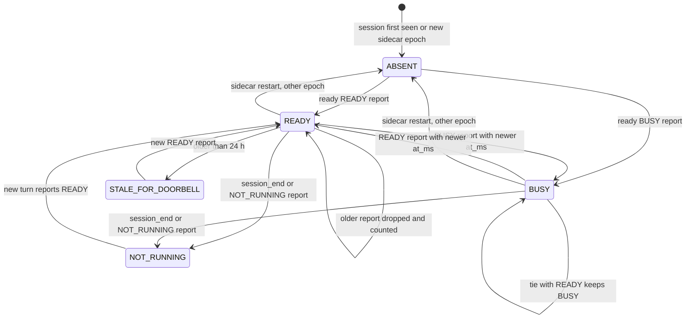

7.1 Text equivalent of D-1.1. 7.1.1 A session starts ABSENT for the doorbell, also after every sidecar restart (new
epoch) and every reboot. 7.1.2 Valid `ready` reports move it between READY and BUSY in the order of the adapter's
`at_ms`; an older report is dropped and counted; a tie between BUSY and READY keeps BUSY. 7.1.3 A session end or a
NOT_RUNNING report makes it NOT_RUNNING until a new turn reports READY. 7.1.4 A READY older than 24 h is stale for the
doorbell until a new report. 7.1.5 Only READY with the current epoch opens AL-5's condition (b).

**Drawing D-1.2 — the ring schedule of one session (state machine, AL-7)**

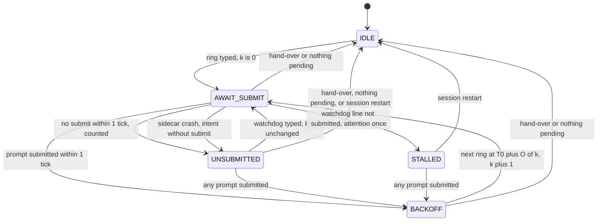

7.2 Text equivalent of D-1.2. 7.2.1 IDLE rings when AL-5 allows and moves to AWAIT_SUBMIT with k = 0. 7.2.2 A submit
within one tick moves to BACKOFF; none moves to UNSUBMITTED and is counted (H-11 (e)). 7.2.3 In UNSUBMITTED no normal
ring happens; any submit moves to BACKOFF; a watchdog line moves back to AWAIT_SUBMIT. 7.2.4 From BACKOFF the next ring
waits until tick T0 + O(k) (0, 4, 12, then every 20 ticks). 7.2.5 A hand-over or an empty pending set returns to IDLE
from any state; a session restart clears UNSUBMITTED. 7.2.6 After a sidecar crash an intent without a recorded submit is
UNSUBMITTED. 7.2.7 (changed in v0.3 by CR-6.7, CR-6.8) A watchdog line may be typed from any state but STALLED and
leaves k unchanged; if a watchdog line is not submitted within one tick the session is STALLED: nothing more is typed
until a prompt is submitted (then BACKOFF) or the session restarts (then IDLE), and one needs-attention entry is
raised. (The drawing shows the watchdog edge from UNSUBMITTED, the case that matters; from IDLE and BACKOFF it is the
same edge.)

**Drawing D-1.3 — the watchdog of one session (state machine, AL-8)**

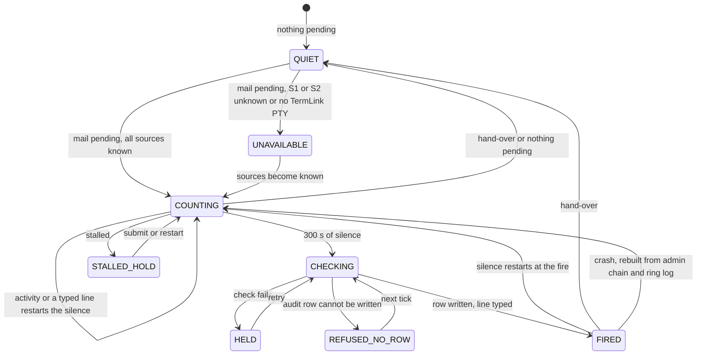

7.3 Text equivalent of D-1.3. 7.3.1 With nothing pending the watchdog is QUIET. 7.3.2 With mail pending it is COUNTING
when every source is known, UNAVAILABLE otherwise (status says so; it never fires blind). 7.3.3 Activity or any typed
line restarts the silence. 7.3.4 After 300 s of silence it CHECKS the kill switch, the foreground, the client input and the veto (which
must be measurable); the drawing labels all of them "a check fails"; a failing check HOLDS with one audit row per kind; an audit row that cannot be written refuses the
fire. (changed in v0.3) It also holds for client input in the last 30 s, read before and after the veto (CR-6.1); on
macOS the veto is the interim `ps` veto (ruling D); only one session of an agent fires per tick (CR-6.27); a STALLED
session is not fired into until a prompt is submitted or it restarts (CR-6.7). 7.3.5 Otherwise the row is written and the line typed (FIRED); silence restarts at the fire. 7.3.6 A hand-over
returns it to QUIET; after a crash the fire and typed-line times are rebuilt from durable logs, so a restart never
shortens the 300 s.

**Drawing D-1.4 — one delivery attempt of a message at the receiver (state machine, AL-6, AL-9)**

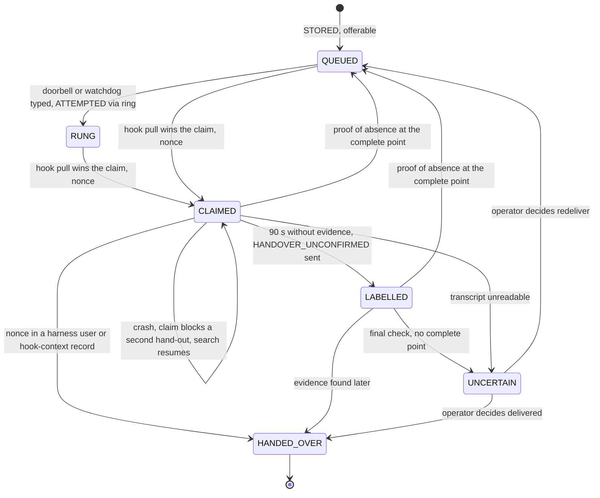

7.4 Text equivalent of D-1.4. 7.4.1 A STORED message is QUEUED. 7.4.2 A typed ring makes it RUNG (ATTEMPTED via the
ring) without handing anything over. 7.4.3 A hook pull that wins the atomic claim makes it CLAIMED with a nonce, from
QUEUED or RUNG. 7.4.4 The nonce in a harness-written user or hook-context record makes it HANDED_OVER. 7.4.5 After
90 s without evidence the sender is told HANDOVER_UNCONFIRMED (LABELLED, still ATTEMPTED); later evidence still makes it
HANDED_OVER. 7.4.6 Proof of absence at the evidence-complete point returns it to QUEUED for a new attempt; no point, or
an unreadable transcript, makes it UNCERTAIN for the operator. 7.4.7 A crash keeps the claim, which blocks a second
hand-out; the evidence search resumes at start.

**Drawing D-1.5 — the main lease in an origin-reporting project (state machine, AL-11)**

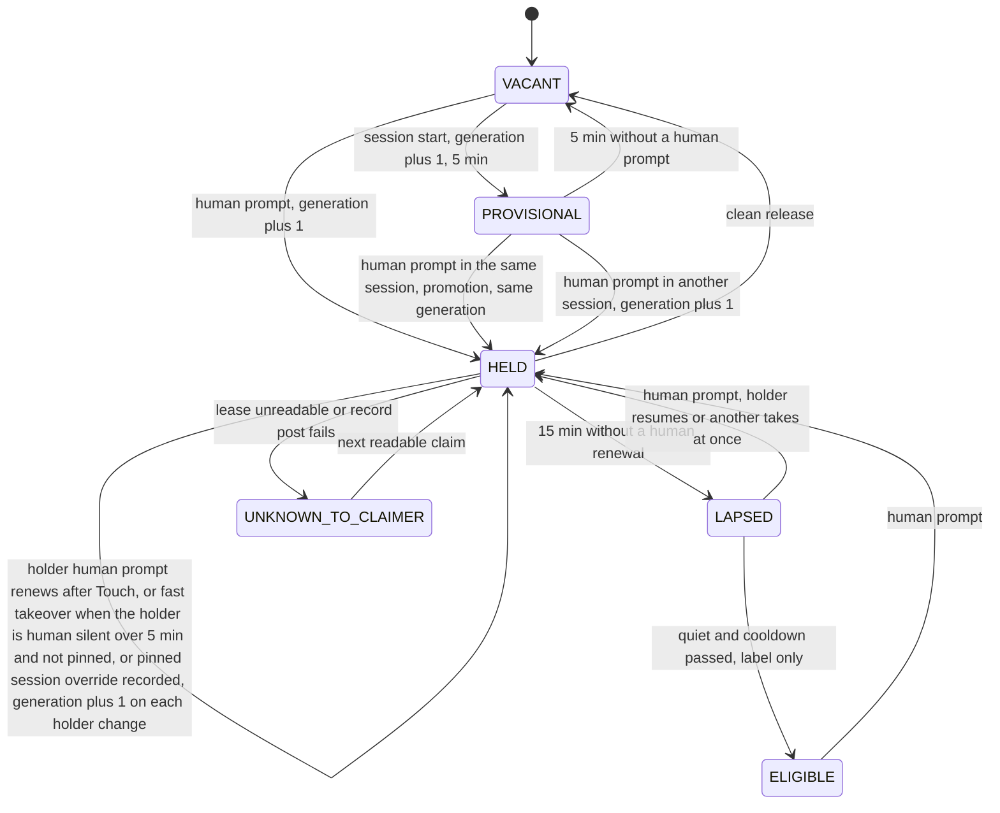

7.5 Text equivalent of D-1.5. 7.5.1 From VACANT a session start takes a 5-minute PROVISIONAL lease (new generation,
no human stamp); a human prompt takes it HELD. 7.5.2 A provisional holder's own human prompt promotes it at the same
generation; another session's human prompt takes it with a new generation; 5 minutes without a human prompt return it
to VACANT. 7.5.3 A HELD lease is renewed only by the holder's human prompts (Touch first, then renew); another session's
human prompt takes it at once when the holder has had no human prompt for over 5 minutes and is not pinned; the pinned
session's claim overrides and is recorded. 7.5.4 15 minutes without a human renewal make it LAPSED; a human prompt then
resumes it (holder) or takes it (another session); ELIGIBLE is only a label for "quiet and cooldown passed". 7.5.5 A
clean release makes it VACANT. 7.5.6 Prompts of origin automated or unknown change nothing (recorded apart). 7.5.7 A
claimer that cannot read the lease or post its record answers unknown and holds nothing.

**Drawing D-1.6 — the waiting-mail signal of one receiver (state machine, AL-13)**

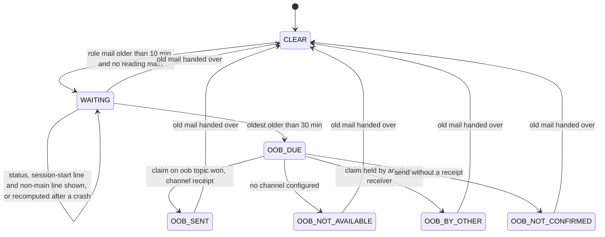

7.6 Text equivalent of D-1.6. 7.6.1 CLEAR becomes WAITING when role mail is older than 10 minutes and there is no
reading main; WAITING shows in status, in the session-start line and once per generation in a non-main session.
7.6.2 When the oldest is over 30 minutes the out-of-band step is due: with the per-project claim won and a channel
receipt it is OOB_SENT; without a channel, OOB_NOT_AVAILABLE; with the claim held by another receiver, OOB_BY_OTHER;
sent without a receipt, OOB_NOT_CONFIRMED; never "sent" without the receipt. 7.6.3 Every state returns to CLEAR only
when the old mail is handed over. 7.6.4 A crash recomputes the state from durable mail ages.

**Drawing D-1.7 — forward-once at the receiving copy Y and at the main X (state machine, AL-14, AL-15)**

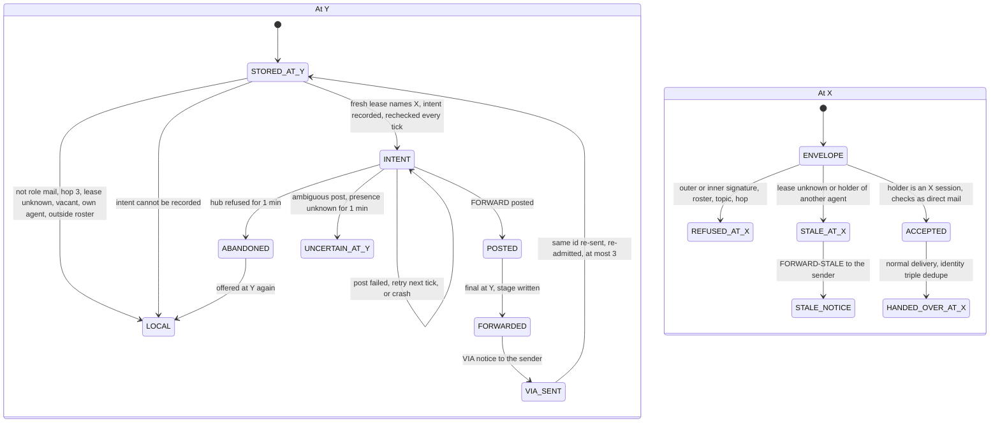

7.7 Text equivalent of D-1.7. 7.7.1 At Y a STORED message stays LOCAL (delivered as before) unless it is role mail of
Y's project, under the hop limit, and a lease read within 15 s names a holder X of another agent in the roster; then Y
records a durable INTENT (if it cannot, the message stays LOCAL). 7.7.2 The FORWARD is POSTED (retried each tick and
after a crash); if it cannot be posted within one minute the forward is ABANDONED and the message is offered at Y again.
7.7.3 After posting, Y marks it FORWARDED (final at Y) and sends the VIA notice. 7.7.3.a (changed in v0.3) A message
that stays LOCAL because the lease was unknown, stale or vacant is re-checked every tick (CR-6.12); a post that failed
ambiguously is FORWARDED only when X's inbox shows it, retried when it shows it absent, and UNCERTAIN for the operator
when neither is known within one minute (CR-6.10); the same id re-sent to Y after FORWARD-STALE is re-admitted to
STORED and decided again, at most three times, then delivered at Y (CR-6.11). At X, a change of generation between two
sessions of X is accepted and recorded; only a holder of another agent makes it STALE (CR-6.13). 7.7.4 At X an envelope with a bad outer
or inner signature, a signer outside the roster, a foreign topic or a bad hop is REFUSED; with X's lease unknown or naming
a holder of another agent (changed in v0.3 by CR-6.13: another generation alone is accepted) it is STALE and the sender gets FORWARD-STALE; otherwise it is ACCEPTED, checked as
direct mail and handed over once.

**Drawing D-2.1 — a doorbell ring and the hand-over (interaction sequence, AL-5, AL-6, AL-9), with the fails-closed paths**

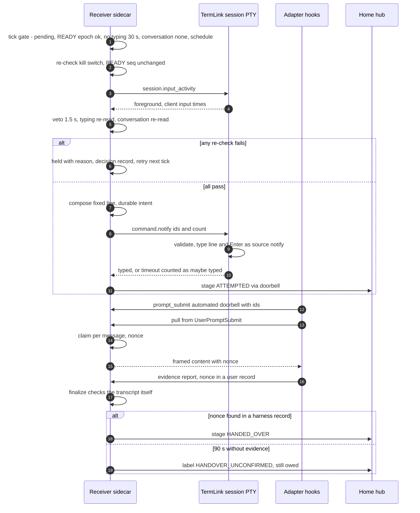

7.8 Text equivalent of D-2.1. 7.8.1 At a tick the receiver sidecar evaluates the gate (pending mail, READY with the
current epoch, no typing for 30 s, no conversation, the schedule). 7.8.2 Immediately before typing it re-checks the kill
switch and the READY sequence, reads the session's foreground and input times, runs the 1.5 s veto and re-reads typing
and the conversation; any failure holds the ring with a recorded reason. 7.8.3 Otherwise it composes the fixed line,
writes the intent and calls `command.notify`; the session validates and types the line and Enter (counted as `notify`
input); a timeout counts as maybe typed; the stage ATTEMPTED is written. 7.8.4 The adapter reports the submitted line as
automated with its ids, and its UserPromptSubmit hook pulls; the sidecar claims each message with a nonce and returns
the frame. 7.8.5 HANDED_OVER is written only when the finalizer finds the nonce in a harness-written record; after 90 s
without evidence the sender gets the HANDOVER_UNCONFIRMED label and the message stays owed.

**Drawing D-2.2 — a watchdog fire (interaction sequence, AL-8), with the fails-closed paths**

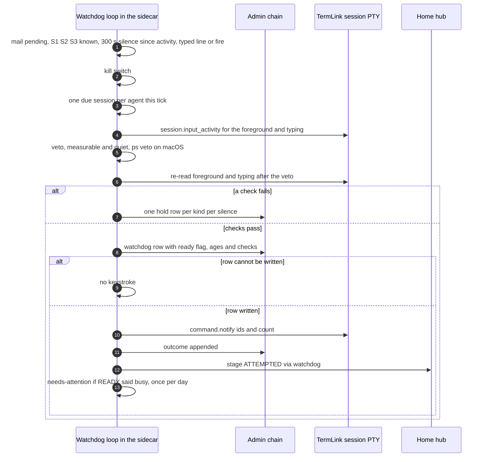

7.9 Text equivalent of D-2.2. 7.9.1 The watchdog loop sees pending mail, all three sources known, and 300 s of silence
since the last activity, typed line or fire. 7.9.2 It checks the kill switch, reads the foreground and the client
input (changed in v0.3 by CR-6.1: no client input in the last 30 s), and runs the veto, which must be measurable and
quiet (on macOS the interim `ps` veto, ruling D), then re-reads the foreground and the client input after the veto
window (CR-6.2); only one due session of an agent is fired per tick (CR-6.27); a failure writes one hold row per kind per silence and types nothing. 7.9.3 Otherwise
it writes the watchdog row (READY flag, ages, checks) to the admin chain first; if that fails nothing is typed. 7.9.4 With
the row written it types through `command.notify`, appends the outcome, writes ATTEMPTED with `via: watchdog`, and raises
a needs-attention entry (once per session per day) when READY said busy.

**Drawing D-2.3 — lease claims with prompt origin (interaction sequence, AL-11), with the fails-closed paths**

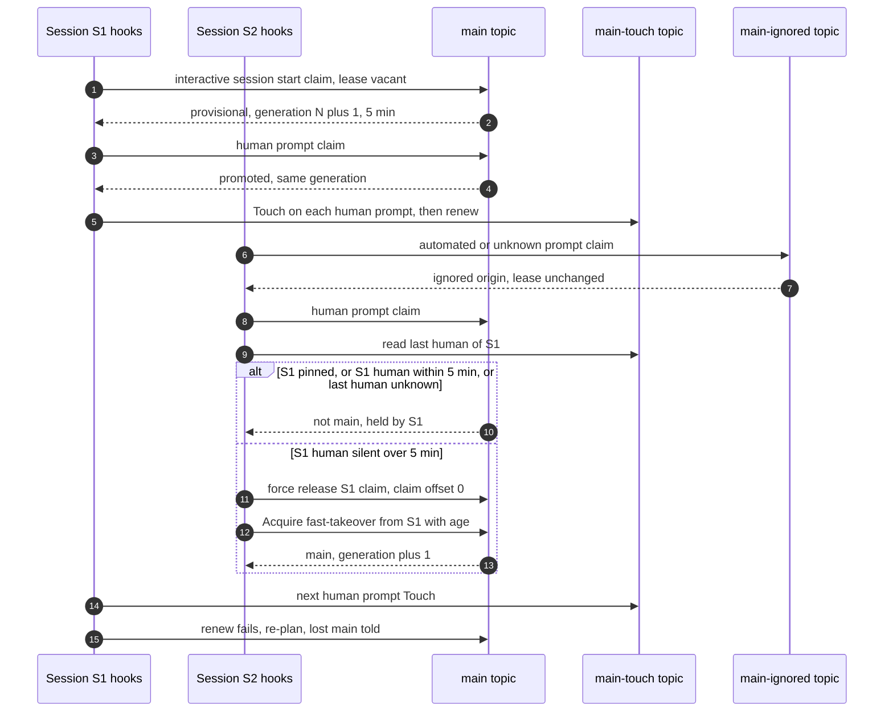

7.10 Text equivalent of D-2.3. 7.10.1 S1's session start (changed in v0.3 by CR-6.5: an interactive session only) takes a vacant lease provisionally (new generation, 5 minutes);
its first human prompt promotes it at the same generation; every later human prompt posts a Touch on the touch topic and
then renews. 7.10.2 An automated or unknown prompt from S2 is recorded on the ignored topic and changes nothing. 7.10.3 A
human prompt from S2 reads S1's last human time: if S1 is pinned, prompted within 5 minutes, or its time is unknown, S2
is told it is not main. 7.10.4 Otherwise S2 force-releases S1's claim, claims offset 0, records the fast takeover with
S1's human age and becomes main at a new generation. 7.10.5 S1's next human prompt posts its Touch, its renew fails, it
re-plans and is told it lost main.

**Drawing D-2.4 — forward-once (interaction sequence, AL-14, AL-15), with the stale and fails-closed paths**

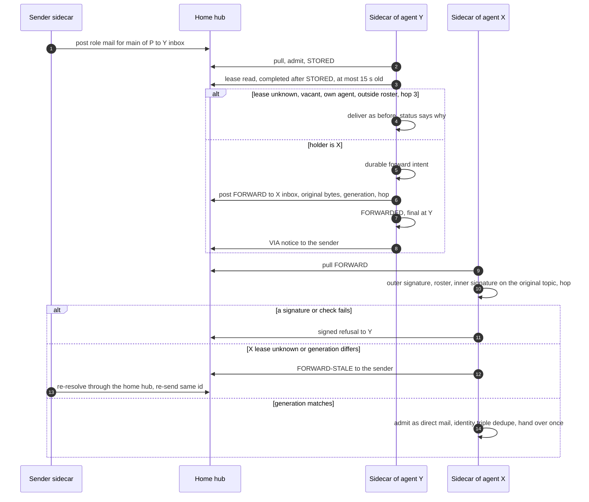

7.11 Text equivalent of D-2.4. 7.11.1 The sender posts role mail to Y's inbox; Y stores it and uses a lease read that
completed after STORED and is at most 15 s old. 7.11.2 If the lease is unknown or vacant, names Y's own agent or an agent
outside the roster, or the hop limit is reached, Y delivers as before and says why. 7.11.3 Otherwise Y records the
intent, posts a FORWARD with the original bytes, generation and hop to X's inbox, marks its copy final and sends the VIA
notice. 7.11.4 X verifies the outer signature, the roster, the inner signature against the original topic and the hop;
a failure is a signed refusal. 7.11.5 With X's lease unknown or at another generation, X sends FORWARD-STALE and the
sender re-resolves and re-sends the same id. 7.11.6 With the generation matching, X admits the inner message as direct
mail and hands it over once.

## 8 Residual risks for the operator (QR-n)

8.1 Nothing accepted earlier is reopened (RR-1..RR-20, RA-1..RA-9, AR-1..AR-6). New or sharpened by the pseudo-code:
8.2 **QR-1** The built lease honours its test seams `TERMLINK_MAIN_TEST_LEASE_MS`, `_QUIET_MS`, `_COOLDOWN_MS` in
production (`main_lease.rs` `Timing::from_env`, no mode gate). A stray variable in a project's hook environment would
shorten main's lease to as little as 1 s. AL-16 closes it in B-25; until then the production scan of 4.8.b can be run
once to show whether any host has one set.
8.3 **QR-2** (closed in v0.3 by CR-6.23: `last_prompt` is persisted with the READY record, AL-1, AL-4) After a
sidecar restart the conversation signal had lost the last prompt; a person mid-conversation was protected only by the
30 s typing veto until their next prompt.
8.4 **QR-3** The prompt origin can be forged by a same-user process calling `termlink main claim --origin human`
directly, outside the hooks (RR-2, AR-6 class). AL-1's override sees only lines the receiver typed and input that came
through `notify` or `inject`. Measured by the share of renewals by basis (E-31), not closed. (changed in v0.3 by
CR-6.4 and the operator's ruling A on F-25 / RQ-3) The receiver now checks every `human` prompt of a PTY session against
its input counters (FCW-195), which closes harness-generated prompts with no client bytes; a same-user process acting
outside the hooks is accepted as a residual until an operator key exists, made visible by the human-claim detector of
evidence CR-5.11 (ARC4 19.7.b), never gated.
8.5 **QR-4** A fast takeover racing the holder's own human prompt is decided in favour of the taker within one RPC round
trip (AL-11 edge 5.11.f.4 (b)); recorded each time; the operator pins to choose.
8.6 **QR-5** (changed in v0.3 by the operator's ruling D on F-20, 2026-11-12) On macOS the watchdog uses the interim
`ps` veto (AL-6 step 4): it fires after 300 s of silence and the 30 s typing re-check unless the harness's tree has a
running child or CPU growth. Blind spot: a job waiting only on network or disk with no child and no CPU is not seen,
and the line arrives as the next prompt (ARC4 AR-7). Status `watchdog: degraded (macOS, ps veto)`. The full veto is
T-3688 and replaces the interim one only once proven. Where neither `/proc` nor `ps` measures, the watchdog never fires
(FCW-41) and a needs-attention entry says so.
8.7 **QR-6** If the touch topic cannot be read, no fast takeover happens (FCW-55); main then moves only by lapse (worst
case 20 min, as built).
8.8 **QR-7** The later-phase algorithms (06b) fix decision logic only; formats and transports wait for gated
sub-designs, and their FCWs must be re-confirmed when those land (marked **[open: gate]**).

## 9 Change requests to earlier steps (requests, not edits)

9.1 **ZR-1 (step 5).** (a) Add specs for the 46 FCWs (changed in v0.3 by CR-6.37: v0.2 said 44) listed in 6.1 that have none, and the 05a table "FCW-n → E-n"
(EV5 14.2), using 6.3 for the AFC mapping. (b) Add a spec for the production seam scan of 4.8.b (an E-101-style L7
check: any `TERMLINK_*TEST*` variable in a production unit environment, the hooks' environment or a running sidecar's
environment fires). (c) E-5's expected table: use 4.2 (one ring then none with a non-submitting adapter; 0, 4, 12, 32,
52, 72, 92, 112 with a submitting adapter that gives proof of absence). (d) E-23 and E-24 stand as written under 4.5.
(e) E-34 (f) "stale (> 15 s read period)": use 4.6 (inclusive 15 000 ms on Y's `mono()`, read completed after STORED,
else a synchronous read).
(f) From the remediation of review r1 (v0.2), the cases step 5 lacks: (f1) FCW-191: extend E-104 (i) so a cancel, a
revoke and an expiry each race a consume of the same APPROVED event in both orders; assert exactly one of CONSUMED or the
final state, never CONSUMED after a final state, and no effect applied after a final state (mutant: the state check
outside the event lock turns it red). (f2) FCW-192: N concurrent starts under a grant with budget B < N; assert exactly B
use rows and B starts (mutant: check and append as two steps). (f3) FCW-193: revoke and expire a grant between the
local check and the hub's reserve; assert no use row and no start. (f4) FCW-172: the hub unreachable at the reserve;
assert no start. (f5) FCW-194 and AL-44 crash rows (a)..(e): kill the executor at each point (after the consume commit
with no dispatch row included); assert one effect, DONE or FAILED only from a post-condition read, no FAILED for an
effect never applied, and OUTCOME_UNKNOWN with no third apply when two applies left no effect.
9.2 **ZR-2 (step 4, ARC4 6.9.2).** Reword "READY re-read and its age ≤ 1 tick" as: "the READY record re-read is still
READY with the same sequence number and the current sidecar process, and the re-checks were made at most 1 tick
before the keystrokes" (4.3). The literal reading would never ring an agent idle for more than 30 s.
9.3 **ZR-3 (step 4, ARC4 6.13, D-4 (b)).** (a) A provisional take raises the generation (it is a holder change); a
promotion in the same session keeps it (4.5). (b) `last_human_at` is not a field of the claim row (renewals cannot change
the claimer string, `main_lease.rs`): it is the newest human-counted Acquire, Promote or Touch record, with Touch and
Ignored records on their own topics `main-touch:<project>` and `main-ignored:<project>` so they can never push lease
records out of the newest-1000 retention. (c) "The hub counts a claim" means the claimer's logic over the hub's claim
primitives, as built; no hub code changes.
9.4 **ZR-4 (step 4, ARC4 6.9.7.b).** The watchdog holds when the activity veto cannot measure (FCW-41, QR-5); OQ-16 D 3
(no veto when unmeasurable) stays for the normal ring only. The watchdog types without READY, so the veto is its only
evidence that the agent is not working.
9.5 **ZR-5 (step 4, ARC4 6.1.4).** Fix the signing-key fingerprint form as `ed25519:` + lower-case hex SHA-256 of the
32-byte public key (06a AL-18).
9.6 **ZR-6 (step 4, ARC4 6.4.3, 6.4.5).** Record the wrapper header `TLBLOB`, format version 1, algorithm id 1
(XChaCha20-Poly1305 with an X25519 sealed box), and the associated data `termlink.blob/1\n<recipient>\n<plain_sha256>`
(06a AL-26) as the decision behind "the wrapper's magic and version". (Superseded in v0.3 by CR-6.14: format version 2, associated data over the immutable
envelope fields with `to` verbatim, 06a AL-26 and ARC4 6.4.3.a.)
9.7 **ZR-7 (step 4, ARC4 17.2, 17.5.a).** (a) A `prompt_submit` with basis `doorbell` SHOULD carry `doorbell_ids`, the
ids parsed from the submitted line; AL-7 (unsubmitted-line tracking), AL-9 (stray count) and AL-1 (origin override) use
them. (b) The receiver orders `ready` reports by `at_ms` and drops an older one; a BUSY/READY tie keeps BUSY (FCW-3).
9.8 **ZR-8 (step 4, ARC4 7.2, 7.3).** (a) Forward-once's lease freshness as 4.6. (b) At X, an unknown lease is answered
with FORWARD-STALE like a generation mismatch (FCW-75); 7.3 names only the mismatch.
9.9 **ZR-9 (step 4, ARC4 6.2.3).** `revocation.head` returns a **signed** head (schema `termlink.revocation-head/1`,
06a V-HEAD-1). An unsigned head would let a party able to answer for the hub say "unchanged" and hide a new revocation
behind it; with the signature the head costs about 250 bytes instead of 100.
9.10 **ZR-10 (step 4, ARC4 22 B-25).** Add to B-25's deliverable: the lease's test seams honoured only in a test estate,
refused (unknown, exit 2) elsewhere (AL-16, QR-1).
9.11 YR-4 of step 5 lapses (4.10).

## 10 Completion conditions (card 7) and the T-3355 criteria

10.1 **Card 7.1, every algorithm in scope in the full form 4.a to 4.h.** AL-1 to AL-16 here, AL-17 to AL-40 in 06a,
AL-41 to AL-53 in 06b: each has SERVES, PROBLEM and APPROACH, ALGORITHM, INVARIANTS, FAILS CLOSED WHEN, EDGE CASES,
EXECUTION SEMANTICS and CRYPTOGRAPHY, plus OBS. Where a part is empty for a stateless algorithm it says so ("none",
"pure"). The card's approval-broker minimum (canonicalise and hash, verify an approval, check a grant, the ticket state
machine with timeout, cancel and revoke, execute once and record, post-condition, revocation, break-glass) is AL-41 to
AL-44, AL-46, AL-50, and AL-21, AL-22, AL-45 for revocation. Canonicalisation has test vectors (06a 2.4.c.1, 06b
2.1.c.1, and the SI-1 line vector 5.6.c.1).
10.2 **Card 7.2, every FAILS CLOSED WHEN handed to the evidence specialist.** Section 6: 211 FCWs since v0.3 (194 in v0.2) (v0.2: FCW-191..FCW-194 added
by the r1 remediation), each with the AFC it refines or `new`, and an E-n or ZR-1; the 46 without a spec are ZR-1 (a),
and the cases of the four new ones that step 5 lacks are ZR-1 (f).
10.3 **Card 7.3, concurrency and crash cases for every state-changing step.** Every algorithm has, in its part f, a
crash table or crash item, and every algorithm that changes state also has a concurrency item that names what orders
or serialises its writers (v0.2, review r1 F-4; v0.1 left AL-36, AL-37, AL-45, AL-49..AL-52 and others with a crash
statement only). 10.3.a **Concurrency item with the lock or ordering named:** AL-1..AL-11, AL-13..AL-17, AL-21..AL-24,
AL-26, AL-27, AL-30, AL-31, AL-33, AL-35..AL-37, AL-40, AL-42..AL-53 (AL-43 and AL-46 decide in one conditional step at
the hub; AL-44 recovery runs before new work). 10.3.b **Explicit single writer, with what serialises it:** AL-18 (hub
start, sidecar start, `store.lock`), AL-32 (the session process, append-only log), AL-34 (runme, per-project lock),
AL-38 (the driver's run lock), AL-39 (the sidecar process, append-only admin log); read-only views with one producer
that replaces them whole: AL-12, AL-29. 10.3.c **No state-changing step** (pure or stateless checks): AL-19, AL-20,
AL-25, AL-28, AL-41.
10.4 **Card 7.4, drawings D-1 and D-2 with ids, captions and text equivalents, rendering without error.** Section 7
(index 7.0), 06a section 3, 06b section 3; render check section 11.
10.5 **T-3355 agent criteria.** Version table and inputs of record with hashes: sections 0 and 1. Pseudo-code for each
component of the step-4 architecture, reconciled with step 5: K-9a AL-17/18, K-9b AL-21/22, K-10 AL-36, K-11 AL-23/24,
K-12 AL-37, K-13 AL-26..28, K-14 AL-35, K-15 AL-30..34, K-16 AL-29, K-17 AL-38, K-18 AL-6 (veto) and AL-9, K-19 AL-5..7,
K-20 AL-39, K-21 (the canary is a scheduled run of E-78 with no decision logic of its own beyond AL-40's gate data),
K-22 AL-11/12, K-23 AL-14/15, K-24 AL-25, K-25 AL-19, K-26 AL-45, K-27 AL-41..44, K-28 AL-47, K-29 AL-48, K-30 AL-52,
K-31 AL-51, K-32 AL-1..4, K-33 AL-8, K-34 AL-13; K-1..K-8 are built and appear where an algorithm uses them (kill switch
AL-10, drain AL-40, supervisor through the heartbeat field of AL-29). Reconciliation with step 5: every algorithm names
the E-n that test it (in its FCWs) and the step-5 questions are answered in section 4.

## 11 Render check of the drawings

11.1 Method as steps 2 to 5: each Mermaid block of the three files is extracted under its `Drawing D-n` caption and
rendered with `mmdc -p <puppeteer config> -i <block>.mmd -o <block>.svg`, config
`{"executablePath":"/usr/bin/chromium","args":["--no-sandbox"]}`; the script also refuses a `;` in any sequence
block and asserts that every Mermaid block has a caption. Script `.context/working/t3355/render/r1.sh`, result
`.context/working/t3355/render/r1.out`. No `render_check` record (the checker is not adopted, profile P4.5).
11.2 Result, 2026-11-11, on v0.1: 21 blocks (06: D-1.1..D-1.7, D-2.1..D-2.4; 06a: D-1.8..D-1.11, D-2.5, D-2.6; 06b:
D-1.12, D-1.13, D-2.7, D-2.8), every one exit code 0, a non-empty SVG, no "syntax error" or "parse error" in any log or
SVG. Script exit code 0.
11.3 Read as PNG: D-1.5 and D-2.1. In the first render of D-1.5 the three HELD self-loops collapsed into one visible
label (the behaviour step 4 met in its D-4); they were merged into one labelled loop, as were the two self-loops of
D-1.6 (WAITING) and D-1.13 (LIVE); a check now refuses any state with more than one self-loop. The re-render shows every
transition of D-1.5 labelled, and D-2.1 shows the four participants, the hold path and both evidence outcomes legibly.

11.4 **v0.2 re-render (review r1 remediation).** Script `.context/working/t3355/render/r2.sh` (the r1 method, output in
`.context/working/t3355/render/r2/`, result `.context/working/t3355/render/r2.out`), which adds the self-loop check of
11.3 as code (it refuses a state with more than one self-loop). 23 blocks: the 21 of 11.2 plus 06a D-1.14 (AL-35) and
D-1.15 (AL-36); the changed D-1.12 and D-2.7 labels (AL-43) are among them. Every one exit code 0, a non-empty SVG, no
syntax or parse error; script exit code 0. Read as PNG: D-1.14 and D-1.15. D-1.14's first two layouts overlapped two
labels near LOST_AFTER_STORED; it is now drawn left to right with short labels (the text equivalent 06a 3.7 carries the
full conditions), and every label reads clearly.

11.5 **v0.3 re-render (step 7 fold, T-3689).** Script `.context/working/t3689/render.sh` (same mmdc method), output in
`.context/working/t3689/render06/`, `render06a/`, `render06b/`. Changed blocks: 06 D-1.2 (STALLED), D-1.3 (STALLED_HOLD,
typing check, labels shortened), D-1.7 (ambiguous post to UNCERTAIN_AT_Y, re-admit, holder-agent check at X), D-2.2
(typing check and re-reads, `ps` veto), D-2.3 (interactive session start); 06b D-1.12 (CONSUMED age bound). All 23
blocks exit code 0, a non-empty SVG, no syntax or parse error; no `;` in any sequence block and no state with more than
one self-loop. Read as PNG: D-1.2, D-1.3, D-1.7 and D-1.12. D-1.3's first two layouts overlapped the HELD labels; the
labels were shortened ("check fails", "retry"; the text equivalent 7.3 names every check) and now read clearly.
