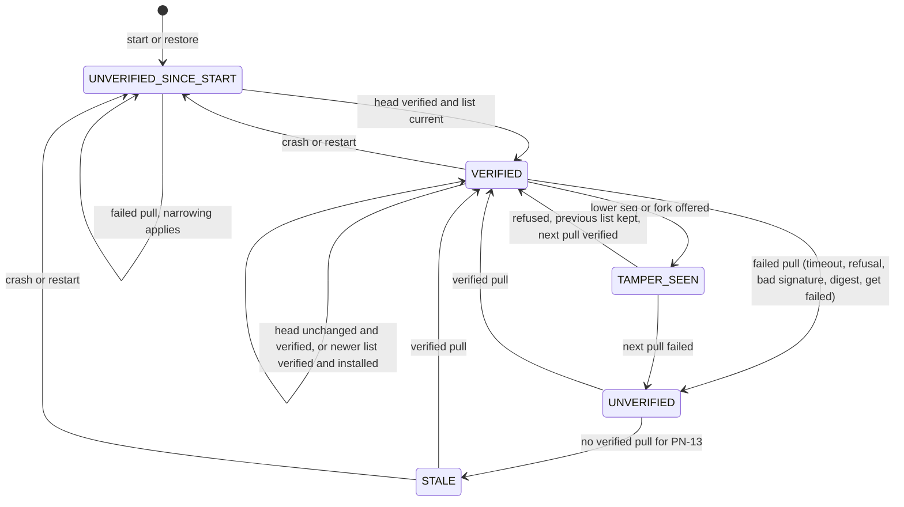
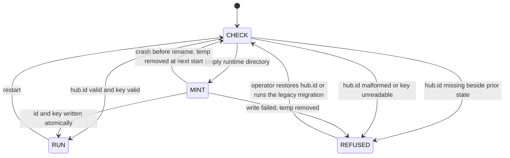
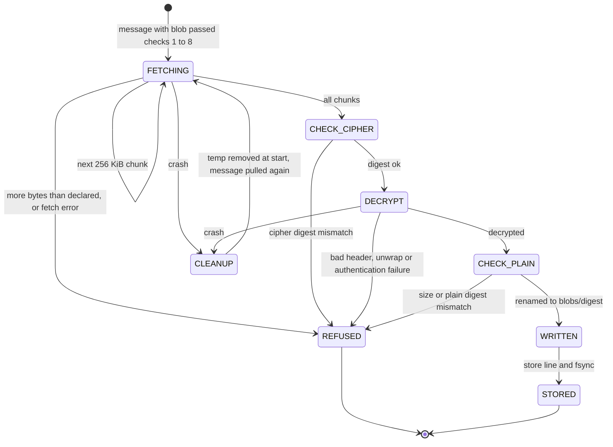
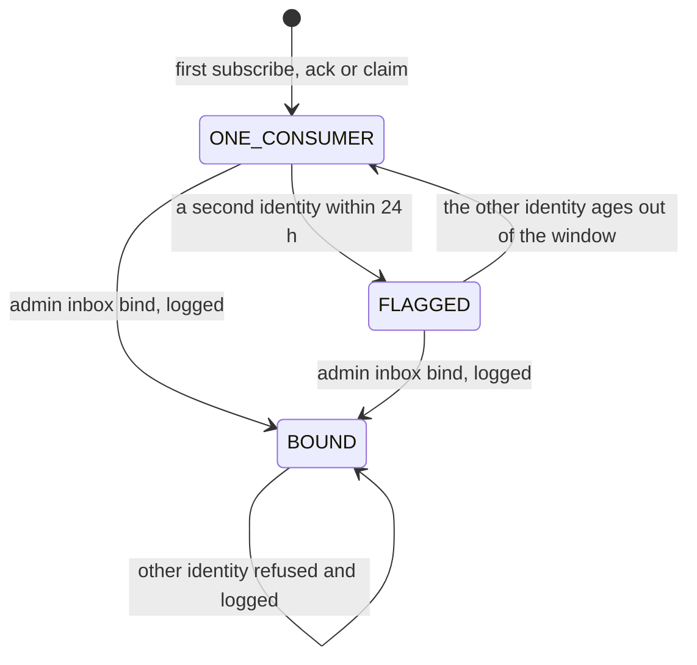
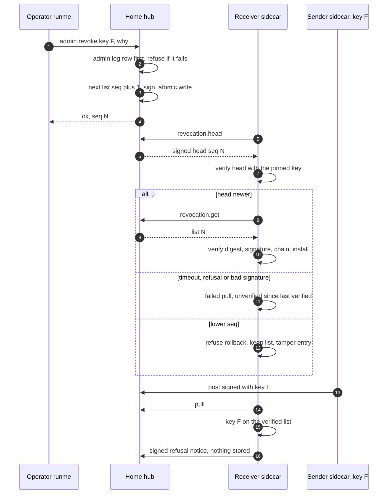
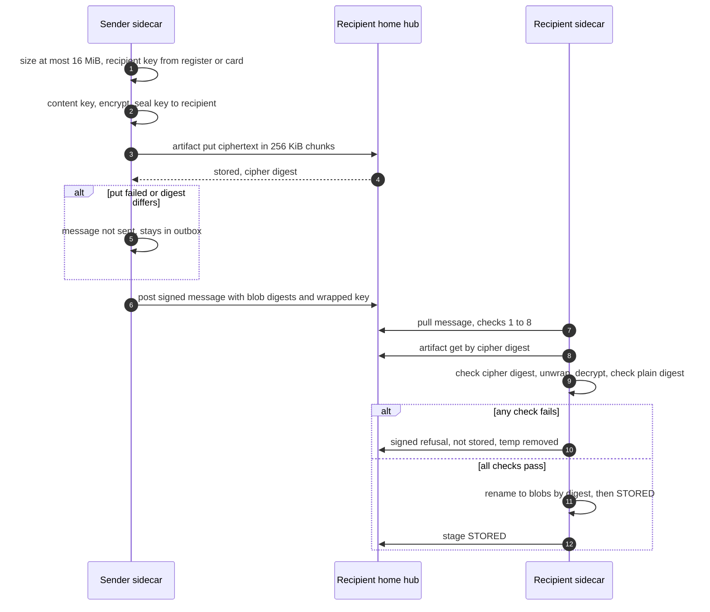

# Interactive agent communication: step 6, pseudo-code, part A: PH-2 hardening

**Task:** T-3355 · **Arc:** arc-011 · **Chain:** arc-011-design, step 6 · **Role:** pseudo-coder
**Status:** DRAFT v0.1, sub-document of `docs/design/interactive-agent-communication-06-pseudo-code.md` ("06"). Read
06 sections 2 and 3 first: identifiers, the algorithm form a..h, clocks, primitives, strict JSON and the seam gate
are defined there and not repeated. The FAILS CLOSED WHEN register for this file is 06 section 6.
**Review link:** none (profile P2.1).

## 0 Version history

| Version | Date | Change | Task |
|---|---|---|---|
| 0.1 | 2026-11-11 | First draft: AL-17..AL-40 (B-1..B-15, B-18, B-21..B-23, B-26 and the task rows P12, P14); test vectors V-REV-1, V-REV-2, V-HEAD-1, V-FWD-1; drawings D-1.8..D-1.11, D-2.5, D-2.6. | T-3355 |

## 1 Scope and inputs

1.1 Inputs of record: 06 section 1 (same bytes, same hashes); nothing else was read for this part.
1.2 Order follows the build table's dependency order (ARC4 22): B-1, B-5 (revocation), B-7 (caps), B-11..B-13 (keys and
blobs), B-14 (status), B-2..B-4, B-6 (hub changes), B-10 (reconciliation), B-8, B-9 (task rows), B-15 (injectors),
B-18, B-26 and the wave actions.

## 2 Algorithms

### 2.1 AL-17 — Hub id: mint once, keep, refuse a silent re-mint (K-9a; ARC4 6.1.1..6.1.3, 6.1.6; B-1; DR-1)

2.1.a **SERVES:** R-61, R-54, R-33; FX-2; TH-3; AFC-20.
2.1.b **PROBLEM:** the id is derived from the TLS fingerprint on every call **[B]** (`tls.rs:48`), absent without
`--tcp`, and changes when the certificate changes. **APPROACH:** read a stored id; mint only into an empty runtime
directory; derive from the certificate once for legacy hubs so no inbox is renamed.
2.1.c **ALGORITHM:**
```text
hub_start(runtime_dir):
 1  prior = exists(hub.secret) or exists(hub.cert.pem) or exists(hub.signing.key) or any topic log
 2  if exists(hub.id):
        s = read(hub.id) stripped of one trailing newline
        if not s matches ^[0-9a-f]{16}$: refuse("hub.id unreadable or malformed")                          # FCW-80
        HUB_ID = s
    elif prior and not exists(hub.id):
        refuse("hub.id missing beside existing state; restore it or re-home (runme)")                      # FCW-79
    else:                                   # an empty runtime directory: first start
        HUB_ID = first16(sha256 fingerprint of hub.cert.pem) if a certificate will exist, else hex(random 64 bits)
        atomic_write(hub.id, HUB_ID + "\n", mode 0644); Err -> refuse, remove the temp file                   # FCW-81
 3  hub.version returns hub_id = HUB_ID (never recomputed), signing_key = "ed25519:" + fpr(signing pub)    # AL-18
legacy migration (one runme action per hub, Δ): a hub with prior state and no hub.id writes
    hub.id = first16(current TLS fingerprint) once, logged, then restarts       # the only path past FCW-79
```
2.1.d **INVARIANTS:** (1) `hub_id` is constant for the life of a runtime directory; (2) a certificate rotation
changes neither `hub_id` nor the signing key; (3) a hub never answers with an id it did not read from `hub.id`.
2.1.e **FAILS CLOSED WHEN:** 2.1.e.1 **FCW-79** [AFC-20; E-36] `hub.id` is missing while the runtime directory holds
prior hub state → the hub refuses to start with the stated message. 2.1.e.2 **FCW-80** [AFC-20; E-36] `hub.id` is
unreadable or not 16 lowercase hex → refuse to start. 2.1.e.3 **FCW-81** [new; ZR-1] the mint cannot be written
atomically → refuse to start, no partial file left.
2.1.f **EDGE CASES:** (1) volatile `/tmp` (PL-021): the whole directory is gone, so the hub mints a new id; senders
refuse it (FX-2) and status names both ids: loud, not silent (E-80 control); (2) altered `hub.id` (edited by root):
accepted as the hub's id; clients pinned to the old id refuse it (FX-2), which is the detection; (3) concurrency: two
hubs started on one runtime directory: the built PID/socket lock refuses the second **[B]**; (4) crash table:

| Crash between | State after restart | Recovery |
|---|---|---|
| temp written and rename | no `hub.id`, a temp file, and (first start) no prior state | the temp is removed; mint again |
| rename and directory fsync | `hub.id` may be missing after power loss | first start: mint again (no prior state yet); otherwise FCW-79 asks the operator |

2.1.g **EXECUTION SEMANTICS:** once per runtime directory. 2.1.h **CRYPTOGRAPHY:** SHA-256 of the DER certificate for
legacy ids (as `tls.rs` today **[B]**); otherwise 64 bits from the OS CSPRNG.
**OBS:** OBS-34 `hub.version` reply; OBS-35 the refusal text in the hub journal.

### 2.2 AL-18 — Hub signing key and the sidecar's pin (K-9a; ARC4 6.1.4, 6.1.5; B-1; DR-2)

2.2.a **SERVES:** R-61, R-75; SI-11, SI-25; TH-26, TH-58; AFC-20; AR-1.
2.2.b **PROBLEM:** the revocation list, dead letters and (later) roster records need a signer that is not the TLS key
and a verifier that notices a swap. **APPROACH:** an ed25519 key persisted like the secret; each sidecar pins its
fingerprint at first verified contact (TOFU, DR-2) and refuses a different one.
2.2.c **ALGORITHM:**
```text
hub_start: if not exists(hub.signing.key): (first start only, same rule as AL-17 step 2) generate ed25519; atomic_write 0600
           k = read(hub.signing.key); require mode 0600, owner = hub user, 32-byte seed      else refuse            # FCW-82
sidecar, on each hub contact that returns hub-signed data or hub.version:
 1  f = hub.version.signing_key
 2  if store.pin(HUB_ID) is none:
        if contact is over the local hub socket or TLS with the pinned certificate (TOFU pin, built [B]):
            store.pin(HUB_ID) = f; admin_row(hub-key-pinned, f); attention("hub signing key pinned", f)
        else: do not pin; treat hub-signed data as unverified                                                       # FCW-84
 3  elif f != store.pin(HUB_ID):
        refuse every hub-signed object; status hub.signing_key = mismatch {pinned, offered};
        attention("hub signing key changed", both fingerprints, coalesce = day)                                     # FCW-83
replacement in PH-2: runme action on the hub host (new key, signed by the old key), then on each sidecar host a runme
action that re-pins with the operator's typed-back fingerprint suffix; both logged (SI-24)
```
2.2.d **INVARIANTS:** (1) the private key never leaves the hub's runtime directory and is never printed (SI-25);
(2) a sidecar accepts hub-signed data only under its pin; (3) a pin changes only by a runme action.
2.2.e **FAILS CLOSED WHEN:** 2.2.e.1 **FCW-82** [AFC-20; E-37] the key file is unreadable, has another mode or owner,
or is malformed → the hub refuses to start. 2.2.e.2 **FCW-83** [AFC-20; E-37] the offered fingerprint differs from the
pin → every hub-signed object is refused; needs-attention names both. 2.2.e.3 **FCW-84** [new; ZR-1] first contact is
neither the local socket nor TLS under the pinned certificate → no pin; hub-signed data stays unverified.
2.2.f **EDGE CASES:** (1) a rogue key at first contact is pinned (AR-1, limit probe E-37); (2) a certificate rotation
does not touch the key; (3) crash: generation and write are one atomic write; a crash leaves no key and the next start
generates (first start only); (4) concurrency: single writer per object: the key is generated only by the hub
process at its start, before it accepts connections; the pin is written only by the sidecar's start, before its tick
loop runs; a second sidecar on the same store is refused by `store.lock` (06 3.2.a) **[B]**, so no two writers meet.
2.2.g **EXECUTION SEMANTICS:** none beyond the pin write (idempotent). 2.2.h **CRYPTOGRAPHY:** ed25519 (RFC 8032), the
fingerprint is `ed25519:` + hex SHA-256 of the 32-byte public key **[P]** (ARC4 6.1.4 says `ed25519:<fingerprint>`
without fixing the hash; SHA-256 matches the TLS pin's form; ZR-5).
**OBS:** OBS-36 status `hub.signing_key {pinned, offered, state}`; OBS-37 admin rows `hub-key-pinned`.

### 2.3 AL-19 — Mail-hub declaration check (K-25; V-7; ARC4 6.7.1, 9.10; B-1; DR-7)

2.3.a **SERVES:** R-54, R-61; FX-2; TH-3; BP-8; AFC-21.
2.3.b **PROBLEM:** a sidecar must post only to the hub the project declared. **APPROACH:** compare the project file,
the sidecar's copy and the answering hub at start and every tick; no fallback.
2.3.c **ALGORITHM:**
```text
start:
 1  d1 = .framework.yaml mail_hub {id, address}; d2 = sidecar config mail_hub
    if d1 missing or d2 missing or d1 != d2 (both fields, exact): refuse start, reason names both          # FCW-85
 2  r = hub.version at d1.address (timeout 10 s)
    if Err: start in state HUB_UNVERIFIED: receive nothing, post nothing, status hub.match = unknown           # FCW-87
    elif r.hub_id != d1.id: refuse start; status hub {declared: d1.id, answering: r.hub_id, match: false}       # FCW-86
every tick: repeat 2; a mismatch stops posting and pulling at once and raises attention (fault injector 5)
```
2.3.d **INVARIANTS:** no message is posted to or pulled from a hub whose `hub_id` is not the declared one.
2.3.e **FAILS CLOSED WHEN:** 2.3.e.1 **FCW-85** [AFC-21; E-38] the declaration is missing in either place, or the two
differ → refuse to start. 2.3.e.2 **FCW-86** [AFC-21; E-38] the hub at the declared address answers another `hub_id` →
refuse (start) or stop (tick). 2.3.e.3 **FCW-87** [AFC-21; ZR-1] the hub cannot be reached at start → the sidecar
runs without posting or pulling until the id is verified.
2.3.f **EDGE CASES:** (1) the declaration names the wrong hub on purpose (who wrote the file): not detectable (ARC4 15
K-25); (2) DNS or address changes: the id check is what binds; (3) crash: stateless.
2.3.g **EXECUTION SEMANTICS:** none. 2.3.h **CRYPTOGRAPHY:** none beyond the TLS pin of the transport **[B]**.
**OBS:** OBS-38 status `hub {id, declared, match}` each tick.

### 2.4 AL-20 — Canonical form, digest and signature of signed hub state (ARC4 6.2.1; FP 10.3.2.c; test vectors)

2.4.a **SERVES:** SI-11, SI-12, SI-21, SI-3 (envelopes); TH-26, TH-58; AFC-22.
2.4.b **PROBLEM:** a signed JSON object must verify identically whatever its byte encoding, and a signature made for one
purpose must not verify for another. **APPROACH:** RFC 8785 (JCS) on a restricted value set, SHA-256 of the canonical
bytes, ed25519 over a domain-separated string `<schema>\n<hex digest>`.
2.4.c **ALGORITHM:**
```text
canonical(obj):
 1  obj passes strict JSON (06 3.3): UTF-8, no duplicate keys, depth <= 8, size <= 1 MiB, numbers only integers in
    [-(2^53-1), 2^53-1] (no fraction, exponent or -0)                                                         # FCW-88
 2  remove the fields "digest" and "signature" from the top level
 3  serialise by RFC 8785: object members sorted by UTF-16 code units of their names, no insignificant whitespace,
    strings with the minimal JSON escapes (\" \\ \b \f \n \r \t, other controls \u00xx lower-case), integers in
    shortest decimal form
digest(obj)  = lower-case hex SHA-256 of canonical(obj)
sign(k, obj) = ed25519_sign(k, utf8(obj.schema + "\n" + digest(obj)))
verify(pub, obj):
 1  require obj.digest == digest(obj)                     # recomputed, never trusted from the object
 2  require ed25519_verify(pub, utf8(obj.schema + "\n" + obj.digest), obj.signature)                            # FCW-89
```
2.4.c.1 **Test vectors** (computed by `.context/working/t3355/vectors.py`; public RFC 8032 test key 1, public key
`d75a980182b10ab7d54bfed3c964073a0ee172f3daa62325af021a68f707511a`; never an estate key):

| Id | Input | Expected |
|---|---|---|
| V-REV-1 | revocation list, `seq` 7, one entry (fields below) | canonical 436 bytes, digest `044cfb1cf8c79cc60832cce9145895ff1bca2338d28c447823e687a3b6fe5767`, signature `02739ad55f80d54104dc59466efe9671ec5493df329023a71468926f193f76f6173b449790f2836e57af6bfc7ef8699c6f2f28f38a718846b4d4a0c8b2c7830e` |
| V-REV-2 | the same object with keys reordered, spaces added and `claude-termlink-alt` | canonical bytes and digest equal to V-REV-1 |
| V-HEAD-1 | revocation head `{schema: termlink.revocation-head/1, hub_id, seq: 7, digest: <V-REV-1 digest>}` | canonical 151 bytes, digest `cc363257e39103a2d922e6ec0000810659449f3c0098e0471ab8c9932f2b24dd`, signature `ea99514e54465969c9ff89430be6a72c3cde1a4e2bdaaa2a2c53f7db5ac44eedc70257e8c8d06b8336b0376f7f798a27daf215292901a0548fc20d98934c8202` |
| V-FWD-1 | forward envelope (06 AL-14), generation 12, hop 1 | canonical 320 bytes, digest `7a7e9bf16ae3f54de6f1007b0ec917cac6f613c9dd5ce7eed6e9a38764af421d`, signature `29495852a7b15ef34240f9471f42f49ae3c3090e76cd37eb0a0277cbbff3d0b0ffc471503e8b9839a5cd2abd9431e5ae31a9add9b6b812014b117ce834dcdc0a` |
| V-NEG-1 | V-REV-1 with `"seq":7.0`, or `"seq":7e0` | refused at step 1 (FCW-88), never hashed |
| V-NEG-2 | V-REV-1 with `"seq"` twice | refused (duplicate key) |
| V-NEG-3 | V-REV-1 signed over the bare digest (no `termlink.revocation/1\n` prefix): signature starting `3b0af0c2379828c0e02d6a1ee48ffa95` | does not verify (FCW-89) |
| V-NEG-4 | V-REV-1 with `seq` 9007199254740992 (2^53) | refused (out of range) |

2.4.c.2 V-REV-1's canonical bytes, exactly: `{"entries":[{"agent":"claude-termlink-alt","by":"operator","event":
"admin-revoke","key":"ed25519:3b6a27bcceb6a42d62a3a8d02a6f0d73653215771de243a63ac048a18b59da29","project":
"010-termlink","reason":"key exposed","revoked_at":1762862399000,"scope":"agent_key"}],"hub_id":"cacc73ea32b121dd",
"issued_at":1762862400000,"prev_digest":"0000000000000000000000000000000000000000000000000000000000000000","schema":
"termlink.revocation/1","seq":7}` (shown wrapped; no whitespace or newline in the bytes).
2.4.d **INVARIANTS:** (1) two objects verify the same iff their canonical bytes are equal; (2) a signature for schema A
never verifies as schema B (the schema is the domain prefix).
2.4.e **FAILS CLOSED WHEN:** 2.4.e.1 **FCW-88** [AFC-22; E-42] a number that is not an integer in range, a duplicate
key, invalid UTF-8, depth over 8 or size over 1 MiB → refused before hashing. 2.4.e.2 **FCW-89** [AFC-22; E-42] the
digest does not recompute, or the signature is not over `<schema>\n<digest>` with the expected key → refused.
2.4.f **EDGE CASES:** (1) Unicode normalisation is **not** applied (RFC 8785 does not), so `é` precomposed and
decomposed are different objects; producers emit what they mean, verifiers compare bytes; (2) keys outside the BMP sort
by UTF-16 code units, not by code point (RFC 8785 3.2.3); no schema here uses such keys; (3) stateless.
2.4.g **EXECUTION SEMANTICS:** pure. 2.4.h **CRYPTOGRAPHY:** SHA-256, ed25519 (RFC 8032, pure, no pre-hash); the
algorithm is pinned by the schema version (`termlink.revocation/1`); a new algorithm needs a new schema version.
**OBS:** none (pure); the vectors are the fixture of E-42.

### 2.5 AL-21 — Issuing a revocation at the hub (K-9b; ARC4 6.2.1, 6.2.2; B-5; OQ-h A)

2.5.a **SERVES:** RK-1, SI-11, SI-24; TH-26, TH-34, TH-56; AFC-22.
2.5.b **PROBLEM:** revoke an agent key by the operator or by the agent's own old key, as numbered signed state.
**APPROACH:** one serialised writer on the hub: log, build the next list, sign, persist atomically, then answer.
2.5.c **ALGORITHM:**
```text
revoke(req):                       # admin revoke --key F --why W (root-only local socket), or revocation.request
 1  if req is a revocation.request:
        require verify(F.pub, req) where the request is canonical {schema: termlink.revocation-request/1, key: F,
        project, agent, reason, at} and F is the key being revoked (or the key card's current key, AL-33)   # FCW-90
 2  with revocation.lock:
 3    admin_log.append({method: revoke, caller, params_digest, by: operator|self}); Err -> refuse              # FCW-91
 4    cur = load(revocations.json)
      if F already in cur.entries: return {ok, seq: cur.seq, already: true}             # idempotent
 5    nxt = cur with entries + [{scope: agent_key, key: F, project, agent, reason, revoked_at: wall(), by, event}],
            seq = cur.seq + 1, prev_digest = cur.digest, issued_at = wall()
      nxt.digest = digest(nxt); nxt.signature = sign(hub signing key, nxt)                                     # AL-20
 6    atomic_write(revocations.json, nxt); Err -> keep cur, refuse                                            # FCW-92
 7    attention("key revoked", F, by); return {ok, seq: nxt.seq}
revocation.head -> {schema: termlink.revocation-head/1, hub_id, seq, digest} signed (AL-20)      # ~250 bytes
revocation.get  -> the current list
```
2.5.d **INVARIANTS:** (1) `seq` rises by exactly one per change; (2) `prev_digest` chains every version; (3) every
revocation has an admin-log row before it takes effect.
2.5.e **FAILS CLOSED WHEN:** 2.5.e.1 **FCW-90** [new; E-43] a self-revocation request is not signed by the key it
revokes → refused and logged. 2.5.e.2 **FCW-91** [new; ZR-1] the admin-log row cannot be written → no revocation.
2.5.e.3 **FCW-92** [new; ZR-1] the new list cannot be persisted → the previous list stays, the call fails.
2.5.f **EDGE CASES:** (1) replayed self-request: idempotent (already revoked); (2) concurrency: the lock serialises
writers; (3) clock: `revoked_at` is the hub's wall clock, display only; (4) crash table:

| Crash between | State after restart | Recovery |
|---|---|---|
| log row and persist | row, list unchanged | the operator's call failed visibly; re-run is idempotent |
| persist and attention | new list, no entry | start-up check: a list `seq` newer than the last attention row raises the entry |

2.5.g **EXECUTION SEMANTICS:** the effect (the signed list) is atomic; sidecars apply it at their next pull (AL-22).
2.5.h **CRYPTOGRAPHY:** AL-20 with schema `termlink.revocation/1` and `termlink.revocation-head/1`.
**OBS:** OBS-39 admin-log rows; OBS-40 `revocation.head`.

### 2.6 AL-22 — Revocation pull, verification and the stale rule at the sidecar (K-9b; ARC4 6.2.3..6.2.5; B-5; answer 06 4.7)

2.6.a **SERVES:** SI-11, SI-18, R-63, RK-1; TH-26, TH-56, TH-58; AFC-22; DR-8.
2.6.b **PROBLEM:** a failed pull must never read as "nothing revoked", a rollback must be refused, a restored sidecar
must notice a newer head. **APPROACH:** per tick one verified-or-failed pull (06 4.7), an `unverified_since` on
`mono()`, the PN-13 narrowing, and a start-up state that is unverified until the first verified contact.
2.6.c **ALGORITHM (D-1.8 draws it):**
```text
on start: held = store.revocation (last verified list, may be from a backup); state = UNVERIFIED_SINCE_START   # FCW-96
pull_tick():
 1  h = hub.revocation.head (10 s); Err -> failed("head: " + kind)                                             # FCW-93
 2  require verify(pin, h) (AL-20, AL-18)                    else failed("head-signature"), tamper = true
 3  if h.seq < held.seq: failed("rollback"), tamper = true                                                     # FCW-94
    if h.seq == held.seq and h.digest == held.digest: verified()
    if h.seq == held.seq and h.digest != held.digest: failed("fork"), tamper = true
 4  if h.seq > held.seq:
        L = hub.revocation.get (10 s, <= 1 MiB); Err -> failed("get: " + kind)
        require verify(pin, L) and L.digest == h.digest and L.seq == h.seq
                and (L.seq != held.seq + 1 or L.prev_digest == held.digest)   else failed("list"), tamper = true
        with store.lock: atomic_write(revocation, L); held = L; verified()
verified(): last_verified = mono(); state = VERIFIED
failed(why): if tamper: attention("revocation-tamper", why, coalesce = hour)
             if state != STALE and mono() - last_verified > PN-13 (1 h): state = STALE; attention("revocation stale")   # FCW-95
check(key) at receive (AL-23): refused iff key in held.entries            # keys on the last verified list stay refused
effects while state in {STALE, UNVERIFIED_SINCE_START}:
   interrupt allow-list = own project's verified roster; urgent from others -> delivered as normal, recorded downgrade  # FCW-95, FCW-96
status.revocation = "verified seq N at T" | "unverified since T (<why>)" | "stale since T"
```
2.6.d **INVARIANTS:** (1) `held.seq` never decreases; (2) a key on any list ever verified by this store stays refused
(lists only grow); (3) `last_verified` moves only in `verified()`; (4) narrowing never drops a message.
2.6.e **FAILS CLOSED WHEN:** 2.6.e.1 **FCW-93** [AFC-22; E-41] any failed-pull class of 06 4.7 → not verified;
`unverified_since` stays at the last verified pull. 2.6.e.2 **FCW-94** [AFC-22; E-40] the head or list has a lower
`seq`, or the same `seq` with another digest → refused, previous kept, tamper entry. 2.6.e.3 **FCW-95** [AFC-22; E-41]
PN-13 (1 h) without a verified pull → allow-list narrowed to the own project, urgent mail from others downgraded,
needs-attention. 2.6.e.4 **FCW-96** [new; E-40 (b), ZR-1] a started or restored sidecar has had no verified contact
yet → the same narrowing until its first verified pull (SI-11 "unreconciled until its first verified hub contact").
2.6.f **EDGE CASES:** (1) restore from backup with an old list: the first head shows a higher `seq`; the new list is
fetched before any urgent delivery from others (FCW-96); with the hub unreachable, normal delivery from a revoked key
is RR-20 (limit probe E-40 (c)); (2) clock: PN-13 on `mono()`; across a reboot `last_verified` is absent, so the state
is UNVERIFIED_SINCE_START; (3) concurrency: the receive path reads `held` under the store lock; (4) crash table:

| Crash between | State after restart | Recovery |
|---|---|---|
| get and install | old list | the next tick pulls again |
| install and `verified()` | new list, state from start | UNVERIFIED_SINCE_START until the next head matches (one tick) |

2.6.g **EXECUTION SEMANTICS:** read-only towards the hub. 2.6.h **CRYPTOGRAPHY:** AL-20 under the pin of AL-18.
**OBS:** OBS-41 status `revocation`; OBS-42 `revocation-tamper` and `revocation stale` entries; OBS-43 downgrade
records.

### 2.7 AL-23 — Receive admission: the order of checks before STORED (K-11, K-9b, K-15; ARC4 6.3.1, 6.3.2, 6.3.4, 6.2.5, 6.4.4; B-5, B-6, B-7, B-12)

2.7.a **SERVES:** SI-3, SI-5, SI-11, SI-15, SI-19, SI-1 (ids), SI-27, R-56; TH-28, TH-29, TH-30, TH-36; AFC-3,
AFC-22, AFC-23, AFC-25, AFC-26, AFC-33.
2.7.b **PROBLEM:** a message is either STORED (a promise) or refused with a reason; floods wait at the sender; nothing
is dropped. **APPROACH:** a fixed order: cheap structural checks first, then authenticity, then limits, then the blob,
then durability; only the last step reports STORED.
2.7.c **ALGORITHM:**
```text
admit(raw, topic) at the receiver:                     # the pull loop [B]; every refusal is recorded and noticed
 1  version: unknown wire version -> refuse "unsupported version" [B]                                         # FCW-97
 2  strict_json; inline payload <= 8 KiB (PN-7) else QUOTA(inline)                                            # FCW-102
 3  m.id matches ^[0-9a-f]{32}$ and the conversation id is a plain name else refuse                            # FCW-100
 4  key = key card / roster entry for m.sender (AL-33); verify(m, topic) [B SI-3] else refuse                  # FCW-98
 5  if revocation.check(m.key): refuse "revoked", signed notice to the sender (AL-22)                          # FCW-99
 6  if m.hop > 3: refuse "hop limit" with a notice (V-4)                                                       # FCW-101
 7  sequence window and equivocation [B T-3362 / AL-36]
 8  budget = receipts (10% of the aggregate) if m is a receipt
             own_project (20%) if m.sender.project == MY_PROJECT
             general otherwise
    if m is not a receipt and open(m.sender) >= 32: QUOTA(per-sender)                                          # FCW-103
    if budget.count >= its share of 256 or budget.bytes >= its share of 64 MiB: QUOTA(aggregate or reserved)  # FCW-103, FCW-104
 9  if m.blob: fetch and check (AL-27); Err -> refuse                                                          # FCW-114..116
10  store.write(m) with checksum, fsync file and directory; Err (disk full, I/O) -> not STORED                 # FCW-105 [B]
11  chain_append(STORED); hub.stage(m, STORED) [B]; after_stored(m) (06 AL-14)
QUOTA(limit): not STORED; notice(m.sender, QUOTA, {limit}); attention("quota", coalesce = (sender, tick)); the
              hub copy stays unacked, so the sender's ladder keeps it                                           # nothing dropped
```
2.7.d **INVARIANTS:** (1) STORED only after step 10's fsyncs; (2) receipts never count against a sender quota and
general traffic never uses the reserved shares; (3) every refused message has a reason the sender can read; (4) no
message is deleted at the receiver because of a limit.
2.7.e **FAILS CLOSED WHEN:** 2.7.e.1 **FCW-97** [new; E-80, E-100] unknown wire version → refused with a reason.
2.7.e.2 **FCW-98** [AFC-33; E-69, E-93] signature fails or the signer has no card → refused. 2.7.e.3 **FCW-99**
[AFC-22; E-39] the key is on the verified list → refused, signed notice. 2.7.e.4 **FCW-100** [AFC-3; E-3, ZR-1] the
message id is not 32 lowercase hex → refused at the receiver, so a bad id can never reach a doorbell. 2.7.e.5
**FCW-101** [AFC-26; E-53] hop over 3 → refused with a notice. 2.7.e.6 **FCW-102** [AFC-25; E-50] inline over 8 KiB →
not STORED, QUOTA notice. 2.7.e.7 **FCW-103** [AFC-25; E-50, E-51] 32 open from one sender, or the general budget of
256 messages or 64 MiB is full → not STORED, QUOTA notice, coalesced entry. 2.7.e.8 **FCW-104** [AFC-25; E-51] a
reserved share (receipts 10%, own project 20%) is full → the same, for that class only. 2.7.e.9 **FCW-105** [new; E-122]
the store write or a fsync fails → not STORED.
2.7.f **EDGE CASES:** (1) forged sender: step 4; replayed message: identity triple **[B]** and step 7; altered: the
signature covers `hop` and every field (E-53); (2) a dishonest sender ignoring QUOTA: its messages stay on the hub
unacked; the receiver's budget is unaffected; (3) concurrency: steps 8..11 under the store lock, so two pulls cannot
both take the last quota slot; (4) crash table: step 10 is the built store write sequence with its kill points **[B]**;
a crash before the STORED line leaves no STORED claim and the hub copy unacked, so the message is pulled again.
2.7.g **EXECUTION SEMANTICS:** at-most-once STORED per identity triple; at-least-once pull from the hub.
2.7.h **CRYPTOGRAPHY:** the built message signature (ed25519, ARCH) **[B]**.
**OBS:** OBS-44 refusal records with the step; OBS-45 QUOTA notices; OBS-46 status `quota {per_sender, aggregate,
reserved}`.

### 2.8 AL-24 — Sender window, jitter and the early re-send ledger (K-11, K-12; ARC4 6.3.3, 6.3.5; V-4; B-7, B-9)

2.8.a **SERVES:** R-56, R-30; SI-19; TH-29; AFC-5.
2.8.b **PROBLEM:** a sender must back off on QUOTA and never chase faster than its ladder. **APPROACH:** AIMD per
receiver agent; a ledger of re-send times.
2.8.c **ALGORITHM:**
```text
w = 100 (start), per receiver agent
per tick: if receipts advanced and no verified QUOTA arrived: w = min(400, w + 5)
on a QUOTA notice: if verify(notice) fails: ignore, count("quota-notice-unverified")                            # FCW-108
                   else w = max(10, floor(w / 2))
send(m): if open_to(receiver) >= w: m waits in the outbox (durable, SENT local); attention("window full", coalesce = tick)  # FCW-106
resend(m, rung r): earliest = m.last_send + interval(r) x U(0.8, 1.2) drawn once per (m, r) and stored
                   if now < m.last_send + 0.8 x interval(r): refuse, record                                         # FCW-107
```
2.8.d **INVARIANTS:** `10 ≤ w ≤ 400`; no re-send earlier than 0.8 of its rung.
2.8.e **FAILS CLOSED WHEN:** 2.8.e.1 **FCW-106** [AFC-5; E-52] the window is full → the message waits in the outbox.
2.8.e.2 **FCW-107** [new; E-54] a re-send earlier than 0.8 of its rung → refused by the sender's own ledger.
2.8.e.3 **FCW-108** [new; ZR-1] a QUOTA notice that does not verify → ignored (a forged notice cannot throttle a sender).
2.8.f **EDGE CASES:** (1) clock: rungs on `mono()`; the stored jitter draw survives a restart, so a restart does not
re-draw an earlier time; (2) crash: `w` restarts at 100 after a restart (conservative versus 400, aggressive versus
10; the receiver's quota still bounds it); (3) concurrency: one window per receiver under the sender's lock.
2.8.g **EXECUTION SEMANTICS:** the outbox is the at-least-once queue **[B]**. 2.8.h **CRYPTOGRAPHY:** notices are signed
by the receiver **[B]**.
**OBS:** OBS-47 status `send.window` per receiver; OBS-48 refused early re-sends.

### 2.9 AL-25 — Encryption key register check at start (K-24; ARC4 6.4.2; B-11)

2.9.a **SERVES:** R-80; FX-5; AFC-24.
2.9.b **PROBLEM:** a blob wrapped to an agent must open only with that agent's private key, and a swapped register
entry must not go unnoticed. **APPROACH:** the built signing-key register rule (P7-2 **[B]**) applied to the X25519 key.
2.9.c **ALGORITHM:**
```text
start (production):
 1  reg = /etc/termlink-sidecar/keys/<agent>.x25519.pub
    require reg exists, owner root, not group- or world-writable, 32 bytes (hex or base64 as the signing register)  # FCW-110
 2  priv = <store>/keys/x25519.key (0600, owner = sidecar user); never minted in production [B rule P7-2]
 3  if x25519_public(priv) != reg: refuse start, reason with both fingerprints                                      # FCW-109
```
2.9.d **INVARIANTS:** a production sidecar runs only with a private key whose public half is the root-owned register
entry. 2.9.e **FAILS CLOSED WHEN:** 2.9.e.1 **FCW-109** [AFC-24; E-48] the private key does not match the register →
refuse to start. 2.9.e.2 **FCW-110** [new; ZR-1] the register entry is missing, not root-owned, or group- or
world-writable → refuse to start.
2.9.f **EDGE CASES:** root can replace both (RR-2, AR-4); stateless otherwise. 2.9.g none. 2.9.h X25519 (RFC 7748);
fingerprint as AL-18. **OBS:** OBS-49 the refusal reason; status `keys.encryption {fingerprint, register: match}`.

### 2.10 AL-26 — Blob send: encrypt to the recipient, upload to the recipient's home hub (K-13; ARC4 6.4.3; B-12; DR-4)

2.10.a **SERVES:** R-11, R-80; SI-28; FX-5; AFC-23, AFC-25.
2.10.b **PROBLEM:** a file must reach the recipient through a hub that never holds it readable. **APPROACH:** a random
content key, AEAD with the recipient bound in the associated data, the content key sealed to the recipient's X25519
key, ciphertext uploaded to the hub the recipient pulls from.
2.10.c **ALGORITHM:**
```text
send_blob(path, to):
 1  st = lstat(path); require regular file; size = st.size; if size > 16 MiB: refuse before reading (PN-11)      # FCW-111
 2  rpub = encryption key of `to` from the register (same host) or the hub key card (AL-33); none -> refuse     # FCW-112
 3  plain = read(path) (exactly size bytes; a file that changes while read -> refuse); ps = sha256(plain)
 4  k = random 32 bytes; n = random 24 bytes; aad = utf8("termlink.blob/1\n" + to + "\n" + hex(ps))
    obj = "TLBLOB" || 0x01 (format version) || 0x01 (alg: XChaCha20-Poly1305, X25519 sealed box) || n
          || xchacha20poly1305_encrypt(k, n, plain, aad)
    cs = sha256(obj); wk = crypto_box_seal(rpub, k)            # 80 bytes
 5  artifact.put(obj) to the recipient's home hub in 256 KiB chunks; require the hub reports digest == cs;
    Err or mismatch -> the message is not sent; it stays in the outbox with the reason                         # FCW-113
 6  m.blob = {cipher_sha256: cs, plain_sha256: ps, size, wrapped_key: base64(wk), name_hint: basename (display only)}
    sign and post m as any message (the blob fields are inside the signed payload)
 7  wipe k and plain from memory
```
2.10.d **INVARIANTS:** (1) the hub receives only `obj`; (2) the plaintext digest and size are signed by the sender.
2.10.e **FAILS CLOSED WHEN:** 2.10.e.1 **FCW-111** [AFC-25; E-44] the file is over 16 MiB (or not a regular file) →
refused before upload. 2.10.e.2 **FCW-112** [AFC-23, AFC-29; E-49] the recipient has no registered encryption key →
refused, never sent in plaintext. 2.10.e.3 **FCW-113** [new; ZR-1] the upload fails or the hub's digest differs → the
message is not sent.
2.10.f **EDGE CASES:** (1) a file growing during the read: size check against the bytes read; (2) crash between upload
and post: an orphan ciphertext object on the hub; it has no message, so blob retention (V-3) treats it as final 24 h
after upload **[P]** and removes it; (3) concurrency: none (per call).
2.10.g **EXECUTION SEMANTICS:** upload is idempotent by content digest (the store is content-addressed **[B]**).
2.10.h **CRYPTOGRAPHY:** XChaCha20-Poly1305 and the X25519 sealed box as ARC4 6.4.3 chose; the object header (magic,
format version, algorithm id) and the associated data are this step's proposal **[P]** (ZR-6); a new algorithm needs a
new algorithm id, never a silent change.
**OBS:** OBS-50 the outbox record with the blob fields; OBS-51 the hub's put reply.

### 2.11 AL-27 — Blob receive: fetch, verify, decrypt, store under the digest (K-13; ARC4 6.4.4; B-12)

2.11.a **SERVES:** R-11, R-15, R-42; SI-15, SI-28; TH-57; AFC-23, AFC-25.
2.11.b **PROBLEM:** STORED must mean the plaintext is on disk and correct; a partial transfer never reads as success
(T-3661). **APPROACH:** fetch into a private temp with a byte cap, check both digests, write under the plaintext digest.
2.11.c **ALGORITHM:**
```text
fetch_blob(m) (AL-23 step 9):
 1  require m.blob.size <= 16 MiB; cap = m.blob.size + 32 (header + tag)                                     # FCW-116
 2  tmp = <store>/blobs/.tmp-<random>; mode 0600
    for each 256 KiB chunk of artifact.get(cs): append; if bytes > cap: abort                                 # FCW-116
 3  require sha256(tmp) == m.blob.cipher_sha256                                                                # FCW-114
 4  parse header: magic "TLBLOB", version 1, alg 1, else refuse                                               # FCW-114
    k = crypto_box_seal_open(my_x25519, base64(m.blob.wrapped_key)); Err -> refuse                             # FCW-114
    plain = xchacha20poly1305_decrypt(k, n, ct, aad(MY_AGENT, m.blob.plain_sha256)); Err -> refuse            # FCW-114
    require len(plain) == m.blob.size and sha256(plain) == m.blob.plain_sha256                                 # FCW-114
 5  atomic_write(<store>/blobs/<plain_sha256>, plain, mode 0600)          # never a path from the message      (FCW-115)
 6  remove tmp; return ok
on any failure: remove tmp; not STORED; notice(m.sender, REFUSED, {reason}); attention("blob refused", coalesce = (sender, tick))
```
2.11.d **INVARIANTS:** (1) a file in `blobs/` is named by its own content digest; (2) `name_hint` is never a file name;
(3) no STORED without both digests checked.
2.11.e **FAILS CLOSED WHEN:** 2.11.e.1 **FCW-114** [AFC-23; E-45] the ciphertext digest, the header, the key unwrap,
the authenticated decryption, the size or the plaintext digest fails → not STORED, refusal to the sender,
needs-attention, temp removed. 2.11.e.2 **FCW-115** [AFC-23; E-46] whatever `name_hint` holds → the file is named by
its digest only. 2.11.e.3 **FCW-116** [AFC-25; E-44] the declared size is over 16 MiB, or
more bytes arrive than declared → the fetch stops; not STORED.
2.11.f **EDGE CASES:** (1) the same blob in two messages: one file (content-addressed), written once; (2) a blob wrapped
to another agent: unwrap fails (E-45 wrong key case); (3) crash: temp files are removed at start; a crash after the
rename leaves the blob without STORED: the message is pulled again and the rename is idempotent; (4) concurrency: two
fetches of the same digest (two messages, or a re-pull) each write their own temp file and rename it onto the digest
name; the rename is atomic and both contents are the same verified bytes, so the last rename wins harmlessly; STORED
is written by AL-23 under its own per-conversation order.
2.11.g **EXECUTION SEMANTICS:** idempotent by digest. 2.11.h **CRYPTOGRAPHY:** as AL-26.
**OBS:** OBS-52 refusal reasons per step; stage STORED after the rename (order in the stage log).

### 2.12 AL-28 — Artifact writer check at the hub, and `artifact put --hub` (K-13; ARC4 6.4.5, 6.4.6; B-11, B-13; DR-5, O-1 A)

2.12.a **SERVES:** FX-5, FX-5A C′, R-80; BP-21; AFC-23, AFC-29.
2.12.b **PROBLEM:** no new plaintext copy of a content class may appear in a hub store. **APPROACH:** today's nine
writers stay allow-listed **[B]** (P8 baseline); every new writer must present the wrapper; the CLI refuses a
plaintext cross-hub put.
2.12.c **ALGORITHM:**
```text
hub artifact.put(obj, writer_class):
 1  if writer_class in BASELINE_WRITERS (the 9 of P8): accept as today [B]
 2  else: require obj starts with "TLBLOB" || 0x01 || a known alg id; else refuse "unwrapped object"              # FCW-117
CLI termlink artifact put <file> --hub <addr> [--encrypt-to <agent>]:
 1  if --hub and not --encrypt-to: refuse "a cross-hub put must be encrypted (O-1 A); use --encrypt-to <agent>"   # FCW-118
 2  rpub = register or the remote hub's key card for <agent>; none -> refuse                                       # FCW-119
 3  wrap as AL-26 steps 3..4 (aad names <agent>), put to <addr>, print cipher digest and wrapped key for the recipient
message fields with plaintext (AL-23 step 2): over 8 KiB -> refused, so content cannot be tunnelled past the store
```
2.12.d **INVARIANTS:** after B-11 every object a non-baseline writer stores begins with the wrapper header.
2.12.e **FAILS CLOSED WHEN:** 2.12.e.1 **FCW-117** [AFC-23; E-47] a non-baseline writer stores an object without the
wrapper header → refused. 2.12.e.2 **FCW-118** [AFC-29; E-49] `--hub` without `--encrypt-to` → refused with the rule
and the form. 2.12.e.3 **FCW-119** [AFC-29; E-49] the named agent has no encryption key → refused, never downgraded.
2.12.f **EDGE CASES:** (1) a baseline writer used to smuggle content: the writer inventory check (E-150) watches the
list; (2) existing routes `file send`, ssh, SMB: out of scope (T-3663), untouched (NID); (3) stateless.
2.12.g none. 2.12.h as AL-26. **OBS:** OBS-53 hub refusal records; `scripts/check-arc011-inventory.sh` result.

### 2.13 AL-29 — Status view: freshness, CLEAR, reachability card, no-surfacing threshold (K-16; ARC4 6.7; V-5, V-8; B-14)

2.13.a **SERVES:** R-6, R-29, R-53, R-70; FX-8; FP 3.1.e; TH-23; AFC-27.
2.13.b **PROBLEM:** status must never show a stale value as current, never call a heartbeat "surfacing", and must name
absent strength. **APPROACH:** every field carries the `mono()` time of its producer's last success and a bound; the
view applies the bound; CLEAR is computed from fields, never from liveness alone.
2.13.c **ALGORITHM:**
```text
field(name) = (value, produced_at, bound)   # bounds: 2 ticks for per-tick fields; 60 s for heartbeat; 1 h for daily-derived [P]
render(name): if mono() - produced_at > bound or produced_at absent: "unknown (last at T)" else value               # FCW-120
bad fields: hub.match false or unknown; revocation stale; consumers > 1 identity; supervision dead; quota refusing
            receipts; reachability.last_surface bad (below); any component heartbeat older than 3 ticks
last_surface bad (V-8) iff exists STORED m, not handed over, and
     (agent became READY at t_r and mono() - t_r > 2 ticks) or (a hook call at t_h did not hand m over and mono() - t_h > 2 ticks)
     an idle agent with nothing pending is never bad; its age is shown
CLEAR iff no field bad and no field unknown and (nothing pending in the last hour
         or exists a HANDED_OVER with evidence after the earliest pending STORED of the last hour)                   # FCW-121
         a heartbeat, a ready report, a pull without evidence never count as surfacing
reachability card (published on the home hub with the liveness note, every tick): {receiver_up: heartbeat fresh,
     right_hub: hub.match, adapter_present: a valid adapter report within 24 h, last_surface: time of the latest
     HANDED_OVER with evidence or confirmation} ; a reader whose last card is older than 2 x PN-9 sees UNKNOWN, never DEAD   # FCW-122
strength flags: computed from the host at each status call; a flag that cannot be computed reads as the absent value
     (e.g. per_agent_accounts: "no (could not check)"), never as present                                         # FCW-123
skew (V-5): estimate from hub round trips; "clock skew" at > 2 s; cross-host delay figures "unusable" at > 30 s;
     NTP state from timedatectl or chronyc, else "unchecked"
```
2.13.d **INVARIANTS:** (1) a rendered value is never older than its bound; (2) CLEAR implies real surfacing progress
when anything was pending; (3) no flag claims strength the host lacks.
2.13.e **FAILS CLOSED WHEN:** 2.13.e.1 **FCW-120** [AFC-27; E-55, E-19] a field is older than its bound → `unknown`.
2.13.e.2 **FCW-121** [new; E-56] any field bad or unknown, or pending mail without a real surfacing after it → NOT
CLEAR. 2.13.e.3 **FCW-122** [new; E-57, E-61] a peer's card or back channel is silent → UNKNOWN, never DEAD.
2.13.e.4 **FCW-123** [new; E-58] a strength flag cannot be determined → it reads as absent.
2.13.f **EDGE CASES:** (1) a status call under an injected fault: the view reads in-memory fields only (no blocking
RPC in the status path) so p95 ≤ 5 s holds (E-55); (2) clock: freshness on `mono()`; (3) crash: after a restart every
field is absent until produced → `unknown`, so a restarted sidecar is never CLEAR until it has re-measured; (4) concurrency: the view is read-only; each field
has one producer (the algorithm that measures it) that replaces it whole, so a reader sees an old or a new value, never
a mix.
2.13.g none. 2.13.h none. **OBS:** OBS-54 the status JSON (schema checked by E-55); OBS-55 the reachability card.

### 2.14 AL-30 — Inbox consumer list, flag and bind (K-15; ARC4 6.6.1, 6.6.2; V-11, V-12; B-2; DR-11)

2.14.a **SERVES:** SI-16, R-49, R-60; BP-15.
2.14.b **PROBLEM:** a second identity consuming an inbox (BP-15) was invisible. **APPROACH:** the hub records consumers
per inbox; sidecars flag a second one each tick; after W4 the operator binds the inbox and the hub refuses others.
2.14.c **ALGORITHM:**
```text
hub, on channel.subscribe | ack | claim of an inbox: or conversation topic by identity I:
 1  if bound(topic) and I != bound(topic): refuse "inbox bound to <identity>", admin_log row                          # FCW-124
 2  consumers[topic][I] = {first: first or now, last: now}; if len > 16: evict the oldest by last, admin_log "evicted I"
hub inbox.consumers(topic, window) -> [{identity, first, last}] with last >= now - window
admin inbox bind <topic> <identity> (root-only socket, runme): admin_log first; then bound(topic) = identity (durable)
sidecar tick: r = inbox.consumers(MY_INBOX, 24 h); Err -> status consumers: unknown                                 # FCW-125
              others = [c in r if c.identity != MY_IDENTITY]
              if others: status consumers = "inbox consumed by two identities: A, B"; attention(coalesce = (topic, identity, day))
```
2.14.d **INVARIANTS:** after a bind, only the bound identity acks or claims. 2.14.e **FAILS CLOSED WHEN:** 2.14.e.1
**FCW-124** [new; E-66] an inbox is bound and another identity acks, claims or subscribes → refused and logged.
2.14.e.2 **FCW-125** [new; ZR-1] the consumer list cannot be read → status `consumers: unknown` (never "one").
2.14.f **EDGE CASES:** (1) a legitimate switch during W1..W3 shows two identities for minutes: flagged, not refused
(DR-11); (2) a second live copy of a project on the same hub is seen within one tick (V-12); (3) crash: the consumer
table is durable hub state written with the RPC; a crash loses at most the last update, which the next RPC repeats; (4) concurrency: the consumer table and the bind of
one topic are written only under the hub's per-topic lock; an ack or claim checks `bound` and updates the table in the
same locked step, so a bind ordered first refuses a later ack by another identity (FCW-124) and one ordered after it
finds that ack already recorded (visible in `inbox.consumers`); the 16-entry eviction runs in the same step.
2.14.g none. 2.14.h the identity is the authenticated caller of the RPC **[B]**. **OBS:** OBS-56 `inbox.consumers`;
status `consumers`; admin rows `bind`, `evicted`.

### 2.15 AL-31 — Admin log, sweep and trim refusal, retention ceilings (K-15; ARC4 6.6.3; V-3; B-3)

2.15.a **SERVES:** FX-6, R-35, SI-24; BP-7; TH-30; AFC-32.
2.15.b **PROBLEM:** an admin RPC could remove open mail silently. **APPROACH:** log first, check finality of every
offset to be removed against the hub record, trim by ceilings oldest-final-first.
2.15.c **ALGORITHM:**
```text
any admin-scope RPC:
 1  admin_log.append({caller, method, params_digest, admin: true}); Err -> refuse the RPC                          # FCW-128
 2  if method in {channel.sweep, set-retention, trim} and topic is inbox:* or a conversation topic:
        R = offsets the call would remove
        for o in R: f = finality(o) from the hub record   # final: REPLIED, ACK_NO_ACTION, REFUSED, FORWARDED, DEAD
            if f unreadable: refuse "cannot read finality"                                                         # FCW-127
            if not final: refuse "would remove an open message at offset o"                                       # FCW-126
 3  run the RPC; append its result to the log row
retention ceilings (V-3), hub, daily and on write:
 1  per topic > 50,000 records or 32 MiB, per hub arc-011 classes > 2 GiB, artifact store > 4 GiB:
      remove oldest final records first, each removal logged; if only open ones remain over the ceiling:
      remove the oldest open one only as a last resort, with needs-attention naming it (R-35.o (3))               # FCW-129
log rotation: rows with admin: true are kept >= 30 days whatever the rotation size
```
2.15.d **INVARIANTS:** (1) every admin RPC has a row before it acts; (2) no open message is removed while a final one
over the ceiling remains. 2.15.e **FAILS CLOSED WHEN:** 2.15.e.1 **FCW-126** [AFC-32; E-67] a sweep, retention change
or trim would remove an open message → refused and logged. 2.15.e.2 **FCW-127** [new; ZR-1] finality cannot be read →
refused. 2.15.e.3 **FCW-128** [new; ZR-1] the admin-log row cannot be written → the RPC is refused. 2.15.e.4
**FCW-129** [new; E-67] past a ceiling → final first; open only as a last resort, loudly.
2.15.f **EDGE CASES:** root on the hub host can edit the log (RR-2, ARC4 15 K-15); crash: the row before the act means a
crash shows an intent without a result, which is visible. Concurrency: the finality check and the removal of an
offset are one step under the hub's per-topic lock, which posts and stage writes to that topic also take; a removal
covers only offsets read final under the lock, and a final stage never becomes open again; the ceiling job takes the
same lock, so a sweep and the ceiling job cannot remove the same offset twice or interleave their checks. 2.15.g none. 2.15.h none.
**OBS:** OBS-57 `rpc-audit.jsonl` rows with `admin: true`; ceiling removal rows.

### 2.16 AL-32 — Founding verbs: scope, use log, owner-only sessions (K-15; ARC4 6.6.4; B-4)

2.16.a **SERVES:** FX-4, R-4; BP-1, BP-2; TH-2.
2.16.b **PROBLEM:** `inject` and `exec` are the founding verbs and stay open by design (RR-13); their use must be seen.
**APPROACH:** scopes as built; a log row at the session and at the hub for every call, allowed or refused; an
owner-only flag on sessions the sidecar launches.
2.16.c **ALGORITHM:**
```text
session, on command.inject | pty inject | command.execute | remote exec from caller C with token scope s:
 1  row = {verb, caller: C, scope: s, at}; append to the session's use log; Err -> refuse the verb                    # FCW-132
 2  if verb in {inject, pty inject} and s lacks control, or verb in {execute, remote exec} and s lacks execute: refuse [B]  # FCW-130
 3  if session.owner_only and C != session.owner: refuse                                                              # FCW-131
 4  hub (relaying remote calls): the same row in the hub log
spawn --owner-only: default on for sessions launched by the reachable launcher
```
2.16.d **INVARIANTS:** every founding-verb call leaves a row at the session (and at the hub when relayed).
2.16.e **FAILS CLOSED WHEN:** 2.16.e.1 **FCW-130** [new; E-68] the token lacks `control` (inject) or `execute` (exec) →
refused **[B]**. 2.16.e.2 **FCW-131** [new; E-68] an owner-only session is called by another identity → refused.
2.16.e.3 **FCW-132** [new; ZR-1] the use-log row cannot be written → the verb is refused.
2.16.f **EDGE CASES:** R-4 (the owner can still inject and read back) is kept; cross-project use is logged only until
PH-4 (RA-2). Crash: row before effect. Concurrency: no shared decision state; each call appends its own row (the use
log is append-only, one row per write, single writer: the session process) before it acts; the owner-only flag is set
at spawn and never changed afterwards. 2.16.g none. 2.16.h token scopes **[B]**. **OBS:** OBS-58 session and hub use logs.

### 2.17 AL-33 — Agent key card: post-time check and replacement (K-15; ARC4 6.6.5; B-6; P7-2)

2.17.a **SERVES:** SI-3, R-75; TH-1, TH-8, TH-56; BP-3; AFC-33.
2.17.b **PROBLEM:** the hub accepted any post from a token holder (BP-3). **APPROACH:** a card per agent registered by
runme; every arc-011 post is verified against the poster's card; a card changes only by an old-key statement or runme.
2.17.c **ALGORITHM:**
```text
card = {schema: termlink.key-card/1, agent, project, signing_key, encryption_key, instances, seq, by: runme|old-key}
hub, on post of an arc-011 message type to inbox:*:
 1  c = card(m.sender); none -> refuse "no key card" (arc-011 types only; other channels unchanged, NID)             # FCW-135
 2  verify(c.signing_key, m) else refuse, admin_log, needs-attention                                                  # FCW-133
key.replace statement {schema: termlink.key-replace/1, agent, old, new_signing, new_encryption, at} signed by old:
 1  require verify(card.signing_key, stmt) and stmt.old == card.signing_key; else refuse, log                         # FCW-134
 2  card.seq += 1; persist atomically; admin_log; attention("key replaced")
runme provisioning: writes or replaces a card (root-only socket), logged
```
2.17.d **INVARIANTS:** after B-6 every stored arc-011 post verified against a card at the hub and again at the receiver
(AL-23). 2.17.e **FAILS CLOSED WHEN:** 2.17.e.1 **FCW-133** [AFC-33; E-69] the signature does not verify against the
card → refused. 2.17.e.2 **FCW-134** [new; E-69] a replacement not signed by the current key and not a runme act →
refused. 2.17.e.3 **FCW-135** [new; ZR-1] no card for the poster → refused (arc-011 message types only).
2.17.f **EDGE CASES:** (1) a stolen old key can replace the card (RR-2 class; revocation AL-21 is the answer); (2) crash
between persist and log: start-up compares card `seq` with the last logged `seq`; (3) concurrency: card writes
(replacement and runme provisioning) are compare-and-set on `seq` under the hub's per-agent card lock; of two
replacements signed by the same old key, the first moves the card and the second no longer verifies against the
current key (FCW-134); a post is verified against the card it reads under that lock, so it meets either the old or the
new card, never a half-written one. 2.17.g none. 2.17.h ed25519 via AL-20
(schema domain). **OBS:** OBS-59 hub refusals; card `seq`.

### 2.18 AL-34 — Signed dead letter for a retired instance (K-15; ARC4 6.6.6; R-44, R-60, R-62; B-6)

2.18.a **SERVES:** SI-26, R-44, R-62; TH-54; AFC-34.
2.18.b **APPROACH:** provisioning retires an instance; the hub writes a signed, sequenced DEAD; a sender verifies it
before ending a conversation.
2.18.c **ALGORITHM:**
```text
runme retire <project> <instance>: hub writes {schema: termlink.dead/1, hub_id, project, instance, seq: project_seq + 1,
                                              at, reason} signed (AL-20); admin_log; attention
sender, polling a conversation to instance i:
 1  d = DEAD record for i, if any
 2  require verify(pin, d) and d.hub_id == declared home hub and d.seq > last_dead_seq(project) seen ... else refuse, flag  # FCW-136
 3  conversation state DEAD (seq shown); stop polling; never redirect to another instance (SI-26)
```
2.18.d **INVARIANTS:** only a hub-signed DEAD ends a conversation (R-60: only the home hub may say DEAD).
2.18.e **FAILS CLOSED WHEN:** 2.18.e.1 **FCW-136** [AFC-34; E-70] the DEAD is unsigned, signed by another key, from
another hub, or its sequence does not rise → refused and flagged; polling continues.
2.18.f **EDGE CASES:** DEAD from liveness alone is PH-3 (R-60.a); crash: the record is atomic; concurrency: single
writer, runme (one process), and `seq = project_seq + 1` is taken under the hub's per-project lock; a sender only reads
DEAD records. 2.18.g none. 2.18.h AL-20.
**OBS:** OBS-60 the sender's state with the DEAD seq.

### 2.19 AL-35 — Reconciliation on start and the daily head compare (K-14; ARC4 6.5; B-10)

2.19.a **SERVES:** SI-15, SI-22, R-15, R-45; TH-14, TH-15, TH-19, TH-65; AFC-28.
2.19.b **PROBLEM:** the store and the hub record can diverge across a crash, a restore or tampering. **APPROACH:** at
start and daily, compare per conversation; never merge a conflict.
2.19.c **ALGORITHM:**
```text
on start (after the PH-1 checksum pass [B]):
 1  state = UNRECONCILED; if the hub is unreachable: stay UNRECONCILED (status, not CLEAR) until a pass completes    # FCW-138
 2  for each conversation c with a non-final message:
      H = hub record stages for c; S = local stages and newest signed receipts (with chain heads)
      local stage missing on hub -> hub.stage(write) (idempotent)                                          # RC-1, RC-3
      hub says STORED-or-later for an own message the store lacks -> mark lost-after-STORED; attention;
          notice(sender, RESEND-REQUEST, {msg}); if the sender answers "payload gone": both sides show the loss   # FCW-139
      digest or chain-link differs -> conflict: keep both, label c "unreconciled", attention; operator decides       # FCW-137
 3  a conversation's label clears only after a clean pass for it
daily: for each c: compare local chain head with the head the hub recorded from the receiver's last receipt;
       mismatch -> fork: "unreconciled", attention                                                         # FCW-140
```
2.19.d **INVARIANTS:** no conflicting record is merged or dropped; every divergence is labelled until a clean pass.
2.19.e **FAILS CLOSED WHEN:** 2.19.e.1 **FCW-137** [AFC-28; E-90] a different digest or chain link → kept on both
sides, "unreconciled", operator decides. 2.19.e.2 **FCW-138** [new; ZR-1] the hub is unreachable at start → the
sidecar stays UNRECONCILED and never CLEAR until a pass completes. 2.19.e.3 **FCW-139** [new; E-90] a message the hub
says is STORED is missing locally → lost-after-STORED, needs-attention, RESEND-REQUEST. 2.19.e.4 **FCW-140** [new;
E-91] the daily head compare finds a fork → unreconciled, needs-attention.
2.19.f **EDGE CASES:** unanchored-suffix truncation and a coordinated rewrite are RR-15 (E-91 limit); crash during the
pass: it restarts from the top and is idempotent (E-90 second start adds nothing). Concurrency: (1) one reconciliation
task per sidecar: the start pass and the daily compare never run at once (the daily compare waits for the pass); (2)
live traffic during the pass: each conversation is reconciled under `store.lock` (06 3.2.a), which admission
(AL-23) and stage writes also take, so the pass compares a consistent snapshot of that conversation; a stage written
after it is written to the hub by its own path and checked by the next pass; (3) a label clears only from a clean pass
for that conversation taken under that lock. 2.19.g idempotent writes.
2.19.h signatures of receipts and stage records **[B]**. **OBS:** OBS-61 status `reconciled` per conversation;
OBS-62 attention entries; daily compare count.

### 2.20 AL-36 — Sequence window and the gap wait (K-10; V-6; DR-12; B-8, task T-3362)

2.20.a **SERVES:** SI-5, SI-6, R-59; TH-11, TH-31; H-3.
2.20.b **APPROACH:** store beyond a gap at once, hold hand-over, ask after 2 ticks, release marked after 10.
2.20.c **ALGORITHM:**
```text
on admit (AL-23 step 7) of (sender, conversation, number n, digest d):
 1  if seen(sender, conv, n) with another digest: refuse "equivocation", keep the first, attention                 # FCW-142
 2  if n > up_to + 256 or n < 1: refuse "out of window"
 3  store; if n > up_to + 1: held_since[n] = mono()                     # beyond a gap
release (per tick): for held n: if all numbers below n are stored: release
                    elif mono() - held_since >= 2 ticks and no request sent: notice(sender, RESEND-REQUEST, gap)
                    elif mono() - held_since >= 10 ticks: release marked "gap before n"; attention naming the gap    # FCW-141
up_to = highest contiguous stored number (signed receipt) [SI-6]
```
2.20.d **INVARIANTS:** a held message is never handed over before the gap fills or 10 ticks pass. 2.20.e **FAILS CLOSED
WHEN:** 2.20.e.1 **FCW-141** [new; E-87] a message beyond a gap → not offered for hand-over until the gap is filled or
10 ticks pass (then marked). 2.20.e.2 **FCW-142** [new; E-86] the same number with another digest → refused, first kept.
2.20.f crash: `held_since` and `requested` are durable with the store line. Concurrency: admission (step 1..3) and
the per-tick release are both under `store.lock` (06 3.2.a) (single writer of `up_to`, `held_since` and the
stored numbers): two copies of number n are ordered by it, so `seen` and `store` are one step (FCW-142); a gap filler
admitted during a release is seen by the release that runs after it; the RESEND-REQUEST is sent once per gap, marked
`requested` in the same locked step. 2.20.g none. 2.20.h signed receipts **[B]**. **OBS:** OBS-63
`max_held`; resend requests.

### 2.21 AL-37 — Re-send ladders and the owed list (K-12; ARC4 15 K-12; B-9, task T-3358)

2.21.a **SERVES:** R-18, R-25, R-28, R-30, R-31, R-52, R-58; SI-18.
2.21.b **APPROACH:** the ladder per priority class re-sends the same message id on each rung (AL-24 jitter); the owed
list is the 06 answer 4.4 function; priority is decided at the receiver.
2.21.c **ALGORITHM:**
```text
owed list = owed(c) of 06 4.4 over every conversation; compared each tick with the hub-record computation
receiver priority: p = clamp(m.priority, -9, 9); if m.sender not on the interrupt allow-list and p > 0: p = 0,
                   record "downgraded"                                                                                # FCW-144
                   local queue files are never read for priority (the store line is the source)                      # FCW-143
sender ladder: re-send at each rung of its class until REPLIED, ACK_NO_ACTION, DEAD or ended by its deadline; ended is
               visible (STUCK naming the step), never dropped silently
```
2.21.d **INVARIANTS:** a message leaves the owed list only by an answer or a visible end. 2.21.e **FAILS CLOSED WHEN:**
2.21.e.1 **FCW-143** [new; E-89] a local queue file's priority → ignored. 2.21.e.2 **FCW-144** [new; E-89, E-124] a
sender off the allow-list asks for a raised priority → downgraded and recorded, never dropped.
2.21.f crash: the ledger is durable (AL-24). Concurrency: the owed list is derived, recomputed each tick, never
written; the sender ladder is one task per sender sidecar, and before each rung it re-reads the message's stage under
`store.lock` (06 3.2.a), so an answer stored first stops the rung; a rung already sent races only with the
receiver's dedupe by message id **[B]**; the priority downgrade is a pure function at receive. 2.21.g re-sends carry the same id; the receiver dedupes **[B]**.
2.21.h none. **OBS:** OBS-64 owed list vs hub record (E-130).

### 2.22 AL-38 — Fault injectors and the drill driver (K-17; ARC4 6.8; B-15)

2.22.a **SERVES:** R-6, R-69, R-70, GP-12; H-18, H-19.
2.22.b **APPROACH:** one driver per fault and tier; a run counts only with its negative control kill-checked.
2.22.c **ALGORITHM:**
```text
inject(fault f in 1..6, tier):
 1  baseline = status(); apply f by its tier form (tier 3: SIGSTOP, throwaway hub config, hooks removed)
 2  poll status every 1 s up to 60 s (30 s for start-up checks): pass when status names f's cause and its fix text
 3  remove f; poll until status equals baseline on the named fields with no operator step; record recovery time
 4  record {fault, tier, named_at_s, recovered_at_s}
run(f): 20 injections; then the same with the build that removes f's diagnosis: every injection MUST fail
        if the control run was not made, or passed: the run's verdict is TOOLING, never PASS                         # FCW-145
```
2.22.d **INVARIANTS:** no injector result counts without its control. 2.22.e **FAILS CLOSED WHEN:** 2.22.e.1 **FCW-145**
[new; E-62] the negative control was not run or did not fail → the run is TOOLING (exit 2).
2.22.f tier 3 in production mode cannot stop one loop (seams refused, AL-16); crash of the driver: it removes the fault
in a trap. Concurrency: one drill run per host at a time: the driver holds an exclusive run lock for the whole run; a
second driver waits for it, so two faults are never injected at once and a baseline is never taken during another run. 2.22.g none. 2.22.h none. **OBS:** OBS-65 per-injection records (the runner writes `termlink.evidence/1`).

### 2.23 AL-39 — Vendor-channel use log (K-20; ARC4 6.10.1; B-18 log half)

2.23.a **SERVES:** FX-1, R-79; BP-14.
2.23.b **APPROACH:** a PreToolUse hook reports the tool; the sidecar logs it; the hook never blocks (ruled).
2.23.c **ALGORITHM:**
```text
hook (matcher SendMessage|Agent|Task): termlink sidecar hook vendor-channel --tool <name>; always exit 0
sidecar: admin_row({kind: vendor-channel-use, session, tool, at}); attention(kind vendor-channel-use, routine,
         coalesce = (session, day))
hook cannot reach the sidecar: append to the hook error log; count; status vendor_log: degraded                      # FCW-146
```
2.23.d **INVARIANTS:** every reported use has a row. 2.23.e **FAILS CLOSED WHEN:** 2.23.e.1 **FCW-146** [new; ZR-1] the
row cannot be written → the use is recorded in the hook error log and status shows `vendor_log: degraded` (the call
itself is not blocked: ruled, ARC4 6.10.1). 2.23.f uses in sessions without the hook are not seen. Concurrency: each report appends its own admin row (the
admin log is append-only, single writer: the sidecar process); the attention entry coalesces by (session, day) in the
sidecar's attention writer, so concurrent reports give one entry and every row. 2.23.g none.
2.23.h none. **OBS:** OBS-66 admin rows; E-140.

### 2.24 AL-40 — Operator runme actions: the SendMessage deny and the wave gates W2, W3, W4 (ARC4 6.10.2, 6.11; B-17, B-18, B-21, B-23, B-26)

2.24.a **SERVES:** FX-1, R-49, R-79; BP-14, BP-16; NID; AFC-30, AFC-31.
2.24.b **PROBLEM:** these actions change the estate; each must be idempotent, gated on recorded evidence or approval,
verified on disk, and FAILED when the check fails (CLAUDE.md runme rule). **APPROACH:** one pattern: check → gate → act
→ re-read → OK, skip or FAILED (exit 1).
2.24.c **ALGORITHM:**
```text
action(name):
 1  if done_on_disk(name): print "skip"; return 0
 2  g = gate(name); if not g.ok: print "FAILED <name>: " + g.reason; return 1
 3  act(name); 4 if not done_on_disk(name): print "FAILED <name>: not verified on disk"; return 1               # FCW-148
 5  print "OK <name>"; return 0
gate(sendmessage-deny): a prover result file from B-26 on the TermLink rail with verdict DELIVERED rc 0 and its control
                        UNDELIVERED rc 1, newer than the last change of the prover script; else refuse          # FCW-147
done_on_disk(sendmessage-deny): .claude/settings.json parses and permissions.deny contains "SendMessage"
gate(w2): W1 started >= 7 days ago; no unresolved urgent needs-attention for the pair in those 7 days; B-16 merged and
          installed (binary checksum verified); the typed-path kill-switch drill record passed                     # FCW-149
gate(w3): the W2 H-11 report exists with (a)..(d) within bounds over >= 7 days; the canary (B-19) completed a run in
          each of the last 7 days and is not stale (V-13)                                                          # FCW-150
gate(w4): the W4 task's ## Decisions holds an entry with the operator's approval in the operator's words (a quoted line
          and a date), and the P24 report exists; the task status field is never read for this                     # FCW-151
act(w4): drain each old receiver's count compare first [B K-4]; mismatch -> refuse ("do not start/stop")           # FCW-152
         then switch AEF's receiver and the notify-sidecar off for .107 inboxes; leave them installed
done_on_disk(w4): the units are inactive for the listed inboxes and still installed; the consumer list shows one identity
```
2.24.d **INVARIANTS:** (1) no action runs past a failed gate; (2) a second run of a done action is `skip`; (3) nothing is
decommissioned without the recorded approval (NID).
2.24.e **FAILS CLOSED WHEN:** 2.24.e.1 **FCW-147** [AFC-31; E-72] the deny is attempted before B-26's prover has passed
on the TermLink rail → refused, settings unchanged. 2.24.e.2 **FCW-148** [new; E-72] the re-read after the act does
not show the change → FAILED. 2.24.e.3 **FCW-149** [new; ZR-1] W2's gate is not met → refused. 2.24.e.4 **FCW-150**
[new; ZR-1] W3's gate is not met → refused. 2.24.e.5 **FCW-151** [AFC-30; E-82] W4 without the operator's approval in
the W4 task's Decisions → refused, nothing changed. 2.24.e.6 **FCW-152** [new; E-81] the drain's count compare does not
match → the switch is refused **[B]**.
2.24.f **EDGE CASES:** (1) the settings file edited by hand between the act and the re-read: the re-read is what counts;
(2) concurrency: runme is one process; (3) crash during act: the next run re-checks `done_on_disk` and completes or
repeats (each act is idempotent). Every action has a hermetic case in `tests/runme-fixtures.sh` through the `RUNME_*`
seams (CLAUDE.md).
2.24.g at-least-once act, verified on disk. 2.24.h none. **OBS:** OBS-67 the runme log lines `OK`, `skip`, `FAILED`
with `finished rc=`.

## 3 Drawings for this part (D-1.8 to D-1.11, D-2.5, D-2.6; index in 06 section 7)

**Drawing D-1.8 — revocation list at a sidecar (state machine, AL-22), including failure and crash states**



3.1 Text equivalent of D-1.8. 3.1.1 A sidecar starts, or is restored, in UNVERIFIED_SINCE_START; it narrows the
allow-list until its first verified pull makes it VERIFIED. 3.1.2 In VERIFIED, an unchanged verified head or a newer
verified list keeps it VERIFIED. 3.1.3 Any failed pull makes it UNVERIFIED; the time of the last verified pull is kept;
after PN-13 (1 h) without one it becomes STALE and narrows. 3.1.4 A lower sequence or a fork moves it to TAMPER_SEEN:
the offer is refused, the previous list kept, a tamper entry raised; the next pull decides. 3.1.5 A verified pull from
UNVERIFIED or STALE returns to VERIFIED. 3.1.6 A crash or restart from any state returns to UNVERIFIED_SINCE_START with
the stored list still refusing its keys.

**Drawing D-1.9 — hub id and signing key at hub start (state machine, AL-17, AL-18)**



3.2 Text equivalent of D-1.9. 3.2.1 At start the hub CHECKs its runtime directory. 3.2.2 A valid `hub.id` and signing
key lead to RUN. 3.2.3 An empty directory leads to MINT, which writes both atomically and runs, or is REFUSED when the
write fails; a crash during MINT leaves only a temp file, removed at the next CHECK. 3.2.4 A missing `hub.id` beside prior
state, a malformed id or an unreadable key is REFUSED; only an operator restore or the one-time legacy migration (a
runme action) leads back to CHECK. 3.2.5 A restart from RUN checks again; the id and key never change.

**Drawing D-1.10 — a blob at the receiver (state machine, AL-27)**



3.3 Text equivalent of D-1.10. 3.3.1 A message whose blob passed the earlier checks is FETCHING, chunk by chunk;
too many bytes or a fetch error REFUSES it. 3.3.2 With all chunks it checks the ciphertext digest, then decrypts (header,
unwrap, authenticated decryption), then checks size and plaintext digest; any failure REFUSES it (not STORED, notice to
the sender, needs-attention, temp removed). 3.3.3 Success renames the file to its digest (WRITTEN) and then records
STORED. 3.3.4 A crash during fetch or decrypt is cleaned at the next start (temp removed) and the message is pulled again.

**Drawing D-1.11 — an inbox's consumers at the hub (state machine, AL-30)**



3.4 Text equivalent of D-1.11. 3.4.1 An inbox has ONE_CONSUMER after the first subscribe, ack or claim. 3.4.2 A second
identity within the 24 h window makes it FLAGGED (status and needs-attention within 60 s); it returns to ONE_CONSUMER
when the other identity ages out. 3.4.3 The operator's logged bind makes it BOUND from either state; from then on any
other identity is refused and logged.

**Drawing D-2.5 — revocation: issue, pull, refusal (interaction sequence, AL-21, AL-22, AL-23), with the fails-closed paths**



3.5 Text equivalent of D-2.5. 3.5.1 The operator's runme action asks the hub to revoke key F; the hub writes its admin
log row first (and refuses if it cannot), builds the next list with sequence + 1, signs it and writes it atomically, then
answers. 3.5.2 Each tick the receiver sidecar reads the signed head and verifies it with its pinned key. 3.5.3 If the
head is newer it fetches the list, verifies digest, signature and chain and installs it; a timeout, refusal or bad
signature is a failed pull (the last verified time stays); a lower sequence is refused as a rollback with a tamper entry.
3.5.4 A message the sender posts with key F is pulled, found on the verified list and refused with a signed notice;
nothing is stored.

**Drawing D-2.6 — a blob from sender to receiver (interaction sequence, AL-26, AL-27), with the fails-closed paths**



3.6 Text equivalent of D-2.6. 3.6.1 The sender checks the size and finds the recipient's encryption key, encrypts with a
fresh content key and seals that key to the recipient. 3.6.2 It uploads the ciphertext to the recipient's home hub in
chunks; a failed put or a digest mismatch keeps the message in the outbox, unsent. 3.6.3 It posts the signed message
carrying both digests and the wrapped key. 3.6.4 The recipient's sidecar pulls the message, fetches the ciphertext,
checks its digest, unwraps, decrypts and checks the plaintext digest; any failure is a signed refusal with nothing stored;
success renames the file to its digest, records STORED and writes the stage.
