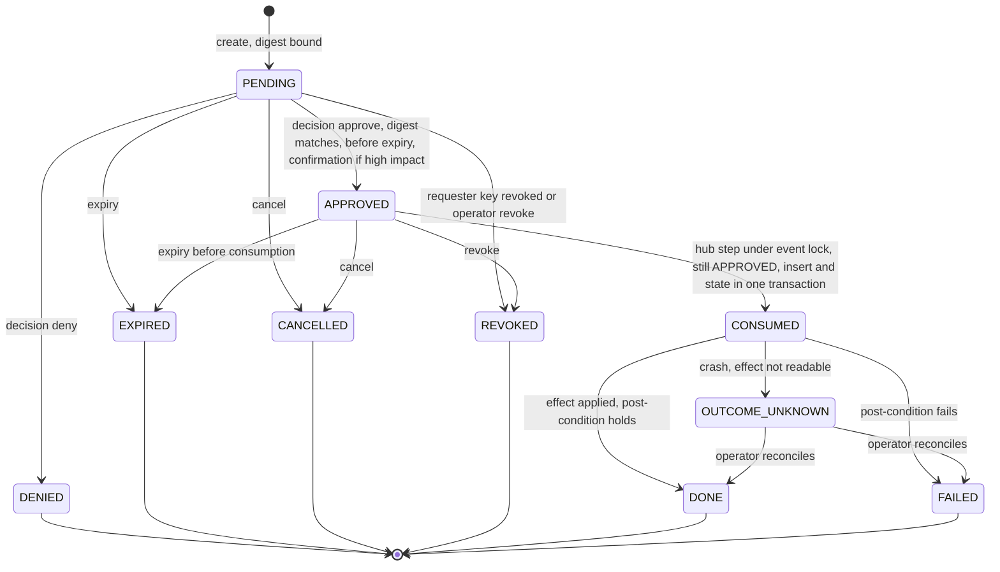
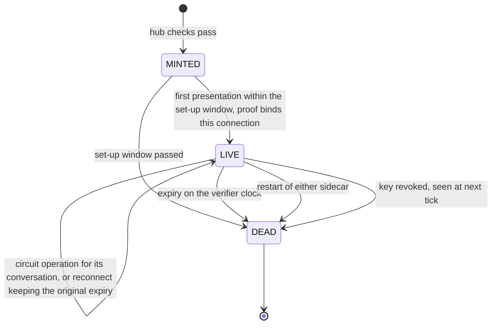
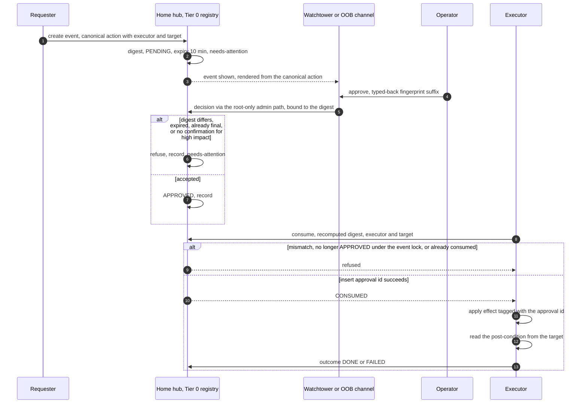
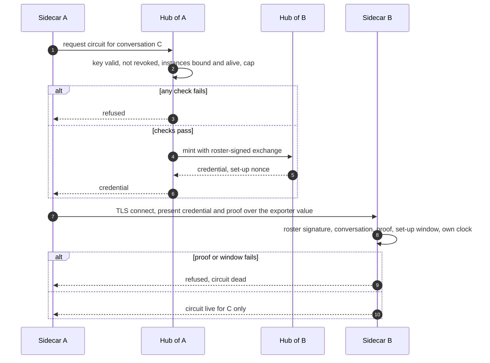

# Interactive agent communication: step 6, pseudo-code, part B: later phases (PH-3 to PH-6)

**Task:** T-3355 · **Arc:** arc-011 · **Chain:** arc-011-design, step 6 · **Role:** pseudo-coder
**Status:** DRAFT v0.1, sub-document of `docs/design/interactive-agent-communication-06-pseudo-code.md` ("06"). Read
06 sections 2 and 3 first. The FAILS CLOSED WHEN register for this file is 06 section 6.
**Level of detail.** ARC4 sets PH-3 to PH-6 at architecture level and leaves their detailed sub-designs open behind
gates (T-2470 charter, T-3385 confirmation provider, AEF's GP-11 channel standard, H-1 and H-27 for the circuit, Track
A). The algorithms below fix the **decision logic** those sub-designs must keep: what is checked, in which order, what
fails closed, and what happens on a crash. Field names and transports that a gated sub-design will choose are marked
**[open: gate]** and are not invented here (card 6: algorithm and key choices belong to the architecture).
**Review link:** none (profile P2.1).

## 0 Version history

| Version | Date | Change | Task |
|---|---|---|---|
| 0.1 | 2026-11-11 | First draft: AL-41..AL-53 (approval broker scope of the card; policy, grants, roster and cards, circuit, membership, break-glass, custody, account helper, security levels); test vector V-T0-1; drawings D-1.12, D-1.13, D-2.7, D-2.8. | T-3355 |

## 1 Scope and inputs

1.1 Inputs of record: 06 section 1. 1.2 The card's minimum scope for an approval broker (card 3) maps here: canonicalise
and hash an action (AL-41); verify an approval (AL-43); check a grant (AL-46); the ticket state machine with timeout,
cancel and revoke (AL-42); execute once and record the outcome, the post-condition (AL-44); revocation (06a AL-21,
AL-22, here for policy records AL-45); break-glass (AL-50).

## 2 Algorithms

### 2.1 AL-41 — Canonicalise and hash a Tier 0 action (K-27; ARC4 12.2; FP 10.2; SI-13)

2.1.a **SERVES:** SI-13, SI-8, SI-31; TH-48, TH-51; PR-14.
2.1.b **PROBLEM:** an approval must bind exactly what will happen, by whom, to what. **APPROACH:** the action is a
canonical object that names the executor and the target; its digest is what the operator approves and what the
executor recomputes.
2.1.c **ALGORITHM:**
```text
action = {schema: "termlink.tier0-action/1", class: C-n, executor, target, action: {op, ...op fields},
          requested_by, event_id: 128 random bits as 32 hex, expires_at: wall() + PN-15 (10 min)}
create_action(a):
 1  require class in the registry (C-1..C-18 as ruled and XR-6); require executor, target, op, expires_at present  # FCW-153
 2  c = canonical(a) (06a AL-20 rules); Err -> refuse                                                             # FCW-154
 3  digest = sha256_hex(c); display text = render(a) from the canonical object only (never from free text)
```
2.1.c.1 **Test vector V-T0-1** (06a AL-20 method, RFC 8032 test key 1): class C-7, executor `hub:cacc73ea32b121dd`,
target `known_hubs:192.168.10.122:9100`, op `tofu-repin` with `new_fingerprint: sha256:abab…ab` (32 × `ab`),
`event_id 0f1e2d3c4b5a69788796a5b4c3d2e1f0`, `expires_at 1762863000000` → canonical 366 bytes, digest
`0f41bddce59e28e68ad5fefcbfb7eb175e8eb17e99c25174b48d53ec945627ac`, signature over
`termlink.tier0-action/1\n<digest>`: `3091e682a73e21a159b62b0db94c57b34bb2084c515fffbdda2436b22fbfab9f5734f21ea1795a7043c3e4b9147e9ff9caee7e13877aa1cb21048e8699ccda08`.
Changing only `executor` or `target` changes the digest (the binding SI-13 needs).
2.1.d **INVARIANTS:** two actions that differ in executor, target, operation, parameters or expiry have different
digests. 2.1.e **FAILS CLOSED WHEN:** 2.1.e.1 **FCW-153** [new; E-104, ZR-1] the class is not registered, or executor,
target, operation or expiry is missing → no event is created. 2.1.e.2 **FCW-154** [new; E-104] the action is not
canonicalisable (06a FCW-88 rules) → no event.
2.1.f **EDGE CASES:** display drift (the shown text differs from what executes) is removed by rendering the display
from the canonical object; stateless. 2.1.g pure. 2.1.h SHA-256; the signature, where an operator key exists (Track K),
uses the same domain form **[open: Track K]**. **OBS:** the event record (AL-42).

### 2.2 AL-42 — Tier 0 event lifecycle: the ticket state machine with timeout, cancel and revoke (K-27; ARC4 12.2; XR-8)

2.2.a **SERVES:** SI-13, SI-24, SI-31, SI-8; R-63..R-65 (via grants); TH-48, TH-49, TH-64.
2.2.b **PROBLEM:** an event is raised, shown to the operator in Watchtower or on an out-of-band channel, decided, and
then executed at most once, with every exit visible. **APPROACH:** one durable record per event at the hub (admin
scope), a strictly forward state table, the decision written back through the existing admin path (the root-only local
socket runme uses; no new hub verb, O-6 OP-5), and expiry on the hub's clock.
2.2.c **ALGORITHM (state table; D-1.12 draws it):**

| State | Event | Guard | Next | Effect |
|---|---|---|---|---|
| — | create (AL-41) | registry class, executor, target | PENDING | record `{event_id, digest, class, who, evidence, expires_at}`, needs-attention, surfaces notified **[open: GP-11]** |
| PENDING | decision approve | via the admin path; `decision.digest == event.digest`; now < expires_at; high-impact: confirmation present (AL-43 step 4) | APPROVED | decision record bound to the digest, needs-attention |
| PENDING | decision deny | via the admin path; digest matches | DENIED (final) | record |
| PENDING | expiry | now ≥ expires_at | EXPIRED (final) | record, visible expiry (SI-31) |
| PENDING, APPROVED | cancel by requester or operator | — | CANCELLED (final) | record |
| PENDING, APPROVED | revoke (key of requester revoked, AL-21; or operator) | — | REVOKED (final) | record |
| APPROVED | executor consumes (AL-43) | approval id inserted into the consumed set | CONSUMED | — |
| APPROVED | expiry before consumption | — | EXPIRED (final) | record |
| CONSUMED | effect done, post-condition holds (AL-44) | — | DONE (final) | outcome record |
| CONSUMED | effect done, post-condition fails | — | FAILED (final) | outcome, needs-attention |
| CONSUMED | crash, outcome not determinable | — | OUTCOME_UNKNOWN | needs-attention; operator reconciles (AL-44) |
| OUTCOME_UNKNOWN | reconcile | operator's recorded finding | DONE or FAILED | record |

```text
decide(event_id, decision, digest, via):
 1  if via is not the root-only admin path: refuse                                                  # FCW-157
 2  with event.lock: e = load(event_id)
 3  if e.state is final or e.state == CONSUMED: refuse "already decided" (record the attempt)          # FCW-158
 4  if wall_hub() >= e.expires_at: e.state = EXPIRED; refuse                                         # FCW-155
 5  if digest != e.digest: refuse, needs-attention ("decision for another action")                  # FCW-156
 6  if decision == approve and e.class is high-impact and not confirmation_ok(e) (AL-43): refuse    # FCW-159
 7  append decision record (admin log first, then the event); e.state = APPROVED | DENIED
expiry sweeper (each tick on the hub): with event.lock: re-load; PENDING or APPROVED past expires_at -> EXPIRED with a record
cancel(event_id, who) and revoke(event_id, why): with event.lock: e = load(event_id)
    if e.state in {PENDING, APPROVED}: e.state = CANCELLED | REVOKED, record
    else: refuse "already <state>" (record the attempt); a CONSUMED event is not cancelled: its effect may be under
          way, and AL-44 settles it                                                                      # FCW-158
lock rule: decide, cancel, revoke, the expiry sweeper and AL-43's consume step are the only writers of e.state, and each
    reads and writes it inside event.lock (one lock per event, held by the hub); no writer acts on a state read outside it
```
2.2.d **INVARIANTS:** (1) states only move forward along the table; (2) final states never change; (3) every
transition has a record in the one audit trail and a needs-attention row; (4) an approval never outlives its expiry.
2.2.e **FAILS CLOSED WHEN:** 2.2.e.1 **FCW-155** [new; E-104] a decision arrives at or after expiry → refused, EXPIRED.
2.2.e.2 **FCW-156** [new; E-104] the decision's digest differs from the event's → refused, needs-attention.
2.2.e.3 **FCW-157** [new; ZR-1] a decision not written through the root-only admin path → refused. 2.2.e.4 **FCW-158**
[new; E-104] a decision for an event that is already final or consumed (including after a cancel or revoke) → refused,
recorded. 2.2.e.5 **FCW-159** [new; E-105] a high-impact approval without the out-of-band confirmation → no APPROVED.
2.2.f **EDGE CASES:** (1) clock: expiry on the hub's wall clock, the single place it is decided; a surface showing a
countdown uses it for display only; (2) concurrency: approve and cancel race: the event lock orders them; the later one
is refused by FCW-158; cancel, revoke or expiry racing the executor's consume are ordered by the same lock (AL-43 step
3): whichever takes it first wins, and the other is refused (FCW-158 or FCW-191); (3) a peer message saying "approved" changes nothing (SI-8): only `decide` changes state;
(4) crash table:

| Crash between | State after restart | Recovery |
|---|---|---|
| admin log row and event write | row, event unchanged | the decision is not applied; the surface shows it pending; the operator decides again (a second row, both visible) |
| event write and needs-attention | decided, no entry | start-up check: decisions newer than the last entry raise it |

2.2.g **EXECUTION SEMANTICS:** deciding has no effect in the world; execution is AL-44. 2.2.h **CRYPTOGRAPHY:** the
digest of AL-41; in PH-3 the decision is authenticated by the root-only socket (IC-2: root stands in for the operator
key, BP-13, RR-16); with Track K the decision carries an operator signature **[open: Track K]**.
**OBS:** OBS-68 the event record and its transitions; OBS-69 the audit trail rows.

### 2.3 AL-43 — Verify an approval and consume it once (K-27; SI-13, SI-31)

2.3.a **SERVES:** SI-13, SI-31; TH-48, TH-51, TH-56, TH-20, TH-64.
2.3.b **PROBLEM:** an approval must be used once, by the named executor, for the displayed action, even with two
executors or two requests racing, and never after a cancel, revoke or expiry has ended it. **APPROACH:** the executor
recomputes the digest from the action it is about to perform and compares executor and target; then the hub, in **one
conditional step under event.lock**, re-checks that the event is still APPROVED and unexpired, inserts the approval id
into the durable consumed set with insert-if-absent and moves the event to CONSUMED, in one transaction, **before** the
effect (compare-and-set: state APPROVED → CONSUMED only if it is APPROVED at that moment).
2.3.c **ALGORITHM:**
```text
consume(event_id, my_action, me):                   # steps 1..2 at the executor, step 3 at the hub
 1  d = digest(my_action) (AL-41); if d != event.digest: refuse                                     # FCW-160
 2  if my_action.executor != me or my_action.target != the object I am about to change: refuse         # FCW-161
 3  hub.consume(event_id, d, me): ONE step, with event.lock held (the lock of AL-42's lock rule):
      e = load(event_id)
      a  if e.state != APPROVED: refuse "no longer approved: <e.state>", record the attempt          # FCW-191
      b  if wall_hub() >= e.expires_at: e.state = EXPIRED, record; refuse                             # FCW-155 (AL-42)
      c  if d != e.digest: refuse                                                                     # FCW-160
      d  confirmation_ok(e): high-impact classes need an out-of-band confirmation record bound to e.digest, by the
         confirmation provider, within expiry [open: T-3385, GP-11]; absent -> refuse                 # FCW-159 (AL-42)
      e  one durable transaction of the hub store (fsync before the reply):
           r = consumed_set.insert_if_absent(e.approval_id, {executor: me, digest: d, at})
           if r == exists: abort; refuse "approval already used"                                       # FCW-162
           e.state = CONSUMED (compare-and-set from APPROVED, which step a saw under the same lock)
           commit; on any error: abort, both unchanged; refuse, nothing done                           # FCW-163
    release event.lock; reply CONSUMED
 4  only on the reply CONSUMED: AL-44 execute (no reply or an error reply: nothing is applied; see 2.3.f (6))
```
2.3.d **INVARIANTS:** at most one successful `consume` per approval id across all executors (the consumed set is at the
hub, one place). 2.3.e **FAILS CLOSED WHEN:** 2.3.e.1 **FCW-160** [new; E-104] the recomputed digest differs →
refused. 2.3.e.2 **FCW-161** [new; E-104] the executor or the target differs → refused. 2.3.e.3 **FCW-162** [new;
E-104] the approval id is already consumed → refused. 2.3.e.4 **FCW-163** [new; ZR-1] the consumed-set insert fails →
refused, nothing done. 2.3.e.5 **FCW-191** [new; E-104, ZR-1] at the hub's conditional step the event is no longer
APPROVED (a cancel, revoke or expiry took event.lock first, between the executor's read and the insert) → refused,
nothing inserted, nothing applied, the attempt recorded; E-104 (i) covers approve against cancel and revoke, ZR-1 asks
for cancel, revoke and expiry racing the consume.
2.3.f **EDGE CASES:** (1) replay within validity: FCW-162; (2) two executors at once: one insert wins; (3) a consumed
set restored from a backup older than the approval accepts it again within its expiry: RR-20 limit (E-104 probe);
(4) crash after the commit, before the effect: AL-44 recovery completes under the same id (not a second use);
(5) cancel, revoke or expiry during the consume (time of check to time of use, card 4.f): the executor's own reads in
steps 1..2 decide nothing about state; the state is checked and changed only inside step 3 under event.lock, which the
cancel, revoke and the expiry sweeper also take (AL-42 lock rule). If one of them takes the lock first, the event is
final and step 3a refuses (FCW-191); if the consume takes it first, the event is CONSUMED and the later cancel or revoke
is refused (FCW-158) and AL-44 settles the effect. No interleaving lets a final state become CONSUMED (AL-42 invariant
2); (6) crash or lost reply around step 3: the transaction either committed (CONSUMED, consumed row present) or did not
(APPROVED, no row); the hub never holds one without the other. An executor that did not receive the reply applies
nothing; at its start AL-44 recover() reads the consumed set for rows naming it and settles those. A retry of
consume after a committed but unanswered step is refused by FCW-191 or FCW-162 and is answered by recover(), not by a
second use.
2.3.g the committed transaction of step 3e (consumed row and CONSUMED together) is the at-most-once point. 2.3.h SHA-256 digest; signatures as AL-42. **OBS:** OBS-70 consumed set rows.

### 2.4 AL-44 — Execute once, record the outcome, check the post-condition (K-27; SI-13; card 4.g)

2.4.a **SERVES:** SI-13, SI-24; R-24-style evidence (an effect is shown, not assumed).
2.4.b **PROBLEM:** at-most-once dispatch is not exactly-once effect; the target may commit while the record does not.
**APPROACH:** every Tier 0 operation is written to be idempotent under its approval id, with a pre-check that detects
"already done" and a post-condition that proves the effect; a crash leads to recovery under the same id, or to
OUTCOME_UNKNOWN for the operator when the effect cannot be read back.
2.4.c **ALGORITHM:**
```text
execute(event):                                     # after AL-43 step 5
 1  if op.already_done(event.approval_id, target): goto 4      # target-side idempotency
 2  journal.append({approval_id, phase: dispatch, at})
 3  op.apply(target, params, tag = approval_id)                 # the target records the tag where it can
 4  ok = op.postcondition(target, params)                       # reads the target, never the journal
    journal.append({approval_id, phase: outcome, result: ok})
    event.state = DONE if ok else FAILED; if not ok: attention("tier0 post-condition failed"); no retry without a new approval  # FCW-164
recover() at executor start: for each consumed approval with dispatch and no outcome:
    if op.postcondition readable: complete step 4 (DONE or FAILED)
    else: event.state = OUTCOME_UNKNOWN; attention; the operator reconciles                                    # FCW-165
per-operation pairs (examples; the PH-3 sub-design lists each class) [open: 04b]:
    C-7 TOFU re-pin: already_done = pinned fingerprint == new; postcondition = the same
    C-15 account create (K-30): already_done = the account exists with the template; postcondition = template check
```
2.4.d **INVARIANTS:** (1) an approval leads to at most one application of its operation's effect; (2) DONE only on a
post-condition read from the target. 2.4.e **FAILS CLOSED WHEN:** 2.4.e.1 **FCW-164** [new; ZR-1] the post-condition
does not hold → FAILED, needs-attention, no automatic retry. 2.4.e.2 **FCW-165** [new; ZR-1] after a crash the
post-condition cannot be read → OUTCOME_UNKNOWN for the operator; never re-applied automatically.
2.4.f **EDGE CASES:** crash table: (a) insert and dispatch row: recovery checks `already_done`, applies if not; (b)
dispatch row and apply: as (a); (c) apply and outcome row: the post-condition decides. 2.4.g as described: at-most-once
dispatch under the consumed set, idempotent effect, reconciliation. 2.4.h none beyond AL-43.
**OBS:** OBS-71 the executor journal; outcome records.

### 2.5 AL-45 — Policy records: fetch, verify, epoch and head (K-26; ARC4 12.3; V-2; FP 10.3)

2.5.a **SERVES:** SI-21, SI-20, SI-18; TH-18, TH-42, TH-47; DR-8 pattern.
2.5.b **PROBLEM:** policy (rules, profiles, grants) must come only from signed records, never be rolled back, and a
failed fetch must not read as "no policy". **APPROACH:** the revocation pattern (06a AL-22) per (scope, kind) counter,
with the policy head fetched with the revocation head each tick and a cut-over epoch after which only operator
signatures count.
2.5.c **ALGORITHM:**
```text
policy_tick(): head = hub.policy.head (signed, AL-20); fail classes as 06 4.7 -> failed                        # FCW-166
   for each (scope, kind): if head.counter < held.counter: refuse, tamper entry                               # FCW-167
                           if newer: fetch, verify each record:
                               signature by the hub key (interim, IC-3) or, from epoch E =
                               require_operator_signature_from_epoch, by the operator key only               # FCW-168
                               record.epoch <= head.epoch; record.digest recomputes; not expired
                           install atomically
   if mono() - last_verified > PN-13: grant starts stop; allow-list narrows to the own project                 # FCW-169
```
2.5.d **INVARIANTS:** counters never decrease; after epoch E no hub-signed record takes effect. 2.5.e **FAILS CLOSED
WHEN:** 2.5.e.1 **FCW-166** [new; E-106, E-107] a failed fetch → not verified (never "no policy"). 2.5.e.2 **FCW-167**
[new; E-106] a lower counter or a fork → refused, previous kept. 2.5.e.3 **FCW-168** [new; E-106, E-115] from the
cut-over epoch, a record not signed by the operator key → refused. 2.5.e.4 **FCW-169** [new; E-106] PN-13 without a
verified head → no grant starts, allow-list narrowed.
2.5.f **EDGE CASES:** restore from backup as AL-22 (RR-20); crash as AL-22. 2.5.g read-only. 2.5.h AL-20; operator key
**[open: Track K]**. **OBS:** OBS-72 status `policy_records {head, epoch, verified_at}`.

### 2.6 AL-46 — Check a grant before a start or resume (K-26; V-2; SI-21; H-25)

2.6.a **SERVES:** SI-21, R-63, R-64, R-65; TH-18, TH-42, TH-47.
2.6.b **APPROACH:** a start or resume cites a grant; the check is signature, epoch, expiry, scope, budget; the use is
logged before the start.
2.6.c **ALGORITHM:**
```text
may_start(agent, kind in {start, resume}, grant_id):
 1  g = held grant records (AL-45) by grant_id; none -> refuse                                                  # FCW-170
 2  require g verified (AL-45), not expired, g.epoch current, g.rules.may includes kind, g.scope covers agent  # FCW-170
 3  u = use counter for (grant_id, per window); if u.starts >= g.limits.budget or u.restarts >= g.limits.restarts: refuse  # FCW-171
 4  append grant-use log {grant_id, agent, kind, at}; Err -> refuse                                            # FCW-172
 5  allow; the start records the grant id
```
2.6.d **INVARIANTS:** every start or resume cites a verified grant and is logged; an agent cannot create or widen one
(it holds no key that verifies). 2.6.e **FAILS CLOSED WHEN:** 2.6.e.1 **FCW-170** [new; E-106] no grant, or an
unsigned, expired, wrong-epoch or out-of-scope one → no start. 2.6.e.2 **FCW-171** [new; E-106] budget or restarts
exhausted → no start. 2.6.e.3 **FCW-172** [new; ZR-1] the use log cannot be written → no start.
2.6.f **EDGE CASES:** a same-user agent can delete or withhold a grant (SI-21 allows), never forge one; before CR-14 the
invariant holds only against remote adversaries (SI-21 condition). Crash: log before start. 2.6.g at-most-once start
per log row. 2.6.h AL-45. **OBS:** OBS-73 the grant-use log.

### 2.7 AL-47 — Roster and card acceptance (K-28; ARC4 12.1; SI-12; R-72, R-77) [PH-3, gate T-2470]

2.7.a **SERVES:** SI-12, R-60, R-72, R-77; TH-3, TH-8, TH-45, TH-51.
2.7.b **APPROACH:** a card counts only if signed by an admitted hub that is the home of the project, within its TTL,
with a rising sequence; a second claimant is a flagged second instance.
2.7.c **ALGORITHM:**
```text
on roster R from a hub exchange: require verify(R) by the issuing hub's pinned key; R.seq >= held.seq else refuse   # FCW-175
on card C:
 1  require C.hub_id in held roster, verify(C) with that hub's roster key                                        # FCW-173
 2  require C.hub_id == home_hub(C.project) per the roster binding                                              # FCW-173
 3  require wall() < C.issued_at + 600 s (PN-9) and C.seq > last_seq(C.hub_id, C.agent)                          # FCW-173
 4  if another hub already bound C.project: keep the binding, flag "second instance", the claimant gets no mail  # FCW-174
```
2.7.d **INVARIANTS:** a bound project stays bound until a signed "moved to" statement. 2.7.e **FAILS CLOSED WHEN:**
2.7.e.1 **FCW-173** [new; E-108] a card unsigned, from an unadmitted hub, from a hub that is not the project's home,
expired or with a non-rising sequence → ignored and flagged. 2.7.e.2 **FCW-174** [new; E-108, E-116] a second hub
claims a bound project → flagged, the binding stays. 2.7.e.3 **FCW-175** [new; E-108] a roster with a lower sequence →
refused.
2.7.f clock: TTL on wall clocks across hosts; skew over 30 s marks figures unusable (V-5) **[open: 04b]**; crash: held
state durable, idempotent. 2.7.g read-only. 2.7.h AL-20 under the hub keys. **OBS:** status roster seq, card ages.

### 2.8 AL-48 — Circuit credential: mint and verify (K-29; ARC4 12.5; SI-9, SI-10) [PH-5, gates H-1, H-27]

2.8.a **SERVES:** SI-9, SI-10, R-46; TH-44, TH-46, TH-50, TH-26, TH-37.
2.8.b **APPROACH:** the hubs mint after the SI-10 checks; the credential is bound to one conversation, the two
instances and a TLS exporter value of the connection it is first presented on; the verifier ages it on its own
monotonic clock.
2.8.c **ALGORITHM:**
```text
mint (hub): require key valid and not revoked, instances bound and alive, sender is the bound instance's agent,
            open-message cap not exceeded; the interrupt allow-list is NOT applied (SI-10)                           # FCW-176
            cred = {conversation, instances, est_nonce, established_at, ttl} signed [open: format]
present (sidecar to sidecar): proof = sign(agent key, exporter(TLS, "termlink-circuit/1") || est_nonce)
verify (receiving sidecar):
 1  require cred signed by a roster hub; conversation and instances match; op is a circuit operation      # FCW-179
 2  require proof verifies with the agent key over this connection's exporter value                        # FCW-177
 3  first presentation within PN-12 of establishment; age on MY mono() since first sight < ttl;
    a reconnect keeps the original expiry; a restart of either side kills every circuit                     # FCW-178
 4  key not on the revocation list (AL-22); urgent from a sender off the allow-list -> delivered as normal (SI-10)
```
2.8.d **INVARIANTS:** a credential is useless on another connection, for another conversation, after expiry or after a
restart. 2.8.e **FAILS CLOSED WHEN:** 2.8.e.1 **FCW-176** [new; E-110] revoked key, dead instance, an instance not the
sender's, or the cap reached → no mint. 2.8.e.2 **FCW-177** [new; E-110] the proof does not bind this connection's
exporter value → refused. 2.8.e.3 **FCW-178** [new; E-110] first use after the set-up window, expired, or after a
restart → dead. 2.8.e.4 **FCW-179** [new; E-110] another conversation, a topic operation, or a non-roster signer →
refused.
2.8.f a thief with the key and a live credential is RR-5 (limit); clock as stated. 2.8.g RC-1..RC-9 reconcile after an
outage (E-117). 2.8.h TLS exporter (RFC 5705/8446), ed25519; format **[open: H-27]**. **OBS:** hub minting log; outage log.

### 2.9 AL-49 — Membership change and the membership epoch (SI-29) [PH-4]

2.9.a **SERVES:** SI-29, R-62; TH-9, TH-61.
2.9.c **ALGORITHM:**
```text
join: event signed by an existing participant AND countersigned by the new one; leave: signed by the leaver;
removal: under the stated rule [open: PH-4 sub-design]; R-62 hand-over under its rule
apply(event): verify signatures per type else refuse                                                            # FCW-180
              append to the hub record, chained; epoch = epoch + 1
on message or receipt: require sender is a current participant and m.epoch == current epoch (or the instance is not
              fenced at a lower epoch) else refuse, attention                                                    # FCW-181
```
2.9.b, d: **PROBLEM/APPROACH** as SI-29; **INVARIANT:** the epoch rises on every change and every turn carries it.
2.9.e **FAILS CLOSED WHEN:** 2.9.e.1 **FCW-180** [new; E-111] a join not countersigned, a leave not signed by the
leaver, a removal outside the rule → refused. 2.9.e.2 **FCW-181** [new; E-111] a message from a non-participant or a
fenced lower epoch → refused, needs-attention.
2.9.f hub unreachable: a removed participant's circuit works until expiry (RR-5); crash: chained record, idempotent.
2.9.g none. 2.9.h signatures as AL-20. **OBS:** the membership chain.

### 2.10 AL-50 — Break-glass and the Tier 0 override (SI-24; ARC4 8.4.4)

2.10.a **SERVES:** SI-24, SI-23; TH-21, TH-34, TH-53, TH-19.
2.10.b **APPROACH:** break-glass actions (override of main, forced re-home, kill switch, revocation, manual store edit,
re-pin, the Tier 0 override) are operator-initiated through the root-only path, logged before acting, and shown.
2.10.c **ALGORITHM:**
```text
break_glass(action, why):
 1  require the call came through the root-only admin path (runme)                                   # FCW-182
 2  admin_log.append({action, who, why, at}); Err -> refuse                                          # FCW-183
 3  attention("break-glass", action, why) ; Err -> refuse                                            # FCW-183
 4  perform action (idempotent per action); status shows "break-glass used at T" for 24 h
```
2.10.d **INVARIANT:** no break-glass action without its log row and entry. 2.10.e **FAILS CLOSED WHEN:** 2.10.e.1
**FCW-182** [new; E-113] not operator-initiated → refused. 2.10.e.2 **FCW-183** [new; E-113] the log row or the entry
cannot be written → refused. 2.10.f root on the host can act outside the path (RR-2); crash: log before act.
2.10.g idempotent. 2.10.h none. **OBS:** admin rows, needs-attention.

### 2.11 AL-51 — Custody release (K-31; ARC4 12.7; C-10; R-80.a (5)) [PH-6]

2.11.a **SERVES:** R-80, R-74; H-29.
2.11.c **ALGORITHM:**
```text
release(content, reader): require every C-10 condition [open: PH-6 sub-design, as ruled in R-80.a (5)] and a consumed
         Tier 0 approval of the release class (AL-43)                                                        # FCW-184
         log the release (custody log) before re-wrapping; Err -> refuse                                     # FCW-185
         re-wrap the content key to the reader (32 bytes per message); content is never re-encrypted
```
2.11.b, d **APPROACH/INVARIANT:** no content key leaves custody without its approval and its log row.
2.11.e **FAILS CLOSED WHEN:** 2.11.e.1 **FCW-184** [new; E-119] a condition or the approval is missing → no release.
2.11.e.2 **FCW-185** [new; E-119] the custody log cannot be written → no release. 2.11.f crash: log first; re-wrap
idempotent. 2.11.g at most one release per approval. 2.11.h sealed box re-wrap as AL-26 **[open]**. **OBS:** custody log.

### 2.12 AL-52 — Account helper (K-30; ARC4 12.6; Track A) [PH-3 A0]

2.12.a **SERVES:** R-82, FP 10.1.5; TH-2, TH-25.
2.12.c **ALGORITHM:**
```text
termlink-account-helper create <agent> --event <digest>     # the only command in one sudoers entry
 1  r = hub: decided C-15 event receipt for digest, consumed for this helper (AL-43 with executor = this host) else refuse  # FCW-186
 2  require <agent> is a plain name, no existing account of that name, the fixed template (home 0700, no login shell,
    no sudo, group tl-agents) else refuse                                                                                  # FCW-187
 3  create; verify the template (AL-44 post-condition); log to the hub's admin log
```
2.12.e **FAILS CLOSED WHEN:** 2.12.e.1 **FCW-186** [new; E-114] no decided, unconsumed C-15 receipt for the digest →
refused. 2.12.e.2 **FCW-187** [new; E-114] a name collision or any template deviation → refused.
2.12.b, d, f, g, h: as AL-43 and AL-44 (one approval, one account; post-condition read from the host). **OBS:** the
helper log and the hub admin log.

### 2.13 AL-53 — Security level change (ARC4 8.4; DR-13; XR-6)

2.13.a **SERVES:** FP 3.1.a (the floor is not traded), SI-24; DR-13.
2.13.c **ALGORITHM:**
```text
set_level(project, L):
 1  lowering: requires a consumed C-17 high-impact approval with out-of-band confirmation (AL-43)          # FCW-188
    raising: requires a consumed C-18 human-route approval                                                   # FCW-189
 2  validate the level's effect set: it may only ADD requirements (accounts, operator signatures, confirmation,
    DM encryption); a configuration that would disable a floor check is refused at load                     # FCW-190
 3  write the profile record's security_level through the policy store (AL-45); log; attention
```
2.13.e **FAILS CLOSED WHEN:** 2.13.e.1 **FCW-188** [new; E-115] lowering without a C-17 approval and its confirmation →
refused. 2.13.e.2 **FCW-189** [new; E-115] raising without a C-18 approval → refused. 2.13.e.3 **FCW-190** [new; E-115]
a level configuration that would switch a floor item off → refused at load.
2.13.b, d, f, g, h: the Tier 0 override stays available as logged break-glass at every level (AL-50); the level is a
policy record (AL-45). **OBS:** status `strength` and the profile record.

## 3 Drawings for this part (D-1.12, D-1.13, D-2.7, D-2.8; index in 06 section 7)

**Drawing D-1.12 — a Tier 0 event (state machine, AL-42..AL-44), including timeout, cancel, revoke and crash states**



3.1 Text equivalent of D-1.12. 3.1.1 An event is created PENDING with its action digest. 3.1.2 From PENDING an approval
(through the admin path, matching digest, before expiry, with the out-of-band confirmation for high-impact classes)
makes it APPROVED; a denial DENIED; expiry EXPIRED; a cancel CANCELLED; a revocation REVOKED. 3.1.3 From APPROVED the
hub's one conditional step under the event lock (still APPROVED and unexpired, then the approval id inserted and the
state set CONSUMED in one transaction) makes it CONSUMED; an expiry, cancel or revoke that takes the lock first ends it,
and the consume is then refused. 3.1.4 From CONSUMED
a post-condition that holds gives DONE, one that fails gives FAILED, and a crash whose effect cannot be read gives
OUTCOME_UNKNOWN, which only the operator reconciles to DONE or FAILED. 3.1.5 DENIED, EXPIRED, CANCELLED, REVOKED, DONE
and FAILED are final.

**Drawing D-1.13 — a circuit credential at its verifier (state machine, AL-48)**



3.2 Text equivalent of D-1.13. 3.2.1 A credential is MINTED after the hub's SI-10 checks. 3.2.2 Its first presentation
within the set-up window, with a proof bound to this connection's exporter value, makes it LIVE; otherwise it is DEAD.
3.2.3 LIVE serves circuit operations for its one conversation; a reconnect keeps the original expiry. 3.2.4 Expiry on
the verifier's monotonic clock, a restart of either sidecar, or a revocation seen at the next tick make it DEAD.

**Drawing D-2.7 — an approval through Watchtower or an out-of-band channel (interaction sequence, AL-41..AL-44), with the fails-closed paths**



3.3 Text equivalent of D-2.7. 3.3.1 The requester creates an event with a canonical action naming executor and target;
the hub computes its digest, records it PENDING with a 10-minute expiry and raises needs-attention. 3.3.2 Watchtower or
an out-of-band channel shows the event, rendered from the canonical action. 3.3.3 The operator approves (typing back the
fingerprint suffix where the class needs it); the surface writes the decision through the root-only admin path, bound
to the digest. 3.3.4 The hub refuses and records a decision whose digest differs, that is late, that targets a final
event, or that lacks the out-of-band confirmation of a high-impact class; otherwise the event is APPROVED. 3.3.5 The
executor recomputes the digest and checks executor and target; under the event lock the hub refuses a mismatch,
an event that a cancel, revoke or expiry has already ended, or a used approval; otherwise it inserts the approval id
and sets CONSUMED in one transaction, the effect applied with the approval id as its tag, the post-condition read from
the target, and the outcome recorded.

**Drawing D-2.8 — circuit set-up (interaction sequence, AL-48), with the fails-closed paths**



3.4 Text equivalent of D-2.8. 3.4.1 Sidecar A asks its hub for a circuit for conversation C; the hub checks the key,
revocation, instances and the cap, and refuses on any failure. 3.4.2 Otherwise the hubs mint the credential through a
roster-signed exchange and return it with the set-up nonce. 3.4.3 A connects to B over TLS and presents the credential
with a proof over the connection's exporter value; B checks the roster signature, the conversation, the proof and the
set-up window on its own clock; a failure kills the circuit; success makes it live for C only.
