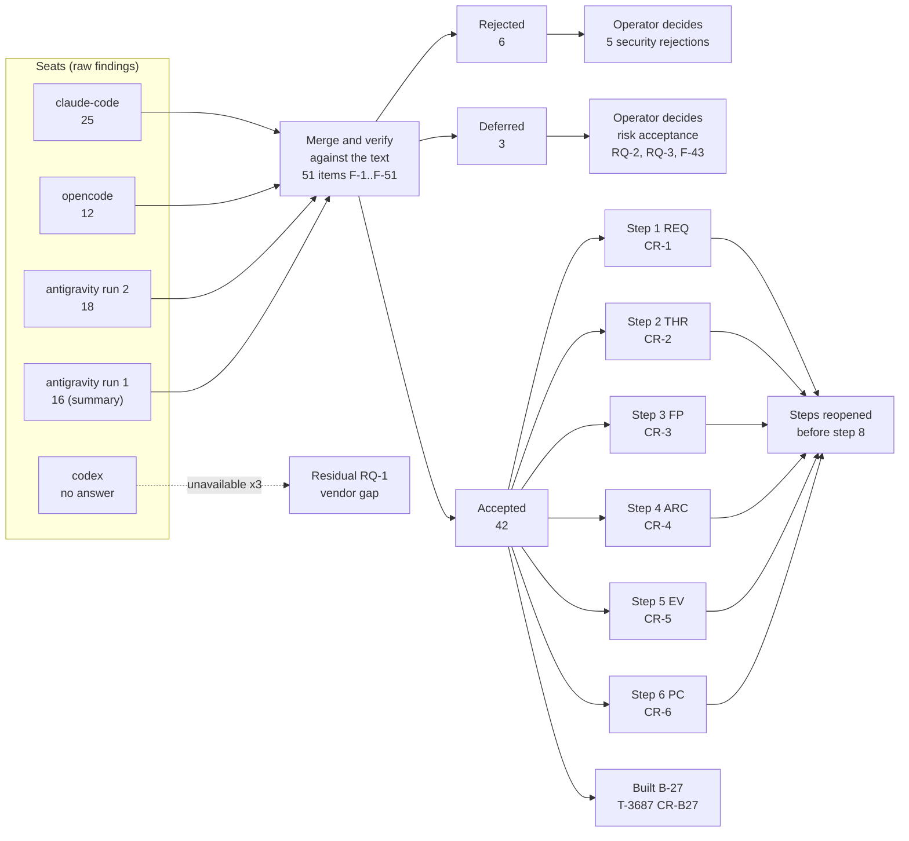

# Interactive agent communication: step 7, review panel and disposition

**Task:** T-3356 · **Arc:** arc-011 · **Chain:** arc-011-design, step 7 · **Role:** review panel and disposition
**Status:** DRAFT v0.1, batch mode (no human present, `_common.md` 5.2). This step **decides** (`decides: true`): the
operator approves it, and the operator alone decides every rejection or deferral of a security finding (card 5).
Everything below is a proposal.
**Review link:** none. This project's Watchtower has no inline design-review page (profile P2.1); read the file in the
repository.
**Standing rules applied (CLAUDE.md):** nothing working is switched off as a side effect (**NID**); thresholds measure
reliability, never usage (**RNU**).

## 0 Version history

| Version | Date | Change | Task |
|---|---|---|---|
| 0.1 | 2026-11-12 | First complete draft: manifest, synthesis of 71 raw findings from three seats (four answer files) into 51 items, verification of each against the text, disposition F-1..F-51, drawing D-1, change requests CR-1..CR-7 per step, residual risks | T-3356 |

## 1 Inputs of record

1.1 Material under review and context, sha256 of the bytes read on 2026-11-12 (`sha256sum`), identical to what every
seat checked (manifest 1.2).

| Id | Path | Version | sha256 |
|---|---|---|---|
| REQ | `docs/design/interactive-agent-communication-01-requirements.md` | v0.5.3 | `f6ce42a2984bd18e049f1f4dda05e6eaab2cc3508396fe373060c6fc527193c9` |
| THR | `docs/design/interactive-agent-communication-02-threat-model.md` | v0.3.7 | `88961693384966502f4ca4eb515ed4b0590a29c3d61ac0c619e17ea4562693f3` |
| FP | `docs/design/interactive-agent-communication-03-floor-and-phasing.md` | v0.3 | `e4de2e3e102ee59f6434db584e099e5bb180c6b33dfd823ae217e6ebb4e5a8c4` |
| ARC | `docs/design/interactive-agent-communication-04-architecture.md` | v0.3.2 (redaction only) | `a5cc08eba8f72ddaabc09e31939db9072155066313e7bced4b437b4eda24927a` |
| TRC | `docs/design/interactive-agent-communication-04a-traceability.md` | v0.3 | `c516a290997e0c75957c0be95af4d611e58155cd818d2fbae961c0f4ad6d4667` |
| EV | `docs/design/interactive-agent-communication-05-evidence.md` | v0.1 | `29be80ae3ad8d32b71ef53caa00f9fdc6d03426c901215eaed85c019f889526e` |
| COV | `docs/design/interactive-agent-communication-05a-coverage.md` | v0.1 | `16a4aa77b23cad191cf1b9153e60016a266ffc763c54674cb2d6e1f6341824fc` |
| PC | `docs/design/interactive-agent-communication-06-pseudo-code.md` | v0.2 | `7d469813239e991304ddad04b35fe2dc713c1d0e2ed8142ee7c05b5ff4dbffcc` |
| PCa | `docs/design/interactive-agent-communication-06a-pseudo-code-ph2-hardening.md` | v0.2 | `1db1532a8d1d4c1002326a4b4e948be959b7a52c5bd33b8fba0ee2f405b69ebf` |
| PCb | `docs/design/interactive-agent-communication-06b-pseudo-code-later-phases.md` | v0.2.1 (redaction only) | `8878cf38acb328b5aee89ef43be71685f4cbd044bb63006b6d3189e268c9f8c2` |

1.2 The panel round (stored in `docs/reports/T-3356-panel/`).

| Id | Path | sha256 |
|---|---|---|
| BRIEF | `brief.md` (version 1, as sent) | `1f829a93e8956d003df5e61ddc4f93b994bedca9cfc448669603f99c3ea780be` |
| MAN | `manifest.md` (version 2, completed in this step) | `c12aee41286991abc9e8c369583acf3c22c08846075f649edc0e7db1e0f30329` |
| A-CC | `claude-code.md` | `e7dfbbe605b553ac13f42327d94acecc56ec43c9ddd1803f6fdb2aed61fdd2b9` |
| A-OC | `opencode.md` | `20c66671208a561720f73045a50bc763e9b1119e34a65e71e78b8c3458281146` |
| A-AG2 | `antigravity.md` (run 2) | `2700ccd1684d49c82a5407c41cfd757d6f0a6b712cd8e8aa64bdf7b0b8258afb` |
| A-AG1 | `antigravity-run1-summary.md` (run 1, summary only) | `f3b3e1476995cf1224bfcb009dc89fff1fd1d0b7a19f4329bea301031acef6ac` |

1.3 Role inputs, in the order given (README 3.3).

| Short | Path | sha256 |
|---|---|---|
| RULES | `CLAUDE.md` (project sections above `## Core Principle`) | `a9b38fd1aeed0145289c6a8c89c491c2ae077d06e1847110209827f33e172aa3` |
| README | `docs/design/roles/README.md` | `3881d5302313a0d0ca4c9ef1b4688dae101b6d693df823be962e9b70946368e0` |
| COMMON | `docs/design/roles/cards/_common.md` | `cca38806358d7a6c09e64289164977a825f2cf57e914f672076ff77a2bdb5563` |
| CARD | `docs/design/roles/cards/review-panel.md` | `9addac6bb48ab8cd57d473f4b37c4b38591bf6c79c27af70922c0dad578d88b8` |
| ADAPTER | `docs/design/roles/adapters/aef.md` | `d840a77649888cdbfd37d1166c15eecd6cd3c8399d497fb6b1b2c52455c6c4a4` |
| PROFILE | `docs/design/roles/profiles/termlink.md` | `b6bc160242d96ca9a8fc167c6845e292529c162fa23faa2945d4742b676e7b21` |
| CHAIN | `docs/design/interactive-agent-communication-role-chain.yaml` | `4cea381100cd19fbfb06194c12c6a45fa5a81b471904d23b8c3cdecbcaab8020` |

1.4 Built code read to check findings against B-27 (T-3687, commit `8cf07e7a3`, HEAD `7adfb8edb`):
`crates/termlink-sidecar/src/meter.rs` and `deliver.rs` (cited by line; not hashed).

## 2 The panel

2.1 **Brief and rules.** One brief (BRIEF) built from the approved outputs of steps 1, 4 and 6 with steps 2, 3 and 5 as
context, with secrets, credentials and internal addresses stripped (card 3.1); the operator gave the go to send it to
four vendors on 2026-11-11 (T-3356 Decisions, ruling A; card 3.2). Each seat saw only the brief (card 3.3).
2.2 **Manifest** (card 3.4): `docs/reports/T-3356-panel/manifest.md` version 2. In short:

| Seat | Vendor | Model | Date | Raw findings |
|---|---|---|---|---|
| claude-code | Anthropic | Claude Opus 5.5 | 2026-11-11 | 25 (CLAUDE-CODE-1..25) |
| opencode | Z.ai | GLM glm-5.3 | 2026-11-11 | 12 (OPENCODE-1..12) |
| antigravity run 2 | Google | Gemini 4 Argon (Medium), in Antigravity | 2026-11-12 | 18 (ANTIGRAVITY-1..18, cited here AG-n) |
| antigravity run 1 | Google | not stated | 2026-11-11/12 | 16 in a surviving summary (cited here AG1-n) |
| codex | OpenAI | — | — | **none**: run 1 void (wrote into its export), run 2 usage limit, run 3 "model at capacity" (04:26Z) |

2.3 **Vendor diversity gap.** The ruled panel was four vendors; three answered. The review policy's multi-vendor
strength (IW-7, rung 5) is met with three vendors, not four. This step does not wait for Codex (orchestrator's
instruction). Recorded as residual risk RQ-1 (section 8).
2.4 **Verdicts of the seats.** All three seats: "fit to plan the build from **after** the critical and high findings
are fixed". None said "no".

## 3 Synthesis (card 3.5)

3.1 **Counting.** 71 raw findings (CLAUDE-CODE 25, OPENCODE 12, AG 18, AG1 16) merge into **51 items F-1..F-51**.
The two antigravity runs are one seat: where AG and AG1 raise the same defect it counts once for that seat. An item's
"seats" is the number of distinct seats (at most 3).
3.2 **Where the seats agree** (raised by two or three seats, after merging):

| Item | Defect | Seats |
|---|---|---|
| F-10 | Ring intent written before the stale-checks hold (dangling intent) | 3 (claude-code, opencode, antigravity) |
| F-20 | Watchdog never fires where the veto cannot measure (macOS) | 3 |
| F-4 | Receiver origin check skipped for basis `inferred`, never reaches the lease | 2 (claude-code, antigravity) |
| F-6 | Per-project OriginReporting flag flips on any origin, locks out other harnesses | 2 (claude-code, antigravity) |
| F-8 | Watchdog types again every 300 s into an unsubmitted buffer, without end | 2 (claude-code, antigravity) |
| F-11 | Ambiguous forward post abandoned, message handed over at X and at Y | 2 (claude-code, antigravity) |
| F-12 | FORWARDED final copy plus identity dedupe wedges a re-sent message | 2 (opencode, antigravity) |
| F-13 | Forward decided once at STORED, never re-evaluated | 2 (claude-code, opencode) |
| F-17 | Admission records `seen`/order state before a later refusal | 2 (claude-code, antigravity) |
| F-21 | Foreground binding source unspecified; interpreter-run harnesses; macOS | 2 (claude-code, antigravity) |
| F-25 / F-24 | Touch records and human claims trusted too far | 2 (claude-code, opencode) |
| F-27 | READY ordering by the adapter's wall clock; `at_ms` missing from `last_prompt` | 2 (claude-code, antigravity) |
| F-31 | OOB status says "sent-by-other" without an outcome | 2 (claude-code, antigravity) |
| F-44 | EV and COV not updated for step 6's FCWs; ZR-1's count | 2 (opencode, antigravity) |

3.3 **Where they differ (dissent kept visible).**
3.3.a **Severity of F-10** (dangling intent): antigravity critical ("permanently wedges"), claude-code and opencode
low. Verified medium: the intent makes the session UNSUBMITTED after a restart (PC AL-7 `on_start`, FCW-37), which
holds normal rings until a submit or the watchdog; nothing is lost; on a host where the watchdog is unavailable (F-20)
it lasts until the person's next prompt.
3.3.b **Severity of F-11** (double hand-over): antigravity critical, claude-code high. Verified high: the brief's
critical class is loss, forgery, keystrokes into a refusing session or a fail-open on the delivery path; processing
twice is a correctness flaw that will be built in (H-24, AL-14 invariant 3).
3.3.c **Severity of F-15** (blobs on role mail): antigravity critical. Verified high: the failure is a visible
refusal to the sender (PCa AL-27 "on any failure … notice(m.sender, REFUSED …)"), not a silent loss, but it fails on
every role-addressed or forwarded message with a blob.
3.3.d **F-4**: antigravity rates the origin bypass critical, claude-code high. Verified high (a lease and
conversation-signal bypass, no keystrokes into a refusing session).
3.3.e **opencode found no critical item**; claude-code one (F-1); antigravity four (two kept as high, one medium, one
rejected as text-only, section 3.4).
3.3.f **Verdict on OriginReporting**: claude-code wants reporting decided per harness; antigravity wants the flag
posted only after a successful human claim. Both fixes are compatible; F-6 asks for both.

3.4 **Findings verified wrong, in whole or in part** (each checked against the text at the hashes of 1.1).
3.4.a **Antigravity run 2 quotes code that is not in the material.** The identifiers `circuit_turn`,
`reconcile_outage_log`, `hub_rpc_guard`, `notified_episode`, `waiting_mail_tick`, `gap_since`, `tier0_decide`,
`log_vendor_bypass`, `owed_to_us`, `turn_open`, `recover_from_hub_copy` and `VENDOR_TOOLS = {"SendMessage"}` occur in
no document under review (grep over `docs/design/*.md`, 2026-11-12); several of its algorithm numbers are shifted
(its "AL-18 hub_rpc_guard" is AL-30, its "AL-21 revocation_pull" is AL-22, its "AL-31/AL-32" are AL-39/AL-40, its
"PCb AL-51/52/54" do not exist). Every AG finding was therefore checked on substance against the real text; six are
rejected in whole (F-7, F-36, F-37, F-38, F-39, F-41) and three in part (F-9, F-12 scenario 1, F-42).
3.4.b **F-38 (AG-8), wrong.** It claims an owed answer holds both rings for up to an hour. PC AL-4 step 2 holds only
conversations with own traffic in the last 120 s (`now - ledger.last_s3(c) <= 120 s`); AL-5 step 7 still rings mail of
those conversations ("`agent(C)` → only mail of C", invariant (3)); and AL-8 never reads the conversation signal (AL-8
invariant (4), ARC 6.9.7.b).
3.4.c **F-37 (AG-14), wrong.** It claims the revocation head is unsigned and skips verification. PCa AL-22 step 2:
"require verify(pin, h) … else failed("head-signature"), tamper = true"; ZR-9 made the head signed in v0.2.
3.4.d **F-36 (AG-17), wrong.** It claims Tier 0 `decide` takes a "policy route" without consulting deny rules. PCb
AL-42 `decide` has no policy route: step 1 refuses anything but the root-only admin path (FCW-157).
3.4.e **F-39 (AG-18 and AG1-7), wrong.** AG-18 says an unknown `last_human` allows immediate fast takeover (and
quotes 60 s). PC AL-11's table: "HELD(other) | prompt, human | otherwise, or `last_human` unknown | Held" (FCW-55), and
the threshold is 300 s. AG1-7 calls the opposite (unknown blocks takeover; Touch before renew) a defect; both are the
designed behaviour (FCW-55, QR-6, AL-11 invariant (7)).
3.4.f **F-7 (AG-7 part 1), wrong as a defect.** Force-release before the claim is the built primitive, and its crash
case is in PC 5.11.f.5 row 2: "no live claim, current = old holder … a lapse-like vacancy … the next human prompt
anywhere takes". No two holders arise.
3.4.g **F-41 (AG-9), wrong.** It says the vendor log matches only SendMessage. PCa AL-39: "hook (matcher
SendMessage|Agent|Task)". AL-40 denies only SendMessage, so nothing is switched off before T-3386 (NID holds). One
editorial point survives: PC AL-1 line "`obj.tool in VENDOR_TOOLS`" names a set nowhere defined (CR-6 editorial).
3.4.h **F-46 (AG1-1), wrong as critical, right as text.** PC AL-9 mints `n` inside the per-message loop and then uses
the last `n` for the frame and the finalizer. The built code mints one nonce per pull before the loop
(`deliver.rs:565`, frame at `:625`), so behaviour is correct; the pseudo-code misstates the **[B]** code.
3.4.i **F-12, opencode scenario 1, wrong in part.** "X's own sessions are withheld (AL-12)" does not hold when the
holder is another agent: AL-12 `withhold` returns none when `v.holder.agent != agent`, so X delivers as before. The
real gap there is F-13 (no re-evaluation). Scenario 2 stands.
3.4.j **F-21, antigravity part.** It says the foreground check compares `comm` against `HARNESS_NAMES`. PC AL-6 step 3
compares `exe_realpath` and `leader_pid`; `HARNESS_NAMES` is EV E-2's fixture wording, which is itself an
inconsistency (CR-5).
3.4.k **F-9, antigravity part.** "Falsely blaming the adapter": AL-8 step 6 raises the entry only when
`row.ready_flag == busy`, not when READY.
3.4.l **F-42 (AG-10), part 2 wrong.** There is no `gap_since`; AL-36 holds per number (`held_since[n]`) and releases
each held number on its own.
3.5 **What the seats found sound** (their sections 5.4; the absence of a finding there means something): the AL-1
intake boundary, AL-2's source attribution, AL-6's line construction and test vector (150 bytes, checked by two seats),
AL-9's single writer of HANDED_OVER and its crash table, AL-10, AL-11's holder-change mechanics, AL-12's fail
directions, the forward cryptography, AL-16, AL-22, AL-29, AL-40's W4 gate, and PCb AL-42..AL-46 after review r1.
Claude-code checked mechanically that every R-n, SI-n and TH-n is cited at least once.

## 4 Disposition (card 3.6)

4.1 **Legend.** Severity is the verified one (seats' ratings in brackets where they differ). Seats: CC claude-code,
OC opencode, AG antigravity (run 2), AG1 antigravity run 1. Disposition: **A** accepted (change request in section 6),
**R** rejected (reason), **D** deferred (risk acceptance request in section 8). **SEC** marks a security finding
(class threat or bypass, or touching an SI-n); for SEC items marked R or D the **operator decides** (card 5).
**B-27** marks items that touch the code already built under T-3687.

| F | Sev | Raised by (seats) | Finding (verified) | Disp. | Change request or reason |
|---|---|---|---|---|---|
| F-1 | critical | CC-1 (1) | The watchdog types without re-reading S1 just before the keystrokes: AL-6 step 5 runs only for `via == doorbell`, AL-8 step 4 comment "does not check … typing", ARC 6.9.7.b lists only kill switch, foreground, veto. A person returning at the 300 s mark gets the line plus Enter in a half-written prompt. AL-8 invariant (1) false. SEC | A | CR-4.1 (ARC 6.9.7.b, ruled text: operator approves the wording), CR-6.1, CR-5.1 |
| F-2 | medium | AG1-2 (1) | Doorbell re-reads READY and the foreground before the 1.5 s veto, not after it; `t_last` is taken after step 6, so `check_to_keystroke_ms` hides the veto window | A | CR-6.2, CR-5.2 |
| F-3 | high | CC-2 (1) | S2 moves on every valid report including `ready`, `evidence`, `complete` (PC AL-1 last line of step 7); ARC 6.14.1 S2 (a) is turn events only. An adapter repeating `ready {BUSY}` keeps the watchdog from ever firing. **B-27** (`meter.rs:565-568`) | A | CR-4.2, CR-6.3, CR-5.3, CR-B27.1 |
| F-4 | high [AG critical] | CC-3, AG-2, AG1-3 (2) | `check_origin` step 3 runs only for basis `pty-input`, so `human/inferred` (the Claude Code default, ARC 17.5.d) is never checked; step 2 needs `doorbell_ids`, a SHOULD; the PC text does not exclude `client_auto` (built code does); and AL-11's claim takes the hook's origin, never the sidecar's downgraded one. The O-3 tightening is bypassed. SEC. **B-27** (`meter.rs:916`) | A | CR-4.3, CR-6.4, CR-5.4, CR-B27.2 |
| F-5 | high | CC-4 (1) | AL-11 table "VACANT \| session-start \| — \| TakeProvisional" has no `interactive` guard (ARC 6.13.2 says interactive). Headless workers become provisional main, role mail goes to them, generations churn. SEC | A | CR-6.5, CR-5.5 |
| F-6 | high | CC-5, AG-7 part 2, AG1-6 (2) | AL-11 step 3 posts OriginReporting when *any* origin field is present (including `automated`, `unknown`) and the flag is per project; non-reporting harnesses of that project then lose main (NID, O-6). AG1: the flag can also revert if retention drops the record. SEC (lease) | A | CR-4.4, CR-6.6 |
| F-7 | — | AG-7 part 1 (1) | Fast takeover force-releases before claiming | R, SEC: **operator decides** | Designed and recorded: PC 5.11.f.5 row 2 (a lapse-like vacancy, no split holder) |
| F-8 | high | CC-6, AG1-10 (2) | UNSUBMITTED + watchdog: a new line every 300 s with no end (AL-7 row "UNSUBMITTED \| watchdog typed → AWAIT_SUBMIT", AL-8 step 3); ARC 6.9.7.d bounds the rate, not the total | A | CR-4.5, CR-6.7, CR-5.6 |
| F-9 | medium [AG high] | AG-5 (1) | AL-7 defines "watchdog typed" only from UNSUBMITTED; from IDLE or BACKOFF the generic `typed` row (k + 1) applies or nothing; the watchdog can fire inside the normal back-off. The "false needs-attention" part is wrong (3.4.k) | A | CR-6.8, CR-4.6 |
| F-10 | medium [AG critical, CC/OC low] | CC-22, OC-6, AG-4 (3) | AL-6 writes the intent (step 7) before the stale-checks hold (step 8): a held ring leaves an intent with no outcome; after a restart the session is UNSUBMITTED (FCW-37); for the watchdog a dangling admin row | A | CR-6.9 |
| F-11 | high [AG critical] | CC-7, AG-3 (2) | AL-14 step 7: a post that failed ambiguously (timeout, lost reply) is abandoned after 1 min and `m` is offered at Y, while X may hold the envelope; handed over twice. H-24 and AL-14 invariant (3) fail | A | CR-4.7, CR-6.10, CR-5.7 |
| F-12 | high | OC-1 scen. 2, AG1-9, OC-9 (2) | Y's FORWARDED copy is final; a sender re-sending the same id after FORWARD-STALE is deduped by the identity triple if resolution lands on Y again: no copy is offerable anywhere. E-35's assert "HANDED_OVER or a visible non-final state" passes the wedge | A | CR-4.8, CR-6.11, CR-5.8 |
| F-13 | medium | CC-13, OC-1 scen. 1 (2) | Forward is decided once, at STORED (`after_stored`) or start-up; role mail stored at Y while the lease was unknown, vacant or stale is never re-evaluated; AL-13 is blind to it because the holder X is reading | A | CR-4.9, CR-6.12 |
| F-14 | medium | CC-12 (1) | AL-15 step 6 answers FORWARD-STALE on any generation change, even between two sessions of X; ARC 7.3 defines mismatch as "X is no longer main" | A | CR-6.13 (or CR-4 wording) |
| F-15 | high [AG critical] | AG-1, AG1-4 (1) | PCa AL-26 seals the content key to `to` and binds `to` in the AEAD data; AL-27 opens with `MY_AGENT`. For a role address (`to` is not an agent) and for a forward Y→X (key sealed to Y) X refuses (FCW-114) after Y marked FORWARDED. Visible refusal, not silent loss | A | CR-4.10, CR-6.14, CR-5.9 |
| F-16 | high | CC-8 (1) | PCa AL-23 2.7.f (3) holds `store.lock` across steps 8..11, which include a blob fetch up to 16 MiB and `after_stored` (10 s lease read, hub post); AL-14 step 5 takes `store.lock` again (deadlock unless re-entrant) | A | CR-6.15 |
| F-17 | medium | CC-15, AG1-11 (2) | AL-36 "store" at AL-23 step 7 advances `seen`/`up_to` before steps 8..10 can still refuse (QUOTA, blob, fsync); the order of identity-triple dedupe versus quota is unstated | A | CR-6.16 |
| F-18 | low | OC-7 (1) | Quota shares (10 %, 20 % of 256 and 64 MiB) are not integers and the general budget is unstated (partition or overlay) | A | CR-6.17 |
| F-19 | medium | CC-14 (1) | AL-12 `withhold(agent, session)` and the built `pull` withhold **all** mail from a non-main session; ARC 7.1 says role mail. Exact-instance mail to a forgotten main sits with no signal (FCW-64 excludes it from AL-13). Touches the built pull (T-3654), not B-27 | A | CR-4.11, CR-6.18 (decide one way) |
| F-20 | medium | CC-17, OC-3, AG1-13 (3) | FCW-41: where the veto is unmeasurable (no `/proc`, e.g. macOS) the watchdog never fires; O-2's "never forever" holds only on Linux. Recorded as QR-5, not yet accepted | D | Risk acceptance RQ-2 (section 8); CR-4.12 makes it a needs-attention status, not a routine row |
| F-21 | medium | CC-11, AG-15 (2) | `harness_pid`, `harness_exes`, `pty_launched`, `harness_exe` are used (AL-5 step 4, AL-6 step 3) but no algorithm sets them; a harness restarted inside the PTY or run by an interpreter (`node`) is undefined; EV E-2 speaks of `HARNESS_NAMES` by `comm` | A | CR-4.13, CR-6.19, CR-5.10 |
| F-22 | medium | OC-2 (1) | The tick has no time budget: one 2 s RPC per session, 64 sessions, before AL-5 and AL-8; the "300 s + 1 tick" bound (AL-8 invariant 2) is not guaranteed. **B-27** (`meter.rs` `tick` reads serially) | A | CR-6.20, CR-B27.3 |
| F-23 | medium | OC-4 (1) | Fast takeover and "reading main" subtract the holder host's `wall()` from the reader's (AL-11 table, AL-13 step 3) against R-57.a "one clock, never across hosts"; 5.11.f.3 concedes a larger skew can take main early. SEC (lease) | A | CR-6.21 (hub receive stamp) or CR-1.2 (record R-57 exception) |
| F-24 | low | CC-21 (1) | `last_human` counts any Touch with matching session and generation; it does not require the signer to be the holder's key and the live `claim_id`. SEC | A | CR-6.22 |
| F-25 | medium | OC-11 (1) | A compromised same-user process can keep `last_human_at` fresh (or claim `--origin human`) and hold main indefinitely, defeating lapse and fast takeover until an operator key exists (extends QR-3). SEC | D, SEC: **operator decides** | Risk acceptance RQ-3; CR-4.14 (AR-6 wording) and a detector in CR-5.11 |
| F-26 | medium | CC-9 (1) | After a sidecar restart `last_prompt` is lost and AL-4 reads `none` (the doorbell may ring into a live conversation), against the design's own "unknown fails toward a person". Recorded as QR-2; the fix is cheap. **B-27** (`last_prompt` in memory, `meter.rs:329`) | A | CR-6.23, CR-B27.4 |
| F-27 | medium | CC-10, CC-23, AG1-5 (2) | READY reports are ordered by the adapter's `at_ms` (wall clock in per-event hook processes); a backward clock step freezes READY for the step's size (5.1.f.3's "next report repairs it" is false meanwhile). PC's `last_prompt` lacks `at_ms` that AL-4 compares (the built code stores it). **B-27** (`meter.rs:508`, `:542`) | A | CR-4.15, CR-6.24, CR-B27.5 |
| F-28 | medium [AG high] | AG-6 (1) | AL-3 step 3: `s2_known` is true whenever a transcript path exists even when `lstat` fails, so an unreadable S2 reads as silence for the watchdog; `s1 = KNOWN(at = null)` before the first keystroke is undefined in step 5's max. **B-27** (`meter.rs:770`, tick `:691`) | A | CR-6.25, CR-B27.6 |
| F-29 | medium | CC-16 (1) | PCa AL-40 `gate(w3)` checks H-11 (a)..(d) only; (e) unsubmitted lines and (f) watchdog fires and false-busy share have no bound (YR-1), though they are reliability measures (RNU) | A | CR-3.1, CR-6.26 |
| F-30 | low | CC-25 (1) | The watchdog runs per session; several silent sessions of one agent can each be typed into for the same ids in one tick (AL-5 rings one per agent) | A | CR-6.27 |
| F-31 | medium | CC-20, AG1-8 (2) | AL-13 step 7 re-runs every tick: the claim holder's own next tick reads Conflict and overwrites "sent at T" or "not confirmed" with "sent-by-other within 1 h"; other receivers never learn the outcome. Invariant (1) "never says sent without the receipt" fails | A | CR-6.28 |
| F-32 | low | AG-13 (1) | An active waiting-mail episode is never re-raised for new urgent mail or a new lease generation (AL-13 steps 4..5); only the count in status changes | A | CR-6.29 |
| F-33 | low | CC-19 (1) | AL-15 step 3 requires `inner_topic` to be *an* inbox of X's project, not the poster's own; provenance in VIA can be false. SEC | A | CR-6.30 |
| F-34 | medium | CC-18 (1) | PCb AL-41: `expires_at` and `requested_by` are set by the requester and only required present; an action can live for years and name another requester while the operator believes PN-15 (10 min) applies. SEC | A | CR-6.31 |
| F-35 | low (summary only) | AG1-15 (1) | A CONSUMED Tier 0 event whose executor never returns has no age bound to OUTCOME_UNKNOWN and needs-attention (PCb AL-42 table) | A | CR-6.32 |
| F-36 | — | AG-17 (1) | "Tier 0 decide ignores policy deny rules" | R, SEC: **operator decides** | Wrong (3.4.d): no policy route exists in PCb AL-42; only the root-only admin path decides (FCW-157) |
| F-37 | — | AG-14 (1) | "Revocation head unsigned, verification skipped" | R, SEC: **operator decides** | Wrong (3.4.c): PCa AL-22 step 2 verifies the head; ZR-9 |
| F-38 | — | AG-8 (1) | "An owed answer blocks doorbell and watchdog for up to an hour" | R, SEC: **operator decides** | Wrong (3.4.b): 120 s window, mail of C still rings, watchdog ignores the signal |
| F-39 | — | AG-18, AG1-7 (1) | "Unknown `last_human` allows immediate fast takeover" (and the inverse) | R, SEC: **operator decides** | Wrong (3.4.e): unknown → Held (FCW-55), threshold 300 s; Touch-before-renew is invariant (7) |
| F-40 | medium | AG-12 (1) | PCa AL-30 records and binds inbox consumers only on subscribe, ack and claim; an identity that reads (polls) another's inbox without acking is neither listed nor refused (the BP-15 incident shape). SEC | A | CR-4.16, CR-6.33 |
| F-41 | — | AG-9 (1) | "Vendor log omits Agent/Task; sub-agent deny gate missing" | R | Wrong (3.4.g): AL-39's matcher includes Agent and Task; nothing is denied before T-3386. Editorial: define `VENDOR_TOOLS` (CR-6.34) |
| F-42 | low | AG-10 (1) | PC AL-9's `store.offerable` comment omits "not held by the gap wait" that AL-5 step 1 lists; the `gap_since` part is wrong (3.4.l) | A | CR-6.35 |
| F-43 | medium | AG-11 (1) | The circuit rules RC-7..RC-9 have no pseudo-code; ARC 6.5.2 says they "wait for PH-5". RC-4 is implemented as RESEND-REQUEST (PCa AL-35, FCW-139), as ARC chose | D | Deferred to PH-5's pseudo-code (CR-6.36); no PH-2 effect |
| F-44 | medium | AG-16, OC-5, AG1-16 (2) | EV and COV still say step 6 does not exist (EV 1.4.d, 14.1); ZR-1 (open since step 6) has not been applied; ZR-1 (a) says "44" FCWs without spec where PC 6.1 lists 46 | A | CR-5.12, CR-6.37 |
| F-45 | low | OC-10 (1) | Delivery attempts per message have no count bound (AL-9 step 5 re-offers after each proof of absence; rings continue after STUCK) | A | CR-6.38, CR-3.2 (value under FP-4) |
| F-46 | low [AG1 critical] | AG1-1 (1) | AL-9 text mints a nonce per message but frames with the last; built code is correct (3.4.h) | A (text only) | CR-6.39 |
| F-47 | medium (summary only) | AG1-12 (1) | AL-9 step 3 re-runs receiver checks but does not say what a failure does; a revoked message stays STORED and pending, so AL-5 and the watchdog ring for it indefinitely | A | CR-6.40 |
| F-48 | low (summary only) | AG1-14 (1) | AL-2 step 2 recognises three terminal replies; others (OSC colour replies, coalesced replies) count as typing. Fail-safe for the doorbell, but they also move S1 and can hold the watchdog | A | CR-6.41 |
| F-49 | low | OC-8 (1) | PCa AL-17: "if a certificate will exist" is undecidable at first start; the legacy migration is undefined for a hub with state and no certificate | A | CR-6.42 |
| F-50 | low | CC-24 (1) | THR SI-2 still says nothing is typed without READY and a missing flag reads not ready; the ruled watchdog (O-2) types without READY. No XR updated SI-2 | A | CR-2.1 |
| F-51 | low | OC-12 (1) | REQ R-23.a says "with `termlink pty inject`"; the design types through the session's `command.notify` (notify scope); XR-9 did not update R-23 | A | CR-1.1 |

4.2 **Totals.** 51 items: **42 accepted**, **6 rejected** (F-7, F-36, F-37, F-38, F-39, F-41), **3 deferred** (F-20,
F-25, F-43). By verified severity: 1 critical, 9 high, 22 medium, 13 low, 6 rejected without a severity.
4.3 **Security items the operator decides** (rejected or deferred SEC): F-7, F-36, F-37, F-38, F-39 (rejections) and
F-25 (deferral). Section 8 carries the risk acceptance request for F-25.

## 5 Drawing

**Drawing D-1 — disposition flow: from each seat's findings to the change requests per step**

5.1 Text equivalent of D-1.
5.1.a Four answer files from three seats enter: claude-code 25 raw findings, opencode 12, antigravity run 2 18,
antigravity run 1 16 (summary only). Codex gave no answer in three attempts; that becomes residual risk RQ-1.
5.1.b All 71 raw findings are merged by defect and checked against the documents at the hashes of 1.1, giving 51
items F-1..F-51.
5.1.c Each item takes exactly one of three exits: accepted (42), rejected (6) or deferred (3).
5.1.d The five rejected security items go to the operator for decision; the sixth rejection (F-41) is not a security
item.
5.1.e The three deferred items go to the operator as risk acceptance requests (RQ-2 for F-20, RQ-3 for F-25) or as a
deferral to PH-5 (F-43).
5.1.f Accepted items become change requests to the owning step: step 1 (CR-1), step 2 (CR-2), step 3 (CR-3), step 4
(CR-4), step 5 (CR-5), step 6 (CR-6), and to the running build item B-27, T-3687 (CR-B27).
5.1.g Every step with a change request (steps 1 to 6) is reopened before step 8 plans the build; under card 6.3 none
of them is final while its change requests are open. Steps 4, 5 and 6 carry the bulk. B-27's requests go to its
running build task.

## 6 Change requests per step (requests, not edits; card 6.2, `_common.md` 2.3)

6.1 **CR-1, step 1 (REQ, T-3344).**
6.1.1 F-51: reword R-23.a to "typed into the session by the session's notify-scope doorbell action (`command.notify`)"
as an [R] change note under XR-9.
6.1.2 F-23 (only if the operator prefers it to CR-6.21): record a ruled exception to R-57.a for the lease's
cross-host `last_human_at` comparison, with the measured skew bound under V-5.
6.2 **CR-2, step 2 (THR, T-3351).** F-50: add an XR rewording SI-2: "the normal ring requires READY; the watchdog
(O-2 D+, DR-15) requires measured silence and the foreground, typing and veto checks instead".
6.3 **CR-3, step 3 (FP, T-3352).**
6.3.1 F-29: starting bounds under FP-4 / YR-1 for H-11 (e) unsubmitted lines per ring and (f) watchdog fires and the
false-busy share per ring (failure per attempt, RNU).
6.3.2 F-45: a starting value for the maximum delivery attempts per message before it leaves the ring pipeline into
needs-attention.
6.4 **CR-4, step 4 (ARC, T-3353).**
6.4.1 F-1: 6.9.7.b adds "no client input in the last 30 s, re-read immediately before typing" to the watchdog's
checks (S1 is measured by the session and cannot be stuck; READY and the conversation stay out). This edits ruled text
(O-2 item 2): **the operator approves the wording**.
6.4.2 F-3: 17.3 / 6.14.1 state that a repeated `ready` report with an unchanged state is not activity; S2 (a) moves
only on the 17.4 turn events and on a READY state change.
6.4.3 F-4: 17.5 and 19.7 AR-6: the receiver applies its own counters to every `human` claim from a TermLink PTY
session regardless of basis, and the lease claim carries the receiver-checked origin (the lower of hook and sidecar);
AR-6 states what this closes and what it does not.
6.4.4 F-6: 6.13.1.a and 17.10: origin reporting is decided per harness (adapter `harness` field), not per project; a
harness is switched to reporting only by a recorded operator act after its adapter passes the 17.9 fixtures; the flag
is never set by a non-human or failed claim and never reverts by retention.
6.4.5 F-8: 6.9.7.d: at most one watchdog line per unsubmitted episode; then a terminal STALLED state, no typing of any
kind until a submit or a session restart, one needs-attention entry.
6.4.6 F-9: 6.9.7: say whether the watchdog may fire while the normal ring is in back-off with a fresh READY, and how a
watchdog line moves the ring schedule.
6.4.7 F-11: 7.2: a forward whose post failed ambiguously is abandoned only on a definite "not present" for its
idempotency id at `inbox:X`; otherwise UNCERTAIN for the operator.
6.4.8 F-12: 7.2 / 7.3: a receiver whose own copy is FORWARDED (final) must not silently dedupe a re-sent copy of the
same id: it re-admits and delivers, or refuses with a notice that makes the sender use a new id.
6.4.9 F-13: 6.13.5 and 7.2: stored, unforwarded, un-handed-over role mail is re-evaluated each tick (the start-up
predicate); role mail held by a receiver that is not the holder's agent counts as "not reading" for that receiver.
6.4.10 F-15: 6.4.3 / 6.4.4 / 7.2: blob keys and associated data for role-addressed and forwarded messages (for
example: AAD over immutable envelope fields with `m.to` verbatim; Y re-wraps the content key to X in the signed
forward envelope), or a ruled statement that blobs are exact-instance only and role-addressed blobs are refused at send.
6.4.11 F-19: 7.1: decide whether a non-main session is withheld role mail only (the text) or all mail (the built
pull), and make AL-13 cover what is withheld.
6.4.12 F-20: 19: the watchdog's platform limit as an operator-accepted residual (RQ-2), with status
`watchdog: unavailable (veto unmeasurable)` raised as needs-attention, not a routine row.
6.4.13 F-21: 17.4: `session_start` carries the harness pid; the TermLink session records the launched process and later
process-group leaders; the registry matches `(exe_realpath, script path)` for interpreted harnesses; the macOS form.
6.4.14 F-25: 19.7 AR-6: until an operator key exists the O-3 tightening does not bind a same-user adversary; name the
detector (CR-5.11).
6.4.15 F-27: 17.2: the adapter sends `boot_id` and a host-monotonic value, and the receiver orders on it (or a stated
clock-step rule).
6.4.16 F-40: 6.6.1 / 6.6.2: every read of an inbox topic (poll, read, subscribe), not only ack and claim, records the
consumer, and after a bind refuses another identity.
6.5 **CR-5, step 5 (EV, T-3354).**
6.5.1 F-1: E-7 case: a client write after the meter tick and before the fire → `held:typing`; mutant drops the re-read.
6.5.2 F-2: E-2: flip READY and the foreground during the 1.5 s veto window → no keystrokes; the logged interval starts
at the earliest check.
6.5.3 F-3: fixture "adapter repeats BUSY every 10 s; the watchdog still fires at 300 s + 1 tick".
6.5.4 F-4: receiver-side negative control: an adapter fixture reports `human/inferred` for a doorbell line and for a
`/loop` prompt with no client bytes → no renewal of main.
6.5.5 F-5: E-23 case: a print-mode SessionStart on a vacant lease → no take.
6.5.6 F-8: E-5/E-7: 60 simulated minutes with no submit → exactly one watchdog fire after the first unsubmitted ring.
6.5.7 F-11: E-35: add the lost-reply fault (hub stored, reply lost) → exactly one hand-over.
6.5.8 F-12: E-35's assert per message id: HANDED_OVER, or an enumerated operator-visible outcome (UNCERTAIN, REFUSED);
anything else FAIL. E-33: re-resolution lands on Y, which holds the FORWARDED final copy.
6.5.9 F-15: E-45: a role-addressed blob and a forwarded blob open at the main.
6.5.10 F-21: E-2: replace `HARNESS_NAMES` by `comm` with the PC binding (`exe_realpath`, leader pid); add an
interpreter-run harness and a harness restarted inside the PTY.
6.5.11 F-25: a detector spec (Touch rate against adapter-reported prompt origins), reported, not gated (RNU).
6.5.12 F-44: apply ZR-1 (open since step 6) in EV v0.2 and COV v0.2, with the count **46**; replace EV 1.4.d and 14.1's
"step 6 does not exist".
6.6 **CR-6, step 6 (PC, PCa, PCb; T-3355).** Each line names the algorithm; the fix proposed by the seat is in the
answer file cited in 4.1.
6.6.1 F-1: AL-6 step 5's S1 re-read for both `via` values, using the step 3 reply; correct AL-8 invariant (1).
6.6.2 F-2: AL-6: re-read READY seq and the foreground after the veto, or take `t_last` at the first check.
6.6.3 F-3: AL-1: S2 only on the turn events and on a READY state change; AL-3 invariant (1).
6.6.4 F-4: AL-1 `check_origin`: the counter check for every `human` origin of a PTY session (basis `inferred`
included), `client_auto` ignored, doorbell override without `doorbell_ids` when the receiver typed in the window and no
client bytes followed; AL-11: the claim carries the sidecar-checked origin, `unknown` when the sidecar is unreachable.
6.6.5 F-5: AL-11: guard `interactive == true` on TakeProvisional; a non-interactive SessionStart is "Answer only".
6.6.6 F-6: AL-11 step 3 per ARC CR-4.4.
6.6.7 F-8: AL-7/AL-8: STALLED state after one watchdog line into an UNSUBMITTED session.
6.6.8 F-9: AL-7: "watchdog typed" defined from every state (k unchanged).
6.6.9 F-10: AL-6: the stale-checks test before the intent write, or outcome `held:stale-checks` appended.
6.6.10 F-11: AL-14 step 7 and FCW-71 per CR-4.7.
6.6.11 F-12: AL-14/AL-15 per CR-4.8.
6.6.12 F-13: AL-14 per-tick re-evaluation; AL-13 per CR-4.9.
6.6.13 F-14: AL-15 step 6: compare the holder agent; keep the generation for audit.
6.6.14 F-15: PCa AL-26/AL-27 and PC AL-14/AL-15 per CR-4.10.
6.6.15 F-16: PCa AL-23: fetch and verify the blob before the lock; `after_stored` after releasing it; PC 3.2.a:
`store.lock` is not re-entrant and never held across an RPC.
6.6.16 F-17: PCa AL-23/AL-36: step 7 only checks; `seen`, `held_since` and `up_to` commit with step 10's STORED write
in one locked step; state where identity-triple dedupe sits in the order.
6.6.17 F-18: PCa AL-23: integer per-class limits that partition the aggregate.
6.6.18 F-19: AL-12 per CR-4.11; change the **[B]** note or the code to match.
6.6.19 F-21: AL-1/AL-2/AL-5/AL-6: where `harness_pid`, `harness_exes`, `pty_launched` come from and when they change.
6.6.20 F-22: AL-3: a per-tick deadline (parallel or bounded reads; the rest read UNKNOWN this tick); restate the
watchdog bound as "300 s + 1 tick + the tick budget".
6.6.21 F-23: AL-11/AL-13: stamp `last_human_at` with the hub's receive time (preferred), or cite the R-57 exception.
6.6.22 F-24: AL-11 `last_human`: count a Touch only when signed by the holder's agent key with the live `claim_id`.
6.6.23 F-26: AL-4: persist `last_prompt` with `sess.ready`, or treat "no prompt this epoch and S2 within 120 s" as
`operator`; close QR-2.
6.6.24 F-27: AL-1 store `at_ms` in `last_prompt`; AL-4 "a `turn_stop`, or a `ready` report with state READY";
ordering per CR-4.15.
6.6.25 F-28: AL-3: `s2_known` false when `lstat` fails and no report is fresh; `s1.at = none` handled in step 5.
6.6.26 F-29: PCa AL-40 `gate(w3)` reads H-11 (a)..(f).
6.6.27 F-30: AL-8: at most one watchdog fire per agent per tick, chosen as AL-5 step 2.
6.6.28 F-31: AL-13: skip the OOB step once this receiver set the outcome for the episode; the claim holder writes its
outcome into the claim record, others show it.
6.6.29 F-32: AL-13: re-raise for an urgent message crossing its threshold or a new lease generation within an episode.
6.6.30 F-33: AL-15 step 3: `env.inner_topic == inbox(poster)`; FCW-73.
6.6.31 F-34: PCb AL-41/AL-42: the hub sets `requested_by` from the authenticated caller and refuses `expires_at >
wall_hub() + PN-15` (small skew allowance); FCW-153.
6.6.32 F-35: PCb AL-42: a CONSUMED age bound → OUTCOME_UNKNOWN and needs-attention.
6.6.33 F-40: PCa AL-30 per CR-4.16.
6.6.34 F-41 (editorial): PC AL-1 names `VENDOR_TOOLS` as AL-39's matcher set.
6.6.35 F-42: AL-9 `offerable` lists "not held (gap wait AL-36)" as AL-5 does.
6.6.36 F-43 (deferred): when PH-5 is detailed, pseudo-code for RC-7..RC-9.
6.6.37 F-44: PC 9.1 ZR-1 (a): "44" → "46".
6.6.38 F-45: AL-9: after N attempts (CR-3.2) the message leaves the ring pipeline into per-message needs-attention.
6.6.39 F-46: AL-9: mint one nonce per pull before the loop, as built.
6.6.40 F-47: AL-9 step 3: a failed receiver re-check marks the message REFUSED with a notice (or held with a reason)
and removes it from the pending set of AL-5 and AL-8.
6.6.41 F-48: AL-2: a wider list of terminal replies counted as `client_auto`, and a measure of how often unrecognised
replies hold a ring.
6.6.42 F-49: PCa AL-17: mint from the certificate only if one is present at first start, else random; the legacy
migration falls back to random.
6.7 **CR-B27, the running build item B-27 (T-3687, built at `8cf07e7a3`).** These findings touch code already
committed; under T-3426 ruling A the build continues, so they are raised against T-3687 now rather than after step 6
is revised. Each follows the step-6 change it mirrors.
6.7.1 F-3: `meter.rs:565-568` moves S2 on every valid report ("S2 (a): every valid report") → only turn events and
READY state changes.
6.7.2 F-4: `meter.rs:916` checks counters only for basis `pty-input` → every `human` origin of a PTY session. (The
built code already ignores `client_auto`, `meter.rs:919`; keep that.)
6.7.3 F-22: `tick` reads S1 serially, one RPC per session (`meter.rs` `tick`) → a per-tick deadline.
6.7.4 F-26: `last_prompt` is in memory only (`meter.rs:329`) → persisted, or the restart rule of CR-6.23.
6.7.5 F-27: READY ordering on `at_ms` (`meter.rs:508`) → the ordering of CR-4.15 once ruled. (`last_prompt` already
stores `at_ms`, `meter.rs:542`.)
6.7.6 F-28: `s2_known = reports > 0 || transcript.is_some()` (`meter.rs:770`) and the tick ignores a failed `lstat`
→ S2 unknown when the transcript cannot be read and no report is fresh.
6.8 **Not yet built** (B-16, B-25, B-20 follow B-27): F-1, F-2, F-5, F-6, F-8..F-14, F-21, F-23, F-24, F-30, F-31 land
there through CR-6 before those items are built. F-19 touches the built pull (T-3654), to change only after the
decision of CR-4.11.

## 7 Open questions

7.1 OQ-7.1: does the operator want Codex re-run once its capacity returns, as a late fourth seat (its answer would be
dispositioned as v0.2 of this document), or is the panel closed at three vendors (RQ-1)? Recommendation: close at
three; re-run only if step 8 is not yet started when Codex is available.

## 8 Residual risks and decisions for the operator

8.1 **RQ-1 Vendor gap.** The panel ran with three of four ruled vendors (Codex unavailable three times). Accept, or
ask for OQ-7.1.
8.2 **RQ-2 (F-20, deferral).** On a host where the activity veto cannot measure (macOS today), the 300 s watchdog never
fires; mail held by a stuck READY flag there waits for the R-44.e notice and the operator (QR-5). Proposed: accept as
a residual with the needs-attention status of CR-4.12, until a macOS veto is built. Not a security finding; it is a
limit of the ruled O-2 guarantee, so the operator accepts it.
8.3 **RQ-3 (F-25, deferral, SEC, operator decides).** Until an operator key exists, a same-user process can forge
human prompt origins and Touch records and hold main indefinitely. Proposed: accept as a residual that widens QR-3,
with the detector of CR-5.11 (reported, never gated) and the AR-6 wording of CR-4.14. The alternative is to block the
lease tightening's build until the operator key exists, which would leave O-3 entirely unbuilt.
8.4 **Security rejections (operator decides).** F-7, F-36, F-37, F-38, F-39: each is rejected because the text it
attacks does not say what the finding says (section 3.4). Proposed: reject all five.
8.5 **F-43 (deferral).** RC-7..RC-9 have no pseudo-code; ARC defers them to PH-5. Proposed: defer to PH-5's
pseudo-code, no PH-2 risk.
8.6 **F-1 changes ruled text.** CR-4.1 adds a typing re-check to the watchdog's ruled check list (O-2 item 2); it
does not touch the reasons READY and the conversation signal are excluded. Proposed: approve.
8.7 Nothing accepted earlier is reopened beyond the QR-2 (F-26, now fixed instead of accepted) and QR-5 / QR-3 (RQ-2,
RQ-3) residuals named above.

## 9 Completion conditions (card 6)

| Card | Condition | Met | Evidence |
|---|---|---|---|
| 6.1 | Manifest complete; every answer stored unedited | yes | `docs/reports/T-3356-panel/manifest.md` v2; four answer files with sha256 in 1.2; Codex recorded unavailable with the three reasons |
| 6.2 | Every finding dispositioned; every accepted finding has a change request to its step | yes | section 4 (51 items, 71 raw findings mapped); section 6 (every accepted F-n has a CR) |
| 6.3 | No step is considered final while it has an open change request | yes, stated | 5.1.g; steps 1..6 and B-27 carry open CRs (section 6); step 8 must not start until they are applied or the operator rules otherwise |
| 6.4 | Every required drawing (D-1) present with id, caption and text equivalent, renders without error | yes | section 5; render check section 10 |

## 10 Render check of the drawing

10.1 Method as steps 2 to 6 (06 11.1): the Mermaid block under its `Drawing D-1` caption is extracted and rendered
with `mmdc -p <puppeteer config> -i 07_D-1.mmd -o 07_D-1.svg`, config
`{"executablePath":"/usr/bin/chromium","args":["--no-sandbox"]}`. Script `.context/working/t3356/render/r1.sh`,
result `.context/working/t3356/render/r1.out`. No `render_check` record (the checker is not adopted, profile P4.5).
10.2 Result, 2026-11-12: 1 block (D-1), exit code 0, a non-empty SVG, no syntax or parse error; script exit code 0.
Read as PNG (`07_D-1.png`, 1600 px): every node and edge label legible, no overlap.
