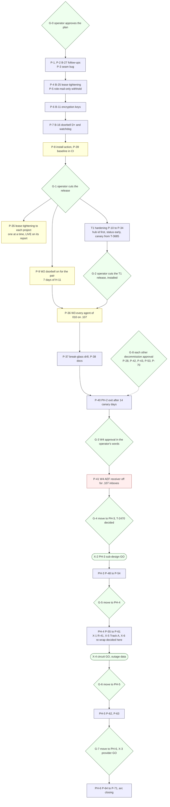

# Interactive agent communication: step 8, build plan

**Task:** T-3357 · **Arc:** arc-011 · **Chain:** arc-011-design, step 8 · **Role:** planner
**Status:** DRAFT v0.1 (2026-11-12), batch mode (no human present, `_common.md` 5.2). This step **decides**
(`decides: true`): the operator approves the plan, and the operator alone decides every exploration (card 5). Until
then this is a **draft**: no work item has been created from it (card 3.2). Everything below is a proposal.
**Review link:** none. This project's Watchtower has no inline design-review page (profile P2.1); read the file in the
repository.
**Standing rules applied (CLAUDE.md):** nothing working is switched off as a side effect, only by a decommission unit
with the operator's explicit, documented approval (**NID**); thresholds measure reliability, never usage (**RNU**).

## 0 Version history

| Version | Date | Change | Task |
|---|---|---|---|
| 0.1 | 2026-11-12 | First complete draft: 71 units P-1..P-71 (46 PH-2, 8 PH-3, 7 PH-4, 2 PH-5, 8 PH-6; 5 of them requests to other projects), 7 explorations X-1..X-7, 9 gates G-0..G-8, 150 typed edges checked for cycles, the order with reasons, coverage of R-1..R-82 and E-1..E-173 and card 3.6, the step-1 build tasks re-scoped or confirmed, R-41 placed, drawings D-1 (two parts) and D-2 | T-3357 |

## 1 Inputs of record

1.1 Read on 2026-11-12, sha256 of the bytes read (`sha256sum`). The chain names 04 and 07 for step 8; card 2.0 names the
approved output of every earlier step, so all are listed.

| Short | Path | Version | sha256 |
|---|---|---|---|
| REQ | `docs/design/interactive-agent-communication-01-requirements.md` | v0.5.4 | `aae4ce0229b14f7e93cf518ee44d88d94c4dd08ffcac7fc441a545c892fbda24` |
| TM | `docs/design/interactive-agent-communication-02-threat-model.md` | v0.3.8 | `6ffa60d9b03f953f76a2a10a50591b594b594ac3c12ba4d04ef6bd8e4b0fd09f` |
| FP | `docs/design/interactive-agent-communication-03-floor-and-phasing.md` | v0.3.1 | `09d82254add16cefd29b868673d4dda135b439842d6582c8a03bbf5e7cf0fca5` |
| ARC | `docs/design/interactive-agent-communication-04-architecture.md` | v0.4 | `190a3f0953dc1e04e74dc2dcc4824c9349184021d322236316c3e6aa35463d55` |
| ARCa | `docs/design/interactive-agent-communication-04a-traceability.md` | v0.3 | `c516a290997e0c75957c0be95af4d611e58155cd818d2fbae961c0f4ad6d4667` |
| EV | `docs/design/interactive-agent-communication-05-evidence.md` | v0.2 (173 specs) | `15e4f53dd1bd3ca2d10e261b8e72c12056072ae257a1df0ca216465dacac1d2b` |
| COV | `docs/design/interactive-agent-communication-05a-coverage.md` | v0.2 (211 FCWs) | `8b56a8f6fad6a4d226b994730d719f169c9c48f016dfcb0865b7fca77808ac28` |
| PC | `docs/design/interactive-agent-communication-06-pseudo-code.md` | v0.3 | `c597d0370bd598c29fb4af93c9fbbc5fa129c98520d5cbc1449b1de401a5105c` |
| PCa | `docs/design/interactive-agent-communication-06a-pseudo-code-ph2-hardening.md` | v0.3 | `8579166a8203245e2e5e0e123aebe16b62ac15c7d7f67c4b916440ffccb0d01d` |
| PCb | `docs/design/interactive-agent-communication-06b-pseudo-code-later-phases.md` | v0.3 | `186dce6598d1bd189b177b4b9373da7c31c253bba4e8050969dffb1c09d41c08` |
| PANEL | `docs/design/interactive-agent-communication-07-review.md` | v0.1, 51 findings, approved 2026-11-12 ("A") | `edcc283aced8940d9628239a0c3b41f13de2ba9dcb129f3a8d161d0340669090` |
| RUL | `docs/reports/T-3344-step1-rulings-summary.md` (section 11, section 12) | | `6381769f3b2a98f3bdc1e1cfe6c6c16c35891b5e5c9fedca55014ceaff13e418` |
| ROLL | `docs/reports/T-3654-main-only-rollout.md` (main-only rollout tracker) | | `5a73a50114345f3b1dfb2fff1e4eb3c9453db0ac0d2c6bce4958c320d1e41aeb` |

1.2 Role inputs, in the order given (README 3.3).

| Short | Path | sha256 |
|---|---|---|
| RULES | `CLAUDE.md` (project sections above `## Core Principle`) | `a9b38fd1aeed0145289c6a8c89c491c2ae077d06e1847110209827f33e172aa3` |
| README | `docs/design/roles/README.md` | `3881d5302313a0d0ca4c9ef1b4688dae101b6d693df823be962e9b70946368e0` |
| COMMON | `docs/design/roles/cards/_common.md` | `cca38806358d7a6c09e64289164977a825f2cf57e914f672076ff77a2bdb5563` |
| CARD | `docs/design/roles/cards/planner.md` | `6f279cafcd0db1dc04c7841933cad894ef0e4237bc0a504e2532418aafdc2022` |
| ADAPTER | `docs/design/roles/adapters/aef.md` | `d840a77649888cdbfd37d1166c15eecd6cd3c8399d497fb6b1b2c52455c6c4a4` |
| PROFILE | `docs/design/roles/profiles/termlink.md` | `b6bc160242d96ca9a8fc167c6845e292529c162fa23faa2945d4742b676e7b21` |
| CHAIN | `docs/design/interactive-agent-communication-role-chain.yaml` | `4cea381100cd19fbfb06194c12c6a45fa5a81b471904d23b8c3cdecbcaab8020` |
| SCHEMA | `docs/design/roles/schemas/role-handback-1.schema.json` | `288a4e312f00bac978a4b2a87e57ee8a05cb14f916d77c397e601e03c703c148` |

1.3 Rulings and facts that bind the plan. Task files change as work proceeds, so they are cited by the commit read.

| Short | Source | Read at | What it binds |
|---|---|---|---|
| RA | T-3426 `## Decisions` 2026-11-11, ruling A | `568a25ec7` | PH-2 build-ahead serialised B-27 → B-25 → B-11 → B-16, in the main checkout |
| B27 | T-3687 `## Decisions` (D-1..D-8, CR-B27.1..6) | `fce269868` | B-27 built; CR-B27 round done; two open follow-ups (F-26 persist `last_prompt`, F-27 READY order) |
| FOLD | T-3689 `## Decisions` and hand-back 9a, 9b | `dcfb2c27d` | the step-7 fold; the pull withholds all mail (needs a unit); FP-4 starting values stay proposals |
| P7 | T-3356 (step 7 approved "A", ruling D on F-20) | `8c8adc521` | B-16 carries the F-1 re-check and the macOS interim `ps` veto; full veto T-3688 |
| T3686 | `.tasks/active/T-3686-*` | `dcfb2c27d` | test seams obeyed in production (`main_lease.rs:82-90`) |

1.4 How this step was run. Batch mode; every question I could not answer from a ruling is an exploration (section 9) or
an operator decision (section 15). The adapter's ring20 paths (`role-chain.py`, `design-render-check.py`) do not exist
here; the profile governs (P2.1, P4.5). Units, edges and gates are kept as data in a working tool,
`.context/working/t3357/plan.py` (not product code), which generates the unit tables, the order table, the coverage
tables and the D-1 drawings, checks the graph for cycles, checks the order against every edge, and exits 0 only when
there is no cycle, no order violation and no unserved R-n or E-n (section 5.3). I changed no earlier output, no task
file other than T-3357, no code, and created no work item.

## 2 How to read this document

2.1 Identifiers new here: **P-n** plan units (stable; each maps to exactly one work item after approval, section 12),
**X-n** explorations (inceptions; GO/NO-GO by the operator), **G-n** gates (operator decision points, or an aggregation
of units that must all be live), **PL-n** plan residual risks, **CR-8.n** change requests to earlier steps, **PD-n**
plan decisions carried by the approval. Ids of earlier steps are cited as defined there (B-n build items and K-n
components of ARC 22 and 5.1; E-n of EV; R-n of REQ; FCW-n of PC; F-n of PANEL).
2.2 **Edge types** (card 3.4, `depends_on` with the condition that satisfies it). An edge "A depends on B (type)" is
satisfied when:
2.2.a `built`: B is merged on `main`, its `## Verification` passes and its fixtures and mutants are green.
2.2.b `live`: B is in a release installed on .107 by the P-8 action, and the [i] that ARC 11.5 names for it reads as stated.
2.2.c `field`: B has run reliably in the field for the window named in the condition (RNU: measured as reliability).
2.2.d `security`: a hard security ordering (card 3.4): satisfied like `built`, and it MUST NOT be relaxed by any priority
or schedule argument.
2.2.e `serial`: serialisation only (same file, same rollout, or the operator's ruled sequence); the operator MAY swap it.
2.2.f `decision`: an operator decision recorded in a task's `## Decisions` in the operator's words (or `fw inception
decide` for an X-n).
2.2.g `external`: another project's deliverable reported shipped on its channel.
2.3 Readiness follows from the edges, never from horizon or a score (card 3.4, 3.7). Every unit also implicitly
depends on **G-0**, the approval of this plan.
2.4 RFC 2119 words mark normative text. Choices are lettered A to D with a recommendation.

## 3 Scope, standing facts and what this plan decides

3.1 **What the plan covers.** All of arc-011 from today's baseline to the target of ARC 11 (PH-2 remainder through
PH-6). PH-2 is planned at build-item grain (each unit one deliverable, one session, its own rollback). PH-3 to PH-6 are
planned at the grain their designs allow: their detailed sub-designs are open behind gates (ARC 23.3), so they carry
explorations first and coarser units that the explorations will split (PL-6).
3.2 **Baseline, reused, not planned again [B].** PH-1 core; PH-2 rows P0..P9 and P20 (ARC 4.2); `termlink sidecar` in
the binary (T-3365, closed); the main lease and the non-main gate (T-3654, live in the projects of ROLL); B-27 the
activity meter (T-3687, built at `8cf07e7a3`, CR-B27 round done); B-24 the fold of XR-1..XR-9 (done by T-3676) and the
fold of the step-7 change requests (T-3689). The PH-1 invariants stay under evidence through P-39.
3.3 **Binding rulings** (1.3): ruling A's serial order is kept as `serial` edges P-4 → P-6 → P-7 (B-25, B-11, B-16), with
the two B-27 follow-ups (P-1, P-2) and the seam bug (P-3) placed in front because they touch the same files and B-16
reads them (section 6.2).
3.4 **Standing facts that shape the plan.**
3.4.a NID: every removal is its own decommission unit gated by a `decision` edge (G-3, G-8): P-28, P-41, P-42, P-43
(the replacement of the interim veto), P-53, P-70. No build unit switches anything off.
3.4.b RNU: every acceptance threshold is a reliability measure (reach per attempt, visible failure, zero false
"delivered"; ARC 15.2); H-11 (e) and (f) are failure shares per ring.
3.4.c The node1 build pool: regular use waits for the operator's go. No unit depends on it; every unit builds in the
main checkout on .107 (no worktree). If the operator gives the go, throughput rises; no edge changes (PL-5).
3.4.d The main-only rollout tracker (ROLL) is where the lease tightening reaches the other projects: P-35, one project
at a time, LIVE only on the project's own report.
3.4.e The guard cap (CLAUDE.md, DP-3: 99 checks, 34 canary crons, one in one out): P-29 and P-33 add checks only
inside existing layers or by retiring one in the same commit; P-23 extends the existing preflight script.
3.5 **What this plan decides, with its approval** (G-0): the units, their edges and order; the plan decisions PD-1..PD-3
(section 15.2); which existing tasks are reused, extended, re-scoped or proposed superseded (section 7). It does not
decide any exploration, any decommission, any release cut or any phase move: those are gates the operator passes later.

## 4 The units (card 4.1)

4.1 Each unit: stable id, type, phase, the work item it maps to (existing task, or "new" to be created after approval),
the deliverable, the R-n and E-n it serves, its typed dependencies, acceptance from the E-n plus a declared
verification check, and its rollback boundary. "R-n served" is derived: the R-n of COV 2.1 whose specs this unit makes
pass, plus the R-n the unit names. "E-n served" is derived from EV's own `Phase:` tag of each spec (the B-n it names),
the K-n of the section-10 invariant checks, and the specs a unit names.
4.2 **Acceptance rule for every build unit (FP 3.1.b, ARC 22.1).** The unit's E-n MUST pass at the level EV states,
each with its negative control; the unit ships its floor probe with a mutant that turns it red; its `## Verification`
captures to a private file and asserts last (adapter A4.3, CLAUDE.md rule 1). A Human criterion appears only where
judgement is needed (P-38), with what to look at and what fails it (card 3.5).

4.3 **PH-2** (46 units; P-44..P-46 are requests to AEF).

| Unit | Type | Phase | Work item (existing or proposed) | Deliverable | R-n served | E-n served | Depends on (type: condition) | Acceptance | Verification check | Rollback |
|---|---|---|---|---|---|---|---|---|---|---|
| P-1 | build | PH-2 | T-3687 follow-up (new task) | B-27 follow-up F-26: persist `last_prompt` with READY (06 v0.3 AL-1, 8.3; revises T-3687 D-4) | R-6, R-19, R-20, R-21, R-24, R-29, R-44, R-47, R-50, R-51, R-67, R-79, R-81 | E-9, E-15, E-16, E-17, E-18, E-19, E-84, E-153, E-154, E-156, E-157, E-158 | none | the E-n listed pass at the level 05 states; the built B-27 specs re-run green (the follow-up changes meter.rs); after a sidecar restart a session with a prompt before the restart reads its persisted `last_prompt`, never `none` (QR-2 closed) | fixture suite for the unit exits 0 with a PASS line per listed E-n, and its mutant list is all killed (FP 3.1.b); restart fixture with a negative control (persistence removed: red) | revert the commit; the CR-6.23 restart rule built in T-3687 returns |
| P-2 | build | PH-2 | T-3687 follow-up (new task) | B-27 follow-up F-27: order READY on `(boot_id, mono_ns)`, receive stamp as fallback; TermLink hooks send both (04 17.2.a, 06 AL-1 CR-6.24) | R-21, R-47 | E-156 | none | the E-n listed pass at the level 05 states; a backward wall-clock step does not freeze READY; reports without the fields are ordered by receive stamp | fixture suite for the unit exits 0 with a PASS line per listed E-n, and its mutant list is all killed (FP 3.1.b); clock-step fixture, mutant ordering by `at_ms` red | revert; ordering returns to `at_ms` (T-3687 test documents the freeze) |
| P-3 | build (bug) | PH-2 | T-3686 | T-3686: main-lease test seams `TERMLINK_MAIN_TEST_*` refused in production builds (main_lease.rs:82-90) | R-6, R-39 | E-163, E-164 | none | the E-n listed pass at the level 05 states; a production binary ignores the seam variables and says so once in its log; tests still drive them | fixture suite for the unit exits 0 with a PASS line per listed E-n, and its mutant list is all killed (FP 3.1.b); `E-164` seam scan on .107 reports no seam set | revert; seams obeyed again (the bug returns, no data effect) |
| P-4 | build | PH-2 | new (proposes superseding T-3359) | B-25: lease tightening (origin counting, `ignored: origin`, PostToolUse no longer renews, provisional SessionStart claim, fast takeover V-20) and the waiting-mail signal K-34 (V-21) | R-6, R-21, R-23, R-24, R-29, R-39, R-47, R-50, R-51, R-53, R-62, R-67, R-67.a1, R-68, R-79 | E-20, E-21, E-22, E-23, E-24, E-25, E-26, E-27, E-28, E-30, E-31, E-84, E-139, E-142, E-153, E-161, E-162, E-163 | P-3 (serial: P-3 merged: same file main_lease.rs; the tightening is tested without seams obeyed in production) | the E-n listed pass at the level 05 states; the B-25 specs pass; `absent` projects behave as before until they report origin (NID) | fixture suite for the unit exits 0 with a PASS line per listed E-n, and its mutant list is all killed (FP 3.1.b); `termlink main status` shows `origin` and `last_human_at` on the W1 pair | per project: hooks back to the built renew rule; lease records kept |
| P-5 | build | PH-2 | new | Pull withholds only role mail from a non-main session (04 7.1.a, CR-4.11; T-3689 hand-back 9a; changes the built T-3654 pull) | R-62, R-67.a1 | E-161 | P-4 (serial: P-4 merged: same lease gate and same per-project rollout) | the E-n listed pass at the level 05 states; mail to an exact instance reaches that session whether or not it is main; role mail to a non-main session is still withheld; the E-spec tagged "B-25 for the withhold change" passes | fixture suite for the unit exits 0 with a PASS line per listed E-n, and its mutant list is all killed (FP 3.1.b); negative control: an all-mail withhold mutant fails the exact-instance case | revert to the built all-mail withhold (fails toward holding, never toward a wrong copy) |
| P-6 | build | PH-2 | new | B-11: per-agent encryption keys in the register, encryption wrapper (TLBLOB v1), artifact writer check | R-11, R-80 | E-47, E-48, E-144, E-168 | P-4 (serial: T-3426 ruling A order B-25 -> B-11) | the E-n listed pass at the level 05 states; the B-11 specs pass | fixture suite for the unit exits 0 with a PASS line per listed E-n, and its mutant list is all killed (FP 3.1.b) | keys stay in the register (never destroyed); writers fall back to refusing blobs, never plaintext |
| P-7 | build | PH-2 | new | B-16: doorbell D+ (READY, no typing 30 s, no conversation, re-checks after the veto), bracket-free SI-1 line, strict delivery, back-off; 300 s watchdog K-33 with the F-1 typing re-check, STALLED, and on macOS the interim `ps` veto (`watchdog: degraded (macOS, ps veto)`); session binding for S1 and `command.notify` | R-3, R-19, R-20, R-22, R-23, R-24, R-25, R-29, R-42, R-44, R-51, R-62, R-63, R-67.a1, R-81 | E-1, E-2, E-3, E-4, E-5, E-6, E-7, E-8, E-9, E-10, E-11, E-12, E-13, E-14, E-98, E-121, E-125, E-136, E-138, E-159, E-160, E-161 | P-6 (serial: T-3426 ruling A order B-11 -> B-16); P-1 (built: P-1 merged: the ring gate reads a persisted last_prompt after restart); P-2 (built: P-2 merged: READY cannot freeze on a clock step) | the E-n listed pass at the level 05 states; the B-16 specs pass, including the F-1 re-check and the macOS degraded status | fixture suite for the unit exits 0 with a PASS line per listed E-n, and its mutant list is all killed (FP 3.1.b); H-11 (a)..(f) collectors write rows on the canary pair | doorbell off per agent (kill switch, tested in W1); watchdog off with it |
| P-8 | deployment | PH-2 | new | Release install action: one idempotent `runme.sh` action that installs a named release on .107, checks `checksums.txt` in status, and rolls back to the previous release | R-8, R-15, R-39, R-42, R-49 | E-80, E-81, E-100 | none | the E-n listed pass at the level 05 states; install, upgrade, rollback and restart on .107 from the release artifact; STORED messages kept and listed on rollback | latest runme log shows the action OK and `finished rc=0`; status `binary` matches the release checksum; hermetic case in tests/runme-fixtures.sh | the action itself is the rollback |
| P-9 | operation | PH-2 | runme action | B-17 W2: the operator runs the W2 action (doorbell on for the W1 pair); H-11 measured for 7 days | R-20, R-49, R-67, R-81 | E-13, E-31, E-171 | P-7 (live: P-7 in a release installed on .107 by P-8); P-8 (built: install action exists); G-1 (decision: release cut) | the E-n listed pass at the level 05 states; H-11 (a)..(f) within their [P] bounds for 7 days (RNU); every ring ATTEMPTED only | latest runme log shows the action OK and `finished rc=0`; H-11 report in docs/reports/ with the 7-day numbers | kill switch then doorbell off; W1 state |
| P-10 | build | PH-2 | T-3366 (re-scoped: alias end moves to P-53) | B-1: minted hub id + hub signing key + `hub.version` fields (DR-1 A, DR-2 A) | R-6, R-33, R-39, R-54, R-61, R-75 | E-36, E-37, E-38, E-126, E-163, E-166 | none | the E-n listed pass at the level 05 states; the B-1 specs pass; existing hubs adopt the fingerprint-derived id; re-mint beside state refused | fixture suite for the unit exits 0 with a PASS line per listed E-n, and its mutant list is all killed (FP 3.1.b) | the id file stays; clients ignore the new fields |
| P-11 | build | PH-2 | T-3363 (re-scoped: PH-2 part) | Mail-hub declaration reader and check (V-7, DR-7 A): the sidecar reads `mail_hub` and refuses to run on a mismatch | R-54 | E-38, E-145 | P-10 (built: the minted id exists); P-46 (external: activation only: AEF ships the mail_hub key) | the E-n listed pass at the level 05 states; the spec tagged "B-1; AEF owns the key" passes; a differing declaration or answering hub stops the sidecar with a named reason | fixture suite for the unit exits 0 with a PASS line per listed E-n, and its mutant list is all killed (FP 3.1.b) | reader off by config; sidecar runs as before |
| P-12 | build | PH-2 | new | B-2: consumer list per inbox, sidecar check each tick, bind-and-refuse verb (DR-11 A) | R-49, R-60 | E-66, E-133, E-169 | none | the E-n listed pass at the level 05 states; the B-2 specs pass | fixture suite for the unit exits 0 with a PASS line per listed E-n, and its mutant list is all killed (FP 3.1.b) | flag-only mode (DR-11 A before W4) |
| P-13 | build | PH-2 | new (extends T-3382) | B-3: admin RPC log flag, sweep and trim refused on open mail, retention ceilings V-3 | R-35 | E-67, E-169 | none | the E-n listed pass at the level 05 states; the B-3 specs pass; the forever-topic growth of T-3382 is bounded by V-3 | fixture suite for the unit exits 0 with a PASS line per listed E-n, and its mutant list is all killed (FP 3.1.b) | ceilings off; log rows kept |
| P-14 | build | PH-2 | new | B-4: founding-verb use log at session and hub; owner-only sessions | R-4 | E-68, E-169 | none | the E-n listed pass at the level 05 states; the B-4 specs pass | fixture suite for the unit exits 0 with a PASS line per listed E-n, and its mutant list is all killed (FP 3.1.b) | log stays; owner-only check off by config |
| P-15 | build | PH-2 | new | B-5: revocation list (hub state, admin revoke, self-revoke, tick pull, stale rule DR-8 A) | R-46, R-63 | E-39, E-40, E-41, E-42, E-43, E-127, E-167 | P-10 (security: signing key before any signed list) | the E-n listed pass at the level 05 states; the B-5 specs pass | fixture suite for the unit exits 0 with a PASS line per listed E-n, and its mutant list is all killed (FP 3.1.b) | revocations stay recorded; pull off returns to PH-1 trust (status says so) |
| P-16 | build | PH-2 | new | B-6: agent key card at the hub, post-time signature check, signed dead letter for retired instances | R-44, R-62, R-75 | E-69, E-70, E-169 | P-10 (security: signing key before signed dead letters) | the E-n listed pass at the level 05 states; the B-6 specs pass | fixture suite for the unit exits 0 with a PASS line per listed E-n, and its mutant list is all killed (FP 3.1.b) | check off at the hub; cards kept |
| P-17 | build | PH-2 | new | B-7: receiver quotas, sender window, hop limit, jitter (DR-3 A) | R-11, R-30, R-56 | E-50, E-51, E-52, E-53, E-54, E-129, E-168 | none | the E-n listed pass at the level 05 states; the B-7 specs pass | fixture suite for the unit exits 0 with a PASS line per listed E-n, and its mutant list is all killed (FP 3.1.b) | quotas to the PH-1 defaults |
| P-18 | build | PH-2 | T-3362 | B-8: sequence window, `up_to`, gap wait (DR-12 A) | R-45, R-59 | E-86, E-87, E-88, E-128 | none | the E-n listed pass at the level 05 states; the B-8 specs pass | fixture suite for the unit exits 0 with a PASS line per listed E-n, and its mutant list is all killed (FP 3.1.b) | window off; numbers still written |
| P-19 | build | PH-2 | T-3358 (extend) | B-9: `--priority`, ladders as sidecar code, owed list, answer deadline | R-2, R-18, R-25, R-28, R-30, R-31, R-44, R-52, R-56, R-58 | E-54, E-89, E-123, E-130 | P-17 (built: 04 B-9 <- B-7) | the E-n listed pass at the level 05 states; the B-9 specs pass | fixture suite for the unit exits 0 with a PASS line per listed E-n, and its mutant list is all killed (FP 3.1.b) | ladders off; the field stays |
| P-20 | build | PH-2 | new | B-10: reconciliation on start, daily head compare, VM host-crash test | R-15, R-16, R-45 | E-90, E-91, E-92, E-122, E-132, E-170 | P-18 (built: 04 B-10 <- B-8) | the E-n listed pass at the level 05 states; the B-10 specs pass | fixture suite for the unit exits 0 with a PASS line per listed E-n, and its mutant list is all killed (FP 3.1.b) | reconciliation off; counts still reported |
| P-21 | build | PH-2 | new | B-12: blobs on the chain with both digests, H-7 | R-11, R-15, R-16, R-42, R-80 | E-44, E-45, E-46, E-122, E-131, E-168 | P-6 (built: encryption keys exist) | the E-n listed pass at the level 05 states; the B-12 specs pass; the hub holds ciphertext only | fixture suite for the unit exits 0 with a PASS line per listed E-n, and its mutant list is all killed (FP 3.1.b) | blobs refused (never plaintext) |
| P-22 | build | PH-2 | T-3614 (re-scope) | B-13: `artifact put --hub` with `--encrypt-to` only; plaintext refused with a reason (DR-5 A) | R-80 | E-49 | P-6 (security: encryption before any remote put: never plaintext (O-1 A)) | the E-n listed pass at the level 05 states; the B-13 spec passes; ring20 node1 pool transfer works encrypted | fixture suite for the unit exits 0 with a PASS line per listed E-n, and its mutant list is all killed (FP 3.1.b) | `--hub` removed; local put unchanged |
| P-23 | build | PH-2 | T-3364 | T-3364: NTP-synchronised clock check in substrate preflight (CAND-13), read by the status skew line | R-57 | — | none | no E-n of its own in 05 (see CR-8.3 where specs are missing); an unsynchronised clock is reported by preflight and by status; inside the existing preflight script, so no new guard (DP-3) | preflight fixture: unsynchronised clock fixture red, synchronised green | revert the check |
| P-24 | build | PH-2 | new | B-14: status strength flags, reachability card, CLEAR, skew, GP-4 lines | R-6, R-7, R-29, R-44, R-45, R-53, R-57, R-70, R-82 | E-19, E-55, E-56, E-57, E-58, E-59, E-60, E-61, E-134 | P-12 (built: 04 B-14 <- B-2); P-15 (built: 04 B-14 <- B-5); P-23 (serial: skew line reads the NTP state) | the E-n listed pass at the level 05 states; the B-14 specs pass; status answers in 5 s | fixture suite for the unit exits 0 with a PASS line per listed E-n, and its mutant list is all killed (FP 3.1.b) | fields hidden; status as before |
| P-25 | build | PH-2 | new | B-15: six fault injectors, tier 1 and tier 3, and the drill | R-6, R-8, R-29, R-49, R-54, R-69, R-70 | E-62, E-63, E-64, E-65, E-135 | P-24 (built: 04 B-15 <- B-14) | the E-n listed pass at the level 05 states; the B-15 specs pass; H-18 100 of 100 | fixture suite for the unit exits 0 with a PASS line per listed E-n, and its mutant list is all killed (FP 3.1.b); drill report | injectors are test-only; remove |
| P-26 | build | PH-2 | new | B-18 log half: vendor-channel log hook (K-20) | R-47, R-79 | E-71, E-140, E-170 | none | the E-n listed pass at the level 05 states; the spec tagged "B-18 log half" passes | fixture suite for the unit exits 0 with a PASS line per listed E-n, and its mutant list is all killed (FP 3.1.b) | hook removed |
| P-27 | build | PH-2 | new (T-2876 is closed; new task cites it) | B-26: session message prover re-based on the TermLink rail (successor of T-2876), keeping assert-on-the-receiver and its mutants | R-24, R-42, R-79 | E-74 | none | the E-n listed pass at the level 05 states; the B-26 spec passes; DELIVERED rc 0 and a never-sent control UNDELIVERED rc 1 on the TermLink rail | fixture suite for the unit exits 0 with a PASS line per listed E-n, and its mutant list is all killed (FP 3.1.b); one live pass with a negative control | T-2876 prover kept until this one is proven |
| P-28 | decommission | PH-2 | new | B-18 deny half: SendMessage deny as an idempotent operator action in `/opt/termlink/runme.sh`, refusing to run before P-27 has passed (O-4 A) | R-79 | E-72, E-73 | P-27 (field: P-27 passed live with its negative control (O-4 A)); G-8 (decision: O-4 A recorded (T-3353); the operator runs it) | the E-n listed pass at the level 05 states; the specs tagged "B-18 deny half" and "B-18" pass; the action refuses without P-27 evidence | latest runme log shows the action OK and `finished rc=0`; the deny entry present in settings; hermetic runme fixture | remove the deny entry (runme action, logged) |
| P-29 | monitoring | PH-2 | T-3361 | B-19: daily two-agent canary on the installed artifact, staleness 26 h (V-13), needs-attention landing | R-66, R-69 | E-78, E-141 | none | the E-n listed pass at the level 05 states; the B-19 spec passes; the canary runs daily on the testdev pair | canary log daily with its control; staleness alarm fixture red when the log stops | cron entry removed (by the guard-cap rule, a canary out frees its slot) |
| P-30 | build | PH-2 | T-3669 (extend) | B-20: forward-once of role mail, VIA and FORWARD-STALE notices, re-admit of a FORWARDED id, ambiguous post to UNCERTAIN, H-24 (04 section 7) | R-51, R-62, R-67.a1 | E-32, E-33, E-34, E-35, E-143, E-165 | P-16 (built: 04 B-20 <- B-6); P-6 (built: CR-4.10 blob keys for forwarded mail); P-5 (built: withhold semantics forward-once relies on) | the E-n listed pass at the level 05 states; the B-20 specs pass; no role mail lost or doubled across copies (H-24) | fixture suite for the unit exits 0 with a PASS line per listed E-n, and its mutant list is all killed (FP 3.1.b) | forward off: role mail waits at the non-main copy, signal K-34 shows it |
| P-31 | deployment | PH-2 | new (runme action) | Credential migration on .107: hub id and signing key minted from the existing certificate, encryption keys for every W-agent, key cards published | R-75 | — | P-10 (built: mint code); P-6 (built: key code); P-16 (built: card code) | no E-n of its own in 05 (see CR-8.3 where specs are missing); every W-agent has a register entry whose public key matches its private key (E-144); the hub id is unchanged from the fingerprint-derived one | latest runme log shows the action OK and `finished rc=0`; status `hub {id, declared, match}` true; E-144 check passes | new keys kept, unused; nothing destroyed |
| P-32 | test | PH-2 | T-3360 (re-scope) | Standing controls (T-3360 re-scoped, PH-2 part): OD-18 takeover tests on the built lease and the three CAND-3 real-failure controls, kill-checked continuously | R-29, R-54, R-68, R-69 | E-79, E-151 | P-4 (built: tightened lease under test); P-25 (built: injectors) | the E-n listed pass at the level 05 states; each control red on its mutant and green on the system; runs in the guard layer within the cap (DP-3) | `scripts/run-guard-layer.sh` lists the controls green; a mutant run turns each red | controls removed (a gap the exit report must name) |
| P-33 | monitoring | PH-2 | new | Production invariant checks E-125..E-152 wired into status, the canary and the existing guard layer, within the guard cap (DP-3: a new canary only by retiring one, same commit) | R-1, R-2, R-6, R-20, R-23, R-24, R-29, R-37, R-39, R-42, R-44, R-54, R-58, R-61, R-66, R-67, R-67.a1, R-69, R-70, R-80 | E-125, E-126, E-127, E-128, E-129, E-130, E-131, E-132, E-133, E-134, E-135, E-136, E-137, E-138, E-139, E-140, E-141, E-142, E-143, E-144, E-145, E-146, E-147, E-148, E-149, E-150, E-151, E-152, E-155, E-164 | P-24 (built: status fields); P-29 (built: canary) | the E-n listed pass at the level 05 states; every 05 section 10 check has a reader and a firing control; guard-cap baseline unchanged or one-in-one-out | guard layer run lists each check; `.context/checks/guard-cap-baseline` respected | checks removed with their slots |
| P-34 | monitoring | PH-2 | T-3433 | T-3433: FX-5 disclosure inventory check (store x form x readers x retention) as the primary FX-5 check | R-11 | — | P-21 (built: new store row); P-22 (built: remote put row) | no E-n of its own in 05 (see CR-8.3 where specs are missing); the inventory diff shows no new plaintext row after P-21 and P-22; an injected plaintext store row fires | inventory check fixture with a firing control | back to the field count |
| P-35 | deployment | PH-2 | T-3654 (tracker; per-project rows) | Lease tightening and role-mail withhold rolled out to the projects of the main-only rollout tracker (docs/reports/T-3654-main-only-rollout.md), one project at a time | R-67 | — | P-4 (live: released); P-5 (live: released) | no E-n of its own in 05 (see CR-8.3 where specs are missing); per project: main status held, `am-i` 0/1, origin reported or `absent` kept; tracker row LIVE only after the project reports it | tracker rows updated with the project report; `termlink main status` per project | per project: previous release; lease records kept |
| P-36 | operation | PH-2 | runme action | B-21 W3: every agent of this project on .107 through the launcher | R-49 | E-171 | P-9 (field: H-11 within bounds for 7 days (W2 bound)); G-2 (live: T1 live); P-29 (live: canary daily); P-30 (live: forward-once live (04 T2)) | the E-n listed pass at the level 05 states; the B-21 spec passes; consumer list shows one identity per inbox over V-11 | latest runme log shows the action OK and `finished rc=0`; consumer list and canary log | per agent back to W2 by the K-4 drain, kept-and-listed |
| P-37 | test | PH-2 | new | Break-glass drill at W3 scale: kill switch (fleet form), revoke, delivery off, drain and recovery, timed | R-82 | E-113 | P-36 (built: W3 running); P-15 (live: revoke available) | the E-n listed pass at the level 05 states; every action logged and shown (SI-24); recovery with zero manual steps; the kill switch stops mid-turn delivery within one tick | drill report in docs/reports/ with timings and the audit rows | the drill is itself reversible; nothing persists but the report |
| P-38 | documentation | PH-2 | new | Operator documentation for PH-2: status fields, CLEAR, watchdog (incl. macOS degraded), lease tightening and waiting-mail signal, W2..W4 runbooks and per-wave rollback | R-29, R-53 | — | P-24 (built: fields to document); P-7 (built: watchdog); P-4 (built: lease) | no E-n of its own in 05 (see CR-8.3 where specs are missing); each runbook names the runme action and the status line that proves it; [REVIEW] the operator follows the W3 rollback runbook on paper and finds no step he cannot do | doc links resolve; every runme action named exists in runme.sh | docs only |
| P-39 | test | PH-2 | new | Baseline re-assertion: the PH-1 built invariants (05 section 8) run on every push and every release | R-2, R-3, R-5, R-6, R-7, R-8, R-13, R-14, R-15, R-16, R-17, R-19, R-24, R-28, R-34, R-39, R-42, R-44, R-45, R-48, R-49, R-50, R-51, R-52, R-58, R-62, R-63, R-67, R-68, R-69, R-72, R-82 | E-30, E-65, E-76, E-80, E-81, E-93, E-94, E-95, E-96, E-97, E-98, E-99, E-100, E-101, E-102, E-103, E-113, E-122, E-123, E-124 | none | the E-n listed pass at the level 05 states; the "PH-1 built" specs run in CI and per release; a broken built invariant turns CI red | CI job lists the specs; one seeded mutant fails it | job removed |
| P-40 | test | PH-2 | new | B-22: W3 two-agent acceptance, PH-2 exit report, FP-3 fixtures handed to AEF | R-1, R-2, R-3, R-14, R-15, R-24, R-26, R-27, R-28, R-42, R-44, R-45, R-49, R-66, R-69 | E-75, E-76, E-77, E-83 | P-36 (built: W3 running); P-37 (built: drill passed); P-32 (built: controls green); P-33 (built: checks wired); P-34 (built: inventory green); P-38 (built: docs); P-39 (built: baseline in CI); P-28 (built: deny in place); P-29 (field: canary 14 days, no silent failure (H-14)) | the E-n listed pass at the level 05 states; FP 6.2.3.d (1)..(5) pass; canary 14 days without a silent failure (H-14) | exit report in docs/reports/; arc-live-probe passes on .107 | report only |
| P-41 | decommission | PH-2 | runme action | B-23 W4: AEF receiver and notify-sidecar switched off for .107 inboxes (decommission, NID) | R-49 | E-82 | P-40 (built: PH-2 exit passed); G-3 (decision: approval recorded) | the E-n listed pass at the level 05 states; the B-23 spec passes; the action refuses without the recorded approval; AEF receiver stays installed, off, until PH-3 exits | latest runme log shows the action OK and `finished rc=0`; AEF receiver unit inactive for .107 inboxes; one consumer per inbox | AEF receiver back on (one receiver at every moment) |
| P-42 | decommission | PH-2 | new | Retire the W1 trial provisioning (the host-specific action 17 script) once the W3 launcher has served every agent (decommission, NID) | — | — | P-40 (built: launcher served all); G-8 (decision: approval recorded) | no E-n of its own in 05 (see CR-8.3 where specs are missing); every agent starts through the launcher for the window the approval names; the action refuses without the recorded approval | latest runme log shows the action OK and `finished rc=0`; install-drift check shows the old script absent | restore the script from git |
| P-43 | build | PH-2 | T-3688 | T-3688: full macOS activity veto (libproc CPU, disk, network); replaces the interim `ps` veto only once proven in the field and approved | — | — | P-7 (live: interim veto shipped; estate: an M1 joined the fleet); G-8 (decision: replacement approval) | no E-n of its own in 05 (see CR-8.3 where specs are missing); on the M1 the veto sees network and disk waits; status leaves `degraded`; replacement only with the recorded approval | fixture suite for the unit exits 0 with a PASS line per listed E-n, and its mutant list is all killed (FP 3.1.b); field run on the M1 with a negative control | interim `ps` veto stays installed until approval |
| P-44 | request (AEF) | PH-2 | AEF T-5054 | Request to AEF: B-29, the Claude Code adapter to `termlink.adapter/2` (READY, turn events, prompt origin, `(boot_id, mono_ns)`, evidence, complete), passing TermLink's parity fixtures | R-21, R-23, R-24, R-47, R-49, R-50, R-51, R-67, R-79 | E-27, E-29, E-84, E-85 | P-4 (built: fixtures published); P-2 (built: fixtures published) | the E-n listed pass at the level 05 states; the B-29 specs pass on AEF's side; TermLink publishes the fixtures with P-4 and P-2 | parity fixture run reported by AEF on framework:pickup | AEF's own |
| P-45 | request (AEF) | PH-2 | AEF (pickup) | Request to AEF: B-28, Watchtower view of `main.mail_waiting` and the out-of-band notice at 30 min (GP-11); approvals via Watchtower and out-of-band channels | R-29, R-47, R-49, R-53, R-67 | E-28, E-29 | P-4 (built: signal exists) | the E-n listed pass at the level 05 states; the B-28-tagged spec part passes on AEF's side | AEF report on framework:pickup | AEF's own |
| P-46 | request (AEF) | PH-2 | AEF (pickup) | Request to AEF: accept the `mail_hub` key in `.framework.yaml` (DR-7 A) | R-54 | — | none | no E-n of its own in 05 (see CR-8.3 where specs are missing); AEF ships the key and its doc | key present in a project .framework.yaml read by P-11 | AEF's own |

4.4 **PH-3.**

| Unit | Type | Phase | Work item (existing or proposed) | Deliverable | R-n served | E-n served | Depends on (type: condition) | Acceptance | Verification check | Rollback |
|---|---|---|---|---|---|---|---|---|---|---|
| P-47 | request (055) | PH-3 | 055 (pickup) | Request to 055: the opencode adapter to `termlink.adapter/2` against the same parity fixtures | R-47 | — | P-44 (built: contract fixtures proven by a first adapter) | no E-n of its own in 05 (see CR-8.3 where specs are missing); parity fixtures pass on 055's side | 055 report | 055's own |
| P-48 | build | PH-3 | new | K-28: directory, roster `termlink.roster/1`, signed cards with seq and TTL, project root key, signed key rotation and "moved to" | R-60, R-61, R-72, R-77 | E-108, E-116 | X-2 (decision: GO); P-10 (built: hub signing key) | the E-n listed pass at the level 05 states; FP 6.2.4.c (1) fixtures, then a two-hub live test with a negative control | fixture suite for the unit exits 0 with a PASS line per listed E-n, and its mutant list is all killed (FP 3.1.b) | stop exchanging cards; single-hub PH-2 resumes |
| P-49 | build | PH-3 | new | K-27: Tier 0 event registry and audit trail; decisions written back through the existing admin path from Watchtower and the out-of-band channels (no new hub verb) | R-50, R-72, R-76 | E-103, E-104, E-105, E-172 | X-2 (decision: GO); P-45 (external: Watchtower and OOB surfaces) | the E-n listed pass at the level 05 states; FP 6.2.4.c (2); a decision whose digest, executor or target differs is refused (SI-13) | fixture suite for the unit exits 0 with a PASS line per listed E-n, and its mutant list is all killed (FP 3.1.b) | pending events expire; no state change takes effect |
| P-50 | build | PH-3 | T-3363 (re-scoped: PH-3 part) | Every client verifies the hub id (T-3363 PH-3 part) and cross-hub mail on the hub path | R-1, R-2, R-5, R-13, R-33, R-45, R-54, R-55 | E-109 | P-48 (built: roster); P-11 (built: declaration reader) | the E-n listed pass at the level 05 states; status `hub.match` on every client; five rows across two hubs (T-5) | fixture suite for the unit exits 0 with a PASS line per listed E-n, and its mutant list is all killed (FP 3.1.b); two-hub live test with a negative control | cross-hub mail waits; sender sees WAITING |
| P-51 | build | PH-3 | T-3347 | T-3347: cross-hub read of a message's stage and reply by message id (primitive for AEF's send-and-wait, R-55) | R-55 | — | P-50 (built: cross-hub path) | no E-n of its own in 05 (see CR-8.3 where specs are missing); stage and reply read by id across two hubs; unknown id answered as unknown | fixture suite for the unit exits 0 with a PASS line per listed E-n, and its mutant list is all killed (FP 3.1.b) | verb removed |
| P-52 | build (pilot) | PH-3 | new | K-30: account helper (one sudoers entry, fixed template, refuses without a decided C-15 event) and the A0 pilot report | R-76, R-82 | E-114, E-115 | P-49 (security: audit before execute: helper refuses without a decided C-15 event) | the E-n listed pass at the level 05 states; the helper refuses without a decided event; the A0 report answers the managed-settings [A] (12.6) | fixture suite for the unit exits 0 with a PASS line per listed E-n, and its mutant list is all killed (FP 3.1.b); A0 pilot report | helper removed; the pilot account kept, disabled |
| P-53 | decommission | PH-3 | new (from T-3366) | T4 decommission: `sidecar:` alias ended with a reason; TOFU re-pin only through a Tier 0 event (NID) | R-71 | E-118 | P-49 (field: Tier 0 route proven); P-50 (field: hub id verified everywhere); G-8 (decision: approval) | the E-n listed pass at the level 05 states; alias calls refused with a reason; re-pin without an event refused; only with the recorded approval | fixture suite for the unit exits 0 with a PASS line per listed E-n, and its mutant list is all killed (FP 3.1.b); runme log OK | alias back for one release |
| P-54 | test | PH-3 | new | PH-3 exit report (FP 6.2.4.c) | — | — | P-48 (built: PH-3 scope); P-49 (built: PH-3 scope); P-50 (built: PH-3 scope); P-51 (built: PH-3 scope); P-52 (built: PH-3 scope) | no E-n of its own in 05 (see CR-8.3 where specs are missing); every PH-3 exit item passes | exit report | report only |

4.5 **PH-4.**

| Unit | Type | Phase | Work item (existing or proposed) | Deliverable | R-n served | E-n served | Depends on (type: condition) | Acceptance | Verification check | Rollback |
|---|---|---|---|---|---|---|---|---|---|---|
| P-55 | build | PH-4 | new | K-26: policy store and rule engine, deny by default, fixed defaults; allow-list as an instance (R-63, R-73, R-78) | R-63, R-73, R-78 | — | G-5 (decision: move confirmed) | no E-n of its own in 05 (see CR-8.3 where specs are missing); FP 6.2.5.c (4) rule-engine fixtures | fixture suite for the unit exits 0 with a PASS line per listed E-n, and its mutant list is all killed (FP 3.1.b) | rule engine off: fixed defaults apply |
| P-56 | build | PH-4 | new | Grants, Tier 2 and Tier 3 starts, resume of an exact instance (R-64, R-65, FX-3) | R-9, R-63, R-64, R-65, R-73, R-78 | E-106, E-112, E-173 | P-55 (security: deny by default before any grant path); P-49 (security: audit before execute) | the E-n listed pass at the level 05 states; an agent cannot create or widen authority (H-25); resume only on signed DEAD and a free session | fixture suite for the unit exits 0 with a PASS line per listed E-n, and its mutant list is all killed (FP 3.1.b) | grants off: nothing starts (fail closed) |
| P-57 | build | PH-4 | T-3360 (PH-4 part) | Main eligibility from signed profiles, duplicate mains resolved by the home hub, the R-68 standing tests (T-3360 PH-4 part) | R-67, R-68, R-78 | E-107 | P-55 (built: signed profiles); P-30 (built: forward-once); P-32 (built: standing controls) | the E-n listed pass at the level 05 states; FP 6.2.5.c (1), (2) | fixture suite for the unit exits 0 with a PASS line per listed E-n, and its mutant list is all killed (FP 3.1.b) | main returns to the PH-2 form |
| P-58 | build | PH-4 | new | Conversation membership, epochs, fencing, the three-agent conversation; direct-message content encryption | R-1, R-74, R-80 | E-111, E-120 | P-55 (built: policy); P-6 (built: encryption keys) | the E-n listed pass at the level 05 states; FP 6.2.5.c (3); FX-5 probe shows no plaintext DM content | fixture suite for the unit exits 0 with a PASS line per listed E-n, and its mutant list is all killed (FP 3.1.b); three-agent live test | membership off: two-party; encryption not rolled back below the floor |
| P-59 | build | PH-4 | new | Framing on the old rails, FX-1 and FX-4 complete; the old rails keep working (NID, BP-12) | R-4, R-50 | E-95 | P-55 (built: policy) | the E-n listed pass at the level 05 states; SI-7 holds on every inbound rail | fixture suite for the unit exits 0 with a PASS line per listed E-n, and its mutant list is all killed (FP 3.1.b) | framing off per rail |
| P-60 | build | PH-4 | new | Track A stage A3: per-agent accounts for every agent (after X-5) | R-82 | — | X-5 (decision: GO) | no E-n of its own in 05 (see CR-8.3 where specs are missing); `strength.per_agent_accounts: yes` | fixture suite for the unit exits 0 with a PASS line per listed E-n, and its mutant list is all killed (FP 3.1.b); status field | one command per component back to its previous account (A2 return) |
| P-61 | test | PH-4 | new | PH-4 exit report (FP 6.2.5.c) | — | — | P-55 (built: PH-4 scope); P-56 (built: PH-4 scope); P-57 (built: PH-4 scope); P-58 (built: PH-4 scope); P-59 (built: PH-4 scope); P-60 (built: PH-4 scope) | no E-n of its own in 05 (see CR-8.3 where specs are missing); every PH-4 exit item passes | exit report | report only |

4.6 **PH-5.**

| Unit | Type | Phase | Work item (existing or proposed) | Deliverable | R-n served | E-n served | Depends on (type: condition) | Acceptance | Verification check | Rollback |
|---|---|---|---|---|---|---|---|---|---|---|
| P-62 | build | PH-5 | new | K-29: the direct circuit, sender-constrained credential, outage log, RC-1..RC-9 | R-7, R-10, R-12, R-32, R-45, R-46, R-59 | E-110, E-117 | G-6 (decision: move confirmed) | the E-n listed pass at the level 05 states; FP 6.2.6.d (1)..(3) | fixture suite for the unit exits 0 with a PASS line per listed E-n, and its mutant list is all killed (FP 3.1.b); both-hubs-stopped live test | hubs stop minting; circuits end at expiry; hub path with the same ids |
| P-63 | test | PH-5 | new | PH-5 exit report with the H-27 value check (FP 6.2.6.f) | — | — | P-62 (built: scope) | no E-n of its own in 05 (see CR-8.3 where specs are missing); FP 6.2.6.d passes; H-27 reported to the operator | exit report | report only |

4.7 **PH-6.**

| Unit | Type | Phase | Work item (existing or proposed) | Deliverable | R-n served | E-n served | Depends on (type: condition) | Acceptance | Verification check | Rollback |
|---|---|---|---|---|---|---|---|---|---|---|
| P-64 | build | PH-6 | new | Track K: operator key off agent hosts and the real confirmation provider (T-3385 outcome) | R-76 | E-105 | X-3 (decision: GO on the provider); P-49 (built: registry); G-7 (decision: move) | the E-n listed pass at the level 05 states; `strength.operator_key: yes`, `confirmation_provider: yes` | fixture suite for the unit exits 0 with a PASS line per listed E-n, and its mutant list is all killed (FP 3.1.b) | disconnect provider: interim double approval (IC-2) returns |
| P-65 | build | PH-6 | new | K-31: project mail, custody key and release (C-10), break-glass after K | R-80 | E-119 | P-64 (security: break-glass only after K); X-6 (decision: sizing decided) | the E-n listed pass at the level 05 states; custody releases only as ruled (H-29) | fixture suite for the unit exits 0 with a PASS line per listed E-n, and its mutant list is all killed (FP 3.1.b) | stop enrolling; custody key kept, never destroyed |
| P-66 | build | PH-6 | new | Track A stage A4: the orchestrator without root | R-82 | — | P-60 (built: A3); G-7 (decision: move) | no E-n of its own in 05 (see CR-8.3 where specs are missing); status no longer says "orchestrator runs as root" | status field | A2 one-command return, a Tier 0 act |
| P-67 | build | PH-6 | new | R-36 digests and R-9 startup chain under grants | R-9, R-36 | — | P-56 (security: startup chain only under grants); G-7 (decision: move) | no E-n of its own in 05 (see CR-8.3 where specs are missing); R-36.e and R-9.e acceptance; specs written by X-1-style spec work at PH-6 entry (05 has none for R-36) | fixture suite for the unit exits 0 with a PASS line per listed E-n, and its mutant list is all killed (FP 3.1.b) | digests off; startup chain off (fail closed) |
| P-68 | build | PH-6 | new (after X-1) | R-41 typed work messages (`assignment.v0`, `result_manifest.v0`) with expiry, execution-time authorisation, fencing token and CAND-14 obligation states, if X-1 is GO | R-41 | — | X-1 (decision: GO); P-56 (security: execution-time authorisation needs grants); P-58 (built: epochs and fencing) | no E-n of its own in 05 (see CR-8.3 where specs are missing); R-41.e: a malformed `assignment.v0` refused with a stated reason; specs from X-1 | fixture suite for the unit exits 0 with a PASS line per listed E-n, and its mutant list is all killed (FP 3.1.b) | typed messages refused; free text continues |
| P-69 | request (AEF) | PH-6 | AEF (pickup) | Request to AEF: the send-and-wait tool on the P-51 primitive (CAND-10, R-55) | R-55 | — | P-51 (built: primitive) | no E-n of its own in 05 (see CR-8.3 where specs are missing); AEF report | AEF report on framework:pickup | AEF's own |
| P-70 | decommission | PH-6 | new | Target decommission: shell sidecars retired; hub-signed policy records end at the operator-signed epoch (NID) | — | — | P-64 (field: operator-signed records proven); P-65 (built: custody); G-8 (decision: approval) | no E-n of its own in 05 (see CR-8.3 where specs are missing); shell sidecar units absent from the install-drift check; policy head at an operator-signed epoch; only with the recorded approval | latest runme log shows the action OK and `finished rc=0` | units restored from the release |
| P-71 | test | PH-6 | new | Arc closing: every R-69 dimension run, tripwires reviewed, bypass inventory re-run, `scripts/arc-live-probe.sh` on every hub, H-29 | R-69, R-70 | — | P-64 (built: PH-6 scope); P-65 (built: PH-6 scope); P-66 (built: PH-6 scope); P-67 (built: PH-6 scope); P-68 (built: PH-6 scope); P-70 (built: PH-6 scope) | no E-n of its own in 05 (see CR-8.3 where specs are missing); FP 6.2.7.b | arc-live-probe exit 0 on every hub that needs the capability | report only |

4.8 **Estate conditions** that are not units of this plan but hold units back (named in the edge condition where they
apply):
4.8.a T-3685 (runme action 28, testdev's long-lived token): tier-3 tests of P-25 and the canary P-29 need it, so the
PH-2 exit (P-40) does too.
4.8.b An M1 (macOS) host in the fleet: P-43 cannot be proven in the field without it.
4.8.c T-3383's 30 days of hub outage data: X-4 and so PH-5.
4.8.d T-2470 (charter): G-4, the move to PH-3 (ARC 12.1 gate).

## 5 Dependencies (card 3.4) and drawing D-1

5.1 **Hard security orderings, enforced as `security` edges:** signing key before any signed state (P-10 → P-15, P-16);
encryption before any remote put, never plaintext (P-6 → P-22); audit before execute (P-49 → P-52 the account helper,
P-49 → P-56 grants); deny by default before any grant path (P-55 → P-56); grants before the startup chain and before
typed work messages with execution-time authorisation (P-56 → P-67, P-68); break-glass only after the operator key
(P-64 → P-65).
5.2 **Gates.** G-0 plan approval; G-1 a release cut (operator go, as recorded in T-3654 2026-11-03); G-2 the T1 release
installed (an aggregation of every T1 hardening unit); G-3 the W4 approval; G-4..G-7 the phase moves (FP 6.1.a); G-8
each other decommission approval.
5.3 **Cycle check, mechanically.** `python3 .context/working/t3357/plan.py` builds the graph of 87 nodes (71 units, 7
explorations, 9 gates) and 150 edges and runs Kahn's algorithm: repeatedly remove nodes with no unremoved predecessor;
a node left over lies on a cycle. Result 2026-11-12: all 87 nodes removed, **no cycle**. It then checks the proposed
order (section 6) against every edge: no node precedes a node it depends on (**0 violations**). It also fails on any
edge that names an unknown node. Exit code 0.

5.4 **Drawing D-1.1 — dependency graph, PH-2 (structure): units, gates and requests with their typed edges**

```mermaid
flowchart LR
  classDef unit fill:#eef,stroke:#446
  classDef ops fill:#ffd,stroke:#a80
  classDef decom fill:#fee,stroke:#a44
  classDef gate fill:#efe,stroke:#363
  classDef expl fill:#fef,stroke:#848
  classDef ext fill:#eee,stroke:#888,stroke-dasharray: 4 3
  classDef ref fill:#fff,stroke:#999,stroke-dasharray: 2 2
  subgraph SPH2["PH-2"]
    G0{"G-0<br/>Operator approves this plan  work item"}:::gate
    X7(["X-7 exploration<br/>Existing cross-machine file routes und"]):::expl
    P46["P-46 <br/>Request to AEF  accept the mail_hub ke"]:::ext
    P1["P-1 B-27<br/>B-27 follow-up F-26  persist last_prom"]:::unit
    P2["P-2 <br/>B-27 follow-up F-27  order READY on (b"]:::unit
    P3["P-3 <br/>T-3686  main-lease test seams TERMLINK"]:::unit
    P4["P-4 B-25<br/>B-25  lease tightening (origin countin"]:::unit
    P5["P-5 <br/>Pull withholds only role mail from a n"]:::unit
    P44["P-44 B-29<br/>Request to AEF  B-29, the Claude Code "]:::ext
    P45["P-45 B-28<br/>Request to AEF  B-28, Watchtower view "]:::ext
    P6["P-6 B-11<br/>B-11  per-agent encryption keys in the"]:::unit
    P7["P-7 B-16<br/>B-16  doorbell D+ (READY, no typing 30"]:::unit
    P8["P-8 <br/>Release install action  one idempotent"]:::ops
    P39["P-39 <br/>Baseline re-assertion  the PH-1 built "]:::unit
    G1{"G-1<br/>Release cut for a wave  operator go, a"}:::gate
    P9["P-9 B-17<br/>B-17 W2  the operator runs the W2 acti"]:::ops
    P35["P-35 <br/>Lease tightening and role-mail withhol"]:::ops
    P10["P-10 B-1<br/>B-1  minted hub id + hub signing key +"]:::unit
    P15["P-15 B-5<br/>B-5  revocation list (hub state, admin"]:::unit
    P16["P-16 B-6<br/>B-6  agent key card at the hub, post-t"]:::unit
    P12["P-12 B-2<br/>B-2  consumer list per inbox, sidecar "]:::unit
    P23["P-23 <br/>T-3364  NTP-synchronised clock check i"]:::unit
    P24["P-24 B-14<br/>B-14  status strength flags, reachabil"]:::unit
    P13["P-13 B-3<br/>B-3  admin RPC log flag, sweep and tri"]:::unit
    P14["P-14 B-4<br/>B-4  founding-verb use log at session "]:::unit
    P17["P-17 B-7<br/>B-7  receiver quotas, sender window, h"]:::unit
    P19["P-19 B-9<br/>B-9  --priority, ladders as sidecar co"]:::unit
    P18["P-18 B-8<br/>B-8  sequence window, up_to, gap wait "]:::unit
    P20["P-20 B-10<br/>B-10  reconciliation on start, daily h"]:::unit
    P21["P-21 B-12<br/>B-12  blobs on the chain with both dig"]:::unit
    P22["P-22 B-13<br/>B-13  artifact put --hub with --encryp"]:::unit
    P30["P-30 B-20<br/>B-20  forward-once of role mail, VIA a"]:::unit
    P25["P-25 B-15<br/>B-15  six fault injectors, tier 1 and "]:::unit
    P26["P-26 <br/>B-18 log half  vendor-channel log hook"]:::unit
    P27["P-27 B-26<br/>B-26  session message prover re-based "]:::unit
    G8{"G-8<br/>Each other decommission approval in th"}:::gate
    P28["P-28 <br/>B-18 deny half  SendMessage deny as an"]:::decom
    P11["P-11 <br/>Mail-hub declaration reader and check "]:::unit
    P31["P-31 <br/>Credential migration on .107  hub id a"]:::ops
    P29["P-29 B-19<br/>B-19  daily two-agent canary on the in"]:::unit
    P32["P-32 <br/>Standing controls (T-3360 re-scoped, P"]:::unit
    P33["P-33 <br/>Production invariant checks E-125..E-1"]:::unit
    P34["P-34 <br/>T-3433  FX-5 disclosure inventory chec"]:::unit
    P38["P-38 <br/>Operator documentation for PH-2  statu"]:::unit
    G2{"G-2<br/>T1 hardening released and installed on"}:::gate
    P36["P-36 B-21<br/>B-21 W3  every agent of this project o"]:::ops
    P37["P-37 <br/>Break-glass drill at W3 scale  kill sw"]:::unit
    P40["P-40 B-22<br/>B-22  W3 two-agent acceptance, PH-2 ex"]:::unit
    G3{"G-3<br/>W4 decommission approval in the operat"}:::gate
    P41["P-41 B-23<br/>B-23 W4  AEF receiver and notify-sidec"]:::decom
    P42["P-42 <br/>Retire the W1 trial provisioning (the "]:::decom
    P43["P-43 <br/>T-3688  full macOS activity veto (libp"]:::unit
  end
  P3 -.->|serial| P4
  P4 -.->|serial| P5
  P4 -.->|serial| P6
  P6 -.->|serial| P7
  P1 --> P7
  P2 --> P7
  P7 -->|live| P9
  P8 --> P9
  G1 -.->|dec| P9
  P10 --> P11
  P46 -.->|ext| P11
  P10 ==>|sec| P15
  P10 ==>|sec| P16
  P17 --> P19
  P18 --> P20
  P6 --> P21
  P6 ==>|sec| P22
  P12 --> P24
  P15 --> P24
  P23 -.->|serial| P24
  P24 --> P25
  P27 -->|field| P28
  G8 -.->|dec| P28
  P16 --> P30
  P6 --> P30
  P5 --> P30
  P10 --> P31
  P6 --> P31
  P16 --> P31
  P4 --> P32
  P25 --> P32
  P24 --> P33
  P29 --> P33
  P21 --> P34
  P22 --> P34
  P4 -->|live| P35
  P5 -->|live| P35
  P10 --> G2
  P12 --> G2
  P13 --> G2
  P14 --> G2
  P15 --> G2
  P16 --> G2
  P17 --> G2
  P18 --> G2
  P19 --> G2
  P20 --> G2
  P21 --> G2
  P22 --> G2
  P24 --> G2
  P25 --> G2
  P26 --> G2
  P31 --> G2
  P8 --> G2
  G1 -.->|dec| G2
  P9 -->|field| P36
  G2 -->|live| P36
  P29 -->|live| P36
  P30 -->|live| P36
  P36 --> P37
  P15 -->|live| P37
  P24 --> P38
  P7 --> P38
  P4 --> P38
  P36 --> P40
  P37 --> P40
  P32 --> P40
  P33 --> P40
  P34 --> P40
  P38 --> P40
  P39 --> P40
  P28 --> P40
  P29 -->|field| P40
  P40 --> P41
  G3 -.->|dec| P41
  P40 --> P42
  G8 -.->|dec| P42
  P7 -->|live| P43
  G8 -.->|dec| P43
  P4 --> P44
  P2 --> P44
  P4 --> P45
```

5.5 Text equivalent of D-1.1.
5.5.1 Boxes are units (blue build, yellow deployment or operation, red decommission, grey dashed requests to another
project), diamonds are gates, rounded boxes explorations. Solid arrows are `built`, `live` or `field` edges (labelled
when not `built`); thick arrows are `security` edges; dashed arrows are `serial`, `decision` or `external` edges.
5.5.2 The ruled spine runs P-3 → P-4 (B-25) → P-6 (B-11) → P-7 (B-16), with P-1 and P-2 feeding P-7; P-4 also feeds P-5,
P-35, P-44, P-45 and P-32.
5.5.3 P-7 with the install action P-8 and the release cut G-1 opens W2 (P-9). The T1 hardening units P-10..P-26 and the
credential migration P-31 all feed G-2, the T1 release; P-10 feeds P-15 and P-16 by security edges, P-6 feeds P-22 by a
security edge.
5.5.4 W3 (P-36) waits for W2 to be bound (field), G-2, the live canary P-29 and live forward-once P-30. W3 feeds the drill
P-37; together with P-28, P-32, P-33, P-34, P-38, P-39 and 14 canary days they feed the PH-2 exit P-40.
5.5.5 After P-40 the decommissions P-41 (through G-3) and P-42 (through G-8) follow; P-43 waits for P-7 live and G-8;
P-28 waits for P-27 proven in the field and G-8. X-7 and G-0 stand alone.

5.6 **Drawing D-1.2 — dependency graph, PH-3 to PH-6 (structure): units, explorations and gates; earlier-phase nodes shown as dotted references**

```mermaid
flowchart LR
  classDef unit fill:#eef,stroke:#446
  classDef ops fill:#ffd,stroke:#a80
  classDef decom fill:#fee,stroke:#a44
  classDef gate fill:#efe,stroke:#363
  classDef expl fill:#fef,stroke:#848
  classDef ext fill:#eee,stroke:#888,stroke-dasharray: 4 3
  classDef ref fill:#fff,stroke:#999,stroke-dasharray: 2 2
  P6["P-6 (earlier phase)"]:::ref
  P45["P-45 (earlier phase)"]:::ref
  P44["P-44 (earlier phase)"]:::ref
  P41["P-41 (earlier phase)"]:::ref
  P40["P-40 (earlier phase)"]:::ref
  P32["P-32 (earlier phase)"]:::ref
  P30["P-30 (earlier phase)"]:::ref
  P11["P-11 (earlier phase)"]:::ref
  P10["P-10 (earlier phase)"]:::ref
  G8["G-8 (earlier phase)"]:::ref
  subgraph SPH3["PH-3"]
    G4{"G-4<br/>Operator confirms the move to PH-3  FP"}:::gate
    X2(["X-2 exploration<br/>PH-3 detailed sub-design  04b   roster"]):::expl
    P48["P-48 <br/>K-28  directory, roster termlink.roste"]:::unit
    P49["P-49 <br/>K-27  Tier 0 event registry and audit "]:::unit
    P50["P-50 <br/>Every client verifies the hub id (T-33"]:::unit
    P51["P-51 <br/>T-3347  cross-hub read of a message's "]:::unit
    P47["P-47 <br/>Request to 055  the opencode adapter t"]:::ext
    P52["P-52 <br/>K-30  account helper (one sudoers entr"]:::unit
    P53["P-53 <br/>T4 decommission  sidecar  alias ended "]:::decom
    P54["P-54 <br/>PH-3 exit report (FP 6.2.4.c)"]:::unit
  end
  subgraph SPH4["PH-4"]
    G5{"G-5<br/>Operator confirms the move to PH-4"}:::gate
    P55["P-55 <br/>K-26  policy store and rule engine, de"]:::unit
    X1(["X-1 exploration<br/>R-41 typed work-message slice  OD-13  "]):::expl
    P56["P-56 <br/>Grants, Tier 2 and Tier 3 starts, resu"]:::unit
    P57["P-57 <br/>Main eligibility from signed profiles,"]:::unit
    P58["P-58 <br/>Conversation membership, epochs, fenci"]:::unit
    P59["P-59 <br/>Framing on the old rails, FX-1 and FX-"]:::unit
    X5(["X-5 exploration<br/>Track A after the A0 pilot  go to A1.."]):::expl
    P60["P-60 <br/>Track A stage A3  per-agent accounts f"]:::unit
    X6(["X-6 exploration<br/>Re-wrap cost for long histories  R-74,"]):::expl
    P61["P-61 <br/>PH-4 exit report (FP 6.2.5.c)"]:::unit
  end
  subgraph SPH5["PH-5"]
    X4(["X-4 exploration<br/>PH-5 circuit sub-design, RC-7..RC-9 ps"]):::expl
    G6{"G-6<br/>Operator confirms the move to PH-5  H-"}:::gate
    P62["P-62 <br/>K-29  the direct circuit, sender-const"]:::unit
    P63["P-63 <br/>PH-5 exit report with the H-27 value c"]:::unit
  end
  subgraph SPH6["PH-6"]
    G7{"G-7<br/>Operator confirms the move to PH-6"}:::gate
    X3(["X-3 exploration<br/>Out-of-band approval confirmation prov"]):::expl
    P64["P-64 <br/>Track K  operator key off agent hosts "]:::unit
    P65["P-65 <br/>K-31  project mail, custody key and re"]:::unit
    P66["P-66 <br/>Track A stage A4  the orchestrator wit"]:::unit
    P67["P-67 <br/>R-36 digests and R-9 startup chain und"]:::unit
    P68["P-68 <br/>R-41 typed work messages (assignment.v"]:::unit
    P69["P-69 <br/>Request to AEF  the send-and-wait tool"]:::ext
    P70["P-70 <br/>Target decommission  shell sidecars re"]:::decom
    P71["P-71 <br/>Arc closing  every R-69 dimension run,"]:::unit
  end
  P44 --> P47
  P40 --> G4
  P41 --> G4
  G4 -.->|dec| X2
  X2 -.->|dec| P48
  P10 --> P48
  X2 -.->|dec| P49
  P45 -.->|ext| P49
  P48 --> P50
  P11 --> P50
  P50 --> P51
  P49 ==>|sec| P52
  P49 -->|field| P53
  P50 -->|field| P53
  G8 -.->|dec| P53
  P48 --> P54
  P49 --> P54
  P50 --> P54
  P51 --> P54
  P52 --> P54
  P54 --> G5
  G5 -.->|dec| P55
  P55 ==>|sec| P56
  P49 ==>|sec| P56
  P55 --> P57
  P30 --> P57
  P32 --> P57
  P55 --> P58
  P6 --> P58
  P55 --> P59
  P52 --> X5
  X5 -.->|dec| P60
  P55 --> P61
  P56 --> P61
  P57 --> P61
  P58 --> P61
  P59 --> P61
  P60 --> P61
  P55 --> X1
  P58 --> X6
  P58 --> X4
  P61 --> G6
  X4 -.->|dec| G6
  G6 -.->|dec| P62
  P62 --> P63
  P63 --> G7
  X3 -.->|dec| P64
  P49 --> P64
  G7 -.->|dec| P64
  P64 ==>|sec| P65
  X6 -.->|dec| P65
  P60 --> P66
  G7 -.->|dec| P66
  P56 ==>|sec| P67
  G7 -.->|dec| P67
  X1 -.->|dec| P68
  P56 ==>|sec| P68
  P58 --> P68
  P51 --> P69
  P64 -->|field| P70
  P65 --> P70
  G8 -.->|dec| P70
  P64 --> P71
  P65 --> P71
  P66 --> P71
  P67 --> P71
  P68 --> P71
  P70 --> P71
```

5.7 Text equivalent of D-1.2.
5.7.1 G-4 (PH-3 move) needs the PH-2 exit P-40 and W4 P-41 (or its recorded deferral). It opens X-2, whose GO opens the
directory P-48 and the Tier 0 registry P-49 (which also needs AEF's Watchtower surfaces P-45).
5.7.2 P-48 with P-11 feeds hub-id verification P-50, then the stage read P-51; P-49 feeds the account helper P-52 by a
security edge; P-53 (T4 decommission) needs P-49 and P-50 proven in the field and G-8; P-48..P-52 feed the PH-3 exit
P-54, which feeds G-5.
5.7.3 PH-4: G-5 → P-55 (deny by default) → P-56 grants (security, also from P-49), P-57 (also from P-30 and P-32), P-58 (also
from P-6), P-59; X-5 (after P-52) → P-60; X-1 after P-55; X-6 after P-58; all PH-4 units feed P-61.
5.7.4 PH-5: X-4 (after P-58 and the outage data) and P-61 feed G-6 → P-62 → P-63 → G-7.
5.7.5 PH-6: X-3 and G-7 feed P-64; P-64 → P-65 by a security edge (with X-6); P-60 → P-66; P-56 → P-67 and P-68 by security
edges (P-68 also needs X-1 GO and P-58); P-51 → P-69; P-64 and P-65 with G-8 → P-70; P-64..P-70 feed the arc closing P-71.

## 6 Order (card 3.7) and drawing D-2

6.1 The order table lists every node in the proposed execution order; the generator checks it against every edge
(5.3). Where nodes have no edge between them the order is my proposal and MAY be changed without re-planning.

| # | Node | Phase | Kind | Depends on | Why here |
|---|---|---|---|---|---|
| 1 | G-0 | — | gate (decision) | — | nothing is created before the operator approves the plan (card 3.2) |
| 2 | X-7 | — | exploration | — | existing spec task; the operator may decide it at any time, it blocks nothing |
| 3 | P-46 | PH-2 | request (AEF) | — | a request costs AEF lead time; send it at once so P-11 is not left waiting |
| 4 | P-1 | PH-2 | build | — | finishes B-27 (built): same file, small, and B-16 reads it |
| 5 | P-2 | PH-2 | build | — | second B-27 follow-up; B-16 must not ring on a frozen READY |
| 6 | P-3 | PH-2 | build (bug) | — | a live bug in the file B-25 changes; fix it first so B-25 is tested without production seams |
| 7 | P-4 | PH-2 | build | P-3 | ruling A: B-25 second |
| 8 | P-5 | PH-2 | build | P-4 | same lease gate and the same rollout as B-25; small |
| 9 | P-44 | PH-2 | request (AEF) | P-2, P-4 | P-4 and P-2 publish the parity fixtures; hand B-29 to AEF now |
| 10 | P-45 | PH-2 | request (AEF) | P-4 | the waiting-mail signal exists after P-4; hand B-28 to AEF |
| 11 | P-6 | PH-2 | build | P-4 | ruling A: B-11 third |
| 12 | P-7 | PH-2 | build | P-1, P-2, P-6 | ruling A: B-16 fourth |
| 13 | P-8 | PH-2 | deployment | — | needed before any wave installs a release |
| 14 | P-39 | PH-2 | test | — | protects everything already built while T1 is built |
| 15 | G-1 | — | gate (decision) | — | operator cuts the release carrying P-1..P-7 |
| 16 | P-9 | PH-2 | operation | G-1, P-7, P-8 | W2 starts its 7-day H-11 clock; the T1 build runs while it measures |
| 17 | P-35 | PH-2 | deployment | P-4, P-5 | P-4 and P-5 are live in the release; the other projects follow one at a time |
| 18 | P-10 | PH-2 | build | — | B-1 unlocks B-5, B-6 and P-11 (security order: key before signed state) |
| 19 | P-15 | PH-2 | build | P-10 | revocation, then status reads it |
| 20 | P-16 | PH-2 | build | P-10 | key card, needed by forward-once |
| 21 | P-12 | PH-2 | build | — | consumer list, needed by status |
| 22 | P-23 | PH-2 | build | — | small; status skew line reads it |
| 23 | P-24 | PH-2 | build | P-12, P-15, P-23 | status: the operator's view of every later item |
| 24 | P-13 | PH-2 | build | — | no dependency; bounds the forever topics early |
| 25 | P-14 | PH-2 | build | — | no dependency |
| 26 | P-17 | PH-2 | build | — | quotas before ladders (B-9 <- B-7) |
| 27 | P-19 | PH-2 | build | P-17 | ladders and owed list |
| 28 | P-18 | PH-2 | build | — | sequence window before reconciliation |
| 29 | P-20 | PH-2 | build | P-18 | reconciliation |
| 30 | P-21 | PH-2 | build | P-6 | blobs on keys from P-6 |
| 31 | P-22 | PH-2 | build | P-6 | encrypted remote put for ring20 (T-3614) |
| 32 | P-30 | PH-2 | build | P-5, P-6, P-16 | forward-once: needed live before W3 (04 T2) |
| 33 | P-25 | PH-2 | build | P-24 | injectors need the status call |
| 34 | P-26 | PH-2 | build | — | vendor log half |
| 35 | P-27 | PH-2 | build | — | prover on the TermLink rail; must pass live before P-28 |
| 36 | G-8 | — | gate (decision) | — | decommission approvals, each one when its unit is ready (shown once, at the first: P-28, already ruled O-4 A) |
| 37 | P-28 | PH-2 | decommission | G-8, P-27 | SendMessage deny, operator act, after P-27 is proven |
| 38 | P-11 | PH-2 | build | P-10, P-46 | declaration reader once AEF has the key |
| 39 | P-31 | PH-2 | deployment | P-6, P-10, P-16 | credentials on .107 for the T1 release |
| 40 | P-29 | PH-2 | monitoring | — | daily canary (needs the testdev token, T-3685); starts the 14-day clock of the exit |
| 41 | P-32 | PH-2 | test | P-4, P-25 | standing controls on the tightened lease and the injectors |
| 42 | P-33 | PH-2 | monitoring | P-24, P-29 | invariant checks on status and canary |
| 43 | P-34 | PH-2 | monitoring | P-21, P-22 | FX-5 inventory after the new stores exist |
| 44 | P-38 | PH-2 | documentation | P-4, P-7, P-24 | operator docs before W3 |
| 45 | G-2 | — | gate (aggregate) | G-1, P-8, P-10, P-12, P-13, P-14, P-15, P-16, P-17, P-18, P-19, P-20, P-21, P-22, P-24, P-25, P-26, P-31 | operator cuts the T1 release; installed on .107 |
| 46 | P-36 | PH-2 | operation | G-2, P-9, P-29, P-30 | W3 once W2 is bound and T1 is live |
| 47 | P-37 | PH-2 | test | P-15, P-36 | break-glass drill at W3 scale |
| 48 | P-40 | PH-2 | test | P-28, P-29, P-32, P-33, P-34, P-36, P-37, P-38, P-39 | PH-2 exit after 14 canary days |
| 49 | G-3 | — | gate (decision) | — | the operator decides W4 in his own words |
| 50 | P-41 | PH-2 | decommission | G-3, P-40 | W4 decommission |
| 51 | P-42 | PH-2 | decommission | G-8, P-40 | retire the W1 trial provisioning, with approval |
| 52 | P-43 | PH-2 | build | G-8, P-7 | when an M1 has joined the fleet; replaces the interim veto only with approval |
| 53 | G-4 | — | gate (decision) | P-40, P-41 | PH-3 move: PH-2 exit, W4 done or deferred, T-2470 decided |
| 54 | X-2 | — | exploration | G-4 | PH-3 sub-design |
| 55 | P-48 | PH-3 | build | P-10, X-2 | directory and cards |
| 56 | P-49 | PH-3 | build | P-45, X-2 | Tier 0 registry (audit before any execute path) |
| 57 | P-50 | PH-3 | build | P-11, P-48 | hub id verified everywhere; cross-hub mail |
| 58 | P-51 | PH-3 | build | P-50 | stage read by id |
| 59 | P-47 | PH-3 | request (055) | P-44 | 055 adapter once a first adapter proved the fixtures |
| 60 | P-52 | PH-3 | build (pilot) | P-49 | account helper and A0 pilot, after the registry |
| 61 | P-53 | PH-3 | decommission | G-8, P-49, P-50 | T4 decommission with approval |
| 62 | P-54 | PH-3 | test | P-48, P-49, P-50, P-51, P-52 | PH-3 exit |
| 63 | G-5 | — | gate (decision) | P-54 | PH-4 move |
| 64 | P-55 | PH-4 | build | G-5 | rule engine, deny by default, first |
| 65 | X-1 | — | exploration | P-55 | R-41 decided once the record and grant formats are fixed |
| 66 | P-56 | PH-4 | build | P-49, P-55 | grants after deny-by-default and the registry |
| 67 | P-57 | PH-4 | build | P-30, P-32, P-55 | main from signed profiles |
| 68 | P-58 | PH-4 | build | P-6, P-55 | membership and DM encryption |
| 69 | P-59 | PH-4 | build | P-55 | framing on the old rails |
| 70 | X-5 | — | exploration | P-52 | A0 report decides Track A |
| 71 | P-60 | PH-4 | build | X-5 | A3 accounts |
| 72 | X-6 | — | exploration | P-58 | re-wrap sizing from PH-4 data |
| 73 | P-61 | PH-4 | test | P-55, P-56, P-57, P-58, P-59, P-60 | PH-4 exit |
| 74 | X-4 | — | exploration | P-58 | circuit sub-design with the outage data |
| 75 | G-6 | — | gate (decision) | P-61, X-4 | PH-5 move |
| 76 | P-62 | PH-5 | build | G-6 | the circuit |
| 77 | P-63 | PH-5 | test | P-62 | PH-5 exit and H-27 |
| 78 | G-7 | — | gate (decision) | P-63 | PH-6 move |
| 79 | X-3 | — | exploration | — | provider decided (existing inception, may come earlier) |
| 80 | P-64 | PH-6 | build | G-7, P-49, X-3 | operator key and provider |
| 81 | P-65 | PH-6 | build | P-64, X-6 | custody after K |
| 82 | P-66 | PH-6 | build | G-7, P-60 | orchestrator without root |
| 83 | P-67 | PH-6 | build | G-7, P-56 | digests and startup chain |
| 84 | P-68 | PH-6 | build | P-56, P-58, X-1 | R-41 if GO |
| 85 | P-69 | PH-6 | request (AEF) | P-51 | AEF send-and-wait |
| 86 | P-70 | PH-6 | decommission | G-8, P-64, P-65 | target decommission with approval |
| 87 | P-71 | PH-6 | test | P-64, P-65, P-66, P-67, P-68, P-70 | arc closing |

6.2 **Why this order, in my words.**
6.2.1 The operator's ruling A fixes B-25 → B-11 → B-16. Three small units go in front of it because they touch the same
code and B-16 depends on them: the two B-27 follow-ups (P-1 persists `last_prompt`, so a restarted sidecar does not ring
into a live conversation; P-2 stops READY freezing on a clock step) and the seam bug P-3 (a leftover test variable can
shrink main's lease on a live host, and B-25 rewrites the same file).
6.2.2 P-5 (role mail only is withheld) rides directly behind B-25: same gate, same per-project rollout, and it removes a
real hole (exact-instance mail to a forgotten main sits with no signal, F-19).
6.2.3 W2 is started as early as possible because it carries the only fixed clock in PH-2 (7 days of H-11). The T1
hardening is built while W2 measures, not before it: ARC 22 makes W2 depend only on W1 and B-16, and ARC 11.5 puts the T1
boundaries before W3, which is where the plan enforces them (G-2 → P-36).
6.2.4 Inside T1, P-10 (hub id and signing key) comes first because three units hang on it, two of them by security edges;
status (P-24) comes early because it is the operator's view of everything after it.
6.2.5 Requests to other projects go out as soon as their inputs exist (P-46 at once, P-44 and P-45 after P-4), because
their lead time is not ours to shorten (PL-3).
6.2.6 The canary P-29 starts as soon as testdev's token exists, because the PH-2 exit needs 14 canary days.
6.2.7 Every phase move is an operator decision (FP 6.1.a); later phases are ordered by their security edges.

6.3 **Drawing D-2 — order view (behaviour): the execution order by phase and wave, with the points where the operator decides**

6.4 Text equivalent of D-2.
6.4.1 The operator approves the plan (G-0). Then, in order: the B-27 follow-ups and the seam bug; B-25 with the
role-mail-only withhold; B-11; B-16; the install action and the baseline job.
6.4.2 The operator cuts a release (G-1). Two things start from it: W2 (doorbell on for the pair, 7 days of H-11) and the
one-project-at-a-time rollout of the lease tightening. The T1 hardening is built meanwhile; the operator cuts the T1
release (G-2).
6.4.3 W3 starts when W2 is bound and the T1 release is live; then the break-glass drill and the docs; then the PH-2 exit
after 14 canary days. The operator decides W4 (G-3); each other decommission waits for its own approval (G-8).
6.4.4 The operator confirms each phase move (G-4 to G-7), with X-2 before PH-3 builds, X-1, X-5 and X-6 decided inside
PH-4, X-4 before PH-5, and X-3 before PH-6's operator key.

## 7 Existing work: reused, extended, re-scoped, proposed superseded (card 3.1)

7.1 **The step-1 build tasks** (RUL 11 row 8; T-3357 agent criterion 4). Searched in `.tasks/active` and
`.tasks/completed`. I propose; the operator decides each re-scope or supersede with the plan's approval (card 3.1: I
never close or supersede work myself).

| Step-1 item | Task | Status found | Proposal | Unit |
|---|---|---|---|---|
| priority | T-3358 `--priority` (CAND-4) | captured, later | **confirm and extend** to B-9 (ladders as sidecar code, owed list, answer deadline) | P-19 |
| main lease | T-3359 readiness-gated fenced lease (OD-18) | captured, later | **propose superseded**: the lease was built by T-3654 (generation, quiet, cooldown, pin, vacancy, visible holder, audited takeover); what remains is B-25 (P-4) and PH-4 eligibility (P-57) | P-4, P-57 |
| sequence numbers | T-3362 (CAND-18) | captured, later | **confirm** as B-8 | P-18 |
| mail-hub check | T-3363 declared mail hub, clients verify `hub_id` | captured, later | **re-scope** in two: the PH-2 reader and refusal (P-11, needs AEF's key, P-46) and every client verifying the id in PH-3 (P-50) | P-11, P-50 |
| standing tests | T-3360 OD-18 takeover tests + CAND-3 controls | captured, later | **re-scope** in two: PH-2 controls on the built lease and the real failures (P-32); the R-68 tests of PH-4 (P-57) | P-32, P-57 |
| NTP check | T-3364 preflight NTP (CAND-13) | captured, later | **confirm**; it feeds the status skew line (P-24) | P-23 |
| canary | T-3361 daily two-agent canary (OD-14) | captured, later | **confirm** as B-19; held by T-3685 | P-29 |
| sidecar | T-3365 `termlink sidecar` in the binary (OD-9) | completed | **reused**, baseline | — |
| hub canonical id | T-3366 minted once, fingerprint becomes instance id | captured, later | **re-scope**: minting is B-1 (P-10); ending the `sidecar:` alias moves to the T4 decommission (P-53, NID) | P-10, P-53 |

7.2 **Other existing work.**

| Task | What it is | Proposal | Unit |
|---|---|---|---|
| T-3687 | B-27 activity meter, built | reused; two follow-ups as new tasks citing it (the task stays open for its own criteria) | P-1, P-2 |
| T-3686 | test seams obeyed in production | reused as is | P-3 |
| T-3688 | full macOS veto | reused; replacement of the interim veto approval-gated | P-43 |
| T-3669 | T-3654 AC4 remainder: forward non-main mail once | **extend** to B-20 (VIA, FORWARD-STALE, re-admit, H-24) | P-30 |
| T-3614 | `artifact put --hub` | **re-scope** to B-13 (`--encrypt-to` only, O-1 A) | P-22 |
| T-3382 | forever inbox topics grow | **extend** under B-3 retention ceilings V-3 | P-13 |
| T-3433 | FX-5 disclosure inventory | reused | P-34 |
| T-2876 | session message prover (closed) | not reopened; B-26 is a new task that cites it | P-27 |
| T-3347 | cross-hub stage read by id | reused, PH-3 | P-51 |
| T-3654 | main-only delivery and its rollout tracker | reused; P-5 changes its built pull; P-35 continues its tracker | P-5, P-35 |
| T-3385 | OTP-style confirmation provider (inception) | reused as X-3 | X-3 |
| T-3663 | existing file routes under O-1 | reused as X-7 | X-7 |
| T-3350 | GP-11 channel inventory (AEF owns the standard) | reused; condition of P-45 and P-49 | — |
| T-3383 | 30 days of hub outages (H-1) | reused; condition of X-4 | — |
| T-3455, T-3423 | PH-3 input; per-peer least-privilege credentials (inceptions) | inputs to X-2 | — |
| T-3685 | testdev token (runme action 28) | reused; estate condition 4.8.a | — |
| T-3656 | 74 messages stuck in `fw sidecar` waiting | not superseded (AEF receiver); its drain is a precondition the W4 action checks (kept-and-listed, OQ-j A) | P-41 |
| T-3330, T-3439 | receive telemetry inception; hub-routed PTY stream (055) | related, outside this plan's scope; unchanged | — |
| AEF T-5054 | Claude Code adapter | the target of request P-44 | P-44 |

7.3 Nothing in 7.1 or 7.2 is closed, re-scoped or superseded by this document; each proposal takes effect only when the
operator approves the plan, and then by an update to that task recorded in its `## Decisions`.

## 8 R-41: the typed work-message slice (OD-13; T-3357 agent criterion 5)

8.1 R-41 is kept as a later slice (OD-13 2c): `assignment.v0` and `result_manifest.v0` with an expiry, authorisation
checked at execution time, a fencing token, and the CAND-14 work-request obligation states (R-41.o). Today: helpers
only, no verb uses them (R-41.g). FP 4.2 puts it in "PH-6 or step 8"; FP 6.2.7.a (4) lists it in PH-6; EV and COV declare
it a gap with nothing to evidence yet.
8.2 **Placement.** Unit P-68 in PH-6, after exploration X-1. Its hard edges: X-1 GO (decision); P-56 grants (security:
authorisation at execution time is a grant check, and no grant path exists before PH-4); P-58 epochs and fencing (built).
8.3 **Why not earlier.** A schema-only slice could ship now (R-41.e is a schema check), but it would put work messages
on the wire without the execution-time authorisation and fencing that R-41.o makes part of the slice, which is the
situation the ruling avoids. X-1 asks the operator exactly that question (9.2).
8.4 X-1 also produces the E-n specs EV lacks (change request CR-8.3).

## 9 Explorations (card 3.3; listed separately, each needs the operator's GO or NO-GO)

9.1 An exploration is an inception (adapter A4.5). Build units that carry out a GO declare
`unlocks_inception_decision`. For each: the question for the operator in plain language, the options and my
recommendation. None is asked now; each is put to the operator one at a time when its inputs exist (profile P1.2.b).

| X | Question for the operator (plain language) | Options | Recommendation | Existing work | When |
|---|---|---|---|---|---|
| X-1 | Typed work messages: build the full slice (expiry, check at execution time, fencing token, obligation states) once grants exist, or ship the message format alone earlier? | A full slice in PH-6 after grants; B format only now, the rest later; C drop R-41 | **A**: B ships work orders without the check that makes them safe to act on | new inception | after P-55 |
| X-2 | PH-3 detail: how hubs admit each other, sign cards and enrol projects; is the design good enough to build? | GO / NO-GO / revise | decide on the sub-design | new inception; inputs T-3455, T-3423 | at G-4, after T-2470 |
| X-3 | Which out-of-band confirmation provider confirms high-impact approvals? | per T-3385 | per T-3385 | T-3385 | before P-64 |
| X-4 | Is the direct agent-to-agent circuit worth building, given 30 days of real hub outages and the cost of the hub path? | GO; stop at PH-4 and keep the hub path; re-rule PN-1 | decide on the H-1 and H-27 numbers | new inception; input T-3383 | after P-58 |
| X-5 | After the first separate-account pilot (A0): give every agent its own account? | GO to A1..A3 / NO-GO | decide on the A0 report | new inception | after P-52 |
| X-6 | Sharing long encrypted histories with a new reader: is re-wrapping the keys affordable at our sizes? | GO / limit history sharing | decide on PH-4 data | new inception | after P-58 |
| X-7 | Bring today's cross-machine file routes (file send and the others) under the "encrypted only" rule? | per T-3663 | per T-3663 | T-3663 | any time |

## 10 FP-4 starting values: where each is confirmed (T-3689 hand-back 9b)

10.1 These stay proposals (RNU, FP-4). Each is confirmed or changed by the operator from the measurement named, at the
unit named; until then the [P] value is used.

| Value [P] | Source | Measured in | Confirmed at |
|---|---|---|---|
| 8 delivery attempts per message before needs-attention | FP 7.5.g (CR-3.2) | P-7 ring log, W2 | the W2 → W3 gate (P-36), with H-11 |
| H-11 (e) at most 10 unsubmitted lines, (f) 20 watchdog fires and 5 false-busy per 1000 rings | FP 9.2 (CR-3.1) | P-9, 7 days | the W2 → W3 gate (P-36) |
| 5 s tick budget (meter) | PC (T-3689) | P-1 re-run of the B-27 specs, W2 status | P-36 |
| 30 min Tier 0 executor bound | PCb AL-42 (F-35) | P-49 fixtures | the PH-3 exit (P-54) |
| `ps` CPU threshold of the macOS interim veto | ARC 6.9.7.f (ruling D) | P-7 on the M1 | P-43 |
| V-17..V-21 (activity windows, fast takeover 5 min, waiting-mail 10/30 min) | ARC 8, approved with step 4 | P-4, P-7, W2 | P-36 (report), changed only by the operator |

## 11 Coverage (card 4.2, completion 6.1)

11.1 **Requirements.** Every R-n of REQ is served by at least one unit or explained. Generated (5.3).

| R-n | Served by | Note |
|---|---|---|
| R-1 | P-33, P-40, P-50, P-58 |  |
| R-2 | P-19, P-33, P-39, P-40, P-50 |  |
| R-3 | P-7, P-39, P-40 |  |
| R-4 | P-14, P-59 |  |
| R-5 | P-39, P-50 |  |
| R-6 | P-1, P-3, P-4, P-10, P-24, P-25, P-33, P-39 |  |
| R-7 | P-24, P-39, P-62 |  |
| R-8 | P-8, P-25, P-39 |  |
| R-9 | P-56, P-67 |  |
| R-10 | P-62 |  |
| R-11 | P-6, P-17, P-21, P-34 |  |
| R-12 | P-62 |  |
| R-13 | P-39, P-50 |  |
| R-14 | P-39, P-40 |  |
| R-15 | P-8, P-20, P-21, P-39, P-40 |  |
| R-16 | P-20, P-21, P-39 |  |
| R-17 | P-39 |  |
| R-18 | P-19 |  |
| R-19 | P-1, P-7, P-39 |  |
| R-20 | P-1, P-7, P-9, P-33 |  |
| R-21 | P-1, P-2, P-4, P-44 |  |
| R-22 | P-7 |  |
| R-23 | P-4, P-7, P-33, P-44 |  |
| R-24 | P-1, P-4, P-7, P-27, P-33, P-39, P-40, P-44 |  |
| R-25 | P-7, P-19 |  |
| R-26 | P-40 |  |
| R-27 | P-40 |  |
| R-28 | P-19, P-39, P-40 |  |
| R-29 | P-1, P-4, P-7, P-24, P-25, P-32, P-33, P-38, P-45 |  |
| R-30 | P-17, P-19 |  |
| R-31 | P-19 |  |
| R-32 | P-62 |  |
| R-33 | P-10, P-50 |  |
| R-34 | P-39 |  |
| R-35 | P-13 |  |
| R-36 | P-67 |  |
| R-37 | P-33 |  |
| R-38 | — | deferred by the operator (REQ 6.15; 04a "deferred"); no unit until it is re-opened |
| R-39 | P-3, P-4, P-8, P-10, P-33, P-39 |  |
| R-40 | — | merged into R-28 (OD-13 A refined), served with R-28 |
| R-41 | P-68 |  |
| R-42 | P-7, P-8, P-21, P-27, P-33, P-39, P-40 |  |
| R-43 | — | dropped (OD-13 A refined) |
| R-44 | P-1, P-7, P-16, P-19, P-24, P-33, P-39, P-40 |  |
| R-45 | P-18, P-20, P-24, P-39, P-40, P-50, P-62 |  |
| R-46 | P-15, P-62 |  |
| R-47 | P-1, P-2, P-4, P-26, P-44, P-45, P-47 |  |
| R-48 | P-39 |  |
| R-49 | P-8, P-9, P-12, P-25, P-36, P-39, P-40, P-41, P-44, P-45 |  |
| R-50 | P-1, P-4, P-39, P-44, P-49, P-59 |  |
| R-51 | P-1, P-4, P-7, P-30, P-39, P-44 |  |
| R-52 | P-19, P-39 |  |
| R-53 | P-4, P-24, P-38, P-45 |  |
| R-54 | P-10, P-11, P-25, P-32, P-33, P-46, P-50 |  |
| R-55 | P-50, P-51, P-69 |  |
| R-56 | P-17, P-19 |  |
| R-57 | P-23, P-24 |  |
| R-58 | P-19, P-33, P-39 |  |
| R-59 | P-18, P-62 |  |
| R-60 | P-12, P-48 |  |
| R-61 | P-10, P-33, P-48 |  |
| R-62 | P-4, P-5, P-7, P-16, P-30, P-39 |  |
| R-63 | P-7, P-15, P-39, P-55, P-56 |  |
| R-64 | P-56 |  |
| R-65 | P-56 |  |
| R-66 | P-29, P-33, P-40 |  |
| R-67 | P-1, P-4, P-9, P-33, P-35, P-39, P-44, P-45, P-57 |  |
| R-67.a1 | P-4, P-5, P-7, P-30, P-33 |  |
| R-68 | P-4, P-32, P-39, P-57 |  |
| R-69 | P-25, P-29, P-32, P-33, P-39, P-40, P-71 |  |
| R-70 | P-24, P-25, P-33, P-71 |  |
| R-71 | P-53 |  |
| R-72 | P-39, P-48, P-49 |  |
| R-73 | P-55, P-56 |  |
| R-74 | P-58 |  |
| R-75 | P-10, P-16, P-31 |  |
| R-76 | P-49, P-52, P-64 |  |
| R-77 | P-48 |  |
| R-78 | P-55, P-56, P-57 |  |
| R-79 | P-1, P-4, P-26, P-27, P-28, P-44 |  |
| R-80 | P-6, P-21, P-22, P-33, P-58, P-65 |  |
| R-81 | P-1, P-7, P-9 |  |
| R-82 | P-24, P-37, P-39, P-52, P-60, P-66 |  |

11.2 **Evidence specs.** Every E-1..E-173 is served by at least one unit. Generated (5.3).

| E-n | Served by | E-n | Served by | E-n | Served by |
|---|---|---|---|---|---|
| E-1 | P-7 | E-59 | P-24 | E-117 | P-62 |
| E-2 | P-7 | E-60 | P-24 | E-118 | P-53 |
| E-3 | P-7 | E-61 | P-24 | E-119 | P-65 |
| E-4 | P-7 | E-62 | P-25 | E-120 | P-58 |
| E-5 | P-7 | E-63 | P-25 | E-121 | P-7 |
| E-6 | P-7 | E-64 | P-25 | E-122 | P-20, P-21, P-39 |
| E-7 | P-7 | E-65 | P-25, P-39 | E-123 | P-19, P-39 |
| E-8 | P-7 | E-66 | P-12 | E-124 | P-39 |
| E-9 | P-1, P-7 | E-67 | P-13 | E-125 | P-7, P-33 |
| E-10 | P-7 | E-68 | P-14 | E-126 | P-10, P-33 |
| E-11 | P-7 | E-69 | P-16 | E-127 | P-15, P-33 |
| E-12 | P-7 | E-70 | P-16 | E-128 | P-18, P-33 |
| E-13 | P-7, P-9 | E-71 | P-26 | E-129 | P-17, P-33 |
| E-14 | P-7 | E-72 | P-28 | E-130 | P-19, P-33 |
| E-15 | P-1 | E-73 | P-28 | E-131 | P-21, P-33 |
| E-16 | P-1 | E-74 | P-27 | E-132 | P-20, P-33 |
| E-17 | P-1 | E-75 | P-40 | E-133 | P-12, P-33 |
| E-18 | P-1 | E-76 | P-39, P-40 | E-134 | P-24, P-33 |
| E-19 | P-1, P-24 | E-77 | P-40 | E-135 | P-25, P-33 |
| E-20 | P-4 | E-78 | P-29 | E-136 | P-7, P-33 |
| E-21 | P-4 | E-79 | P-32 | E-137 | P-33 |
| E-22 | P-4 | E-80 | P-8, P-39 | E-138 | P-7, P-33 |
| E-23 | P-4 | E-81 | P-8, P-39 | E-139 | P-4, P-33 |
| E-24 | P-4 | E-82 | P-41 | E-140 | P-26, P-33 |
| E-25 | P-4 | E-83 | P-40 | E-141 | P-29, P-33 |
| E-26 | P-4 | E-84 | P-1, P-4, P-44 | E-142 | P-4, P-33 |
| E-27 | P-4, P-44 | E-85 | P-44 | E-143 | P-30, P-33 |
| E-28 | P-4, P-45 | E-86 | P-18 | E-144 | P-6, P-33 |
| E-29 | P-44, P-45 | E-87 | P-18 | E-145 | P-11, P-33 |
| E-30 | P-4, P-39 | E-88 | P-18 | E-146 | P-33 |
| E-31 | P-4, P-9 | E-89 | P-19 | E-147 | P-33 |
| E-32 | P-30 | E-90 | P-20 | E-148 | P-33 |
| E-33 | P-30 | E-91 | P-20 | E-149 | P-33 |
| E-34 | P-30 | E-92 | P-20 | E-150 | P-33 |
| E-35 | P-30 | E-93 | P-39 | E-151 | P-32, P-33 |
| E-36 | P-10 | E-94 | P-39 | E-152 | P-33 |
| E-37 | P-10 | E-95 | P-39, P-59 | E-153 | P-1, P-4 |
| E-38 | P-10, P-11 | E-96 | P-39 | E-154 | P-1 |
| E-39 | P-15 | E-97 | P-39 | E-155 | P-33 |
| E-40 | P-15 | E-98 | P-7, P-39 | E-156 | P-1, P-2 |
| E-41 | P-15 | E-99 | P-39 | E-157 | P-1 |
| E-42 | P-15 | E-100 | P-8, P-39 | E-158 | P-1 |
| E-43 | P-15 | E-101 | P-39 | E-159 | P-7 |
| E-44 | P-21 | E-102 | P-39 | E-160 | P-7 |
| E-45 | P-21 | E-103 | P-39, P-49 | E-161 | P-4, P-5, P-7 |
| E-46 | P-21 | E-104 | P-49 | E-162 | P-4 |
| E-47 | P-6 | E-105 | P-49, P-64 | E-163 | P-3, P-4, P-10 |
| E-48 | P-6 | E-106 | P-56 | E-164 | P-3, P-33 |
| E-49 | P-22 | E-107 | P-57 | E-165 | P-30 |
| E-50 | P-17 | E-108 | P-48 | E-166 | P-10 |
| E-51 | P-17 | E-109 | P-50 | E-167 | P-15 |
| E-52 | P-17 | E-110 | P-62 | E-168 | P-6, P-17, P-21 |
| E-53 | P-17 | E-111 | P-58 | E-169 | P-12, P-13, P-14, P-16 |
| E-54 | P-17, P-19 | E-112 | P-56 | E-170 | P-20, P-26 |
| E-55 | P-24 | E-113 | P-37, P-39 | E-171 | P-9, P-36 |
| E-56 | P-24 | E-114 | P-52 | E-172 | P-49 |
| E-57 | P-24 | E-115 | P-52 | E-173 | P-56 |
| E-58 | P-24 | E-116 | P-48 |  |  |

11.3 **Card 3.6 items beyond the requirements.**

| Item | Where | Note |
|---|---|---|
| Deployment | P-8 install action per release; G-1, G-2 release cuts; P-9, P-36 waves; P-35 rollout to the other projects | per host and per wave (FP 6.1.d) |
| Credential migration | P-31 on .107 (hub id adopted, signing key, encryption keys, key cards); PH-3 hubs at P-48 | other hosts' hubs are their owners' (requests through X-2) |
| Removal of old bypass routes | P-28 BP-14; P-41 BP-16; P-12 then the W4 bind BP-15; P-53 BP-9 and BP-19; P-59 BP-12 framed, kept working | each removal approval-gated (NID) |
| Monitoring | P-29 canary; P-33 section-10 invariant checks; P-34 FX-5 inventory; P-32 standing controls; P-24 status | within the guard cap |
| Recovery | P-20 reconciliation; P-25 injectors and drill; P-62 outage reconciliation | zero manual steps (H-18, H-19) |
| Rollback | the Rollback column of every unit; P-8 rolls a release back; per-wave drain with kept-and-listed (FP 6.2.3.e) | rollback keeps the floor (FP 3.1.d) |
| Decommissioning of trial setups | P-42 the W1 host-specific provisioning; P-43 the interim macOS veto; P-70 shell sidecars | approval-gated |
| Break-glass drill | P-37 at W3 scale; PH-6 break-glass after K (P-65) | W1's kill-switch drill (2026-10-16) is baseline |
| Operator documentation | P-38 for PH-2; each later phase's exit report carries its runbook (P-54, P-61, P-63, P-71) | PL-6 |
| Work of other projects | P-44, P-45, P-46, P-69 (AEF); P-47 (055); GP-11 (T-3350, AEF); ring20 uses P-22 | sent as requests on their inboxes; never done for them |

## 12 Mapping to work items (card 3.2, 3.6, completion 6.3)

12.1 After G-0, and only then, each P-n and X-n gets exactly one work item: the task named in its "Work item" column
where one exists (updated, not duplicated), else a new task created by `fw task create` with the P-n in its name and
`plan_unit: P-n` in its frontmatter; requests to other projects are recorded as the message id of the request.
12.2 Idempotent: before creating, the creator searches `.tasks/` for `plan_unit: P-n`; a hit is reconciled, never
duplicated. The map is added to this document as version 0.2 (a column "Work item id" per unit).
12.3 Dependencies go into each task as `depends_on:` (frontmatter, not enforced by the framework), a `Depends on: T-XXXX
(type: condition)` line in Context, and the ids in `related_tasks:` (adapter A4.4). Horizon follows readiness: units
whose edges are all satisfied get `now`, the rest `next` or `later`.

## 13 Residual risks for the operator

13.1 Nothing accepted earlier is reopened. New at the plan level:
13.2 **PL-1** W2 runs while T1 is built. If H-11 misses its bounds, the fix lands in P-7 while T1 work is in flight in the
same checkout; serialisation (no worktrees) means T1 waits. Accepted cost of starting the only fixed clock early.
13.3 **PL-2** T-3685 (testdev token) holds the tier-3 tests (P-25), the canary (P-29) and so the PH-2 exit. One operator
runme act away.
13.4 **PL-3** Four PH-2 units depend on AEF (P-44 adapter, P-45 Watchtower, P-46 key) and later ones on 055; their
schedule is not ours. TermLink's own hooks keep the W1 pair working meanwhile (NID).
13.5 **PL-4** The guard cap (DP-3) can force P-33 to retire an existing check for each new one; the choice of what to
retire is the operator's when it arises.
13.6 **PL-5** 46 PH-2 units in one main checkout, serialised. Throughput is the constraint; the node1 pool needs the
operator's go (3.4.c).
13.7 **PL-6** PH-3 to PH-6 units are coarse; X-2 and X-4 will split them. The plan is re-issued (a new version) when
they do, so ids P-48..P-71 stay and new ones are appended.

## 14 Change requests to earlier steps (requests, not edits)

14.1 **CR-8.1 (step 4).** ARC 22 row B-16 depends on B-14 (status), but the operator's ruling A builds B-16 before the T1
hardening, and B-14 depends on B-2 and B-5 (so on B-1). The plan builds B-16 with the status lines it needs itself
(`activity`, `watchdog`, the macOS `degraded` line) and leaves the rest of B-14 to P-24 (plan decision PD-1). Request:
reword row B-16's dependency to "B-27; the status lines it adds itself; B-14 for the full status".
14.2 **CR-8.2 (step 4).** Row B-24 (fold XR-1..XR-9) is done (T-3676, and the step-7 fold T-3689); mark it done.
14.3 **CR-8.3 (step 5).** R-36 (digests) and R-41 have no spec. Request specs for R-41 from X-1 and for R-36 at the PH-6
entry; until then P-67 and P-68 carry "specs to be written".
14.4 **CR-8.4 (step 5).** E-163 ("test seams refused outside a test estate") is tagged `B-25, B-1`; the fix is T-3686
(P-3). Retag it, so the evidence follows the unit that builds it.
14.5 **CR-8.5 (step 3).** FP 4.2 row R-41 "PH-6 or step 8": record PH-6, after grants, subject to X-1 (section 8).

## 15 Open questions and decisions only the operator can take

15.1 **The decision this step asks for:** approve the plan (G-0), which creates the work items of section 12. One
question; the items below are what the approval carries, each answerable on its own if the operator wants.
15.2 Carried by the approval (recommendations):
15.2.1 **PD-1** B-16 before the full status (CR-8.1): recommend yes, it keeps ruling A's sequence.
15.2.2 **PD-2** The step-1 task proposals of 7.1: T-3359 superseded; T-3360, T-3363, T-3366 split as shown; T-3358,
T-3362, T-3364, T-3361 confirmed. Recommend as proposed.
15.2.3 **PD-3** Three small units in front of B-25 (P-1, P-2, P-3), before ruling A's sequence continues. Recommend yes.
15.3 Later, each at its time and one at a time: G-1 and G-2 release cuts; the W2 go (P-9); G-3 W4; each G-8
decommission; the phase moves G-4..G-7; X-1..X-7; the FP-4 values of section 10.

## 16 Completion conditions (card 6) and the T-3357 criteria

| Card | Condition | Met | Evidence |
|---|---|---|---|
| 6.1 | Coverage table complete; no dependency cycle | yes | 11.1, 11.2 (every R-n and E-n served or explained), 11.3 (every card 3.6 item); 5.3 (Kahn, 0 cycles, 0 order violations) |
| 6.2 | Every unit has acceptance criteria and a verification check; no rubber-stamp criteria | yes | section 4 tables (Acceptance and Verification check columns); 4.2; the one Human criterion (P-38) says what to look at and what fails |
| 6.3 | After approval: every plan item mapped to exactly one work item | not yet (after approval) | section 12 gives the rule; the map is v0.2 |
| 6.4 | Every required drawing (D-1, D-2) present with id, caption and text equivalent, renders without error | yes | 5.4..5.7 (D-1 in two parts), 6.3..6.4 (D-2); section 17 |

16.1 T-3357 agent criteria met by this output: inputs of record with hashes (section 1); build plan with the step-1
build tasks re-scoped or confirmed (section 7.1); R-41 placed (section 8). The chain's step-8 `task: T-3357` was
already set in CHAIN.

## 17 Render check of the drawings

17.1 Method as steps 4 to 7: each Mermaid block under its `Drawing D-n` caption is extracted and rendered with
`mmdc -p <puppeteer config> -i <block>.mmd -o <block>.svg`, config
`{"executablePath":"/usr/bin/chromium","args":["--no-sandbox"]}`, and checked for a non-empty SVG and no "syntax error"
or "parse error" in the SVG or the log. Script `.context/working/t3357/render/r1.sh`, result
`.context/working/t3357/render/r1.out`. No `render_check` record (the checker is not adopted, profile P4.5).
17.2 Result: 2026-11-12, on v0.1: 3 blocks (D-1.1, D-1.2, D-2), every block exit code 0, a non-empty SVG (169913, 383929 and 134528 bytes), no syntax or parse error; script exit code 0. All three were also rendered to PNG and read: D-1.1 shows the ruled spine P-3 → P-4 → P-6 → P-7 at the top, the T1 units converging on G-2, and the waves and exit below it, every node label legible at full size; D-1.2 shows the four later phases as boxes left to right with the earlier-phase references outside them and the security edges drawn thick; D-2 reads top to bottom with every decision diamond labelled. D-1.1 is dense (52 nodes): it is meant to be read zoomed, and its text equivalent (5.5) carries the same content.
